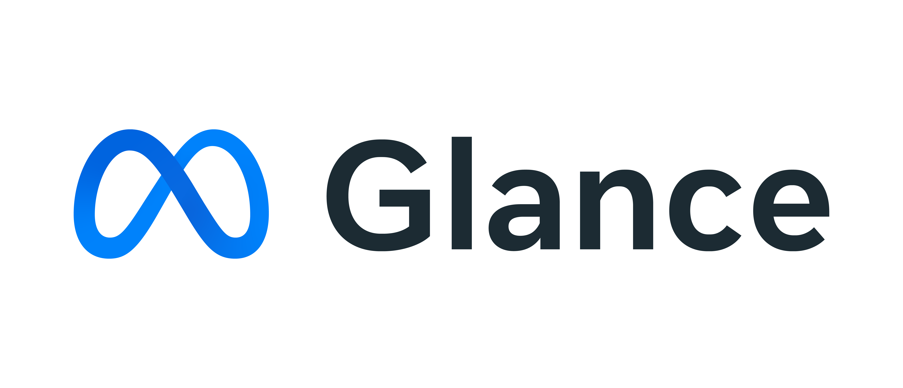

# Meta Glance

<picture>
  <source media="(prefers-color-scheme: dark)" srcset="assets/Glance%20Dark.png">
  <source media="(prefers-color-scheme: light)" srcset="assets/Glance.png">
  
</picture>

Meta Glance is a proof of concept for the Meta challenge at Junction 2026. Smart glasses replace the scanner in scan-as-you-shop: a glance tells the name and the price of a product, a nod adds it to the cart, and a nod at the kiosk code pays.

The design is in `docs/superpowers/specs/2026-11-13-meta-glance-design.md`. The implementation plans are in `docs/superpowers/plans/`. The architecture of the parts that exist is in `docs/architecture.md`.

## State of the build

The repository is one npm workspace with a Gradle project for the Android app. These parts exist and pass their tests:

- The message contract.
- The server, with fake modes that need no key and no database.
- The Android app with its probe screen and its mock mode, and the phone UI with its setup screen and its session screen.
- The four pages of the website: the landing page, the privacy page, the kiosk page, and the mirror page.
- The Display HUD mockup.

One shop runs from the first glance to the mock payment with the fake server. Nobody has run the app with real glasses yet. `docs/architecture.md` shows the parts, the messages between them, the parts that do not exist yet, and the checks that nobody did.

## Folders

| Path | Content |
|---|---|
| `packages/shared` | `@glance/shared`: the message types as zod schemas, the JSON fixtures, the money and kiosk code helpers, and the frame codec. |
| `apps/server` | `@glance/server`: recognition, the cart rules, the spoken lines, the kiosks, and the mock payment. |
| `apps/mobile/android` | The Android app `com.metaglance.android`: a Gradle project with the modules `core` and `app`, and a fake server in `tools/fake-server`. |
| `apps/mobile/ui` | `@glance/phone-ui`: the phone UI that the Android app shows in a WebView. |
| `apps/website` | `@glance/website`: the landing page, the privacy page, the kiosk page, and the mirror page. |
| `apps/display-pow` | `@glance/display-pow`: the Display HUD mockup, one screen on the Display toolkit. It plays a recording, or it follows a live session. |
| `agents` | `recognition.md`, the instruction for the recognition model, and `answers.md`, the instruction for the model that answers a question. |
| `infra` | The Docker image of the server and the Caddy proxy, for one machine with HTTPS. |
| `scripts/integration` | The tests that run the apps against the server in fake mode. |
| `skills` | The agent skills of the project (part "Agent Skills"). |
| `scripts/hooks` | The pre-commit checks (part "Hooks"). |
| `docs/architecture.md` | The parts, the path of one glance, the phases of a session, and the steps of a checkout. |
| `docs/superpowers` | The design document and the implementation plans. |
| `docs/overnight` | The log of the unattended build of 2026-11-14. |
| `docs/research` | The research behind the design. |
| `assets` | The logo files. |

Each app and each package has a `README.md` with its settings, its checks, and its gotchas.

## Tools

For the TypeScript parts:

- Node 22 or later, with npm. `.nvmrc` names the version. Do not use pnpm or yarn.
- Git.

For the Android app, also:

- A JDK from 17 to 24. Set `JAVA_HOME`. Gradle 8.14.1 does not run on JDK 25 or later.
- The Android SDK with Platform 36. Set `ANDROID_HOME` to its folder, or write `sdk.dir` in `apps/mobile/android/local.properties`.
- A phone or an emulator with Android 10 or later, and `adb`, for the install only.

The server needs no key and no database in fake mode. With real recognition and real speech it needs a Gemini key and an ElevenLabs key, and each call costs money. `apps/server/README.md` lists the settings.

## Install, test, and lint

Run each command at the repository root.

```bash
npm install          # installs each workspace and turns the pre-commit hook on
npm test             # runs the tests of each workspace
npm run typecheck    # runs the TypeScript compiler on each workspace, with no output files
npm run lint         # runs ESLint on each JavaScript and TypeScript file
```

To check one workspace, add its name: `npm test --workspace @glance/shared`. The names are `@glance/shared`, `@glance/server`, `@glance/phone-ui`, `@glance/website`, and `@glance/display-pow`.

No test calls a vendor, and no test needs a key.

`eslint.config.mjs` holds the lint rules for each workspace, and `tsconfig.base.json` holds the compiler options. A workspace package extends `tsconfig.base.json` and adds no ESLint of its own.

The Android project has its own checks. Run them in `apps/mobile/android`. PowerShell uses `.\gradlew.bat` in place of `./gradlew`.

```bash
./gradlew :core:test         # runs the unit tests of the pure Kotlin module
./gradlew ktlintCheck        # checks the Kotlin style
```

## Run each part

Run each `npm` command at the repository root, after `npm install`.

### Server

```bash
npm run dev:fake --workspace @glance/server    # port 8080, no key, no database, no vendor call
curl http://localhost:8080/healthz
# {"ok":true,"fakeRecognition":true,"fakeSpeech":true,"store":"memory","saveFrames":false}
```

- Set `PORT` for another port, for example `PORT=18473 npm run dev:fake --workspace @glance/server`.
- In fake mode a script stands in for recognition, and the kiosk `Checkout 3` with the code `K3X7` exists from the start.
- `npm run dev --workspace @glance/server` reads `apps/server/.env`. With both keys and no fake switch, each frame is one paid Gemini call, and each new line is one paid ElevenLabs call.

### Phone UI

```bash
npm run dev --workspace @glance/phone-ui      # dev server on port 5173
npm run build --workspace @glance/phone-ui    # writes apps/mobile/ui/dist
```

Open `http://localhost:5173/?ready=1&api=/` in a browser to shop against the server on port 8080, with no phone. Open `http://localhost:5173/?replay=1` to see one recorded shop with no server.

### Website

```bash
npm run dev --workspace @glance/website       # dev server on port 5174
npm run build --workspace @glance/website     # writes apps/website/dist
```

Open `http://localhost:5174/kiosk` for a kiosk of the server on port 8080. Open `http://localhost:5174/kiosk?replay=1` for a recorded run with no server.

Both dev servers send each `/api` request to `GLANCE_SERVER_ORIGIN`. The default is `http://localhost:8080`.

### Display HUD

```bash
npm run dev --workspace @glance/display-pow -- --port 5175 --strictPort
```

Open `http://localhost:5175/` for a recording with no server. `apps/display-pow/README.md` shows how to follow a live session.

### Android app

Build the phone UI first, because the Gradle build copies `apps/mobile/ui/dist` into the APK and does not run npm. Then run these in `apps/mobile/android`:

```bash
./gradlew :app:assembleDebug    # builds app/build/outputs/apk/debug/app-debug.apk
./gradlew :app:installDebug     # installs the debug build on each attached phone
```

- With more than one phone attached, set `ANDROID_SERIAL` to the serial of the test phone before `installDebug`.
- The app reads the server address from `glance.serverUrl` in `local.properties`. The default is `http://10.0.2.2:8080`, which is the host machine as an emulator sees it.
- A phone on USB reaches a server on this machine with `adb -s <serial> reverse tcp:8080 tcp:8080` and `glance.serverUrl=http://127.0.0.1:8080`.
- The debug build has three screens: "Glance" with the phone UI, "Glance Mock" with the menu of mock mode, and "Glance Probe" with the checks for the glasses and for mock glasses.
- `./gradlew :core:test :app:assembleDemo` builds the signed APK for the testers. It needs a keystore: see "The demo build" in `apps/mobile/android/README.md`.
- `tools/fake-server` holds a small server for work on the app alone. Start it with `node server.mjs`, and test it with `npm test` in that folder.
- `scripts/integration/android/run-spine.mjs` runs the instrumented tests on a phone with mock glasses, against `apps/server` with fake recognition and fake speech. Run `npm install` in `scripts/integration` one time, then `node android/run-spine.mjs --integration`. See "Instrumented tests" in `apps/mobile/android/README.md`.

## Branches and commits

- Do not commit on `main`. Work on a branch.
- Each commit message is a conventional commit: `type(scope): description`.

## Hooks

The repository has two hooks.

**Pre-commit hook.** `.githooks/pre-commit` runs `scripts/hooks/pre-commit.mjs` on the staged files. It stops a commit that holds one of these:

- a secret, or a file that can hold one (`.env`, `local.properties`, a keystore)
- an ESLint error in a staged JavaScript or TypeScript file (rules: `eslint.config.mjs`)
- a ktlint error in `apps/mobile/android`, when a Kotlin file is staged

`npm install` at the repository root turns the hook on. Without npm, run `git config core.hooksPath .githooks` one time. Do not commit with `--no-verify`. Fix the finding.

**Stop hook of Claude Code.** `.claude/settings.json` runs `.claude/hooks/stop-docs.cjs` each time Claude Code wants to stop. If code changed and no documentation changed with it, the hook asks Claude one time to update the documentation: this file, the `README.md` of each changed app or package, and `docs/architecture.md`. Each diagram in the documentation is a Mermaid code block.

## Agent Skills

`skills/` is the only copy of the project skills. `.claude/skills` (Claude Code) and `.agents/skills` (Codex, Cursor, Gemini CLI, and other agents that read `.agents/`) are symlinks to it.

| Skill                | Use for                                                                              |
| -------------------- | ------------------------------------------------------------------------------------ |
| `anti-slop`          | Output hygiene for code, comments, docs, and commit messages                         |
| `refero-design`      | Phone and web UI design (`apps/website`, `apps/mobile`)                              |
| `mrbd-ui-toolkit`    | UI that renders on the Ray-Ban Display glasses (React, `@wearables-ui-toolkit/mrbd`) |
| `meta-wearables-dat` | Native iOS and Android code that connects to the glasses (DAT SDK)                   |
| `diagram-design`     | Standalone diagrams as HTML and SVG, for the website, the deck, and the video        |

`diagram-design` came from `npx skills add cathrynlavery/diagram-design`. `skills-lock.json` records the source of each skill that this command added. The documentation in Markdown keeps Mermaid diagrams, because GitHub renders them. Use `diagram-design` for a diagram that stands alone. Its checks need Python 3.

`.mcp.json` adds the hosted Meta Wearables docs server (`wearables-dat`, no auth). Approve it when Claude Code asks.

Keep the skill count low. Each skill description uses space in the context of every agent session, and overlapping skills compete for the same tasks. Before you add a skill, remove one that the team does not use.

On Windows, the symlinks need `git config core.symlinks true` and Developer Mode before you clone. Without them, create junctions after the clone:

```bat
rmdir .claude\skills .agents\skills 2>nul & del .claude\skills .agents\skills 2>nul
mklink /J .claude\skills skills
mklink /J .agents\skills skills
git update-index --skip-worktree .claude/skills .agents/skills
(echo .claude/skills/& echo .agents/skills/)>> .git\info\exclude
```
