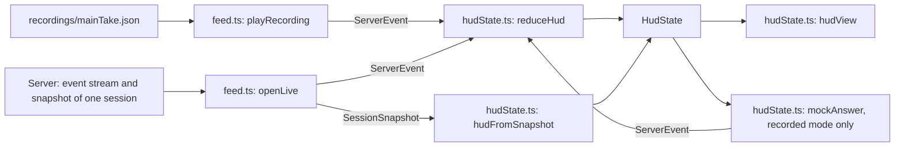

# @glance/display-pow

The Display HUD mockup of Meta Glance, for glasses with a display. It is a Vite app with React 19 and the Display toolkit `@wearables-ui-toolkit/mrbd`.

The project has its state and its feeds. It has no screen yet: `index.html` loads `src/main.tsx`, and that file does not exist. So `npm run dev` shows an empty page, and `npm run build` fails.

## Parts



| File | Content |
|---|---|
| `src/hudState.ts` | `reduceHud` turns each `ServerEvent` into a `HudState`. `hudFromSnapshot` builds the same state from a `SessionSnapshot`. `hudView` gives each text of the screen. `mockAnswer` plays the server for an answer in recorded mode. |
| `src/feed.ts` | `readFeedParams` selects the mode. `playRecording` plays a recording again and again. `openLive` follows a live session. `postIntent` sends an answer to the server. |
| `src/recordings/mainTake.json` | The recording: two products, one unknown product, and the camera stop. It holds no answer. |

All types of the messages come from `@glance/shared`.

## Modes

`readFeedParams` reads the query string of the page.

| Query | Mode |
|---|---|
| none, or `s` or `t` missing or empty | Recorded: the HUD plays `mainTake.json`. After the last step it waits 4 seconds and starts again. |
| `s=<sessionId>&t=<token>` | Live: the HUD follows this session on the origin of the page. |
| `s=<sessionId>&t=<token>&api=<origin>` | Live: the HUD follows this session on the server at `<origin>`. |

The mirror page of the website uses the same names `s` and `t`.

A live session uses three paths of the server, each with `?token=<token>`:

- `GET /api/sessions/<id>/events`: the stream of server-sent events. Each message is one `ServerEvent` as JSON.
- `GET /api/sessions/<id>`: the snapshot.
- `POST /api/sessions/<id>/intents`: an answer, with the source `hud`.

## Gotchas

- `openLive` opens the stream first. It gets the snapshot after each open of the stream, so a reconnect gives a fresh state. An event that arrives while the snapshot is on its way is applied one more time after the snapshot.
- The HUD ignores a message that is not JSON, and an event type that `@glance/shared` does not know.
- A `glance.cleared` clears the product only if its prompt ID is the ID of the pending product.
- Only `mockAnswer` computes a total, because the recorded mode has no server. In live mode each total comes from the server.
- `parseRecording` throws an error that names the step, for an unknown event and for steps out of time order.
- The toolkit script `init-app.mjs` wrote `index.html`, `tsconfig.json`, and `vite.config.ts`. Do not change `tsconfig.json` or `vite.config.ts`. `package.json` is not the file of the script: that file pins versions that fail `npm install` in this workspace.
- `tsconfig.json` does not extend `tsconfig.base.json` of the repository, because the toolkit script owns it.

## Checks

Run each command at the repository root, after `npm install`.

```bash
npm test --workspace @glance/display-pow         # runs the tests of the state and the feeds
npm run typecheck --workspace @glance/display-pow
```

No test opens a network connection. The tests of `openLive` and `postIntent` use stubs for `EventSource` and `fetch`.
