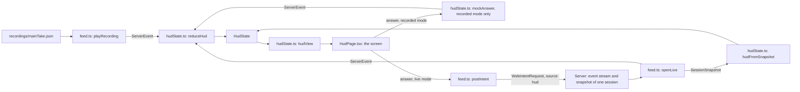

# @glance/display-pow

The Display HUD mockup of Meta Glance, for glasses with a display. It is a Vite app with React 19 and the Display toolkit `@wearables-ui-toolkit/mrbd`.

It has one screen: the camera status, the pending product with its price and its warnings, the prompt, the total, and the last caption. While a product is pending, the buttons Add and Skip (or Remove) answer the prompt.

## Run

Run each command at the repository root, after `npm install`.

```bash
npm run dev --workspace @glance/display-pow -- --port 5175 --strictPort   # the phone UI and the website use 5173 and 5174
npm run build --workspace @glance/display-pow                             # typecheck, then the static build in apps/display-pow/dist
```

Open `http://localhost:5175/` for the recorded mode. It needs no server.

For the live mode, start the fake server and create a session. The second command prints the address of the HUD.

```bash
npm run dev:fake --workspace @glance/server    # port 8080, no key, no vendor call
node -e "fetch('http://localhost:8080/api/sessions',{method:'POST',headers:{'content-type':'application/json'},body:'{}'}).then(r=>r.json()).then(j=>console.log('http://localhost:5175/?s='+j.sessionId+'&t='+j.token+'&api=http://localhost:8080'))"
```

The fake script offers the oat drink after about 3 seconds. Add changes the total to `1.89 EUR, 1 item`.

## Parts



| File | Content |
|---|---|
| `src/hudState.ts` | `reduceHud` turns each `ServerEvent` into a `HudState`. `hudFromSnapshot` builds the same state from a `SessionSnapshot`. `hudView` gives each text of the screen. `mockAnswer` plays the server for an answer in recorded mode. |
| `src/feed.ts` | `readFeedParams` selects the mode. `playRecording` plays a recording again and again. `openLive` follows a live session. `postIntent` sends an answer to the server. |
| `src/HudPage.tsx` | The screen: one `Page` with one `ScrollView`, one `Panel`, and one `ButtonRail`. It starts the feed of the mode and sends each answer. |
| `src/main.tsx` | Renders `HudPage` in the toolkit `App`. |
| `src/app.css` | The layout rules. Each value is a toolkit token. |
| `src/recordings/mainTake.json` | The recording: two products, one unknown product, and the camera stop. It holds no answer. |

All types of the messages come from `@glance/shared`.

## Modes

`readFeedParams` reads the query string of the page.

| Query | Mode |
|---|---|
| none, or `s` or `t` missing or empty | Recorded: the HUD plays `mainTake.json`. After the last step it waits 4 seconds and starts again. |
| `s=<sessionId>&t=<token>` | Live: the HUD follows this session on the origin of the page. |
| `s=<sessionId>&t=<token>&api=<origin>` | Live: the HUD follows this session on the server at `<origin>`. |

The mirror page of the website uses the same names `s` and `t`.

A live session uses three paths of the server, each with `?token=<token>`:

- `GET /api/sessions/<id>/events`: the stream of server-sent events. Each message is one `ServerEvent` as JSON.
- `GET /api/sessions/<id>`: the snapshot.
- `POST /api/sessions/<id>/intents`: an answer, with the source `hud`.

## Gotchas

- The dock with the two buttons exists only while a product is pending. The runtime audit of the toolkit rejects a dock with no enabled action. When the dock appears, the toolkit puts the focus on Add, unless the focus is on the status region. After an answer the focus is on no element until the next key or the next product.
- A failed answer in live mode shows the toast `Not sent. Try again.` The product stays pending, and the focus stays on the button.
- The HUD shows no sign of a lost stream. The last state stays on the screen until the stream opens again. Then the HUD gets the snapshot.
- The gap of `.content-inset` is `calc(var(--uit-spacing-large) + var(--uit-spacing-xsmall))`. The structure check of the toolkit rejects each other gap for a stack with labels and text. The class `fact-group` keeps each label near its values.
- With a caption of two lines, the status region scrolls. The product and the total stay in view at 600 x 600.
- `openLive` opens the stream first. It gets the snapshot after each open of the stream, so a reconnect gives a fresh state. An event that arrives while the snapshot is on its way is applied one more time after the snapshot.
- The HUD ignores a message that is not JSON, and an event type that `@glance/shared` does not know.
- A `glance.cleared` clears the product only if its prompt ID is the ID of the pending product.
- Only `mockAnswer` computes a total, because the recorded mode has no server. In live mode each total comes from the server.
- `parseRecording` throws an error that names the step, for an unknown event and for steps out of time order.
- The toolkit script `init-app.mjs` wrote `index.html`, `tsconfig.json`, and `vite.config.ts`. Do not change `tsconfig.json` or `vite.config.ts`. `package.json` is not the file of the script: that file pins versions that fail `npm install` in this workspace.
- `tsconfig.json` does not extend `tsconfig.base.json` of the repository, because the toolkit script owns it.

## Checks

Run each command at the repository root, after `npm install`.

```bash
npm test --workspace @glance/display-pow         # runs the tests of the state and the feeds
npm run typecheck --workspace @glance/display-pow
node skills/mrbd-ui-toolkit/library/uit-screen-architecture-web/scripts/validate-app-structure.mjs apps/display-pow/src   # the structure check of the toolkit
```

The runtime audit of the toolkit needs the dev server and a Chrome with a debug port, with the HUD in its one tab at 600 x 600:

```bash
node skills/mrbd-ui-toolkit/library/uit-screen-architecture-web/scripts/audit-runtime.mjs http://127.0.0.1:9222
```

The audit has one kind of finding: the caption repeats a text of the screen. On 2026-11-14 the recording gave this finding in three states:

| State | Text that the caption repeats |
|---|---|
| Camera on, no product, caption `Camera on. Hold a product up to hear its price.` | `Camera on` and the prompt line |
| Oat drink pending | `Warning: contains gluten.` |
| Camera off at the end of the recording, caption `Camera off.` | `Camera off` |

The caption is the spoken line, and the spoken line names the same facts, so the finding stays. The audit had no finding in each other state: the rye bread pending with the focus on Add, after Add, after Skip, the unknown product, a product pending in live mode, and the toast of a failed answer.

No test renders the screen. The checks of the screen ran by hand in headless Chrome at 600 x 600: both buttons in recorded mode, and Add and the toast in live mode with the fake server. Nobody checked the screen in the Display simulator or on glasses.

For the audit of the live mode, start Chrome again. In one run, a headless Chrome tab that showed the recorded mode did not answer after a change to a live address. The cause is not known.

No test opens a network connection. The tests of `openLive` and `postIntent` use stubs for `EventSource` and `fetch`.
