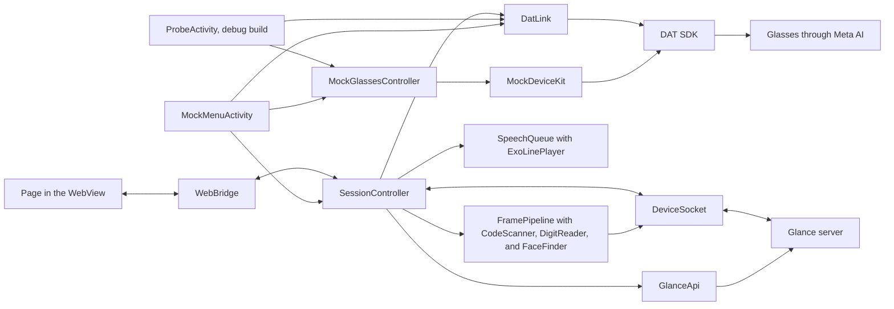
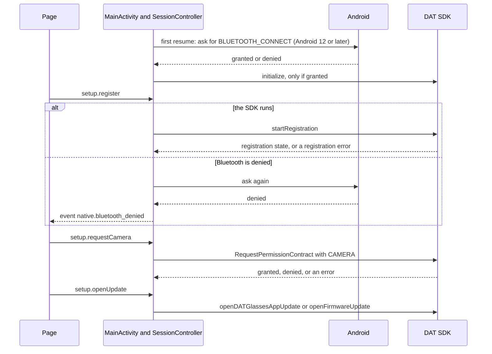
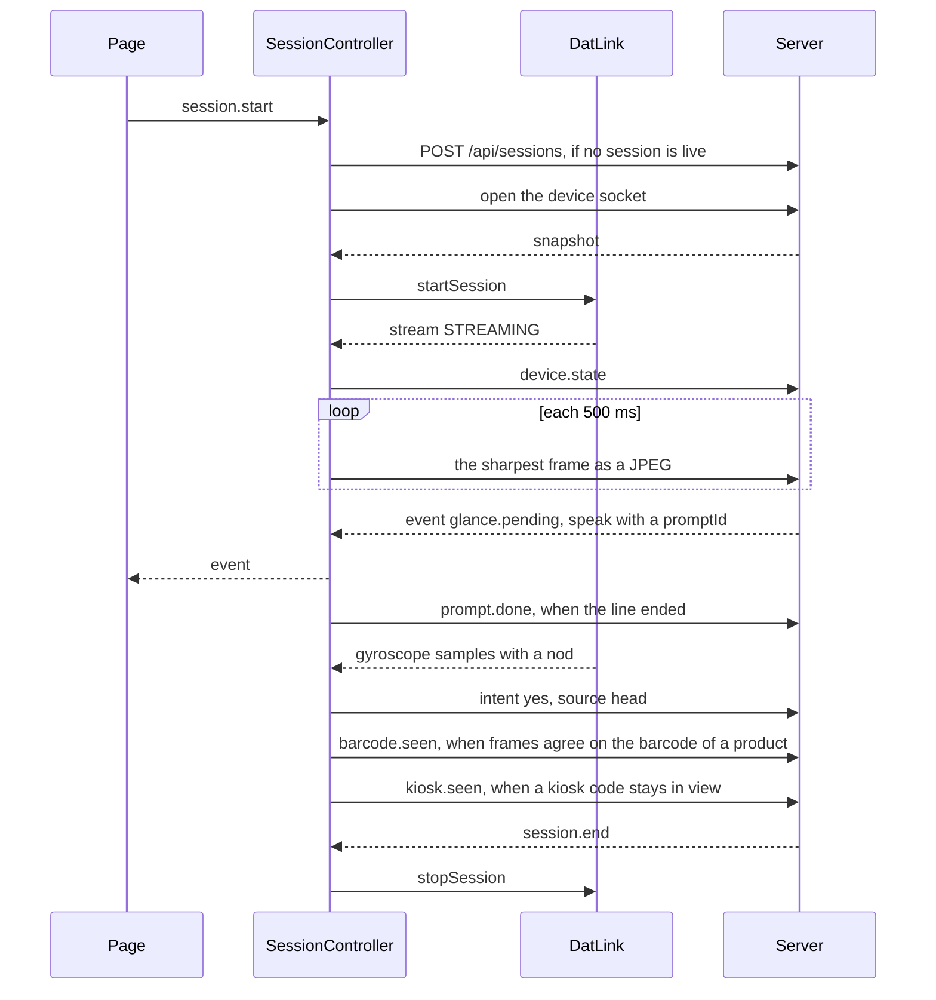
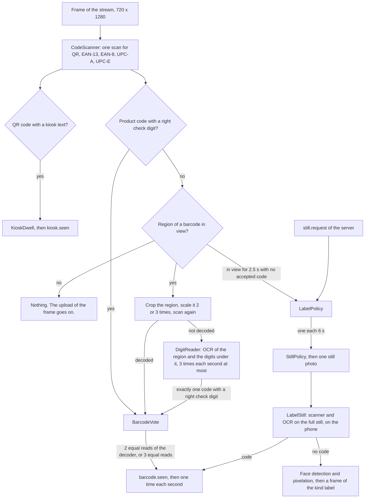
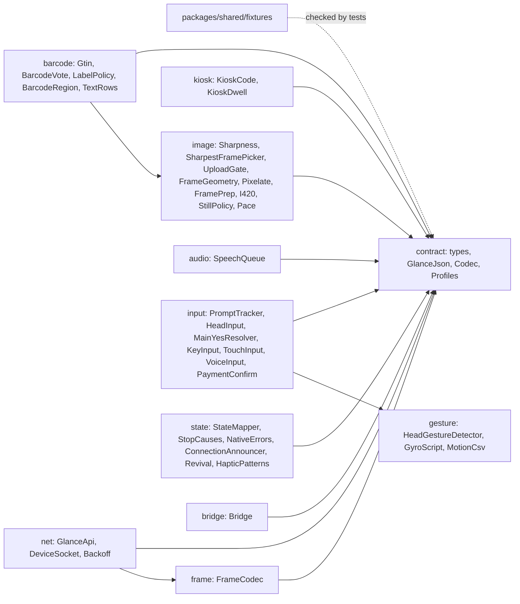
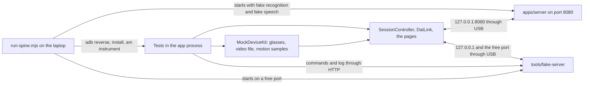

# Glance for Android

The Android app of Meta Glance. This folder holds a Gradle project with two modules.

- `core` is pure Kotlin on the JVM. It holds each rule that a unit test can check.
- `app` is the Android application `com.metaglance.android`. Its debug build also holds the probe screen "Glance Probe". Its demo build is the signed APK for the testers.
- `tools` holds a fake server and the script that makes the sounds. Both need Node 22 or later.
- `app/src/androidTest` holds the tests that run on a phone with mock glasses. See "Instrumented tests".

The app has three screens. Each one has its own icon on the phone.

- "Glance" is `MainActivity`: a WebView with the phone UI. An APK that was built without the phone UI shows a placeholder page with one button for each message of the bridge.
- "Glance Mock" is `MockMenuActivity`: the menu of mock mode, in each build. See "Mock mode for seats without glasses".
- "Glance Probe" is `ProbeActivity`, in the debug build only: a list of buttons above a log. It writes each log line to Logcat with the tag `Glance`, and to `Android/data/com.metaglance.android/files/probe/probe-<start time>.log` on the phone.

The debug APK has about 155 MB, because it holds the ML Kit models for 4 processor types and the libraries of the DAT SDK. The text recognition model is about 43 MB of it.

## Parts



- `GlanceApp` owns one `DatLink`, one `MockGlassesController`, one `ProfileStore`, and one `SessionController`. A new activity keeps the session.
- `DatLink` is the one connection to the DAT SDK. It gives a `snapshot` of the state, the `faults` of the SDK, and the `frames` of the stream. Call its functions on the main thread.
- A frame is a `RawFrame` in I420 layout. `frames` holds the newest frame only. A frame with an odd width or height, or with fewer bytes than its size needs, is dropped with one log line.
- While a session runs, the device of the snapshot comes from the session. After the session, it comes from the device list of the SDK again.
- `attachMotion`, `attachInputs`, and `attachSpeech` add a capability to a started session. `gyro`, `motionRows`, `touches`, and `transcripts` give their data.
- A capability that stops with no request from the app starts again 750 ms later, at most 3 times in a row, and only if the session still runs then. `Revival` in `core` holds the count.
- A stop waits until the stream is 1 second old. A stop at the start of a stream ended the app process in the video decoder of the SDK (DAT 1.0.1).
- `captureStill` takes a photo while the stream runs.
- `PhoneVoice` speaks a line with the speech engine of the phone, as media sound.
- `ProbeDecisions` holds the values that the probe run on the glasses decides: the capabilities that start, the input sources, and the gyroscope axes. Its values are defaults until that run.
- A stopped DAT session is final. `startSession` creates a new session each time.
- `MockGlassesController` pairs mock glasses of MockDeviceKit. Call `DatLink.initialize` after `enable` and after `disable`. `enable` on a kit that runs starts it again, and its mock glasses are gone then.
- `DatLink.initialize(false)` with MockDeviceKit off stops the use of the SDK: the registration is `UNAVAILABLE`, and the device is gone.
- `DatLink` has three debug hooks for the states that MockDeviceKit cannot make. `debugFault` reports a fault as if the SDK reported it, and a `STREAM` fault also stops the session. `debugOverride` sets a missing Meta AI app or the compatibility of the device. `debugClearOverrides` removes both.
- After a stop, the snapshot of `DatLink` has the stream state `STOPPING`, then `STOPPED`. The stream collectors end with the stop, so `DatLink` sets these two states itself.

## The page and the bridge

- The page loads from `https://appassets.androidplatform.net/index.html`. `UiAssetsHandler` serves it from the APK assets: from the folder `ui` when the APK holds `ui/index.html`, else from the folder `placeholder`. A debug build adds `?debug=1`.
- The Gradle task `syncUi` copies `apps/mobile/ui/dist` into the APK as the folder `ui`. It does not run npm. Build the phone UI first: `npm run build --workspace @glance/phone-ui` at the repository root.
- A debug build with `glance.uiDevUrl` loads that address in place of the assets.
- The page sends a message with `window.GlanceNative.postMessage(json)`. The app sends one with `window.__glanceReceive(json)`. `WebBridge` sends nothing before the first `ui.ready`. A page that loads again gets no message until its own `ui.ready`, and the answer to that brings the state, the profile, and the snapshot again.
- A link to another site opens outside the app.
- The text of the page follows the font size of the phone.
- `ProfileStore` keeps the profile, the yes input that the shopper selected, the server session, the server address, the gesture sensitivity, and the placeholder switch in the preferences file `glance`.

## The setup

`MainActivity` and `SessionController` handle the three setup messages of the page.



- No SDK call runs before the Bluetooth permission. Without it, `registration` is `unavailable`. Mock glasses need no Bluetooth: they keep their registration, and the app does not ask.
- The app asks one time at the first resume. A new activity does not ask again. Android shows its prompt two times at most, and then it denies with no prompt.
- `setup.register` with Bluetooth denied asks again. Each denied answer sends `native.bluetooth_denied`, also the answer of Android with no prompt.
- A registration error `FAILED_TO_REGISTER` or `UNKNOWN` sends `native.registration_failed`. The page reads "no internet" from `network`.
- A camera request that fails sends `native.permission_failed`, but not for a missing Meta AI app: `metaAiInstalled` is false then.
- Each resume reads the camera permission and the microphone permission of the SDK again. The shopper returns from Meta AI through this path.
- The app reads both permissions again when the glasses connect. The SDK answers a permission check only with connected glasses (`PermissionError.NO_DEVICE`, `NO_DEVICE_WITH_CONNECTION`), so a check at the start of the app can fail before the link exists.
- A permission check suspends. If `DatLink.initialize` runs again before the answer arrives, for example at a change between mock glasses and the SDK, the app drops that answer.
- The answer to a permission request of the app is newer than a check of that permission that started before it. The app drops the answer of such a check.
- Meta AI opens the app again through the `glance` scheme. `onCreate` and `onNewIntent` give the intent to the SDK, after the SDK started.

## A session

The app holds two sessions. The server session holds the cart. The DAT session holds the camera stream, and a stopped DAT session is final. So one server session can see many DAT sessions: after a rest, a closed hinge, or a lost link.



Start checks, in this order. Each failure sends one `error` event to the page and starts nothing.

| Check | Error code |
|---|---|
| The Bluetooth permission is granted, or the glasses are mock glasses | `native.bluetooth_denied` |
| A device is connected | `native.no_device` |
| The glasses are not off the face | `native.not_worn` |
| The server answers `POST /api/sessions` | `native.server_unreachable` |
| The SDK creates the session | `native.sdk_too_old` for `INSUFFICIENT_SDK_VERSION`, else `native.session_failed` |

Rules of `SessionController`:

- A start with a live server session makes no new one. If its socket is down, the app first asks the server for the snapshot. With no answer, a new server session starts.
- `session.rest` of the server stops the DAT session. The socket and the server session stay.
- `session.end` of the server stops the DAT session and marks the server session as not live. The socket closes 5 seconds later, so the last lines still arrive. If the server closes the socket first, the app does not connect again, and it does not say the "Connection lost" line.
- `profile.set` of the page changes the profile only when the result is inside the limits of `packages/shared`: a speech rate from 0.8 to 2, a head window of 8000, 15000, or null, and a budget above 0 or null. The page gets a `profile` message after each `profile.set`, also when nothing changed.
- When a DAT session stops with no request from the app, `StopCauses.classify` names the cause, and the page gets its `error` event. The app reads the cause 500 ms after the stop, because the glasses can report a closed hinge after the stop.
- After a lost link or a closed hinge, a new DAT session starts by itself when the glasses are connected, open, and not off the face. The app waits 2 seconds first, and it stops after 5 such starts in a row with no stream.
- A stream that ends by itself after it ran also ends its DAT session.
- The screen stays on while a DAT session runs, and in pocket mode.
- `haptic` of the page plays the pattern of `HapticPatterns`, if `haptics` of the profile is true. The app never vibrates by itself.
- `pocket.set` on dims the screen to 1 percent and hides the system bars. A swipe from the edge shows them for a short time. `pocket.set` off gives the brightness of the phone again. The page draws the black screen and blocks the touches. A new activity starts with pocket mode off.
- Five seconds after the first `STREAMING`, `MainYesResolver` selects the yes input that works. A change goes to the page and to the server as a profile patch.
- The volume keys of the phone answer a prompt when `mainYes` of the profile is `key`: up sends `intent yes`, and down sends `intent no`, each with the source `key` and the ID of the current prompt. A prompt is current from the end of its line until the server ends it or a new prompt replaces it. `MainActivity` then takes the key down, its repeat events, and its key up, so the volume does not change, and a key that stays down sends one answer. In each other case the key changes the volume as usual. `KeyInput` in `core` holds the rule.
- A double tap on the touchpad of the glasses sends `intent yes` with the source `touch` and the ID of the last finished prompt, or with no ID before the first prompt. The server decides if it counts. A swipe in each direction sends `intent repeat` with the source `touch`, and the server sends the last line again. A session attaches Inputs with `ProbeDecisions.INPUT_SOURCES` when `ProbeDecisions.INPUTS` is true. `TouchInput` in `core` holds the rule. The single tap and the tap and hold belong to the glasses.
- Each final speech result of the glasses goes to the server as `speech.final` with its text, its confidence, and the locale of the glasses. The app maps no word to an intent: the server owns the command words. With no confidence the app sends 0.5, and with no locale it sends `und`. A result that is not final, a blank text, and each result while a line plays or in the 500 ms after it send nothing, because the microphone hears each line. `VoiceInput` in `core` holds the rule.
- A session attaches Speech when `DatLink.usesSpeech` is true and the microphone permission of the glasses is granted. `usesSpeech` is `ProbeDecisions.SPEECH`, and it is always true with mock glasses. The bridge has no message for the microphone permission. The app asks for it when the page sets `mainYes` to `voice` and when the page sends the intent `ask`, if `usesSpeech` is true and the permission is missing. A permission that arrives while a stream runs attaches Speech to that stream. A denied request sends no `error` event.
- When a capability starts after the main yes was selected, and the profile does not have the input that the shopper selected, `MainYesResolver` selects again. So the voice becomes the main yes when Speech starts late.
- The intent `ask` of the page goes to the server as each other page intent, with the source `phone` and no prompt ID.
- `biometric.request` of the server shows the biometric prompt of Android, with the title "Confirm payment" and the subtitle "Demo payment. No money moves." The shopper confirms with a fingerprint or a face, or with the screen lock of the phone (`BIOMETRIC_WEAK or DEVICE_CREDENTIAL`, which works from Android 10). A success sends `biometric.result` with `ok: true`. An error sends `ok: false`, and a cancel is an error. A finger that does not match sends nothing, because the prompt stays open. `PaymentConfirm` in `core` holds the rule: one result for each prompt.
- On a phone with no screen lock and no biometric, the app shows no prompt. It sends `ok: false` and the `error` event `native.biometric_unavailable`.
- The app closes an open payment prompt when the server sends `checkout.cancelled` or `session.end`, and at `data.delete`. The closed prompt sends `ok: false`. A second `biometric.request` while the prompt is open shows no second prompt. A request while the activity is in the background sends `ok: false`, because the biometric library shows no prompt then.
- In pocket mode the screen has the brightness of the phone while the payment prompt shows, and it is dim again after the result.
- The event `glance.ambiguous` of the server makes the app take one still photo with `DatLink.captureStill`: the sharp second look. `StillPolicy` in `core` allows one capture at a time and one start each 5 seconds in a DAT session. `StillPhoto` crops the photo as a frame of the stream, scales its long side to 1440 pixels at most, pixelates each face, and makes a JPEG of quality 85. The header has `kind: still` and `blurred: true`. If face detection fails, the still is dropped. A still does not pass the upload gate, but it needs an open socket. The log line `still seq=...` has the milliseconds from the event to the upload.
- The frames of the stream and the stills share one upload number, `seq`, which counts up for the life of the app process.
- With the socket down for 3 seconds, the phone voice says "Connection lost. Your cart is safe. Glances are paused."
- With the media volume at 0, no line plays, and each prompt is reported at once.
- `FramePipeline` scans each frame for a kiosk code and for the barcode of a product, and selects the sharpest frame of each 500 ms. See "The barcode of a product". `FaceFinder` looks for faces in that frame with ML Kit, on the phone. The upload is the center of the frame (80 percent of the width, 70 percent of the height) with each face pixelated, as a JPEG of quality 80 with a long side of 768 pixels at most: 494 x 768 for the stream of 720 x 1280. Its header has `blurred: true`. If face detection fails, the frame is dropped. The app writes no frame to storage.
- `ExoLinePlayer` plays the sound of a line, then its clip. A clip that does not load, that does not start in 3 seconds, or whose address is not an address, is replaced by the phone voice. The speech rate of the profile changes the clip, not the sound.

## The barcode of a product

The shopper looks at the barcode of a product, and the phone reads the code. The server finds the product. The phone has three ways to read a code, in this order. `FramePipeline` runs them on its one worker thread.



1. The decoder. `CodeScanner` is the ML Kit barcode scanner with the formats QR, EAN-13, EAN-8, UPC-A, and UPC-E. `enableAllPotentialBarcodes()` makes it also report a region that can hold a barcode which it did not decode: such a hit has a box, an empty text, and the format unknown. `CodeScanner` gives it with the text null.
2. The region again. `BarcodeRegion` adds the quiet zone to the box of the region. `I420.cropLumaToArgb` scales the gray of that crop 3 times, or 2 times for a crop wider than 320 pixels, and the scanner reads the result.
3. The digits. `DigitReader` is ML Kit text recognition v2 with the Latin model of the APK (`com.google.mlkit:text-recognition`). It reads the region with half of its height more below it. `TextRows` puts the words into rows, and `Gtin.digitRuns` finds the code in a row.

Rules that keep a wrong product out:

- A code must have 8, 12, or 13 digits and a right GS1 check digit. A UPC-E code goes out in its 12-digit UPC-A form. The server makes 13 digits of each code.
- `BarcodeVote` reports a code of the decoder at its second equal read inside 1500 ms. A code from OCR needs 3 equal reads inside 2500 ms, and a read of the decoder counts as one of them. A different valid code starts the count again. Two reads are equal when their 13-digit forms are equal, so the 12 digits of a UPC-A code and the same code with 13 digits agree.
- After the first report, the phone sends the same code one time each second while it stays in view. A gap of 1000 ms with no read keeps the appearance. After a longer gap the code needs its reads again.
- With more than one code in a frame, the largest one counts. OCR counts only when the region holds exactly one code.
- A region counts only when its long side is at least 1.25 times its short side. So a kiosk QR code that is too far to decode asks for no still.
- The frame gets one NV21 copy, for the scan. The crops for the second scan and for OCR read the Y plane of the frame.
- The log (tag `Glance`) has `barcode read <code> <source>` for each read before the first report of a code.

The still photo:

- `LabelPolicy` asks for a still when a region was in view for 2500 ms with no accepted code, and when the server sends `still.request`. Both share one limit: one still each 6 seconds. A request inside that time is dropped.
- A region that stays in view asks for 3 stills at most. The scanner can report a region where no barcode is, and each still can stop Motion and can cost one model call of the server. The region asks again after it left the view for more than 600 ms. A `still.request` does not count for this limit.
- After a still gave a code, its region asks for no other still while it stays in view: the frames cannot read that code, so each still would give the same report again.
- `LabelPolicy` asks for no still while the upload gate is closed, for example with the socket down or with the glasses off the face. A `still.request` in that time is dropped.
- The still also needs `StillPolicy`, which it shares with the sharp second look: one capture at a time, and one start each 5 seconds.
- `LabelStill` reads the still on the phone first, with the scanner and with OCR. A code of the decoder counts with its check digit, because one still has no second image that can agree. It does not count when the digits under its bars give another code: ML Kit read blurred bars as a wrong code with a right check digit in one test image. Such a still goes to the server. With no decoded code, the digits count when the still holds exactly one code. With no region in the still, only 12 or 13 digits count, because 8 digits in a photo can be a date.
- A still with a code gives `barcode.seen`, and the still stays on the phone.
- A still with no code goes to the server as a frame with `kind: label` and `blurred: true`: the full photo with no crop, each face pixelated, a long side of 1600 pixels at most, and JPEG quality 85. If face detection fails, the still is dropped.
- The log line `label still <w>x<h>: ...` has the size of the photo and the milliseconds from the trigger to the result. `DatLink` logs `still <w>x<h> <variant> <ms> ms` for the capture alone.

Measured on the test phone on 2026-11-14, with images of an EAN-13 code with 5 pixels for each narrow bar and a Gaussian blur:

| Blur radius (sigma) in pixels | Scan of the full image | Scan of the crop, 2 times as large | OCR of sharp digits under the bars |
|---|---|---|---|
| 6 | right code | right code | right code |
| 8 | region, no code | right code for bars with no digits, no code with digits | right code |
| 10, 12 | region, no code | no code | right code |
| 16 | region, no code | no code, and no region with digits | right code |
| 20 | region, no code. With sharp digits on the bars: the wrong code 3777654524301 for 3017624010701 | no code | right code |
| 26 | nothing | not run | not run |

In the stream of the sharp clip `barcode.mp4`, OCR of the crop read the digits as `4 008381333931!`, with one wrong digit and the guard bars as a character, in each of 5 runs. The check digit refused the row. So OCR can give the same wrong digit in each read, and the check digit is the rule that keeps it out: the GS1 check finds each single wrong digit.

So each of the three ways reads a code that the way before it does not read. The wrong code at 20 has a right check digit. In the stream, `BarcodeVote` asks for 2 equal reads, and the server adds only a code of the store list. The test clips use the radius 12.

What nobody measured:

- The distance at which a code decodes from the stream of the real glasses. ML Kit asks for 2 pixels for each narrow bar, so an EAN-13 code must be 190 pixels wide in the frame. The research of 2026-11-13 estimates 7 to 11 cm for that. See "Checks with the glasses or with sound".
- The size and the time of a still on Android, and whether a still stops Motion.
- The time of one scan with the 5 formats and the regions, and the time of one OCR run, on the phone.
- The text that ML Kit gives for a UPC-E code. The app expects 8 digits.

## The core module

`core` has no Android import and no DAT import.



| Package | Content |
|---|---|
| `contract` | The Kotlin mirror of `packages/shared`: one file for each TypeScript file, with the same type names and field names. `GlanceJson` is the one JSON format. `Codec` encodes and decodes the messages, and returns null for a message that it does not know. `Profiles.applyPatch` sets the keys of a profile patch, and changes nothing for a patch that does not decode or that leaves the limits of `ProfileSchema`. |
| `frame` | `FrameCodec` builds and reads the binary frame message: a 4-byte header length, the JSON header, the JPEG. |
| `kiosk` | `KioskCode` parses the QR text `GL1 <code>`. `KioskDwell` reports a kiosk code after 1500 ms in view, then one time each second. |
| `barcode` | `Gtin` holds the rules of `gtin.ts` in `packages/shared` for the digits of a product barcode: the GS1 check digit, the UPC-A form of a UPC-E code, the 13-digit form, and the codes of one store. `Gtin.digitRuns` finds each code of 8, 12, or 13 digits with a right check digit in an OCR text, also when the text has the digits in groups such as `8 076809 513753` or in neighbouring text elements. It reads 8 digits as EAN-8, never as UPC-E. `Gtin.fromDecoder` gives the code of a decoder as the phone sends it. `BarcodeVote` reports a code when frames agree on it, then one time each second. `LabelPolicy` says when a still must read a barcode. `BarcodeRegion` gives the crops around a region that did not decode, and says if a box has the form of a product barcode. `TextRows` puts the words of an OCR result into rows and finds the codes in them. |
| `image` | `Sharpness` and `SharpestFramePicker` select the sharpest frame of each 500 ms. `UploadGate` gives the reason to skip an upload. `FrameGeometry` and `FramePrep` crop and scale a frame to a long side of 768 pixels at most. `FrameGeometry.mapBox` maps a face box into the output and never makes it smaller. `Pixelate` covers a box that is 20 percent larger on each side with blocks of one color. A block has one sixth of the box width, and 8 pixels at least. `I420.cropScaleToArgb` converts with BT.709 limited range. `I420.cropLumaToArgb` gives a crop of the Y plane as gray pixels in a larger scale. `StillPolicy` limits the still photos: one at a time, and one start each 5 seconds. `Pace` limits a slow step, for example OCR, to one run in a given time. |
| `gesture` | `HeadGestureDetector` finds a nod and a shake in gyroscope samples. `HeadGestureConfig.of` gives the limits of the levels `GENTLE`, `NORMAL`, and `FIRM`. `GyroScript` builds samples of head movements for tests and for mock glasses. |
| `audio` | `SpeechQueue` plays one line at a time through a `LinePlayer`, with interrupt and priority. It reports each prompt whose line ended. A line with no clip uses the phone voice. |
| `input` | `PromptTracker` follows the prompts of the server. `HeadInput` turns a gesture into a yes or a no while the head window of a prompt is open. `MainYesResolver` selects the yes input that works. `KeyInput`, `TouchInput`, and `VoiceInput` hold the rules of the volume keys, the touchpad, and the voice. `PaymentConfirm` gives one `biometric.result` for each payment prompt. |
| `state` | `StateMapper` maps the state of the DAT SDK to `NativeState` and `DeviceState`. `StopCauses` names the cause of a stopped session, and says if a new session starts by itself. `NativeErrors` holds the `error` events of the phone, with codes that start with `native.`. `ConnectionAnnouncer` gives the "Connection lost" line after 3 seconds without the socket. `Revival` limits the restarts of a capability. `HapticPatterns` holds the vibration timings of the 8 haptic patterns. |
| `net` | `GlanceApi` makes the REST calls. It puts the socket address and each clip address of the server on the server address of the app. A server address that is not an HTTP address fails each call with an `IOException`, like a server that does not answer. `DeviceSocket` sends messages and frames, and connects again after 500, 1000, 2000, 4000, and 8000 ms. A message never waits for a later connection. |
| `bridge` | `Bridge` builds the JavaScript call that gives a message to the page, and knows the MIME types of the page files. |

The detector cuts the angle of each axis into strokes. A nod is a stroke down and a stroke back up to the start, then quiet. A shake is two strokes to opposite sides.

### Tests of the contract

`FixturesTest` reads each file of `packages/shared/fixtures` and compares it with the Kotlin types. The Gradle build gives the folder to the test as the system property `glance.fixtures`. A new message variant in `packages/shared` needs its Kotlin class, or this test fails on the fixture count.

`MotionReplayTest` replays each motion recording in `core/src/test/resources/motion`. A file name ends with `__nod<n>_shake<n>.csv`, and the test expects these counts. The folder is empty until the probe run on the glasses.

### Test against the real server

`ServerSpineTest` in `core/src/integrationTest` plays one shop against the server of `apps/server` in fake mode, with the real `GlanceApi`, `DeviceSocket`, and codecs. It needs a server, so `./gradlew test` and `./gradlew check` do not run it. `node scripts/integration/server-kotlin.mjs` at the repository root starts the server, runs the test, and stops the server. `scripts/integration/README.md` lists the steps of the test.

## The probe

Open "Glance Probe" on the phone. The text field above the buttons gives the label of a saved frame and of a motion recording.

| Button | Action |
|---|---|
| `Bluetooth permission` | Asks for `BLUETOOTH_CONNECT`, then starts the DAT SDK |
| `Register` | Starts the registration in the Meta AI app |
| `Camera permission`, `Mic permission` | Asks for the DAT permission in the Meta AI app |
| `Start session`, `Start session (no camera)`, `Stop session` | Starts a session with or without the stream at 720 x 1280 and 7 frames per second, or stops it |
| `Save frame` | Saves the next frame as `probe/frames/<label>-<nn>.jpg` |
| `QR log` | Logs each QR code in the stream, at most 2 lines each second |
| `Barcode log` | Logs what the scanner and OCR read of a product barcode, each kind of line at most 2 times each second. `barcode <format> "<text>" valid=<check digit> width=<pixels> frame=<w>x<h>` is a decoded code. `barcode region <w>x<h> at <left>,<top> frame=<w>x<h>` is a region that did not decode. `barcode digits "<row>" codes=[...] crop=<w>x<h>` is a row with digits that OCR read under the largest code. |
| `Motion`, `Inputs`, `Speech` | Adds the capability to the session. `Speech` needs the microphone permission. |
| `Speak line` | Speaks one product line with `PhoneVoice`. Logs the audio outputs, and the frame size before and after the line. |
| `Axis test` | Reads the gyroscope for 4 seconds. Logs the RMS rate of each axis, the strongest axis, and the sign of its first movement. |
| `Gesture test` | Runs the head gesture detector on the gyroscope with no head window. Logs each nod and each shake with a count. |
| `Still` | Takes a photo. Logs its size, its variant, and the time. |
| `Pipeline test` | Runs `FramePipeline` on the stream and sends nothing. Logs `upload seq=<n> <w>x<h> <bytes> bytes`, `kiosk <text>`, `barcode read <code> <source>` for each read before a report, `barcode <code> <source>` for each report, and `label still wanted`. |
| `Play test line` | Plays the `found` sound, then `<server address>/clip.wav` of the fake server. Logs `line ended`. |
| `Play bad clip` | The same line with a clip that does not exist. The phone voice says "Test line." |
| `Record motion` | Appends each motion sample to `probe/motion/<label>.csv`, in the CSV format of MockDeviceKit |
| `Endurance 10 min` | Speaks the line each 30 seconds. Logs battery, thermal level, frame count, frame size, and motion sample count each minute. |
| `Mock: enable and pair` | Enables MockDeviceKit and pairs mock glasses that are on, open, and on the face |
| `Mock: enable, not registered` | Starts MockDeviceKit with no registration and pairs mock glasses. `Register` then registers. |
| `Mock: deny camera` | Sets the camera permission of the mock glasses to denied, also for the next request |
| `Mock: phone camera` | Uses the back camera of the phone as the stream of the mock glasses |
| `Mock: motion` | Feeds 60 samples with a gyroscope rate of 1 rad/s on the x axis, in a loop |
| `Mock: nod` | Feeds one nod of 15 degrees each 4 seconds, in a loop |
| `Use placeholder page` | Makes "Glance" show the placeholder page, also when the APK holds the phone UI. Close "Glance" and open it again. |
| `Mock: double tap`, `Mock: swipe` | Sends a select event and a navigation event from the touchpad |
| `Mock: say add` | Sends the final transcript "add" |
| `Mock: still image` | Uses the newest saved frame as the next photo |
| `Mock: disable` | Stops the session and disables MockDeviceKit |

The probe folder on the phone is `/sdcard/Android/data/com.metaglance.android/files/probe`. Get it with `adb pull` in PowerShell.

The second tap on `QR log`, `Barcode log`, `Gesture test`, `Pipeline test`, `Record motion`, or `Endurance 10 min` stops it.

## Mock mode for seats without glasses

Mock mode runs the app with the mock glasses of MockDeviceKit. It needs no glasses, no Meta AI app, and no Bluetooth permission. It is in each build, because it is the fallback of the live demo.

1. Start a server. See "The fake server", or use `npm run dev:fake --workspace @glance/server` at the repository root.
2. Open "Glance Mock" on the phone. Tap `Enable (registered)`, then `Pair`.
3. Tap `Phone camera` and allow the camera. The back camera of the phone is the camera of the mock glasses then.
4. Type the address of the server in the field `Server URL` and tap `Save server URL`. An empty field gives the address of the build again.
5. Open "Glance" and start a session on the page. The placeholder page has the button `session.start`.

The top line of the menu shows `NativeState` and `DeviceState` as JSON, live. The line below it shows the result of the last item. The menu has a task of its own, so "Glance" keeps its page when you change between both.

| Group | Items |
|---|---|
| Mode | `Enable (registered)`, `Enable (not registered)`, `Disable`. Each one stops a running session first, and removes the forced values. |
| Glasses | `Pair`, `Power on`, `Power off`, `Don`, `Doff`, `Fold`, `Unfold` |
| Camera | `Phone camera`. `Still image`: select an image for the next still photo. |
| State | `Battery 100`, `20`, `10`, `3`. `Thermal none`, `severe`, `critical`. |
| Touchpad | `Tap` (pause and resume), `Tap and hold` (stop), `Double tap`, `Swipe` |
| Registration | `Next registration fails`, `Next registration works`. `Camera: deny`, `Camera: allow`. |
| Motion | `Replay nod`, `Replay shake`: head movements of `GyroScript`, one time. `Replay CSV file`: select a motion recording. |
| Speech | `Say add`, `Say skip`: a final transcript. A mock session always has Speech, so the app sends each one as `speech.final`. |
| Force | `Meta AI missing`, `Update required`, `Stream error BATTERY_LOW`, `Stream error THERMAL_HOT`. MockDeviceKit has no call for these states, so the debug hooks of `DatLink` make them. |
| App | `Server URL`. `Drop server link 10 s`: the socket closes and connects again after 10 seconds. `Sensitivity: gentle, normal, firm` for the head gestures. `Use placeholder page`. |

The states of the app, and the items that make each one:

| State | Items | Result |
|---|---|---|
| Meta AI app missing | `Meta AI missing` | `metaAiInstalled` is false |
| Not registered | `Enable (not registered)`, `Pair` | `registration` is `unavailable`, and no device shows. `setup.register` gives `registered` and the device. |
| Registration fails | `Next registration fails`, then `setup.register` | Event `native.registration_failed` |
| Camera permission denied | `Camera: deny` | `cameraPermission` is `denied` |
| Glasses not found | `Power off` | No device, or `link` is `disconnected`. `session.start` sends `native.no_device`. |
| Update required | `Update required` | `device.updateRequired` is true |
| Paused | `Tap` in a session | `paused`, and no frame goes out. `Tap` again resumes the same session. |
| Stopped by the device | `Tap and hold` | Event `native.stopped_by_device`. Only `session.start` starts a new session. |
| Hinge closed | `Fold`, then `Unfold` and `Don` | Event `native.hinge_closed`. A new session starts by itself, with the same cart. |
| Link lost | `Power off` in a session, then `Power on`, `Unfold`, `Don` | Event `native.link_lost`. A new session starts by itself. |
| Off the face | `Doff` | `device.worn` is false, and no frame goes out. `session.start` sends `native.not_worn`. |
| Battery too low | `Battery 3`, `Stream error BATTERY_LOW` | The session stops. Event `native.battery_low`. |
| Too warm | `Thermal critical`, `Stream error THERMAL_HOT` | The session stops. Event `native.too_warm`. |
| Server not reachable | `Drop server link 10 s` | `network` is `offline`. After 3 seconds the phone voice says the "Connection lost" line. |

## The fake server

`tools/fake-server` stands in for the Glance server. It holds one session and no cart logic, and it reads its messages from `packages/shared/fixtures`.

| Command, in `tools/fake-server` | Result |
|---|---|
| `npm install` | Installs `ws` |
| `node server.mjs` | Starts the server on port 8080. `PORT` sets the port, and `HOST` sets the address (default `0.0.0.0`). |
| `SAVE_FRAMES=1 node server.mjs` | Also writes the newest frame to `<temp folder>/glance-last.jpg` |
| `FIRST_PROMPT_MS=60000 node server.mjs` | Sends the first product prompt 60 seconds after the first frame, in place of 3 seconds |
| `npm test` | Plays one shop against the server on `127.0.0.1` and a free port |

What it does:

- `POST /api/sessions` gives the session `s-1`. `GET /clip.wav` gives a tone of 1 second.
- The first `device.state` with the stream `streaming` gives the "Camera on" line.
- A product prompt comes 3 seconds after the first frame, then each 15 seconds while frames arrive. A product prompt with no answer ends with `glance.cleared` when the next one comes.
- A yes on the product prompt gives `glance.cleared`, the "Added" line, and `cart.updated`. A no gives `glance.cleared` and "Skipped."
- `kiosk.seen` gives a pay prompt. A yes on it gives `checkout.paid`, the "Paid" line, and `session.end`.
- A yes or a no with another prompt ID logs `rejected`.
- Type a command and press Enter: `rest` (`session.rest`), `bio` (`biometric.request`), `cancel` (`checkout.cancelled`), `amb` (`glance.ambiguous`), `label` (`still.request` with the purpose `label`), `slow` (the `error` event `recognition.slow` and its line), `badclip` (a prompt with a clip that does not exist), `drop` (closes the socket and refuses a new one for 10 seconds).
- `POST /debug/command/<name>` runs the same command and answers 204, or 404 for a name that is no command. `GET /debug/log` gives the newest 500 log lines as a JSON list. A test on a phone has no keyboard, so it uses these two paths.
- The log has one line for each `biometric.result` and for each `barcode.seen` (`barcode.seen <code> source=<source>`), and the line of a frame has its `kind`: `frame`, `still`, or `label`. A `barcode.seen` gives no prompt.

A phone on USB reaches the server with `adb -s <serial> reverse tcp:8080 tcp:8080` and `glance.serverUrl=http://127.0.0.1:8080`.

## Instrumented tests

`app/src/androidTest` holds tests that run on a phone with mock glasses of MockDeviceKit. They follow the DAT guide "Android testing with Mock Device Kit" (https://wearables.developer.meta.com/docs/develop/dat/testing-mdk-android). No test needs the glasses, the Meta AI app, or a vendor.



| Class | What it checks |
|---|---|
| `SpineTest` | One shop: the stream starts, frames go out, the product prompt arrives, `prompt.done` goes out, a mock nod adds the product, and the server snapshot holds one item. Then the mock glasses fold and open, the app starts a new DAT session by itself, the kiosk code gives `kiosk.seen`, a mock nod pays, the phase is `paid`, and the DAT session stops. A start after the payment gets a new server session. |
| `ProbeLinkTest` | `DatLink` with mock glasses: the paired device, the stream, the colors of a frame, the kiosk code in a frame, a stop and a new start, and six stops at the start of a stream. |
| `ProbeScreenTest` | The probe screen: each test taps the buttons and reads the log, for the stream, the saved frame, `QR log`, `Barcode log`, `Pipeline test`, Motion, Inputs, Speech, `Speak line`, `Still`, `Record motion`, and `Play bad clip`. |
| `PlaceholderPageTest` | The placeholder page in the WebView: state and profile, a stored profile patch, a page that loads again, and `Add` and `Skip` on a product prompt. |
| `SetupFlowTest` | The setup messages with mock glasses: a registration, a registration that fails, a denied and an allowed camera request, the permissions after a resume, and the permissions when the glasses connect after the start. |
| `BluetoothPromptTest` | The Bluetooth prompt of Android: the test denies it, the app does not stop, and `setup.register` asks again and sends `native.bluetooth_denied`. At its end the test clears the flags of the permission. |
| `DeviceStatesTest` | The states of the table in "Mock mode for seats without glasses": `NativeState`, the `error` events, and the `device.state` messages for each one. One test pays at a kiosk that declines each payment: `checkout.failed` and its line arrive, the cart stays, and the camera stays on. |
| `RecognitionSlowTest` | The state "Recognition slow", with the command `slow` of the fake server of the app: the `error` event `recognition.slow` and its line arrive, the placeholder page gets the event, the app sends no error of its own, and the frames go on. |
| `PaymentPromptTest` | The fingerprint above 50 EUR, with the command `bio` of the fake server of the app. Two tests show the real prompt of Android and close it with no finger: the back key sends `ok: false`, and `checkout.cancelled` closes the prompt. Four tests replace the prompt: a finger that does not match sends nothing and a match sends `ok: true` one time, a phone with no screen lock sends `ok: false` and `native.biometric_unavailable`, the screen is bright in pocket mode while the prompt shows, and the end of the checkout closes the prompt. |
| `StillPhotoTest` | The sharp second look, with the command `amb` of the fake server of the app: one still of 576 x 896 pixels goes out with `kind: still` and `blurred: true`, two events within one second give one still, each upload has a number of its own, and a mock nod answers a prompt after a still. |
| `BarcodeScanTest` | The barcode of a product, with the clips of `make-clips.mjs` and the fake server of the app. The sharp code gives `barcode.seen` with the source `barcode`, then 3 to 5 reports in 3.3 seconds. The digits with no bars, and the sharp digits under blurred bars, never give another code than their own. The kiosk clip gives `kiosk.seen`, no `barcode.seen`, and no still. The blurred bars give one frame with `kind: label`, and no code. With blurred bars in the stream and the sharp code as the still, the phone sends one `barcode.seen` and takes no other still. The command `label` gives a label frame, or `barcode.seen` when the still holds a code that the phone reads. Two commands within one second give one still, and a `label` right after `amb` gives none. |
| `LabelStillTest` | `LabelStill.read` with no glasses and no server. ML Kit reads the code of `barcode.png`, the blurred bars of `barcode-blurred.png` are one region with no text and the still goes to the server, and `scene.png` becomes a frame of 720 x 1280 pixels. With hits and words that the test gives: a photo of 3000 x 4000 pixels becomes 1200 x 1600 with no crop, a failed face detection drops the still, the digits under a region count and the digits of another product do not, and with no region only 12 or 13 digits count. |
| `StillPhotoPrepareTest` | `StillPhoto.prepare` with no glasses and no server: a photo of 3000 x 4000 pixels becomes a JPEG of 1234 x 1440 pixels, the face box that the test gives is pixelated, and the stripes outside it stay. A photo with no result of face detection is dropped. |
| `MockMenuTest` | The mock menu: each item of the plan exists, the top line follows the mock glasses, and the App items change the stored settings. |
| `HapticsPocketTest` | The 8 haptic buttons of the placeholder page give the 8 patterns, `haptics: false` gives none, and pocket mode dims the screen, hides the bars, and keeps the screen on. |
| `VolumeKeysTest` | The volume keys with `mainYes: key`: volume up on a product prompt sends `intent yes` with the source `key` and adds the product, volume down sends `intent no`, and the media volume stays at 0. A key that stays down in pocket mode sends one yes. Before the first prompt, after the prompt ended, and with the head as the main yes, the app does not take the key. |
| `TouchpadInputTest` | The touchpad of the mock glasses: a double tap after a product prompt sends `intent yes` with the source `touch` and the prompt ID, and the server adds the product. A double tap before the first prompt carries no ID and adds nothing. A swipe sends `intent repeat`, and the server sends the line of the prompt again. |
| `VoiceCommandsTest` | The speech results of the mock glasses: a final "add" after a product prompt goes out as `speech.final`, and the server adds the product. A result that is not final sends nothing, and "skip" skips the product. With the microphone denied, `mainYes: voice` and the intent `ask` each make the app ask for the permission, and Speech starts in the running session. With a denied request, the head stays the main yes. |
| `FaceFinderTest` | ML Kit face detection runs on the phone, and an image with no face gives an empty list. |
| `PhoneUiPageTest` | The phone UI in the WebView. The setup test clicks through the three steps: link the glasses, a denied and then an allowed camera, and the start, which opens the session screen. The card test reads the product card of a prompt and the cart after `Add`. Both are skipped for an APK with no build of the phone UI. The setup test is skipped for a phone UI with no setup screen. |

`SpineTest`, `DeviceStatesTest`, `VolumeKeysTest`, `TouchpadInputTest`, `VoiceCommandsTest`, `PhoneUiPageTest`, and the prompt tests of `PlaceholderPageTest` need the server of `apps/server` with both fake switches at `BuildConfig.SERVER_URL`. They read `GET /healthz` first, and they fail if recognition or speech is real.

`RecognitionSlowTest`, `PaymentPromptTest`, `StillPhotoTest`, and `BarcodeScanTest` need a message that the server of `apps/server` cannot send on request, or the log of the fake server. They use the fake server of the app, `tools/fake-server`, at the address of the instrumentation argument `fakeServerUrl`. Without that argument each of their tests is skipped. `FakeServerTestCase` is their base class.

Run them with the script, in `scripts/integration`. It needs `adb`, FFmpeg, and the JDK on `PATH`.

| Command | Result |
|---|---|
| `npm install` | Installs `qrcode` and `bwip-js`, one time |
| `npm test` | Runs the tests of `android/device.mjs`: the serial, the port, and the reverse entry of a run. It needs no phone. |
| `node android/run-spine.mjs` | Starts the server in fake mode and the fake server of the app, sets `adb reverse` for both, builds the phone UI, builds and installs both APK files, and runs the suite `spine`. Then it removes both reverse entries and stops both servers. |
| `node android/run-spine.mjs --integration` | Runs the six suites, each with a new server: `spine` (`SpineTest`), `state` (`DeviceStatesTest`, `SetupFlowTest`, `RecognitionSlowTest`), `page` (`PhoneUiPageTest`), `input` (`VolumeKeysTest`, `TouchpadInputTest`, `VoiceCommandsTest`), `extra` (`PaymentPromptTest`, `StillPhotoTest`, `StillPhotoPrepareTest`), and `barcode` (`BarcodeScanTest`, `LabelStillTest`) |
| `node android/run-spine.mjs --suite state` | Runs one suite. A list takes commas: `--suite state,page`. |
| `node android/run-spine.mjs --runs 3` | Runs each selected suite three times, each time with a new server |
| `node android/run-spine.mjs --all` | Runs each test class |
| `node android/run-spine.mjs --class com.metaglance.android.ProbeScreenTest` | Runs one class. `Class#method` runs one test. |
| `node android/run-spine.mjs --no-build` | Uses the APK files of the last build |
| `node android/run-spine.mjs --keep-volume` | Ends with status 2 when the media volume is not 0, and does not change it. For a phone that a person uses. |
| `GLANCE_TEST_PORT=18080 node android/run-spine.mjs` | Uses port 18080 for the server in place of 8080, on the laptop and on the phone |
| `node android/make-clips.mjs --force` | Makes the camera feeds again, in `app/src/androidTest/assets`: `scene.mp4`, `kiosk.mp4`, `scene.png`, `barcode.mp4`, `barcode.png`, `barcode-digits.mp4`, `barcode-blurred.png`, `barcode-blurred.mp4`, and `barcode-blurred-digits.mp4`. The files are in git. Without `--force` it makes only the files that are missing. |

Rules of the script and of the tests:

- The script uses one phone, and each `adb` call names it. The phone is the one of the environment variable `ANDROID_SERIAL`. With no such variable, it is the one attached phone. With no phone, or with more than one, the script ends with status 2 and a message that lists the serials.
- The server uses port 8080 on the laptop and on the phone. `GLANCE_TEST_PORT` sets another port, for a machine where another process holds 8080. The APK of that build has the address with that port as its default server address.
- If the phone has a reverse entry for the port before the run, the script sets that entry again after the run. Each other reverse entry of the phone stays as it is.
- The tests clear the stored data of the app on the phone: the profile, the server session, and the server address. Run them on a phone that a person uses only when that is acceptable, and install the build of that person again after the run.
- The barcode clips: `barcode.mp4` has the EAN-13 code `4006381333931` with 5 pixels for each narrow bar. `barcode-digits.mp4` has the digits of `8076809513753` with white bars. `barcode-blurred.mp4` has the bars of `3017624010701` with a Gaussian blur of 12 pixels and no digits, and `barcode-blurred-digits.mp4` adds sharp digits. ML Kit on the test phone decodes a blur of 6 pixels, and reports a region with no code from 10 to 16 pixels: see the table in "The barcode of a product". `barcode-blurred.png` is the image of the blurred clip. `bwip-js` draws each symbol.
- The script ends with status 2 when the phone is locked or not attached. It does not unlock the phone.
- The script prints one line for each test: `ok`, `FAIL`, or `skip` with the cause. It ends with status 0 when each test passed, with 1 after a failure, and with 3 when no test failed and a test was skipped.
- The build step runs `npm run build --workspace @glance/phone-ui` first, because Gradle copies `apps/mobile/ui/dist` into the APK and does not run npm. With `--no-build` the APK keeps the phone UI of its last build.
- For `DeviceStatesTest`, the script registers a kiosk with `failPayment: true` at each new server. The server gives that kiosk a random code, so the script makes a clip with that code and writes it into the cache folder of the app with `adb exec-in run-as`. The test gets the code and the file name as the instrumentation arguments `failKioskText` and `failKioskClip`. Without them the test of the failed payment is skipped. The script deletes the clip after the run.
- The script reads the media volume. If it is not 0, it prints the old value and sets 0. With `--keep-volume` it ends with status 2 in place of that. Each test class fails at its start when the volume is not 0, because the phone voice speaks each line that has no clip.
- The server gets no vendor key, and it plays `scripts/integration/android/spine-script.json`: the product `oat-drink-1l` from second 8 to second 10 after the socket of a session opens.
- The script installs with no `-g`, and no test grants `BLUETOOTH_CONNECT`. Without that permission the app never starts the real SDK, and mock glasses need no Bluetooth. A feed from a video file needs no camera permission.
- The fake server of the app runs as a process of its own on a free port of `127.0.0.1`, with `FIRST_PROMPT_MS` at one hour. So it sends no product prompt by itself, and each message after "Camera on" is the answer to a command of a test. The script waits for the tests in a call that blocks, and a server inside the script would not answer in that time.
- The server of `apps/server` reports slow recognition after 3 failed recognition calls in a row. With fake recognition it makes no recognition call, so the command `slow` of the fake server of the app stands in for it.
- `PaymentPromptTest` shows the biometric prompt of Android on the test phone for about one second, two times. No test puts a finger on the sensor: see "Checks with the glasses or with sound".
- The log of each server is in `<temp folder>/glance-integration`. The log of the fake server of the app ends with `-app-fake.log`.
- The tests run with `GlanceTestRunner`. It stops the Bluetooth prompt at the start of "Glance", and it takes each vibration in place of the phone. So the phone stays quiet, and no prompt waits for a tap. `BluetoothPromptTest` turns the prompt on for itself and taps its deny button.
- `VolumeKeysTest` sends a volume key through the input system of Android only when the app must take it. For a key that Android must get, the test calls `MainActivity.onKeyDown` and reads the result, because the real key changes the media volume of the phone. If the volume is not 0 at the end of a test, the test sets it to 0 again.
- The media volume is 0, so no line plays, and no test on the phone reaches the mute time of a line. `SpeechQueueTest` and `VoiceInputTest` of `core` check that rule. Check it by ear with sound: see "Checks with the glasses or with sound".
- No test sends `setup.openUpdate`, because the SDK opens the Meta AI app for it.
- The mock glasses give the image that `camera.setCapturedImage` got as the still photo, with its own size: 720 x 1280 for `scene.png`. So no test with mock glasses scales a still down to 1440 pixels. `StillPhotoPrepareTest` gives `StillPhoto.prepare` a photo of 3000 x 4000 pixels for that.
- No test image holds a face. `StillPhotoPrepareTest` gives the face box itself, so it checks the pixelated box of a still and not the face detection. Check the pixelated face by hand: start the fake server with `SAVE_FRAMES=1`, point the mock camera at a photo of a face, and open `glance-last.jpg` in the temp folder.
- On a phone with no network of its own, `network` stays `offline`. `DeviceStatesTest` then checks the dropped server link in the frames, the line, and the messages only.

Facts about MockDeviceKit that the tests found (DAT 1.0.1, Nothing Phone (1), Android 15):

- `setCameraFeed(fileUri)` takes effect at the next stream start. A running stream keeps its feed, and it plays the file again from its start when the file ends.
- A feed from a video file gives 30 frames each second, also for a file with 15 and a stream configuration with 7.
- `fold()` reports `DOFFED`, then the session error `SESSION_ENDED_BY_DEVICE` and `STOPPED`, and the closed hinge after them.
- With `initiallyRegistered = false`, the registration state is `UNAVAILABLE`, not `AVAILABLE`, and the paired mock glasses are not visible. `startRegistration` gives `REGISTERED` at once, with no `REGISTERING` state, and then the glasses show.
- After `simulateRegistrationOutcome(false)`, `startRegistration` reports the error `FAILED_TO_REGISTER`.
- `captouch.tap()` pauses a running session, and no frame arrives while it is paused. A second tap resumes the same session: its state goes from `PAUSED` to `STARTED` again.
- `doff()` in a session reports `DOFFED`, and `don()` gives frames again with no tap.
- `setMotionFeed(samples, loop = false)` on a running Motion capability plays the samples one time from their start.
- `speech.simulateTranscription` with the same text, the same final flag, and the same confidence two times in a row, with nothing between them, reaches the app one time. `Speech.transcriptions` is a `StateFlow`, and it drops a value that is equal to the one before it. With a result that is not final between them, both arrive.
- With `permissions.set(MICROPHONE, Denied)` and `permissions.setRequestResult(MICROPHONE, Granted)`, a request with `RequestPermissionContract` answers `Granted` with no screen.
- With no network on the phone, the page shows `network: offline` also when the socket through `adb reverse` is open, because the phone reports no active network.

## Checks with the glasses or with sound

No test of the night covers these checks of Plan 2 Tasks 17 and 21 to 25. Each one needs the real glasses, a finger, or a phone that plays sound.

| Check | Expected |
|---|---|
| Mock session with sound on. Tap `Say add` in "Glance Mock" while a prompt plays. | The server logs no `speech.final`. |
| The same session. Tap `Say add` one second after the prompt ended. | The server logs `speech.final` with the text `add`, and it adds the product. |
| Mock session with `mainYes: key`. Press volume up with no prompt. | The volume changes, and the server logs no intent. |
| On the glasses: double tap after a prompt. Swipe after a line. | `intent yes` and `intent repeat`, each with the source `touch`. The line plays again after the swipe. |
| On the glasses, after the probe set `ProbeDecisions.SPEECH` to true: select the voice as the main yes, allow the microphone in Meta AI, and start a session. | `capabilities.speech` is true. |
| On the glasses: let a prompt play to its end, then say "add". | One `speech.final` with `add`. No `speech.final` holds the words of the prompt. |
| On the glasses: say "add" for two prompts in a row. | Two messages. If the second one is missing, the `StateFlow` dropped an equal result: write it in the probe results file. |
| Mock session against `tools/fake-server`. Type `bio`. Put a finger that the phone knows on the sensor. | The prompt "Confirm payment" shows. The fake server logs `biometric.result ok=true`. |
| Type `bio`. Use a finger that the phone does not know, then cancel the prompt. | No line for the wrong finger, then `biometric.result ok=false`. |
| Enable pocket mode on the page. Type `bio`. | The screen is bright while the prompt shows, and dim after it. |
| On a phone or an emulator with no screen lock: type `bio`. | `biometric.result ok=false`, and the page logs `native.biometric_unavailable`. |
| With sound on, type `slow` in the fake server. | The glasses, or the phone, say "Recognition is slow right now." |
| On the glasses: start a session, hold a product up, type `amb`. | The fake server logs one frame with `kind=still blurred=true`. Write down its size, and the milliseconds of the log line `still seq=...` of the app. |
| Run `node android/run-spine.mjs --suite barcode` and `--class com.metaglance.android.ProbeScreenTest` on an unlocked phone with the media volume 0. | Each test passes. On 2026-11-14 each of the 18 tests of the suite and the 6 tests of `ProbeScreenTest` passed on the test phone, with mock glasses. If the test of the blurred bars fails after a new version of ML Kit, the log says which: a `barcode.seen` means that ML Kit decodes the blur of the clip, and no label frame means that ML Kit reports no region for it. Change `BLUR_SIGMA` in `make-clips.mjs` then. |
| On the glasses: open "Glance Probe", start a session, tap `Barcode log`. Hold a product with an EAN-13 code at 40 cm and move it closer. | Write down the distance of the first `barcode region` line, of the first `barcode EAN_13 ... valid=true` line with its `width`, and of the first `barcode digits` line with the right code in `codes`. These three values are the range of the three ways. Until then the distance is not measured. |
| The same session with the code in view. Tap `Barcode log` off and `Pipeline test` on. | `barcode <code> barcode` one time each second. Write down the frame rate of the log line `frame ... fps=` with and without `Pipeline test`: it shows what the scan costs. |
| On the glasses, with a session of "Glance" against `tools/fake-server`: hold a barcode at a distance where `Barcode log` showed a region and no code, for 3 seconds. | The log of the app has `still <w>x<h> <variant> <ms> ms` and `label still <w>x<h>: ...`. Write down the size, the variant, and both times. The fake server logs `barcode.seen`, or one frame with `kind=label blurred=true`. |
| On the glasses: type `label` in the fake server while no barcode is in view. | The same two log lines, and one frame with `kind=label`. |
| On the glasses, after a label still: type `badclip`, wait for the prompt, and nod. | `intent yes` with the source `head`. The log shows `revive motion` if the still stopped Motion. If the nod has no effect after a still, raise the 2500 ms of `LabelPolicy`, or cut the label still. |
| On the glasses: look at a kiosk QR code from 2 meters for 5 seconds. | No `label still` line in the log. A line means that ML Kit reports the far QR code as a region that is not square. |
| On the glasses, after that still: wait for the next prompt, and nod. | `intent yes` with the source `head`. The log shows `revive motion` if the still stopped Motion. If the nod has no effect, cut the sharp second look: a dead nod costs more than a sharper frame. |

## The sounds

`node tools/make-sounds.mjs` writes `found.wav`, `added.wav`, `removed.wav`, `warning.wav`, and `paid.wav` to `app/src/main/res/raw`. The files are in git. Run the script only to change a sound.

## Machine needs

- A JDK from 17 to 24. Gradle 8.14.1 does not run on JDK 25 or later.
- The Android SDK with Platform 36. Set `ANDROID_HOME` to its folder, or write `sdk.dir` in `local.properties`.
- A phone or an emulator with Android 10 or later, for the install only.

## Build commands

Run each command in `apps/mobile/android`. PowerShell uses `.\gradlew.bat` in place of `./gradlew`.

| Command | Result |
|---|---|
| `./gradlew --version` | Prints the JVM that Gradle uses |
| `./gradlew ktlintFormat` | Formats the Kotlin files |
| `./gradlew ktlintCheck` | Checks the Kotlin style. The pre-commit hook of the repository runs it. |
| `./gradlew :core:test` | Runs the unit tests of `core` |
| `./gradlew :core:test --tests "*gesture*"` | Runs the tests of one package |
| `./gradlew test` | Runs each unit test task. `app` has no unit test. |
| `./gradlew :core:integrationTest -Pglance.serverUrl=<address>` | Runs the tests of `core/src/integrationTest` against a running Glance server. No other task runs them. |
| `./gradlew :app:assembleDebug` | Builds `app/build/outputs/apk/debug/app-debug.apk` |
| `./gradlew :app:installDebug` | Installs the debug build on each attached phone |
| `./gradlew :app:assembleDebugAndroidTest` | Builds the test APK `app/build/outputs/apk/androidTest/debug/app-debug-androidTest.apk` |
| `./gradlew :app:assembleDebug -Pglance.serverUrl=http://127.0.0.1:8080` | Builds with another server address. A Gradle property wins over `local.properties`. |
| `./gradlew :core:test :app:assembleDemo` | Builds the signed demo APK `app/build/outputs/apk/demo/app-demo.apk`. See "The demo build". |

Run `ktlintFormat` and `ktlintCheck` as two commands. In one command, the check can read a file before the format task writes it.

## The demo build

The build type `demo` is the APK for the testers. It is not debuggable, it has no probe screen, and it allows no address without TLS, because both are in `app/src/debug`. It has mock mode.

1. Make the keystore one time, in `apps/mobile/android/app`. `keytool` is in the `bin` folder of the JDK. It asks for the password.

   ```bash
   keytool -genkeypair -v -keystore glance-demo.jks -alias glance-demo -keyalg RSA -keysize 2048 -validity 3650 -dname "CN=Meta Glance Demo"
   ```

2. Write `glance.demoStorePassword`, `glance.demoKeyPassword`, and `glance.serverUrl` with the HTTPS address of the server in `local.properties`. Git ignores `local.properties` and each `*.jks` file. Never commit them.
3. Build the phone UI at the repository root: `npm run build --workspace @glance/phone-ui`.
4. Build the APK: `./gradlew :core:test :app:assembleDemo`.
5. Check it. `apksigner` and `aapt2` are in `build-tools` of the Android SDK.

| Command | Expected |
|---|---|
| `apksigner verify --print-certs app/build/outputs/apk/demo/app-demo.apk` | `Signer #1 certificate DN: CN=Meta Glance Demo` |
| `unzip -l app/build/outputs/apk/demo/app-demo.apk` | The list has `assets/ui/index.html` |
| `aapt2 dump badging app/build/outputs/apk/demo/app-demo.apk` | Two `launchable-activity` lines: `MainActivity` and `MockMenuActivity`. No `application-debuggable` line. |

Give the keystore and its password to one other team member. An update with another key needs an uninstall first, and so does a change from the debug build to the demo build.

## Keys of `local.properties`

Git ignores `local.properties`. Each key is optional, and each one is also a Gradle property: `-P<key>=<value>`.

| Key | Default | Use |
|---|---|---|
| `mwdat_application_id` | `0` | DAT application ID. `0` is Developer Mode. |
| `mwdat_client_token` | `0` | DAT client token. `0` is Developer Mode. |
| `glance.serverUrl` | `http://10.0.2.2:8080` | Address of the Glance server, as `BuildConfig.SERVER_URL` |
| `glance.uiDevUrl` | empty | Address of the dev server of the phone UI, as `BuildConfig.UI_DEV_URL` |
| `glance.demoStoreFile` | `glance-demo.jks` | The keystore of the demo build, as a path from the folder `app` |
| `glance.demoStorePassword` | empty | The password of the keystore |
| `glance.demoKeyAlias` | `glance-demo` | The name of the key in the keystore |
| `glance.demoKeyPassword` | empty | The password of the key |

## Notes

- JDK: a terminal outside Android Studio needs `JAVA_HOME`. With Android Studio, its JDK is in `C:\Program Files\Android\Android Studio\jbr`. If `./gradlew --version` prints JVM 25 or later, select a JDK 21.
- `adb`: run each `adb` command that names a device path in PowerShell. Git Bash rewrites `/sdcard/...` to a Windows path.
- More than one phone: set `ANDROID_SERIAL` to the serial of the test phone, and pass `-s <serial>` to `adb`. Without it, `installDebug` installs on each attached phone. `run-spine.mjs` reads the same variable.
