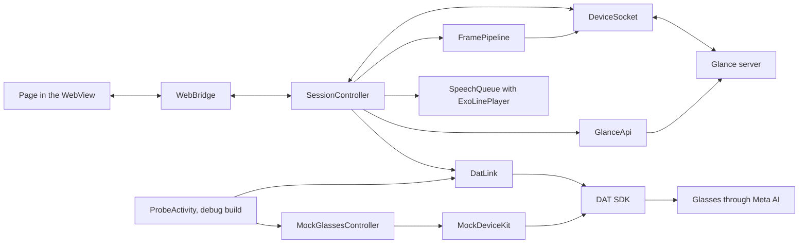
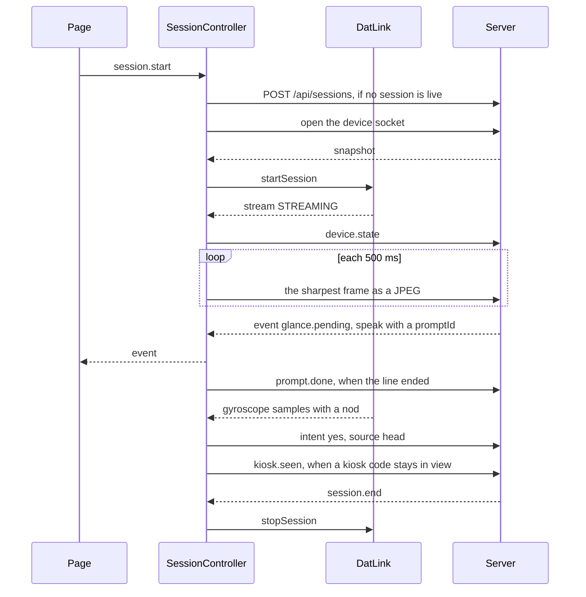
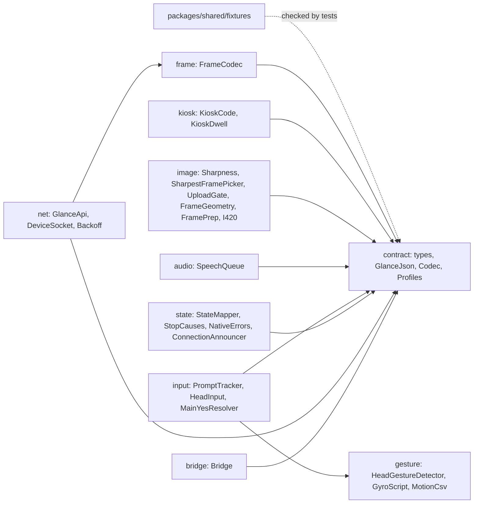

# Glance for Android

The Android app of Meta Glance. This folder holds a Gradle project with two modules.

- `core` is pure Kotlin on the JVM. It holds each rule that a unit test can check.
- `app` is the Android application `com.metaglance.android`. Its debug build also holds the probe screen "Glance Probe".
- `tools` holds a fake server and the script that makes the sounds. Both need Node 22 or later.

The app has two screens.

- "Glance" is `MainActivity`: a WebView with the phone UI. An APK that was built without the phone UI shows a placeholder page with one button for each message of the bridge.
- "Glance Probe" is `ProbeActivity`, in the debug build only: a list of buttons above a log. It writes each log line to Logcat with the tag `Glance`, and to `Android/data/com.metaglance.android/files/probe/probe-<start time>.log` on the phone.

The debug APK has about 110 MB, because it holds the ML Kit models and the libraries of the DAT SDK.

The setup messages of the page (`setup.register`, `setup.requestCamera`, `setup.openUpdate`), `pocket.set`, `haptic`, and `biometric.request` have no handler yet. The app logs them. The app does not ask for the Bluetooth permission by itself yet: use the probe button, or mock glasses.

## Parts

- `GlanceApp` owns one `DatLink`, one `MockGlassesController`, one `ProfileStore`, and one `SessionController`. A new activity keeps the session.
- `DatLink` is the one connection to the DAT SDK. It gives a `snapshot` of the state, the `faults` of the SDK, and the `frames` of the stream. Call its functions on the main thread.
- A frame is a `RawFrame` in I420 layout. `frames` holds the newest frame only. A frame with an odd width or height, or with fewer bytes than its size needs, is dropped with one log line.
- While a session runs, the device of the snapshot comes from the session. After the session, it comes from the device list of the SDK again.
- `attachMotion`, `attachInputs`, and `attachSpeech` add a capability to a started session. `gyro`, `motionRows`, `touches`, and `transcripts` give their data.
- A capability that stops with no request from the app starts again, at most 3 times in a row. `Revival` in `core` holds this rule.
- `captureStill` takes a photo while the stream runs.
- `PhoneVoice` speaks a line with the speech engine of the phone, as media sound.
- `ProbeDecisions` holds the values that the probe run on the glasses decides: the capabilities that start, the input sources, and the gyroscope axes. Its values are defaults until that run.
- A stopped DAT session is final. `startSession` creates a new session each time.
- `MockGlassesController` pairs mock glasses of MockDeviceKit. Call `DatLink.initialize` after `enable` and after `disable`.
- After a stop, the snapshot of `DatLink` has the stream state `STOPPING`, then `STOPPED`. The stream collectors end with the stop, so `DatLink` sets these two states itself.

## The page and the bridge

- The page loads from `https://appassets.androidplatform.net/index.html`. `UiAssetsHandler` serves it from the APK assets: from the folder `ui` when the APK holds `ui/index.html`, else from the folder `placeholder`. A debug build adds `?debug=1`.
- The Gradle task `syncUi` copies `apps/mobile/ui/dist` into the APK as the folder `ui`. It does not run npm. Build the phone UI first: `npm run build --workspace @glance/phone-ui` at the repository root.
- A debug build with `glance.uiDevUrl` loads that address in place of the assets.
- The page sends a message with `window.GlanceNative.postMessage(json)`. The app sends one with `window.__glanceReceive(json)`. `WebBridge` sends nothing before the `ui.ready` of a page.
- A link to another site opens outside the app.
- The text of the page follows the font size of the phone.
- `ProfileStore` keeps the profile, the yes input that the shopper selected, the server session, the server address, the gesture sensitivity, and the placeholder switch in the preferences file `glance`.

## A session

The app holds two sessions. The server session holds the cart. The DAT session holds the camera stream, and a stopped DAT session is final. So one server session can see many DAT sessions: after a rest, a closed hinge, or a lost link.

Start checks, in this order. Each failure sends one `error` event to the page and starts nothing.

| Check | Error code |
|---|---|
| The Bluetooth permission is granted, or the glasses are mock glasses | `native.bluetooth_denied` |
| A device is connected | `native.no_device` |
| The glasses are not off the face | `native.not_worn` |
| The server answers `POST /api/sessions` | `native.server_unreachable` |
| The SDK creates the session | `native.sdk_too_old` for `INSUFFICIENT_SDK_VERSION`, else `native.session_failed` |

Rules of `SessionController`:

- A start with a live server session makes no new one. If its socket is down, the app first asks the server for the snapshot. With no answer, a new server session starts.
- `session.rest` of the server stops the DAT session. The socket and the server session stay.
- `session.end` of the server stops the DAT session and marks the server session as not live. The socket closes 5 seconds later, so the last lines still arrive. If the server closes the socket first, the app does not connect again, and it does not say the "Connection lost" line.
- `profile.set` of the page changes the profile only when the result is inside the limits of `packages/shared`: a speech rate from 0.8 to 2, a head window of 8000, 15000, or null, and a budget above 0 or null. The page gets a `profile` message after each `profile.set`, also when nothing changed.
- When a DAT session stops with no request from the app, `StopCauses.classify` names the cause, and the page gets its `error` event.
- After a lost link or a closed hinge, a new DAT session starts by itself when the glasses are connected, open, and not off the face. The app waits 2 seconds first, and it stops after 5 such starts in a row with no stream.
- A stream that ends by itself after it ran also ends its DAT session.
- The screen stays on while a DAT session runs.
- Five seconds after the first `STREAMING`, `MainYesResolver` selects the yes input that works. A change goes to the page and to the server as a profile patch.
- With the socket down for 3 seconds, the phone voice says "Connection lost. Your cart is safe. Glances are paused."
- With the media volume at 0, no line plays, and each prompt is reported at once.
- `FramePipeline` scans each frame for a kiosk code, selects the sharpest frame of each 500 ms, and makes a JPEG of quality 80 with a long side of 768 pixels at most. It writes no frame to storage.
- `ExoLinePlayer` plays the sound of a line, then its clip. A clip that does not load, that does not start in 3 seconds, or whose address is not an address, is replaced by the phone voice. The speech rate of the profile changes the clip, not the sound.

## The core module

`core` has no Android import and no DAT import.

| Package | Content |
|---|---|
| `contract` | The Kotlin mirror of `packages/shared`: one file for each TypeScript file, with the same type names and field names. `GlanceJson` is the one JSON format. `Codec` encodes and decodes the messages, and returns null for a message that it does not know. `Profiles.applyPatch` sets the keys of a profile patch, and changes nothing for a patch that does not decode or that leaves the limits of `ProfileSchema`. |
| `frame` | `FrameCodec` builds and reads the binary frame message: a 4-byte header length, the JSON header, the JPEG. |
| `kiosk` | `KioskCode` parses the QR text `GL1 <code>`. `KioskDwell` reports a kiosk code after 1500 ms in view, then one time each second. |
| `image` | `Sharpness` and `SharpestFramePicker` select the sharpest frame of each 500 ms. `UploadGate` gives the reason to skip an upload. `FrameGeometry` and `FramePrep` crop and scale a frame to a long side of 768 pixels at most. `I420.cropScaleToArgb` converts with BT.709 limited range. |
| `gesture` | `HeadGestureDetector` finds a nod and a shake in gyroscope samples. `HeadGestureConfig.of` gives the limits of the levels `GENTLE`, `NORMAL`, and `FIRM`. `GyroScript` builds samples of head movements for tests and for mock glasses. |
| `audio` | `SpeechQueue` plays one line at a time through a `LinePlayer`, with interrupt and priority. It reports each prompt whose line ended. A line with no clip uses the phone voice. |
| `input` | `PromptTracker` follows the prompts of the server. `HeadInput` turns a gesture into a yes or a no while the head window of a prompt is open. `MainYesResolver` selects the yes input that works. |
| `state` | `StateMapper` maps the state of the DAT SDK to `NativeState` and `DeviceState`. `StopCauses` names the cause of a stopped session, and says if a new session starts by itself. `NativeErrors` holds the `error` events of the phone, with codes that start with `native.`. `ConnectionAnnouncer` gives the "Connection lost" line after 3 seconds without the socket. `Revival` limits the restarts of a capability. |
| `net` | `GlanceApi` makes the REST calls. It puts the socket address and each clip address of the server on the server address of the app. A server address that is not an HTTP address fails each call with an `IOException`, like a server that does not answer. `DeviceSocket` sends messages and frames, and connects again after 500, 1000, 2000, 4000, and 8000 ms. A message never waits for a later connection. |
| `bridge` | `Bridge` builds the JavaScript call that gives a message to the page, and knows the MIME types of the page files. |

The detector cuts the angle of each axis into strokes. A nod is a stroke down and a stroke back up to the start, then quiet. A shake is two strokes to opposite sides.

### Tests of the contract

`FixturesTest` reads each file of `packages/shared/fixtures` and compares it with the Kotlin types. The Gradle build gives the folder to the test as the system property `glance.fixtures`. A new message variant in `packages/shared` needs its Kotlin class, or this test fails on the fixture count.

`MotionReplayTest` replays each motion recording in `core/src/test/resources/motion`. A file name ends with `__nod<n>_shake<n>.csv`, and the test expects these counts. The folder is empty until the probe run on the glasses.

### Test against the real server

`ServerSpineTest` in `core/src/integrationTest` plays one shop against the server of `apps/server` in fake mode, with the real `GlanceApi`, `DeviceSocket`, and codecs. It needs a server, so `./gradlew test` and `./gradlew check` do not run it. `node scripts/integration/server-kotlin.mjs` at the repository root starts the server, runs the test, and stops the server. `scripts/integration/README.md` lists the steps of the test.

## The probe

Open "Glance Probe" on the phone. The text field above the buttons gives the label of a saved frame and of a motion recording.

| Button | Action |
|---|---|
| `Bluetooth permission` | Asks for `BLUETOOTH_CONNECT`, then starts the DAT SDK |
| `Register` | Starts the registration in the Meta AI app |
| `Camera permission`, `Mic permission` | Asks for the DAT permission in the Meta AI app |
| `Start session`, `Start session (no camera)`, `Stop session` | Starts a session with or without the stream at 720 x 1280 and 7 frames per second, or stops it |
| `Save frame` | Saves the next frame as `probe/frames/<label>-<nn>.jpg` |
| `QR log` | Logs each QR code in the stream, at most 2 lines each second |
| `Motion`, `Inputs`, `Speech` | Adds the capability to the session. `Speech` needs the microphone permission. |
| `Speak line` | Speaks one product line with `PhoneVoice`. Logs the audio outputs, and the frame size before and after the line. |
| `Axis test` | Reads the gyroscope for 4 seconds. Logs the RMS rate of each axis, the strongest axis, and the sign of its first movement. |
| `Gesture test` | Runs the head gesture detector on the gyroscope with no head window. Logs each nod and each shake with a count. |
| `Still` | Takes a photo. Logs its size, its variant, and the time. |
| `Pipeline test` | Runs `FramePipeline` on the stream and sends nothing. Logs `upload seq=<n> <w>x<h> <bytes> bytes` and `kiosk <text>`. |
| `Play test line` | Plays the `found` sound, then `<server address>/clip.wav` of the fake server. Logs `line ended`. |
| `Play bad clip` | The same line with a clip that does not exist. The phone voice says "Test line." |
| `Record motion` | Appends each motion sample to `probe/motion/<label>.csv`, in the CSV format of MockDeviceKit |
| `Endurance 10 min` | Speaks the line each 30 seconds. Logs battery, thermal level, frame count, frame size, and motion sample count each minute. |
| `Mock: enable and pair` | Enables MockDeviceKit and pairs mock glasses that are on, open, and on the face |
| `Mock: phone camera` | Uses the back camera of the phone as the stream of the mock glasses |
| `Mock: motion` | Feeds 60 samples with a gyroscope rate of 1 rad/s on the x axis, in a loop |
| `Mock: nod` | Feeds one nod of 15 degrees each 4 seconds, in a loop |
| `Use placeholder page` | Makes "Glance" show the placeholder page, also when the APK holds the phone UI. Close "Glance" and open it again. |
| `Mock: double tap`, `Mock: swipe` | Sends a select event and a navigation event from the touchpad |
| `Mock: say add` | Sends the final transcript "add" |
| `Mock: still image` | Uses the newest saved frame as the next photo |
| `Mock: disable` | Stops the session and disables MockDeviceKit |

The probe folder on the phone is `/sdcard/Android/data/com.metaglance.android/files/probe`. Get it with `adb pull` in PowerShell.

The second tap on `QR log`, `Gesture test`, `Pipeline test`, `Record motion`, or `Endurance 10 min` stops it.

## The fake server

`tools/fake-server` stands in for the Glance server. It holds one session and no cart logic, and it reads its messages from `packages/shared/fixtures`.

| Command, in `tools/fake-server` | Result |
|---|---|
| `npm install` | Installs `ws` |
| `node server.mjs` | Starts the server on port 8080. `PORT` sets the port, and `HOST` sets the address (default `0.0.0.0`). |
| `SAVE_FRAMES=1 node server.mjs` | Also writes the newest frame to `<temp folder>/glance-last.jpg` |
| `npm test` | Plays one shop against the server on `127.0.0.1` and a free port |

What it does:

- `POST /api/sessions` gives the session `s-1`. `GET /clip.wav` gives a tone of 1 second.
- The first `device.state` with the stream `streaming` gives the "Camera on" line.
- A product prompt comes 3 seconds after the first frame, then each 15 seconds while frames arrive. A product prompt with no answer ends with `glance.cleared` when the next one comes.
- A yes on the product prompt gives `glance.cleared`, the "Added" line, and `cart.updated`. A no gives `glance.cleared` and "Skipped."
- `kiosk.seen` gives a pay prompt. A yes on it gives `checkout.paid`, the "Paid" line, and `session.end`.
- A yes or a no with another prompt ID logs `rejected`.
- Type a command and press Enter: `rest` (`session.rest`), `bio` (`biometric.request`), `amb` (`glance.ambiguous`), `badclip` (a prompt with a clip that does not exist), `drop` (closes the socket and refuses a new one for 10 seconds).

A phone on USB reaches the server with `adb -s <serial> reverse tcp:8080 tcp:8080` and `glance.serverUrl=http://127.0.0.1:8080`.

## The sounds

`node tools/make-sounds.mjs` writes `found.wav`, `added.wav`, `removed.wav`, `warning.wav`, and `paid.wav` to `app/src/main/res/raw`. The files are in git. Run the script only to change a sound.

## Machine needs

- A JDK from 17 to 24. Gradle 8.14.1 does not run on JDK 25 or later.
- The Android SDK with Platform 36. Set `ANDROID_HOME` to its folder, or write `sdk.dir` in `local.properties`.
- A phone or an emulator with Android 10 or later, for the install only.

## Build commands

Run each command in `apps/mobile/android`. PowerShell uses `.\gradlew.bat` in place of `./gradlew`.

| Command | Result |
|---|---|
| `./gradlew --version` | Prints the JVM that Gradle uses |
| `./gradlew ktlintFormat` | Formats the Kotlin files |
| `./gradlew ktlintCheck` | Checks the Kotlin style. The pre-commit hook of the repository runs it. |
| `./gradlew :core:test` | Runs the unit tests of `core` |
| `./gradlew :core:test --tests "*gesture*"` | Runs the tests of one package |
| `./gradlew test` | Runs each unit test task. `app` has no unit test. |
| `./gradlew :core:integrationTest -Pglance.serverUrl=<address>` | Runs the tests of `core/src/integrationTest` against a running Glance server. No other task runs them. |
| `./gradlew :app:assembleDebug` | Builds `app/build/outputs/apk/debug/app-debug.apk` |
| `./gradlew :app:installDebug` | Installs the debug build on each attached phone |

Run `ktlintFormat` and `ktlintCheck` as two commands. In one command, the check can read a file before the format task writes it.

## Keys of `local.properties`

Git ignores `local.properties`. Each key is optional.

| Key | Default | Use |
|---|---|---|
| `mwdat_application_id` | `0` | DAT application ID. `0` is Developer Mode. |
| `mwdat_client_token` | `0` | DAT client token. `0` is Developer Mode. |
| `glance.serverUrl` | `http://10.0.2.2:8080` | Address of the Glance server, as `BuildConfig.SERVER_URL` |
| `glance.uiDevUrl` | empty | Address of the dev server of the phone UI, as `BuildConfig.UI_DEV_URL` |

## Notes

- JDK: a terminal outside Android Studio needs `JAVA_HOME`. With Android Studio, its JDK is in `C:\Program Files\Android\Android Studio\jbr`. If `./gradlew --version` prints JVM 25 or later, select a JDK 21.
- `adb`: run each `adb` command that names a device path in PowerShell. Git Bash rewrites `/sdcard/...` to a Windows path.
- More than one phone: set `ANDROID_SERIAL` to the serial of the test phone, and pass `-s <serial>` to `adb`. Without it, `installDebug` installs on each attached phone.
