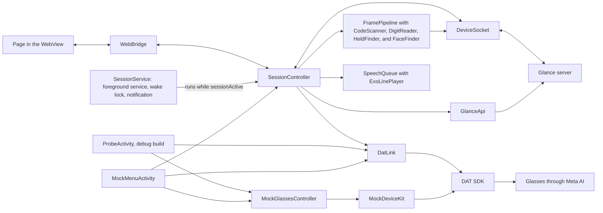
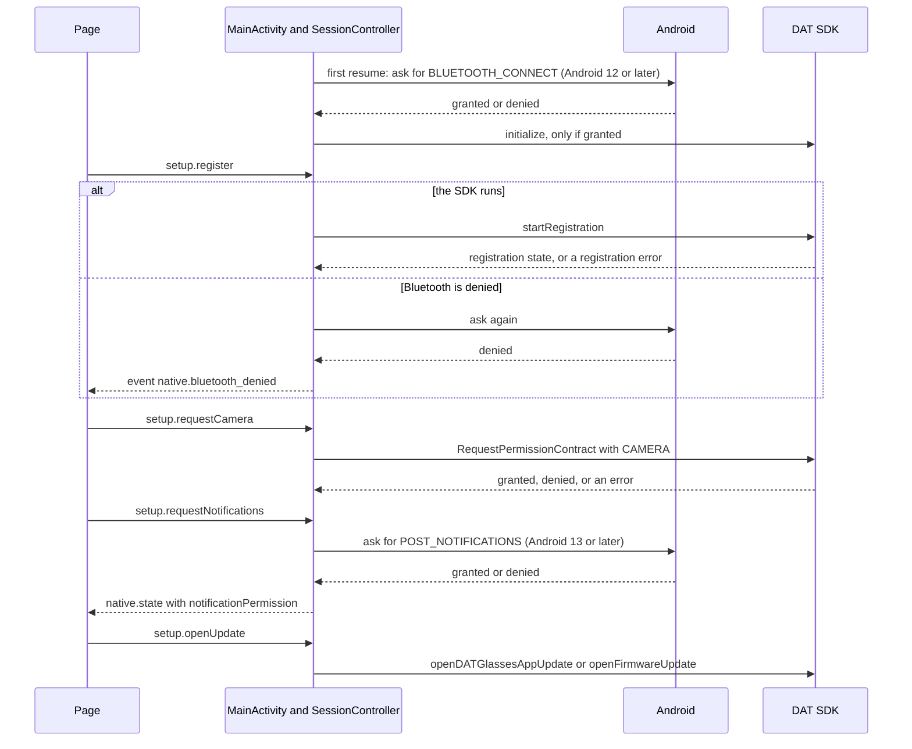
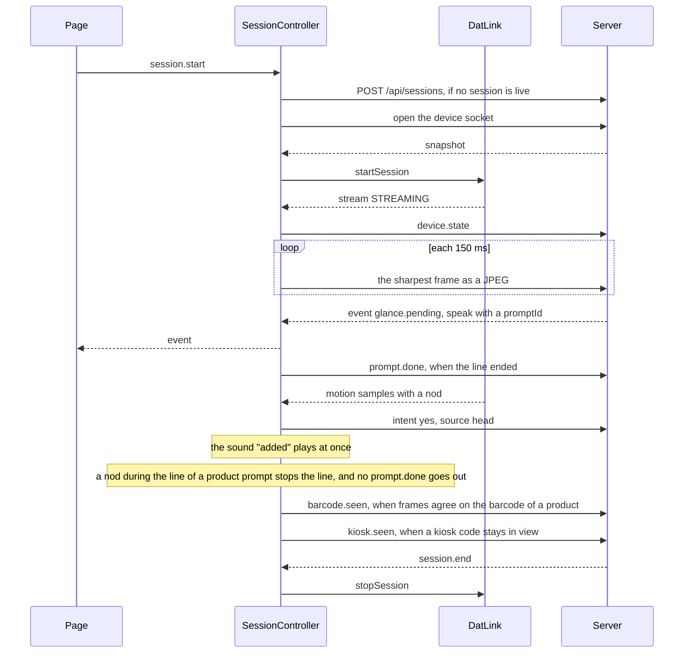
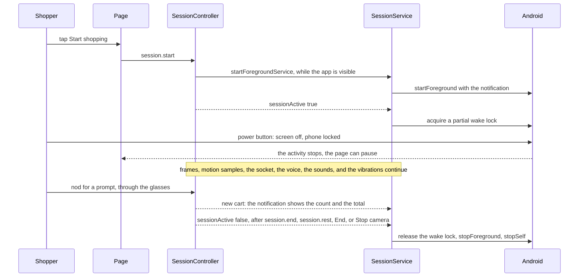
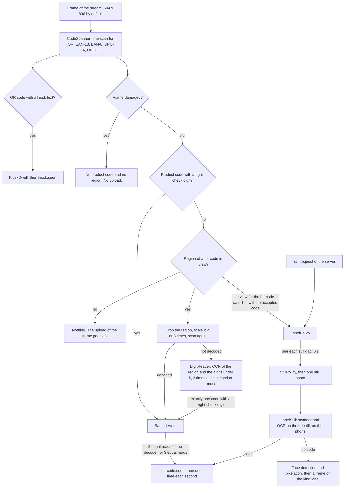
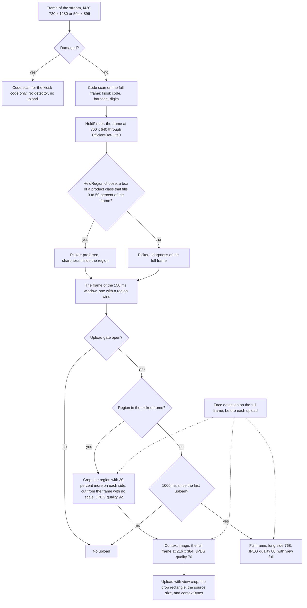
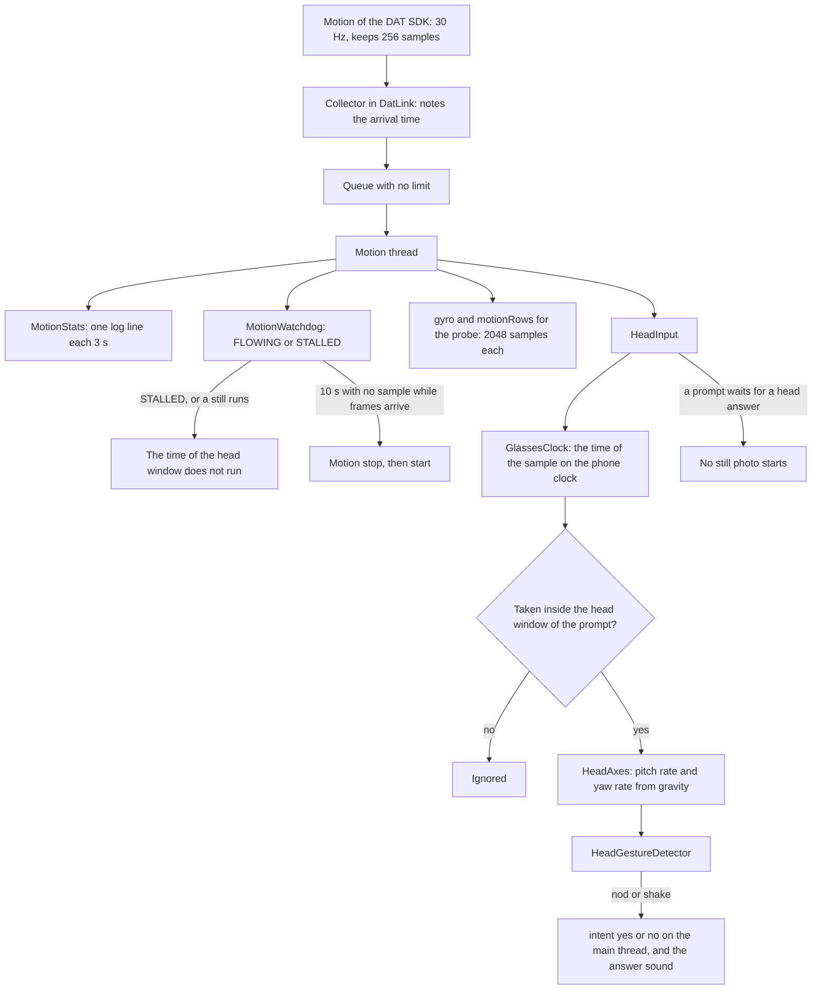
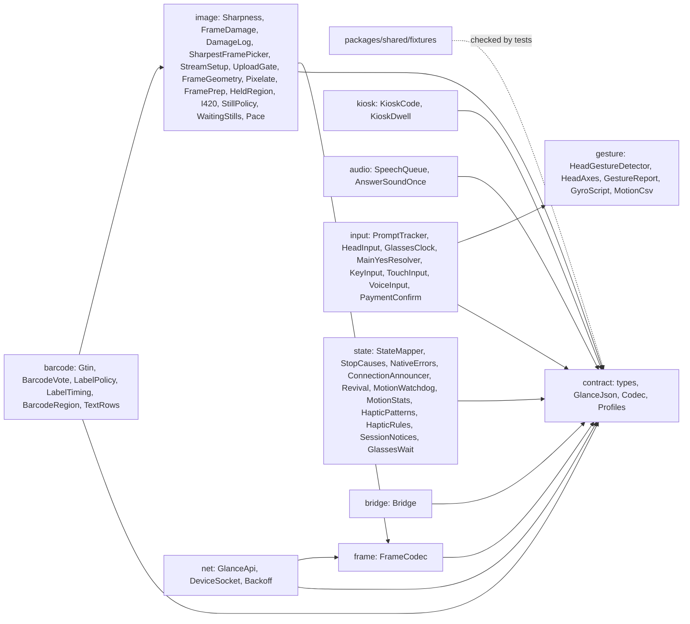
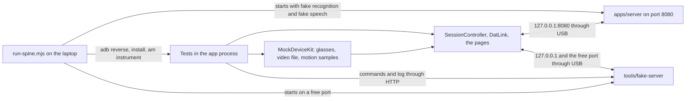

# Glance for Android

The Android app of Meta Glance. This folder holds a Gradle project with two modules.

- `core` is pure Kotlin on the JVM. It holds each rule that a unit test can check.
- `app` is the Android application `com.metaglance.android`. Its debug build also holds the probe screen "Glance Probe". Its demo build is the signed APK for the testers.
- `tools` holds a fake server and the script that makes the sounds. Both need Node 22 or later.
- `app/src/androidTest` holds the tests that run on a phone with mock glasses. See "Instrumented tests".

The app has three screens. Each one has its own icon on the phone.

- "Glance" is `MainActivity`: a WebView with the phone UI. An APK that was built without the phone UI shows a placeholder page with one button for each message of the bridge.
- "Glance Mock" is `MockMenuActivity`: the menu of mock mode, in each build. See "Mock mode for seats without glasses".
- "Glance Probe" is `ProbeActivity`, in the debug build only: a list of buttons above a log. It writes each log line to Logcat with the tag `Glance`, and to `Android/data/com.metaglance.android/files/probe/probe-<start time>.log` on the phone.

The debug APK has about 211 MB, because it holds the ML Kit models and the MediaPipe library for 4 processor types, and the libraries of the DAT SDK. The text recognition model is about 43 MB of it, and the MediaPipe library with the model of the held crop is about 53 MB.

## Parts



- `GlanceApp` owns one `DatLink`, one `MockGlassesController`, one `ProfileStore`, and one `SessionController`. A new activity keeps the session.
- `SessionService` keeps a session alive with the screen off. It owns no part of the session. See "The session service".
- `DatLink` is the one connection to the DAT SDK. It gives a `snapshot` of the state, the `faults` of the SDK, and the `frames` of the stream. Call its functions on the main thread.
- A frame is a `RawFrame` in I420 layout. `frames` holds the newest frame only. A frame with an odd width or height, or with fewer bytes than its size needs, is dropped with one log line.
- While a session runs, the device of the snapshot comes from the session. After the session, it comes from the device list of the SDK again.
- `attachMotion`, `attachInputs`, and `attachSpeech` add a capability to a started session. `touches` and `transcripts` give their data.
- The motion samples have a thread of their own. `headSink` gets each sample with a gyroscope reading and its arrival time on that thread. `gyro` and `motionRows` are flows for the probe: each holds 2048 samples, and a reader that is so far behind misses the newest sample. `motionHealth` gives the state of the watchdog. See "Head gestures".
- A capability that stops with no request from the app starts again 750 ms later, at most 3 times in a row, and only if the session still runs then. `Revival` in `core` holds the count.
- Motion that runs and gives no sample for 10 seconds is stopped and started again. See "Head gestures".
- A stop waits until the stream is 1 second old. A stop at the start of a stream ended the app process in the video decoder of the SDK (DAT 1.0.1).
- `captureStill` takes a photo while the stream runs. `stillRunning` is true in that time.
- `PhoneVoice` speaks a line with the speech engine of the phone, as media sound.
- `ProbeDecisions` holds the values that the probe run on the glasses decides: the capabilities that start, the input sources, and the gyroscope axes. Its values are defaults until that run. The head gestures use the gyroscope axes only for a sample with no accelerometer reading.
- A stopped DAT session is final. `startSession` creates a new session each time.
- `MockGlassesController` pairs mock glasses of MockDeviceKit. Call `DatLink.initialize` after `enable` and after `disable`. `enable` on a kit that runs starts it again, and its mock glasses are gone then.
- `DatLink.initialize(false)` with MockDeviceKit off stops the use of the SDK: the registration is `UNAVAILABLE`, and the device is gone.
- `DatLink` has three debug hooks for the states that MockDeviceKit cannot make. `debugFault` reports a fault as if the SDK reported it, and a `STREAM` fault also stops the session. `debugOverride` sets a missing Meta AI app or the compatibility of the device. `debugClearOverrides` removes both.
- After a stop, the snapshot of `DatLink` has the stream state `STOPPING`, then `STOPPED`. The stream collectors end with the stop, so `DatLink` sets these two states itself.

## The page and the bridge

- The page loads from `https://appassets.androidplatform.net/index.html`. `UiAssetsHandler` serves it from the APK assets: from the folder `ui` when the APK holds `ui/index.html`, else from the folder `placeholder`. A debug build adds `?debug=1`.
- The Gradle task `syncUi` copies `apps/mobile/ui/dist` into the APK as the folder `ui`. It does not run npm. Build the phone UI first: `npm run build --workspace @glance/phone-ui` at the repository root.
- A debug build with `glance.uiDevUrl` loads that address in place of the assets.
- The page sends a message with `window.GlanceNative.postMessage(json)`. The app sends one with `window.__glanceReceive(json)`. `WebBridge` sends nothing before the first `ui.ready`. A page that loads again gets no message until its own `ui.ready`, and the answer to that brings the state, the profile, and the snapshot again.
- A session does not need the page. With the screen off the activity is stopped, and Android can pause the page or drop a message to it. So each time the activity becomes visible, the app sends the state, the profile, and the snapshot again.
- Android can end the renderer of a page that is not visible. `MainActivity` answers that event, so the app continues, and it loads the page again. If the renderer ends again within 10 seconds, the app loads no third page, and the screen stays empty until the activity starts again.
- A link to another site opens outside the app.
- The text of the page follows the font size of the phone.
- `ProfileStore` keeps the profile, the yes input that the shopper selected, the server session, the server address, the gesture sensitivity, the placeholder switch, the two times of the label still, the switch "Record motion in sessions", and the fact that the app asked for notifications, in the preferences file `glance`.

## The setup

`MainActivity` and `SessionController` handle the four setup messages of the page.



- No SDK call runs before the Bluetooth permission. Without it, `registration` is `unavailable`. Mock glasses need no Bluetooth: they keep their registration, and the app does not ask.
- The app asks one time at the first resume. A new activity does not ask again. Android shows its prompt two times at most, and then it denies with no prompt.
- `setup.register` with Bluetooth denied asks again. Each denied answer sends `native.bluetooth_denied`, also the answer of Android with no prompt.
- A registration error `FAILED_TO_REGISTER` or `UNKNOWN` sends `native.registration_failed`. The page reads "no internet" from `network`.
- A camera request that fails sends `native.permission_failed`, but not for a missing Meta AI app: `metaAiInstalled` is false then.
- Each resume reads the camera permission and the microphone permission of the SDK again. The shopper returns from Meta AI through this path.
- The app reads both permissions again when the glasses connect. The SDK answers a permission check only with connected glasses (`PermissionError.NO_DEVICE`, `NO_DEVICE_WITH_CONNECTION`), so a check at the start of the app can fail before the link exists.
- A permission check suspends. If `DatLink.initialize` runs again before the answer arrives, for example at a change between mock glasses and the SDK, the app drops that answer.
- The answer to a permission request of the app is newer than a check of that permission that started before it. The app drops the answer of such a check.
- Meta AI opens the app again through the `glance` scheme. `onCreate` and `onNewIntent` give the intent to the SDK, after the SDK started.
- `notificationPermission` of the native state is `unknown` until the app showed the request of Android one time, then `granted` or `denied`. Before Android 13 it is always `granted`. Android tells no app that a request was denied, so a permission that is missing after a request counts as `denied`. `StateMapper.notificationPermission` in `core` holds the rule.
- A denied notification permission does not block a session. The service still runs, and Android lists it in the Task Manager of the notification drawer. The notification itself, with the total and the action "Stop camera", does not show.
- After two denied requests, Android shows its prompt no more. `setup.requestNotifications` then opens the notification settings of the app. Each resume reads the permission again.

## A session

The app holds two sessions. The server session holds the cart. The DAT session holds the camera stream, and a stopped DAT session is final. So one server session can see many DAT sessions: after a rest, a closed hinge, or a lost link.



Start checks, in this order. Each failure sends one `error` event to the page and starts nothing.

| Check | Error code |
|---|---|
| The Bluetooth permission is granted, or the glasses are mock glasses | `native.bluetooth_denied` |
| A device is connected | `native.no_device` |
| The glasses are not off the face | `native.not_worn` |
| The server answers `POST /api/sessions` | `native.server_unreachable` |
| The SDK creates the session | `native.sdk_too_old` for `INSUFFICIENT_SDK_VERSION`, else `native.session_failed` |

Rules of `SessionController`:

- A start with a live server session makes no new one. If its socket is down, the app first asks the server for the snapshot. With no answer, a new server session starts.
- `session.rest` of the server stops the DAT session. The socket and the server session stay.
- `session.end` of the server stops the DAT session and marks the server session as not live. The socket closes 5 seconds later, so the last lines still arrive. If the server closes the socket first, the app does not connect again, and it does not say the "Connection lost" line.
- `profile.set` of the page changes the profile only when the result is inside the limits of `packages/shared`: a speech rate from 0.8 to 2, a head window of 8000, 15000, or null, and a budget above 0 or null. The page gets a `profile` message after each `profile.set`, also when nothing changed.
- When a DAT session stops with no request from the app, `StopCauses.classify` names the cause, and the page gets its `error` event. The app reads the cause 500 ms after the stop, because the glasses can report a closed hinge after the stop.
- After a lost link or a closed hinge, a new DAT session starts by itself when the glasses are connected, open, and not off the face. The app waits 2 seconds first, and it stops after 5 such starts in a row with no stream.
- A stream that ends by itself after it ran also ends its DAT session.
- The app does not keep the screen on. The screen follows the timeout of the phone, and a session continues with the screen off and the phone locked. See "The session service".
- The app selects each vibration itself, if `haptics` of the profile is true. The page has no message for it, because the page does not run with the screen off. `HapticRules` in `core` maps an event of the server and a change of the camera stream to one of the 8 patterns of `HapticPatterns`: `prompt` for a product prompt and a pay prompt, `warning` for a product prompt with a warning and for `budget.exceeded`, `added`, `removed`, `paid`, `error` for `checkout.failed` and each `error` event, `cameraPaused`, and `cameraOff`. The add that brings the total over the budget gives the `warning` of its `budget.exceeded` only.
- Five seconds after the first `STREAMING`, `MainYesResolver` selects the yes input that works. A change goes to the page and to the server as a profile patch.
- The volume keys answer a prompt only while "Glance" is on the screen. With the screen off, or with another app in front, Android gives the keys to no activity, so `mainYes: key` has no input then. A media session could take the keys, but it also puts media controls on the lock screen and takes the play and pause gestures of the glasses, so the app has none.
- The volume keys of the phone answer a prompt when `mainYes` of the profile is `key`: up sends `intent yes`, and down sends `intent no`, each with the source `key` and the ID of the current prompt. A prompt is current from the end of its line until the server ends it or a new prompt replaces it. `MainActivity` then takes the key down, its repeat events, and its key up, so the volume does not change, and a key that stays down sends one answer. In each other case the key changes the volume as usual. `KeyInput` in `core` holds the rule.
- A double tap on the touchpad of the glasses sends `intent yes` with the source `touch` and the ID of the last finished prompt, or with no ID before the first prompt. The server decides if it counts. A swipe in each direction sends `intent repeat` with the source `touch`, and the server sends the last line again. A session attaches Inputs with `ProbeDecisions.INPUT_SOURCES` when `ProbeDecisions.INPUTS` is true. `TouchInput` in `core` holds the rule. The single tap and the tap and hold belong to the glasses.
- Each final speech result of the glasses goes to the server as `speech.final` with its text, its confidence, and the locale of the glasses. The app maps no word to an intent: the server owns the command words. With no confidence the app sends 0.5, and with no locale it sends `und`. A result that is not final, a blank text, and each result while a line plays or in the 500 ms after it send nothing, because the microphone hears each line. `VoiceInput` in `core` holds the rule.
- A session attaches Speech when `DatLink.usesSpeech` is true and the microphone permission of the glasses is granted. `usesSpeech` is `ProbeDecisions.SPEECH`, and it is always true with mock glasses. The bridge has no message for the microphone permission. The app asks for it when the page sets `mainYes` to `voice` and when the page sends the intent `ask`, if `usesSpeech` is true and the permission is missing. A permission that arrives while a stream runs attaches Speech to that stream. A denied request sends no `error` event.
- When a capability starts after the main yes was selected, and the profile does not have the input that the shopper selected, `MainYesResolver` selects again. So the voice becomes the main yes when Speech starts late.
- The intent `ask` of the page goes to the server as each other page intent, with the source `phone` and no prompt ID.
- The server sends `biometric.request` only with its setting `BIOMETRIC_ABOVE_CENTS`. With no such setting, which is the default, a yes pays each total and the three rules below never apply.
- `biometric.request` of the server shows the biometric prompt of Android, with the title "Confirm payment" and the subtitle "Demo payment. No money moves." The shopper confirms with a fingerprint or a face, or with the screen lock of the phone (`BIOMETRIC_WEAK or DEVICE_CREDENTIAL`, which works from Android 10). A success sends `biometric.result` with `ok: true`. An error sends `ok: false`, and a cancel is an error. A finger that does not match sends nothing, because the prompt stays open. `PaymentConfirm` in `core` holds the rule: one result for each prompt.
- On a phone with no screen lock and no biometric, the app shows no prompt. It sends `ok: false` and the `error` event `native.biometric_unavailable`.
- The app closes an open payment prompt when the server sends `checkout.cancelled` or `session.end`, and at `data.delete`. The closed prompt sends `ok: false`. A second `biometric.request` while the prompt is open shows no second prompt. A request while the activity is in the background sends `ok: false`, because the biometric library shows no prompt then. That is also the answer with the screen off or the phone locked: the app shows no notification for it and does not wait.
- A nod or a shake in the head window of a prompt sends `intent yes` or `intent no` with the source `head` and the ID of the prompt. For a product prompt the window opens while the line still plays, and the answer stops the line. See "Head gestures".
- With the setting `Second look still` on, the event `glance.ambiguous` of the server makes the app take one still photo with `DatLink.captureStill`: the sharp second look. The setting is off by default, and then the event starts no still. See "The second look still". While a prompt waits for a head answer, this still waits, for 5 seconds at most. See "No still while a prompt waits". `StillPolicy` in `core` allows one capture at a time and one start each 5 seconds in a DAT session. `StillPhoto` crops the photo to its center (80 percent of the width, 70 percent of the height), scales its long side to 1440 pixels at most, pixelates each face, and makes a JPEG of quality 85. The header has `kind: still` and `blurred: true`. If face detection fails, the still is dropped. A still does not pass the upload gate, but it needs an open socket. The log line `still seq=...` has the milliseconds from the event to the upload.
- The frames of the stream and the stills share one upload number, `seq`, which counts up for the life of the app process.
- With the socket down for 3 seconds, the phone voice says "Connection lost. Your cart is safe. Glances are paused."
- With the media volume at 0, no line plays, and each prompt is reported at once.
- `FramePipeline` scans each frame for a kiosk code and for the barcode of a product, and selects the sharpest frame of each 150 ms that is not damaged. See "The barcode of a product" and "Damaged frames". With the setting `Held crop` on, which is the default, the upload is the crop around the product in the hand, or the full frame one time each second. See "The crop of the held product". The rest of this rule describes the full frame. `FaceFinder` looks for faces in that frame with ML Kit, on the phone. The upload is the full frame with each face pixelated, as a JPEG of quality 80 with a long side of 768 pixels at most: 432 x 768 for a stream of 720 x 1280 and for the default stream of 504 x 896, and 360 x 640 for a stream of 360 x 640. Until 2026-11-14 the upload was the center of the frame (80 percent of the width, 70 percent of the height). That crop cut off a product that the shopper held at chest height: in the test of that day the can was at the lower edge of several frames. The full frame shows more of the room and of the people in it, and face detection is the one guard for them. Its header has `blurred: true`. If face detection fails, the frame is dropped. The app writes no frame to storage.
- The app plays each line of the server one time, with the sound of the line. It plays one sound by itself: the answer sound of a head gesture, `added` for a yes and `removed` for a no, at the moment the app sends the answer. The line that answers the gesture then plays with no sound, so one answer gives one sound. See "Head gestures". A still, a label upload, and a barcode report play no sound. `apps/server/README.md` lists each sound and each vibration of a line with its trigger, in "A guard for the voice".
- `ExoLinePlayer` plays the sound of a line, then its clip. A clip that does not load, that does not start in 3 seconds, or whose address is not an address, is replaced by the phone voice. The speech rate of the profile changes the clip, not the sound.

## The session service

`SessionService` is a foreground service with the types `connectedDevice` and `mediaPlayback`. It makes a session work with the screen off and the phone locked in a pocket. Without it, Android can stop the CPU and end the process a short time after the screen turns off.



- The service holds three things: the right of the process to run, one partial wake lock with the tag `Glance:session`, and the notification. Each object of the session stays in `GlanceApp`, and the service starts and stops none of them.
- `SessionController.sessionActive` decides the life of the service. It is true while the camera starts, while a DAT session runs, in the 500 ms after a stop that the app did not ask for, and while the app waits for the glasses to start again. The service watches it and stops itself when it is false.
- The start is the tap on Start shopping. Android lets an app start a foreground service only while the app is visible, and a start from the background fails (`ForegroundServiceStartNotAllowedException`). So a session that ended with the screen off does not start again by itself: `session.rest` and the 5 minute limit below both end the service, and the shopper starts the camera from the app.
- A new DAT session after a lost link or a closed hinge needs no new service start, because the service runs through the wait. The wait ends after 5 minutes (`GlassesWait` in `core`), so the service and its wake lock do not stay forever.
- The type `connectedDevice` needs the Bluetooth permission. The service asks for it only when `BLUETOOTH_CONNECT` is granted. Mock glasses run without Bluetooth, and the service then has the type `mediaPlayback` only.
- A request to the service is a start command with an action, never `stopService`. A stop before the first `startForeground` makes Android end the app. The pattern is that of `StreamingService` in the CameraAccess sample of the DAT SDK.
- The wake lock has a limit of 2 hours, and the service takes a new one each hour. So a lock that the app lost ends by itself, and a long shop keeps its lock.
- The notification is ongoing and has low importance, so it makes no sound. Its title is the state: "Shopping", "Camera starts", "Camera paused", "Camera off", "Server not reachable", or "Glasses disconnected". Its text is the item count and the total, for example "3 items, 12.40 EUR". A tap opens "Glance". The one action "Stop camera" stops the camera as `session.rest` does: the cart and the server session stay. `SessionNotices` in `core` holds the texts, in English and in Italian.
- The service is `START_NOT_STICKY`. If Android ends the process, or the shopper taps Stop in the Task Manager, nothing starts again. The next start of "Glance" finds the server session and gets the cart from the snapshot.
- Each timer of a session is a `delay` or a `Handler` on the main thread, which count only while the CPU runs. The wake lock keeps the CPU on for the life of the service, so the timers run. With no session, the timers stop while the phone sleeps: the socket then connects again when the shopper opens the app.
- The app asks for no battery exemption. Set the battery use of "Glance" and of "Meta AI" to "Unrestricted" by hand on a phone that ends background apps early.

What nobody measured with the screen off, as of 2026-11-14. The checks in "Checks with the glasses or with sound" cover each one.

- If the frames that the SDK decodes keep their rate. The CameraAccess sample of Meta shows a stream behind a locked screen with compressed frames, which the sample decodes itself. If the raw frames stop, `compressVideo = true` with a decoder in the app is the next step.
- If Motion keeps its rate of samples, and how often the watchdog of the motion samples starts Motion again.
- If the Meta AI app stays alive in the background on the test phone.
- The step times of ML Kit. A process with no visible activity can get fewer fast cores.
- The battery use and the heat of the phone for a full shop.

## The barcode of a product

The shopper looks at the barcode of a product, and the phone reads the code. The server finds the product. The phone has three ways to read a code, in this order. `FramePipeline` runs them on its one worker thread.



1. The decoder. `CodeScanner` is the ML Kit barcode scanner with the formats QR, EAN-13, EAN-8, UPC-A, and UPC-E. `enableAllPotentialBarcodes()` makes it also report a region that can hold a barcode which it did not decode: such a hit has a box, an empty text, and the format unknown. `CodeScanner` gives it with the text null.
2. The region again. `BarcodeRegion` adds the quiet zone to the box of the region. `I420.cropLumaToArgb` scales the gray of that crop 3 times, or 2 times for a crop wider than 320 pixels, and the scanner reads the result.
3. The digits. `DigitReader` is ML Kit text recognition v2 with the Latin model of the APK (`com.google.mlkit:text-recognition`). It reads the region with half of its height more below it. `TextRows` puts the words into rows, and `Gtin.digitRuns` finds the code in a row.

Rules that keep a wrong product out:

- A code must have 8, 12, or 13 digits and a right GS1 check digit. A UPC-E code goes out in its 12-digit UPC-A form. The server makes 13 digits of each code.
- `BarcodeVote` reports a code of the decoder at its second equal read inside 1500 ms. A code from OCR needs 3 equal reads inside 2500 ms, and a read of the decoder counts as one of them. A different valid code starts the count again. Two reads are equal when their 13-digit forms are equal, so the 12 digits of a UPC-A code and the same code with 13 digits agree.
- After the first report, the phone sends the same code one time each second while it stays in view. A gap of 1000 ms with no read keeps the appearance. After a longer gap the code needs its reads again.
- With more than one code in a frame, the largest one counts. OCR counts only when the region holds exactly one code.
- A region counts only when its long side is at least 1.25 times its short side. So a kiosk QR code that is too far to decode asks for no still.
- A region also counts only up to half of the frame width and 30 percent of the frame height (`BarcodeRegion.fits`). A real code of that size decodes. The scanner reported the text of a laptop screen as a region of 361 x 242 pixels in a frame of 504 x 896, and the phone took a still each 6 to 10 seconds.
- A damaged frame gives no product code and no region: the scanner reports the blocks of such a frame as regions. See "Damaged frames".
- The frame gets one NV21 copy, for the scan. The crops for the second scan and for OCR read the Y plane of the frame.
- The log (tag `Glance`) has `barcode read <code> <source>` for each read before the first report of a code.

The still photo:

- `LabelPolicy` asks for a still when a region was in view for the barcode wait (1000 ms) with no accepted code, and when the server sends `still.request`. Both share one limit, the still gap: one still each 6 seconds. A request inside that time is dropped.
- A person can change both times on the phone with no new build. See "The two times of the label still".
- A region that stays in view asks for 3 stills at most. The scanner can report a region where no barcode is, and each still stalls the motion samples for seconds and can cost one model call of the server. The region asks again after it left the view for more than 600 ms. A `still.request` does not count for this limit.
- After a still gave a code, its region asks for no other still while it stays in view: the frames cannot read that code, so each still would give the same report again.
- `LabelPolicy` asks for no still while the upload gate is closed, for example with the socket down or with the glasses off the face. A `still.request` in that time is dropped.
- `LabelPolicy` asks for no still while a prompt waits for a head answer. That time uses no still gap and none of the 3 stills of a region. A `still.request` that meets the prompt, and a region that asks behind it, give no still after the answer: the request is dropped, and the region starts its barcode wait again. See "No still while a prompt waits".
- A `still.request` that is 3 seconds old when its first frame arrives is dropped (`LabelPolicy.STALE_MS`). A still can stop the frames for that time.
- The still also needs `StillPolicy`, which it shares with the sharp second look: one capture at a time, and one start each 5 seconds. With a still gap below 5000 ms, the limit of `StillPolicy` is the still gap.
- `LabelStill` reads the still on the phone first, with the scanner and with OCR. A code of the decoder counts with its check digit, because one still has no second image that can agree. It does not count when the digits under its bars give another code: ML Kit read blurred bars as a wrong code with a right check digit in one test image. Such a still goes to the server. With no decoded code, the digits count when the still holds exactly one code. With no region in the still, only 12 or 13 digits count, because 8 digits in a photo can be a date.
- A still with a code gives `barcode.seen`, and the still stays on the phone.
- A still with no code goes to the server as a frame with `kind: label` and `blurred: true`: the full photo with no crop, each face pixelated, a long side of 1600 pixels at most, and JPEG quality 85. If face detection fails, the still is dropped. With the held crop on, a still in which the detector finds a region goes out as the crop around that region. See "The crop of the held product".
- Each 10 seconds the frame path logs `frame path: scan <n>x mean <ms> max <ms> ms, product ..., faces ..., pixelate ..., jpeg ...`: the time of the code scan and the product read of each frame, and of the face detection, the crop with pixelation, and the JPEG of each upload. With the held crop on, the line also has the detector time and the counts of the crop. See "Log lines" in "The crop of the held product".
- A capture that gives no photo (`capture error CaptureFailed`, after about 10 seconds) stops frames and motion samples for that time. After one, the app takes no still by itself for 45 seconds and logs `still failed: no new still for 45 s`. A reference picture that a person asks for does not wait. Measured on 2026-11-14 with the stream at 360 x 640: three failed captures in 40 seconds, each with a motion stall of 11 to 14 seconds.
- The log line `label still asked: region <box> in <w>x<h>` or `label still asked: server request` says why the phone takes a still.

The still of a reference picture:

- A person at the computer asks the server for a reference picture of a store item, and the server sends `still.request` with the purpose `reference`. `apps/server/README.md` has the command, in "Reference pictures".
- This still does not go through `LabelPolicy`. `StillPolicy.tryStartNow` starts it at once, and refuses it only while another capture runs. The next still of the app keeps its distance from it.
- While a prompt waits for a head answer, this still waits, for 30 seconds at most. The log has `reference still waits: a prompt waits for its answer`.
- The phone reads no code in this still. It always goes to the server as a frame with `kind: label`: the full photo, each face pixelated, a long side of 1600 pixels at most. If face detection fails, the still is dropped.
- The still plays no sound and gives no vibration.
- The log has `reference still seq=<n> <w>x<h> <n> bytes sent, <n> ms`, or `reference still dropped: <cause>`.
- No instrumented test covers this still yet. The tests of `:core` cover `StillPolicy.tryStartNow` and the purpose of the message.
- The log line `stream size <w>x<h>` comes with the first frame of a stream and with each change of the frame size. The glasses lower the size when Bluetooth is slow, and a smaller frame makes each code harder to read.
- The log line `label still <w>x<h>: ...` has the size of the photo and the milliseconds from the trigger to the result. `DatLink` logs `still <w>x<h> <variant> <ms> ms` for the capture alone.

### The two times of the label still

With the glasses, a still took 2.3 to 2.9 seconds and its label call 1.5 to 2.3 seconds (measured on 2026-11-14). The shopper waits about 5 seconds after the barcode wait, so the default barcode wait is short: 1 second. Nobody knows yet which value is best with a product in the hand. So the two times are settings of the app, for mock glasses and for real glasses.

| Time | Field of "Glance Mock" | Key of `local.properties` | Default | Limits |
|---|---|---|---|---|
| Barcode wait: a barcode region is in view with no accepted code for this time, then the phone takes the still | `Barcode wait (ms)` | `glance.labelWaitMs` | 1000 | 300 to 10000 |
| Still gap: the shortest time between two label stills | `Still gap (ms)` | `glance.labelGapMs` | 6000 | 2000 to 60000 |

1. Open "Glance Mock" and go to the group `Barcode`, at the end of the list.
2. Type the milliseconds in one field or in both.
3. Tap `Save barcode waits`. The line below the top line shows the two values that the app stored.
4. If a session runs in "Glance", stop it and start it again. A pause does not start the camera again.

- The app reads the two values each time the camera of a session starts, and logs `label still: wait <n> ms, gap <n> ms` with the tag `Glance`. A running camera keeps its values.
- The app keeps the values over a restart. An empty field gives the value of the build again.
- A number outside the limits becomes the nearest limit. A text that is no whole number changes nothing.
- The keys of `local.properties` set the values of the build. A value of the menu wins over them until a person empties the field.
- A short barcode wait takes the still before the scanner and OCR had their time: OCR needs 3 equal reads, which take up to 1 second. Each still stalls the motion samples for seconds. No still starts while a prompt waits for a head answer, but a prompt that arrives during a still gets its head window only after the still.
- The server starts at most one label call each 5 seconds for a session. With a still gap below 5000 ms it drops some label frames, and the phone still reads each still for a code.
- With real recognition, each label frame that the server accepts is one paid model call. A shorter still gap can cost more calls.
- `LabelTiming` in `core` holds the limits and reads a field. The probe screen always uses the defaults, 1000 ms and 6000 ms.

Measured on the test phone on 2026-11-14, with images of an EAN-13 code with 5 pixels for each narrow bar and a Gaussian blur:

| Blur radius (sigma) in pixels | Scan of the full image | Scan of the crop, 2 times as large | OCR of sharp digits under the bars |
|---|---|---|---|
| 6 | right code | right code | right code |
| 8 | region, no code | right code for bars with no digits, no code with digits | right code |
| 10, 12 | region, no code | no code | right code |
| 16 | region, no code | no code, and no region with digits | right code |
| 20 | region, no code. With sharp digits on the bars: the wrong code 3777654524301 for 3017624010701 | no code | right code |
| 26 | nothing | not run | not run |

In the stream of the sharp clip `barcode.mp4`, OCR of the crop read the digits as `4 008381333931!`, with one wrong digit and the guard bars as a character, in each of 5 runs. The check digit refused the row. So OCR can give the same wrong digit in each read, and the check digit is the rule that keeps it out: the GS1 check finds each single wrong digit.

So each of the three ways reads a code that the way before it does not read. The wrong code at 20 has a right check digit. In the stream, `BarcodeVote` asks for 2 equal reads, and the server adds only a code of the store list. The test clips use the radius 12.

Measured with Ray-Ban Meta glasses on 2026-11-14, in one test:

- The stream fell to 504 x 896, the Bluetooth ladder of the glasses. The uploaded frames were about 402 x 626 and blurred.
- The scanner decoded no code at the length of an arm.
- A label still was 1080 x 1440 (HEIC) and took 2.3 to 2.9 seconds. In one still the barcode of a pack of paper cups was about 95 pixels wide, which is too small to read.
- With no barcode in view, the scanner reported the text of a laptop screen as a region. See the size rule above.
- A still stopped the head-motion stream for 5.9 seconds, and for 10 seconds when the capture failed. A nod in that time is lost. So the server asks for a still only as an exception: see "The model also reads the code" in `apps/server/README.md`.

What nobody measured:

- The distance at which a code decodes from the stream of the real glasses. ML Kit asks for 2 pixels for each narrow bar, so an EAN-13 code must be 190 pixels wide in the frame. The research of 2026-11-13 estimates 7 to 11 cm for that. See "Checks with the glasses or with sound".
- Whether the glasses keep the motion samples of a still and send them after it, or lose them. In the log of 2026-11-14, Motion stayed `STARTED` during each still, and few samples or none arrived in that time.
- The size rule of a region and the barcode wait of 1000 ms with the real glasses. The instrumented tests did not run after these changes: they need the test phone.
- The time of one scan with the 5 formats and the regions, and the time of one OCR run, on the phone.
- The text that ML Kit gives for a UPC-E code. The app expects 8 digits.

## The stream settings

The app asks the glasses for a frame size and a frame rate. A person can change both on the phone with no new build, to compare them.

| Setting | Item of "Glance Mock" | Key of `local.properties` | Default | Values |
|---|---|---|---|---|
| The frame size | `Stream quality: <name> <width> x <height>` | `glance.streamQuality` | `HIGH` | `HIGH` 720 x 1280, `MEDIUM` 504 x 896, `LOW` 360 x 640 |
| The frames each second | `Stream frame rate: <n>` | `glance.streamFps` | `7` | 2, 7, 15, 24, 30 |
| The still of the sharp second look | `Second look still: <off or on>` | `glance.secondLookStill` | `false` | `false`, `true` |
| The crop of the held product | `Held crop: <on or off>` | `glance.heldCrop` | `false` | `true`, `false`. See "The crop of the held product". |

1. Open "Glance Mock" and go to the group `Stream`, at the end of the list.
2. Tap an item. Each tap goes to the next value, and from the last value to the first.
3. Start the camera again: end the session in "Glance" and start a new one.
4. Read the log: `adb logcat -s Glance`. Each camera start has the lines `stream config: quality=<name> fps=<n>` and `second look still: <off or on>`.

- The values are the ones that the DAT SDK 1.0.1 accepts: the three constants of `VideoQuality`, and the five values of `StreamConfiguration.frameRate`. `StreamSetup` in `core` has them.
- The app keeps both values over a restart. They also count for real glasses and for the probe.
- The keys of `local.properties` set the values of the build. From the first tap, the value of the menu wins, and no item gives the value of the build again.
- The default was 720 x 1280 before. The glasses lowered that stream to 504 x 896 in each session of 2026-11-14. The guide of Meta says: "Requesting a lower resolution, a lower frame rate, or both can yield higher visual quality with less compression loss." So the default asks for 504 x 896 at once.
- The glasses can give less than the app asked for. The line `stream size <w>x<h>` shows each change of the frame size, and the line `frame <w>x<h> #<n> fps=<rate>` shows the frame rate that arrives, one time each second.
- The damage lines show what a setting does to the picture: see "Damaged frames".

What follows the settings:

| Part | 720 x 1280 | 504 x 896 | 360 x 640 |
|---|---|---|---|
| The upload of a frame with no region, and each upload with the held crop off: the full frame, with a long side of 768 pixels at most and no scale up | 432 x 768 | 432 x 768 | 360 x 640 |
| The upload of a frame with a region: the crop, with no scale. The median of the measurement | 298 x 598 | 224 x 364 | not measured |
| The scale of the upload | 0.6 | 0.86 | 1 |
| The largest region of a barcode that did not decode (`BarcodeRegion.fits`) | 360 x 384 | 252 x 268 | 180 x 192 |
| The smallest face that `FaceFinder` asks ML Kit for: 5 percent of the width | 36 pixels | 25 pixels | 18 pixels |

- The crop of before sent a stream of 504 x 896 with no scale, as 402 x 626. The full frame of that stream is scaled by 0.86, so a product has 14 percent fewer pixels on each side. A stream of 360 x 640 loses none. Nobody measured what the full frame does to recognition: the saved frames of each test are crops. A long side of 896 pixels (`FrameGeometry.outputSize`) would send the default stream with no scale, for about 1.4 times the pixels of each upload.
- At 2 frames each second, one missed frame is a gap of 1000 ms. A rule that must last over one missed frame has a gap of 2.5 frame times at least (`StreamSetup.gapMs`): 1250 ms at 2 frames each second for the kiosk dwell (600 ms at the other rates), the barcode vote (1000 ms), the region of the label still (600 ms), and the frame flow of the motion watchdog (1000 ms).
- The window of an upload is 150 ms (`Timing.uploadEveryMs`). At 2 and at 7 frames each second, most windows have one frame, so the phone uploads almost each frame that is not damaged: 6.5 frames each second from a stream of 7. With the held crop on, this holds for the frames with a region. With no region, one full frame goes out each second. A window starts where the last one ended, and not at its first frame. A window of 300 ms that started at its first frame gave one upload each 400 ms in the test of 2026-11-14, because a frame each 143 ms never falls on the end of such a window.
- The smallest crop of a region is 16 pixels at each size, and the second scan scales a crop 2 or 3 times at each size. So a barcode must be nearer to the glasses at a smaller frame size.
- The instrumented tests ask for 720 x 1280 at 7 frames each second (`TestStreamRule`), because their clips and their checks are for that stream. The rule also sets the held crop to off, because no clip shows a product in a hand. `HeldCropTest` sets it to on with `HeldCropRule`.

What nobody measured:

- Each setting other than 720 x 1280 at 7 frames each second with the real glasses: the frame size and the frame rate that arrive, and the damage lines.
- The default is `HIGH`. Measured on 2026-11-14: the glasses lower a stream by one step when the link is weak. With a request of `HIGH` the stream fell to 504 x 896 and stayed there. With a request of `MEDIUM` it fell to 360 x 640 in each of 6 sessions, and frames of that size are too small to read a label.
- The frame size of the mock glasses for `MEDIUM` and `LOW`. The mock stream had 720 x 1280 and 30 frames each second for a request of `HIGH` at 7.
- The distance at which a barcode decodes at 504 x 896 and at 360 x 640.
- Whether ML Kit finds each face in a frame of 360 x 640. A face that it does not find is not pixelated.

### The second look still

The server sends the event `glance.ambiguous` for products that look alike. A still of that moment has more pixels than a frame, and the server can name the product in it. The server waits for that still only with its setting `SECOND_LOOK_WAIT_MS`, which is 0 by default. The phone cannot read that setting, so the still is a setting of the app.

- The default is off: `glance.ambiguous` starts no still. Set `Second look still` to `on` only for a server with `SECOND_LOOK_WAIT_MS` above 0.
- Each still stalls the motion samples for seconds, so a nod in that time arrives late or not at all. In the session of 2026-11-14 the phone took 2 such stills, of 2.3 and 4.8 seconds. The second one ran when the prompt of the held product arrived, and the motion samples came back 6.7 seconds after they stopped, 2.7 seconds after the end of the capture.
- The app reads the setting at each camera start and logs `second look still: off` or `second look still: on`. A running camera keeps its value.
- The app keeps the value over a restart. The key of `local.properties` sets the value of the build, and from the first tap the value of the menu wins.
- `SecondLook` in `core` holds the default and the texts. `StillPhotoTest` and one test of `BarcodeScanTest` set the setting to on with `SecondLookRule`.
- The instrumented tests did not run after this change: they need the test phone. They compile.

## Damaged frames

In a session of 2026-11-14, some uploads were pictures of large blocks with smeared colors, where the frame before showed the scene. The glasses compress the stream with HEVC for the bandwidth of Bluetooth. When the data for a frame is too little or is lost, the decoder of the SDK gives such a picture, and the frames after it keep the damage until the stream recovers. `FrameDamage` in `core` finds these frames, and `FramePipeline` keeps them out.

What the pipeline does with a damaged frame:

- It is never uploaded. `SharpestFramePicker` selects the sharpest frame of the window that is not damaged, and a window with only damaged frames uploads nothing.
- It gives no product code and no barcode region, so it starts no second scan, no OCR, and no label still. For `BarcodeVote` and `LabelPolicy` it is a frame with nothing in view.
- Its kiosk code counts. The scan for the QR code runs in each case, and a QR code that decodes to a kiosk text is not a product of the blocks.
- The log (tag `Glance`) has `frames damaged=<n> of <m>` for each 3 seconds with a damaged frame: `<n>` damaged frames of the `<m>` frames of that time. No line means no damaged frame. At the end of the stream, the log has `frames damaged total=<n> of <m>`.
- The line `frame <w>x<h> #<n> fps=<rate>` has no damage count: `DatLink` writes it, and the measure runs later, in the pipeline.

### The measure

The HEVC decoder works in blocks of 16, 32, or 64 pixels that start at the frame corner. So the edges of the blocks are on the lines at each 16th pixel, in both directions. A scene has its edges at any place.

1. The frame is cut into bands of 16 rows. The measure reads 4 rows of each band (rows 2, 6, 10, and 14) and adds them, so each column has one sum for the band.
2. The step at a column is the mean of the 4 pixels from it to the right, minus the mean of the 4 pixels to its left. A step counts when it is 6 luma levels or more above the larger step of its two neighbors, 4 pixels away. So a thin line and a slow change of light do not count, and the edge of a block does, also after the decoder made it soft.
3. For each of the 16 places of a column in a block, the measure has the share of the bands with a step there.
4. The ratio is the share on the block lines over the median share in the middle of the blocks, 5 to 11 pixels from a line. A median below 0.02 counts as 0.02, so a flat wall and a dark frame have the ratio 0.
5. The same runs for the lines between rows, with bands of 16 columns.
6. The score is the smaller ratio of the two directions. A frame with a score of 1.45 or more is damaged (`FrameDamage.DAMAGED_AT`).

- The measure also looks for block lines that do not start at the frame corner. It takes the best ratio of the 15 other starts, times 0.7, so such lines need a ratio of 2.07. The best of 15 ratios is larger by chance, and the text lines of a laptop screen reached 1.8 in one direction.
- The measure reads one quarter of the luma pixels two times: 460 800 reads for 720 x 1280. On the JVM of the build computer it took 0.6 ms for a frame of 720 x 1280, about the time of the NV21 copy that each frame already gets. Nobody measured it on a phone.
- A scene is not damage by these rules: blur (few steps at each place), a flat wall or a dark frame (no steps), and one long straight edge on a block line (one edge is a small share of the places). The tests of `FrameDamageTest` cover each one, with pictures that the test draws.

### What the real frames gave

The server kept the uploads of one session of 2026-11-14, with a request of 720 x 1280 at 7 frames each second: 312 stream frames of 402 x 626, the center crop of 504 x 896. 53 of them were sorted by eye into three groups before the threshold was set. The table has the lowest value, the median, and the highest value of each group.

| Group | Frames | Damage score | Sharpness (`Sharpness.of`) | Damaged by the threshold |
|---|---|---|---|---|
| Heavy: blocks in the full picture, the scene is lost | 21 | 1.49 / 2.09 / 5.21 | 11 / 19 / 93 | 21 |
| Moderate: blocks in a part, the objects show | 23 | 1.01 / 1.34 / 1.65 | 24 / 79 / 298 | 5 |
| Good, with 2 frames of motion blur | 9 | 0.85 / 1.05 / 1.22 | 25 / 258 / 386 | 0 |
| All frames | 312 | median 1.03 | median 83 | 26 |

- The 26 damaged frames are the 21 heavy ones and 5 moderate ones. The highest score of a frame that was not sorted is 1.42.
- 13 of the damaged frames came in a row, for about 4 seconds: the damage stays until the stream recovers.
- The block lines were at each 16th pixel from the frame corner: in the files they were at the columns 14, 30, 46 and at the rows 10, 26, 42, and the crop starts at column 50 and row 134. So the SDK gives the frame as the decoder made it, with no scale, at 504 x 896.
- A damaged frame is not sharp by the measure of the picker: the median sharpness of the damaged frames is 24, and that of the other frames is 91. So the picker did not prefer damaged frames. They went to the server because each frame of their window was damaged.
- Measures that do not use the place of the block lines did not divide the groups. The share of flat blocks of 16 x 16 was 0.01 to 0.12 for the heavy group and 0.01 to 0.18 for the good group: the blocks of a damaged frame are not flat. The share of the luma steps in straight runs of 8 pixels or more was 0.51 to 0.75 for the heavy group and 0.34 to 0.79 for the good group: the text lines of a screen are straight too. The plain ratio of the steps on a grid of 16 pixels was 1.32 to 1.59 and 1.13 to 1.49.

What nobody measured:

- The I420 frames. The numbers are from the uploads, after the crop and JPEG quality 80. JPEG has its own grid of 8 pixels, at other columns and rows than the block lines of these frames. So the scores in the app can differ, and the threshold can need a change. The damage lines of the log show it.
- Damage at 720 x 1280 and at 360 x 640, and other scenes: all numbers are from one evening in one room. The first 6 uploads of the session came from frames of 720 x 1280 and were scaled, so their block lines are at other places, and they are not in the numbers.
- Whether the SDK gives frames with no scale at each quality. A frame that the SDK scaled has its block lines at other places, and the measure then finds no damage.
- A scene with a pattern of 16 pixels in both directions, for example a tiled wall at one distance. It can read as damage while the head is still.
- The time of the measure on a phone.
- The pipeline with a damaged frame on a phone: no instrumented test gives it one. Each frame of the test clips has a score below 1, measured with a decoder on the build computer.

## The crop of the held product

The phone scaled each stream frame to a long side of 768 pixels before the upload. A can in the hand is then about 90 pixels wide, and 84 percent of the uploads of 2026-11-14 showed nothing in a hand. With the held crop, the phone looks for the product in each frame and uploads the part of the frame around it, with the pixels of the stream.



### The detector

`HeldFinder` runs the object detector of MediaPipe Tasks with the model EfficientDet-Lite0 (8 bit, 320 x 320 pixels, the 80 classes of COCO). The model file is in the APK, at `assets/held/efficientdet_lite0.tflite`, and the detector uses no network.

| Part | Value | Source |
|---|---|---|
| Library | `com.google.mediapipe:tasks-vision:1.0.0`, Apache 2.0 | https://dl.google.com/android/maven2/com/google/mediapipe/tasks-vision/maven-metadata.xml |
| Model | `efficientdet_lite0.tflite`, 4 602 795 bytes, SHA-256 `0720bf247bd76e6594ea28fa9c6f7c5242be774818997dbbeffc4da460c723bb`, Apache 2.0 | https://storage.googleapis.com/mediapipe-models/object_detector/efficientdet_lite0/int8/latest/efficientdet_lite0.tflite, licence at https://www.kaggle.com/models/tensorflow/efficientdet |
| Time of one frame in the documentation | 29.31 ms on the CPU of a Pixel 6 | https://developers.google.com/edge/mediapipe/solutions/vision/object_detector |
| Time of one frame on the build computer | 23.7 ms at the median, 26.3 ms at the 90th percentile, 6150 frames | measured on 2026-11-14 with the Python package `mediapipe` 1.2.3 |
| Size of the debug APK | 157.3 MB before, 210.8 MB after | `app-debug.apk`, which holds the libraries of 4 processor types |
| Size for one phone | 11.0 MB for `libmediapipe_tasks_jni.so` (arm64-v8a) and 4.6 MB for the model | the APK listing |

- The version 1.0.0 is not the newest one. From 1.1.0 the library brings `litertlm-android` with a native library of 22 MB, which the object detector does not use.
- The model knows no hand and no "can". A can in a hand gets the class `cup` or `bottle`. So the detector finds cans, bottles, cups, and the food classes. It does not find a box, a bag, or a pack. For these the full frame of each second is the path.
- `HeldRegion` in `core` has the rules. A box counts with a score of 0.15, a class of `HeldRegion.LABELS`, and an area of 3 to 50 percent of the frame. The largest such box is the region.
- The size is the rule for "held". A product at the length of an arm fills more of the frame than a product on a table: the boxes of the held can were 18 to 27 percent of the frame width, and 90 percent of the cans on the tables were below 15 percent.
- The phone is no judge of "held". A product on a near table or shelf gets a region too. The server model decides, with the context image.
- A detector that does not start, or that fails on a frame, turns the held crop off for that stream. The log has `held crop off: the detector did not start: <message>` or `held crop off: the detector failed: <message>`, and each window uploads its full frame again.

Why this detector. Each number is of 2026-11-14, from the saved uploads of the glasses, with the Python runtime of MediaPipe on the build computer. 146 frames have a label by eye: 117 with a product in a hand, 29 with none. 88 of the 117 have a box of the held product from the observe call of the server.

| Detector | Frames with a product in a hand that get a region | Region on the held product, of 88 | Frames with nothing in a hand that get a region | Time of a frame on the build computer |
|---|---|---|---|---|
| MediaPipe Hand Landmarker (`hand_landmarker.task`), a hand at a confidence of 0.1 | 11 of 117 | 0: of 8 hands in frames with a box, none held the product | 9 of 29 | 25.8 ms |
| MediaPipe Object Detector, EfficientDet-Lite0 8 bit, with the rule of `HeldRegion` | 65 of 117 | 52, and 3 on another object | 12 of 29 | 23.7 ms |
| The same model as 16 bit float | 63 of 117, with a rule of that day | 40, and 17 on another object | 9 of 29 | 32.2 ms |
| EfficientDet-Lite2 8 bit | 56 of 117, with a rule of that day | 44, and 5 on another object | 14 of 29 | 61.3 ms |
| SSD MobileNetV2 | 39 of 117, with a rule of that day | 34, and 2 on another object | 10 of 29 | 22.1 ms |
| Mobile Object Localizer v1, with no classes | a box on the product in 46 of 88, at a score of 0.19 among 10 boxes of each frame | no rule divides them | the same 10 boxes | 5.7 ms |
| ML Kit Object Detection and Tracking 17.0.2 | not measured: it runs on Android only | | | |

- The Hand Landmarker does not find a hand that holds a can in these frames. Its model card says: "Not appropriate for: ... Predicting hand landmarks with gloves or occlusions. For example when the hand is holding objects" (https://storage.googleapis.com/mediapipe-assets/Model%20Card%20Hand%20Tracking%20(Lite_Full)%20with%20Fairness%20Oct%202021.pdf).
- ML Kit Object Detection was not selected, and no measurement is behind that. Its guide says that the stream mode "might need to process 30 or more frames" before the first object, which is 4 seconds at 7 frames each second, and that it finds "the most prominent object" (https://developers.google.com/ml-kit/vision/object-detection/android). In these frames the most prominent object is a laptop. The Mobile Object Localizer of the table is a public model of the same kind, with no classes, and its boxes did not tell the held product from the other objects.
- The rows "with a rule of that day" used a width of 14 percent in place of the area. They compare the models, and their numbers are not those of the rule of the app.
- A white balance, a gamma change, a gray image, and a detector image of a part of the frame gave fewer regions on the product than the frame as it is, or more regions on other objects.
- The detector image has a long side of 640 pixels, made with one sample for each pixel. With that image the model gave 53 regions on the product, against 50 with the saved frame. At 320 pixels it gave 44.

What the rule of the app gives in the saved sessions:

| Set | Frames with a region |
|---|---|
| 267 uploads that the server named (`identified`) | 130, 49 percent |
| 430 uploads with `ambiguous` or `unsure` | 246, 57 percent |
| 3203 uploads with `none` | 833, 26 percent |
| All 6150 saved uploads of 11 sessions | 1844, 30 percent |
| 14 appearances of a store item in a hand | 7 have a region in the first second, 10 in the first 3 seconds, and 1 has none |

- The upload rule on the 11 sessions gives 1844 crops and 923 full frames for 6150 uploads of before: 45 percent of the model calls.
- The detector misses about half of the frames of a held can, and whole appearances of the purple can before a purple room. For these the full frame of each second is the path, as for a product with no class.

### The crop

- `HeldRegion.crop` adds 30 percent of the region on each side. With that margin the crop held the box of the observe call in 52 of 55 frames, and 40 percent added none.
- The short side of a crop is half of its long side at least, and 224 pixels at least. A crop that reaches over an edge moves into the frame and keeps its size. Each value is even.
- `FramePrep.prepare(frame, faces, crop)` cuts the crop from the I420 frame with no scale. A crop of a stream of 720 x 1280 is cut from 720 x 1280.
- The JPEG has the quality 92, against 80 for a full frame.
- Face detection runs on the full frame, as before, and not on the crop: it finds a face that the crop cuts. The part of each face inside the crop is pixelated, also the 20 percent margin of a face that ends beside the crop. A frame with no result of face detection is dropped.
- The context image is the full frame with a long side of 384 pixels (216 x 384) and JPEG quality 70, with the same faces pixelated. It goes out in the message of the crop, behind the crop. See "Why a crop carries the full frame".

Measured on the 140 frames with a region that the server saved at the size of the stream:

| Stream frame | Crop: smallest, median, largest | JPEG of the crop: median, largest | Width of the can box in the crop | Width of the same box in an upload of before |
|---|---|---|---|---|
| 720 x 1280 | 262 x 376, 298 x 598, 350 x 700 | 36.6 kB, 51.1 kB | 152 pixels | 91 pixels |
| 504 x 896 | 224 x 224, 224 x 364, 304 x 608 | 18.2 kB, 29.1 kB | 101 pixels | 86 pixels |

- So a crop of a 720 x 1280 stream has 2.8 times the pixels on the can, and a crop of a 504 x 896 stream has 1.4 times.
- The context image had about 13 kB.

### The uploads

`HeldUploads` in `core` selects the view of each picked frame.

- A frame with a region goes out as a crop, in each window of 150 ms.
- With no region, the full frame goes out when the last upload is 1000 ms old. It is the safety net for a product that the detector does not find.
- The 1000 ms count from the last upload of each view. So no full frame comes between two crops of a held product: the server wants 2 equal results in a row, and a full frame with a small can would end the row.
- `SharpestFramePicker` prefers a frame with a region in its window. The sharpness of such a frame is that of the region.
- The header of an upload has `view` (`crop` or `full`), `crop` (the rectangle in frame pixels, for a crop), `source` (the size of the frame), and `contextBytes` (for a crop). `packages/shared/src/frame.ts` has the contract.
- The barcode, the digits under it, and the kiosk code are read on the phone, in the full frame of each frame. They need no upload and no product in a hand. So a checkout works with no upload at all.
- A label still and a still of the second look go through the same detector. A still with a region goes out as the crop around it, at the size of the photo, with JPEG quality 92 and with no context image. A still with no region goes out as before. The phone reads the barcode of a label still in the full photo first. A reference still is always the full photo.

### Why a crop carries the full frame

Measured on 2026-11-14 with `gemini-3.5-flash-lite` and the crops that the rule cuts from the saved frames. See "A crop of the phone" in `apps/server/README.md` for the table.

- With a crop alone, the frame call said `held` true for 4 of 12 crops of an object that no hand held, and it named a product in one of them at a confidence of 0.9. The full frame of the same moments gave `none` 12 times.
- With the full frame at 216 x 384 before the crop, 2 of the 12 were `held` true, both as `unsure`, and none had a name.
- The context image costs about 13 kB in each crop upload, 410 prompt tokens, and no time that 27 calls can show.

### The setting

| Setting | Item of "Glance Mock" | Key of `local.properties` | Default | Values |
|---|---|---|---|---|
| The held crop | `Held crop: <on or off>` | `glance.heldCrop` | `false` | `true`, `false` |

- The item is in the group `Stream`. Each tap switches it. The app reads the value at each camera start and logs `held crop: on` or `held crop: off`. A running camera keeps its value.
- The app keeps the value over a restart. The key of `local.properties` sets the value of the build, and from the first tap the value of the menu wins.
- With `off`, the app uploads the full frame of each window, with no view in the header, and it does not load the detector: the uploads of before the held crop.
- `HeldRegion` in `core` holds the default, the texts, and each number of the rule. The probe screen runs with no crop.

### Log lines

Each line has the tag `Glance`.

| Line | When |
|---|---|
| `held crop: on` or `held crop: off` | Each camera start |
| `frame path: scan <n>x mean <ms> max <ms> ms, product ..., detector <n>x mean <ms> max <ms> ms, faces ..., pixelate ..., jpeg ..., context ..., held <n> of <m> frames, crop <n>x, full <n>x, median crop <w>x<h>` | Each 10 seconds. `detector` is the time of `HeldFinder` for a frame. `held` is the number of frames with a region of the frames that went through the detector. `crop` and `full` count the uploads. The median crop is absent with no crop. |
| `first crop: seq=<n> <w>x<h> at <x>,<y> of <W>x<H>, <n> bytes, context <n> bytes` | The first crop of a stream |
| `held crop off: the detector did not start: <message>` | The model did not load |
| `held crop off: the detector failed: <message>` | The detector threw on a frame |
| `held crop: the detector failed on a still: <message>` | The still then goes out as before |

### What was measured, and what nobody measured

Measured, on the build computer, with the saved uploads of 2026-11-14: the detectors of the table, the rule, the margin, the sizes and the bytes of a crop, and the effect of a crop on the frame call.

Nobody measured, as of 2026-11-14:

- The app on a phone. No instrumented test ran after this change, and nobody held a product before the glasses with it.
- The time of the detector on the test phone, and what it does to the frame rate of the pipeline thread. The thread already spends about 12 ms on the code scan of a frame and 60 to 80 ms on the face detection of an upload, and a frame arrives each 143 ms.
- Whether the Android runtime of MediaPipe 1.0.0 gives the boxes of the Python runtime 1.2.3. Both read the same model file.
- The detector on the I420 frames. The numbers are from uploads of 288 x 448 to 720 x 1280 pixels after JPEG quality 80.
- Whether the server names more products from a crop of the stream. The crops of the measurement come from saved uploads, most of them 288 or 402 pixels wide, so they have fewer pixels than a crop of the phone. In that measurement the crop named fewer cans than the full frame.
- Another room, another light, and a real shelf. A shelf of bottles near the shopper gives regions with nothing in a hand, and a bottle on the shelf can be larger than the product in the hand.
- A product that is no can: a box, a bag, a pack of paper cups. The one appearance of the paper cups got 2 regions in 15 frames.

### Checks with the glasses

The crop is off by default. The measurement of 2026-11-14 on saved frames showed no gain in the names (a crop alone named 10 of 65 held cans, the full frame 16), and the detector found a region in about half of the frames with a held can. Nobody has measured a crop at the native stream size, which is the case it was built for. So a person turns it on in "Glance Mock" to compare.

Run one session with `Held crop: on` and the server with `SAVE_FRAMES`, and the same walk with `Held crop: off`.

| Check | Expected, or what to write down |
|---|---|
| Read `held crop: on` and the `frame path` lines. | Write down the mean and the longest time of `detector`. Above 40 ms, the detector is too slow for each frame. |
| Compare the line `frame <w>x<h> #<n> fps=<rate>` of `DatLink` with the count of `scan` in a `frame path` line. | With `scan` below 60 runs in 10 seconds at 7 frames each second, the pipeline thread drops frames. Write down both numbers with the crop on and off. |
| Hold a can up for 5 seconds, 5 times. | Write down `held <n> of <m> frames` of the `frame path` lines of that time, and the time from the can in view to the line `first crop` or to the next crop in the server log. |
| The same with a bottle, a box, and a bag. | Write down which ones get a region. |
| Read `median crop <w>x<h>` at each stream size, and the `stream size` lines. | About 300 x 600 at 720 x 1280, and about 224 x 364 at 504 x 896. |
| Look at the saved files `<seq>.crop.jpg` and `<seq>.context.jpg` of the server. | The crop shows the product and the fingers. Each face in both files is pixelated. No crop is a picture of blocks. |
| Hold each Kili can up with its front to the glasses, with the crop on and with the crop off. | Write down for each can and each setting: the results of the server log (`identified`, `ambiguous`, `unsure`), and whether the voice names the can from the stream, with no still. This is the answer to "does the crop help". |
| Put a can on the table, 40 cm from the glasses, and look at it for 5 seconds with nothing in the hand. | The server log has `view=crop` frames with the status `none`, and the voice says nothing. A name is a failure of the `held` rule: write down the saved crop. |
| Look at a kiosk QR code with nothing in the hand, with a cart. | The pay prompt comes as before. The log of the app has `kiosk.seen`, and the server gets one full frame each second. |
| Show the barcode of a product with the crop on. | `barcode.seen` goes out as before. |
| Tap `Held crop: on` to `off`, start the camera again. | The log has `held crop: off`, no `detector` step is in the `frame path` line, and the server log has no `view=`. |

## Head gestures

The shopper answers a prompt with the head: a nod is a yes, and a shake is a no. `yesGesture` of the profile can swap the two. The app reads the gestures from the motion samples of the glasses, at 30 Hz.

The numbers below come from head studies, from tests with synthetic samples, from the log lines of one session with the glasses, and from four motion recordings of two persons: see "The nods of the test of 2026-11-14" and "The recordings of 2026-11-14". The next session with the glasses gives more data: see "Log lines" and "Record and replay real motion".



### The path of a sample

- The SDK keeps 256 samples and drops the oldest one when its reader is behind (DAT 1.0.1, read in the classes of the SDK). After a stall it gives more than 256 samples at once.
- So the collector of `Motion.samples` does one thing on a background thread: it puts each sample with its arrival time into a queue with no limit.
- The motion thread takes the samples from the queue, in the order of the SDK, and calls `HeadInput` for each one. The app drops no sample on this path.
- If the SDK drops samples before the collector takes them, the step between two sample times shows it: see `timeGapMs` in "Log lines".
- Before this change the app kept 64 samples and the main thread read them. After a stall the glasses send hundreds of samples at once, so the app lost samples.
- `gyro` and `motionRows` are for the probe. A sample that one of them cannot take counts as `dropped` in the log line of the motion samples.
- The answer of `HeadInput` goes to the main thread, which sends the intent.
- `HeadInput` and `PromptTracker` take a lock for each call, because the main thread gives the prompts and the motion thread reads them.

### The head window

A head gesture counts only in the head window of a prompt. The window ends `headWindowMs` of the profile after the end of the line of the prompt: 8 seconds, 15 seconds, or no limit.

- The window of a product prompt opens 1200 ms after its line starts to play on the phone (`PromptTracker.EARLY_OPEN_MS`). The shopper of the test of 2026-11-14 nodded at the name of the product, seconds before the line ended, and those nods did not count. In the first 1200 ms the head still moves with the hand that lifts the product.
- The start of a line is the moment `SpeechQueue` gives it to the player. The clip then loads, so the voice starts some time later. Nobody measured that time.
- The window of a pay prompt opens when its line ended. A movement during the line must not confirm a payment.
- With the sound off no line plays. Each window then opens when the prompt is finished, which is at once.
- When a head gesture answers a prompt whose line still plays, the app stops the line at once: `SpeechQueue.stopPrompt` stops the player with no fade. The answer sound plays, and the line of the server that answers the gesture is the next line. The app sends no `prompt.done` for the stopped line, because the server already has the answer.
- A line that an interrupt removed never reports its end. Its window ends 20 seconds plus the head window after the start of the line.
- The window is in the time of the samples. `timestampNs` of a sample is on the clock of the glasses. `GlassesClock` keeps the offset to the clock of the phone: the smallest value of arrival time minus sample time in the DAT session.
- A sample counts when the glasses took it after the window opened and before the window ended. A sample that the glasses took before the window opened never counts, also when it arrives after that time.
- A sample of the window that arrives late still counts, up to 6 seconds after the end of the window (`HeadInput.LATE_MS`). The stalls of 2026-11-14 took 3 to 12 seconds, so a nod in a long stall can still arrive too late.
- The time of the window does not run while it is blocked: while the watchdog says `STALLED`, and while the glasses take a still. A block adds 15 seconds to one window at most (`HeadInput.MAX_EXTRA_MS`). Blocked time before the end of the line adds nothing, because the length of the window counts from that end. A block that starts after the end of a window does not open it again.
- So a prompt whose line ends during a still gets its full head window after the still.
- A prompt that arrives during a still, or in the stall after it, keeps its head window open through the stall, and the samples of the stall count when they arrive. In the session of 2026-11-14 the line of `p-0003` started 2.8 seconds into a still, and no motion sample arrived for 6.7 seconds. The head window of `p-0003` did not run out: it closed with 0 samples because the server replaced the prompt with `p-0004` for the same product, 33 ms before the samples of the stall arrived. The server keeps such a prompt now (rule R1 in `apps/server/README.md`). Two tests of `HeadInputTest` replay the times of that log with the prompt kept: the nod in the stall is a yes, and the window has its full length after the stall.
- A new window starts the detector from rest. A movement that started in the window of another prompt is no answer.
- The window stays open after an answer, until the server ends the prompt or a new prompt replaces it. The server decides if an answer counts.
- The server has no head window of its own (rule R4 in `apps/server`). It takes a head answer while the prompt is current, up to the head window plus `MAX_EXTRA_MS` plus `LATE_MS` after `prompt.done` on its clock: the last time at which this class can send the answer. For a product prompt with no `prompt.done` yet, it counts that time from the start of the prompt. `HEAD_MAX_EXTRA_MS` and `HEAD_LATE_MS` in `apps/server/src/sessions/answers.ts` repeat the two values, so change them together.

### The pitch and the yaw of the head

The recordings of 2026-11-14 gave the axes of these glasses: x points to the ground, y is the axis from ear to ear, and z points to the front. `ProbeDecisions` has this map: the pitch axis y, the yaw axis x, and a positive pitch rate for a head that moves down. The Android sample of Meta has y to the sky and x from ear to ear, and `ProbeDecisions` had that map before. See "The recordings of 2026-11-14" for what it cost.

`HeadAxes` needs no calibration:

- The accelerometer reads gravity, so its slow part gives the direction to the sky. The gyroscope turns that direction at once, and the accelerometer pulls it to the measured gravity with a time constant of 1 second.
- The yaw rate is the part of the gyroscope rate about the direction to the sky.
- The pitch rate is the rate about the ear axis: the pitch axis of `ProbeDecisions`, laid level. A nod turns the head about the ear axis, so that axis stays level when the head looks down. A nod from a head that looks 60 degrees down at a product counts as a nod from a level head.
- The pitch axis of `ProbeDecisions` must be the axis from ear to ear. With an axis to the ground in its place, the rule fails for a head that looks 30 degrees down or more: that axis, laid level, is then the front axis, and a nod gives no pitch rate.
- If that pitch axis is less than 30 degrees from the sky or from the ground, the axis map is wrong or the head lies on its side, and the ear axis is not known. The pitch rate is then the rate about the level axis of the movement, which is set when a movement starts from rest. In this case a movement of the head to the shoulder also counts as a pitch.
- The sign of the pitch does not matter, because a nod can start down or up. The sign of the accelerometer does not matter also: it only turns the sign of the yaw.
- A sample with no accelerometer reading uses the two axes of `ProbeDecisions`. Mock glasses with a motion feed of `GyroScript` send such samples.
- The tests use synthetic samples for glasses with y to the sky and with x to the sky, for a head that looks 30 degrees down, and for a head that leans 35 degrees to the side.

### The rules of a nod and of a shake

`HeadGestureDetector` integrates the pitch rate and the yaw rate to an angle, and cuts each angle into strokes. A stroke is a movement in one direction. It ends at a reversal, or when the rate stays below 0.3 rad/s for 250 ms. Each time is the time of a sample, so samples that arrive together give the same result as samples that arrive one by one. A step of more than 200 ms between two sample times starts the detector from rest.

A nod:

- Two opposite pitch strokes with no rest between them. The first one can go down or up.
- Each stroke is at least the smallest stroke of the level, and its top rate is at least the smallest top rate of the level.
- No stroke is larger than 0.6 rad (34 degrees).
- The detector reports the nod when the second stroke has brought the head back to 40 percent of the largest stroke, or less, from the start of the first stroke. That moment is before the head is back. So a look down at a product, which does not return, is not a nod.
- The first pair that passes is the nod. The detector waits for no rest and for no third stroke: it tests the open second stroke at each sample, which is each 33 ms.
- The report comes 1500 ms after the start of the first stroke at the latest.
- In the time of the two strokes, the top pitch rate is at least 1.5 times the top yaw rate. The yaw angle does not count, so a nod during a slow turn of the head is a nod.
- A slow first stroke does not hide the nod: the detector tests each pair of strokes that follow each other.

A shake:

- Two opposite yaw strokes and the start of a third one. One yaw pair is never a shake, at each speed, because a shopper looks to the side and back many times.
- The top rate of each of the two strokes is at least the smallest top rate of the level.
- The third stroke starts 2500 ms after the start of the first stroke at the latest.
- In that time, the top yaw rate is at least 1.5 times the top pitch rate. A shake of 26 degrees with 8 degrees of pitch passes.

After a gesture, the detector reports no other gesture for 600 ms and until both angles were at rest. So a nod with many cycles is one nod.

| Level of "Glance Mock" | Smallest stroke | Smallest top rate |
|---|---|---|
| `gentle` | 0.07 rad (4 degrees) | 0.6 rad/s (34 degrees each second) |
| `normal`, the default | 0.10 rad (6 degrees) | 0.8 rad/s (46 degrees each second) |
| `firm` | 0.16 rad (9 degrees) | 1.2 rad/s (69 degrees each second) |

The other limits are the same for each level. They are the defaults of `HeadGestureConfig`.

| Value | Limit | Meaning |
|---|---|---|
| `maxNodRad` | 0.6 rad | The largest stroke of a nod |
| `maxNodMs` | 1500 ms | From the start of a nod to its report |
| `maxShakeMs` | 2500 ms | From the start of a shake to the start of its third stroke |
| `settleRadS`, `holdMs` | 0.3 rad/s, 250 ms | A stroke ends after this time below this rate. A slower turn splits a pair of strokes. |
| `restRadS` | 0.15 rad/s | Below this rate the head is at rest, and a stroke can start |
| `dominance` | 1.5 | In the time of the two strokes, the top rate of the gesture axis is this many times the top rate of the other axis |
| `refractoryMs` | 600 ms | The time after a gesture with no new gesture |
| `gapResetMs` | 200 ms | A larger step between two sample times starts the detector from rest |

Values that the research of 2026-11-14 took from head studies, and that the synthetic tests use:

- A nod has about 17 degrees with a mean rate of 59 degrees each second, often with more than one cycle. In the Headar study, 74 percent of the nods started up (http://hilab.dev/research/Headar/Headar.pdf).
- A shake has about 26 degrees with a mean rate of 84 degrees each second, with some pitch.
- The head of a person who walks moves at 17 degrees each second (0.3 rad/s) at most, in a bob of 2 Hz.

What the synthetic tests show for the level `normal`:

| Movement | Result |
|---|---|
| A nod of 10 degrees at a mean rate of 40 degrees each second, down first or up first | One nod |
| A nod that swings about the start position (strokes of A, 2A, A), and a return that goes past the start | One nod |
| A nod with 2 or 4 cycles | One nod |
| A shake with strokes of 200 ms, and a slow shake with strokes of 700 ms | One shake |
| A look down that stays, and a look down of 30 degrees with a slow return after 2 seconds | Nothing |
| A turn of 45 degrees to a shelf and back, slow or fast | Nothing |
| A scan of a shelf with strokes of 1200 ms | Nothing |
| The walk of the head studies, for 5 minutes at each level | Nothing |
| The same movement on both axes, with two strokes or with three | Nothing |
| A nod with strokes of 0.22 rad at 2.5 rad/s during a turn of the head of 0.3 rad at 1.0 rad/s | One nod |
| That turn of the head alone | Nothing |
| A nod that starts with the first sample of a head window | One nod |

The old rule took a nod only as a stroke down and an equal stroke up, closed by a rest. It also ended a stroke after 150 ms below 0.5 rad/s, which split a shake with strokes of 700 ms at its turns.

### The nods of the test of 2026-11-14

One person answered three prompts with the glasses, at the level `normal`. That session wrote no motion file, so these numbers come from the log lines of the detector.

| Value | Measured | Limit of `normal` |
|---|---|---|
| Stroke of a nod | 0.14 to 0.39 rad | 0.10 rad at least, 0.6 rad at most |
| Top rate of a stroke | 1.3 to 3.0 rad/s | 0.8 rad/s at least |
| Time of a pair | 300 to 830 ms | 1500 ms at most |
| Angle between the start and the head at the report | 0.00 to 0.16 rad | 40 percent of the largest stroke at most |

- Each nod of this person passes the limits of `normal`, and most of them pass `firm` (0.16 rad, 1.2 rad/s). So the levels stay as they are.
- One answer needed 7 nods in 2.4 seconds. The head also turned by 0.2 to 0.4 rad at about 1 rad/s, and the old rule rejected each pair: it compared the yaw angle with the pitch stroke. The rule now compares the top rates of the two strokes: 2.5 to 3.0 rad/s of pitch against 1 rad/s of yaw is a nod.
- The first pair after one head window opened had a time of 265988227 ms and was rejected. The head moved at the first sample of the window, and the stroke took the time 0 as its start, not a time on the clock of the glasses. The stroke now starts at the first sample.
- An accepted nod was reported 300 to 430 ms after the start of its first stroke.

### The watchdog of the motion samples

The link to the glasses stalls for seconds: at the start of a session until the first video frame, around a still photo, and at other times. In the log of 2026-11-14 a stall took 3 to 12 seconds, and then 180 to 436 samples arrived together. Motion stays `STARTED` in a stall, so `Revival` never runs for it.

`MotionWatchdog` in `core` reads the arrival times:

- `STALLED`: Motion is `STARTED`, and no sample arrived for 500 ms.
- `FLOWING` again: 10 samples in a row with less than 500 ms between them.
- `IDLE`: Motion does not run, for example in a paused session.
- In the state `STALLED` the time of a head window does not run. See "The head window".
- After 10 seconds with no sample, `DatLink` stops Motion and starts it again. `Motion.start` does nothing unless the state is `STOPPED`, and `Motion.stop` sets `STOPPED` before it returns (DAT 1.0.1, read in the classes of the SDK).
- A restart comes only while a video frame arrived in the last second, because a link with no frames is down for each stream. It never comes during a still, and after a still the 10 seconds start again.
- 3 restarts in a row is the limit. Only samples that flow again set the count back.
- The stop and the start of a restart do not change `capabilities.motion` of the page.
- Mock glasses send samples only while a motion feed plays, and a restart plays their feed again. So `DatLink` does not run the watchdog for mock glasses.

### No still while a prompt waits

A still photo stalls the motion samples: in the log of 2026-11-14 a still took 2.3 to 5.9 seconds. A still in the head window of a prompt takes the nod of the shopper.

`HeadInput.holdsStills` is true while a prompt waits for a head answer:

- From the start of the line of a prompt to its end. A line that never reports its end counts for 20 seconds. The head window of a product prompt opens in that time.
- Then to the first head answer, to the event that ends the prompt, or to the end of the head window. With no head window in the profile, it is 30 seconds after the line.
- It is false when `headGestures` of the profile is false.

In that time no still starts:

| Still | What happens |
|---|---|
| Label still | `LabelPolicy` asks for none. The time uses no still gap and none of the 3 stills of a region. A `still.request`, and a region that asks for its still, wait and then give no still. See below. |
| Sharp second look, with its setting on | It waits in `WaitingStills`, for 5 seconds at most. After that the shopper holds something else, and the still is dropped. |
| Reference picture | It waits in `WaitingStills`, for 30 seconds at most. |

A label still that waits behind a prompt dies with its reason:

- A `still.request` that meets a prompt is dropped when the prompt gets a head answer, when the prompt ends, and 3 seconds after the request arrived (`LabelPolicy.STALE_MS`). It never becomes a still. The log has `label still dropped: the request is stale`.
- A region that asks for its still behind a prompt starts its barcode wait again at the same moments. So the first still of a region comes one barcode wait after the answer, and only when the region is still in view. The log has `label still dropped: the region waited behind a prompt`.
- The reason: the answer gives the product its name, or the shopper put the product down. In the session of 2026-11-14 a `still.request` waited 7 seconds behind two prompts. The phone took its still 47 ms after the nod that added the product, and the label call of that still ended with a line about a code that nobody showed.
- The server waits 5 seconds for the label frame of its request, and a still takes 2.3 to 4.8 seconds. So a request that is 3 seconds old gives a frame that the server does not wait for.
- The server also drops a label frame for a product that has its name. See "Label frames" in `apps/server/README.md`.
- Tests of `LabelPolicy` in `core` cover these rules, with the times of that session. No session with the glasses ran after the change.

- A still that waits uses no time of `StillPolicy`.
- When the wait ends, the session starts one still that waited: the reference picture before the second look.
- If a prompt starts in the moment between the request of the frame path and the start of the label still, the still is dropped, with the log line `label still dropped: a prompt waits for its answer`. `LabelPolicy` counted that still, so the next one waits for the still gap.
- The other direction: a prompt whose line ends while a still runs gets its head window after the still. See "The head window".

### The answer sound

Before this change, nothing told the shopper that a nod counted until the line of the server arrived. Now the app plays one sound at the moment it sends a head answer: `added` for a yes, and `removed` for a no. Both are sounds of the app that the lines of the server also use: the line "Added" has the sound `added`, and the line "Removed" has the sound `removed`.

- One answer gives one sound. A rejected stroke pair gives none.
- The line that answers the gesture plays its clip with no sound. `AnswerSoundOnce` in `core` holds the rule for the next line of the server after an answer sound. That line loses its sound when the sound is the same and the line arrives less than 3 seconds later. Another sound stays, for example `warning` for the add that crosses the budget. A line after that one keeps its sound.
- An answer that the server rejects still gave its answer sound. The shopper then hears the sound and no "Added" line.
- The sound plays only when the socket took the answer.
- `AnswerSound` plays it with a `SoundPool` as media. It goes to the glasses when they are the media output, it is silent with a media volume of 0, and it does not stop a line that plays.

### Log lines

Each line has the tag `Glance`. Read them with `adb logcat -s Glance`.

| Line | When | Meaning |
|---|---|---|
| `motion samples=<total> new=<n> arrivalGapMs=<ms> timeGapMs=<ms> burst=<n> dropped=<n>` | Each 3 seconds while Motion is `STARTED` | `new`: the samples of these 3 seconds, 90 for a flow at 30 Hz. `arrivalGapMs`: the longest time with no sample. `timeGapMs`: the largest step between two sample times, 33 at 30 Hz. A larger step is a sample that the glasses or the SDK lost. `burst`: the most samples that arrived less than 20 ms after each other. `dropped`: the samples that a reader of the app missed. |
| `motion stalled: no sample for <ms> ms` | The flow becomes `STALLED` | |
| `motion stall <ms> ms, burst <n>` | The first samples after a stall arrived | The time with no sample, and the samples that then arrived together |
| `motion restart <n> of 3: no sample for <ms> ms` | The watchdog starts Motion again | |
| `head window open: prompt <id>, in <ms> ms` | The line of a product prompt started, or the line of a pay prompt ended | `<ms>`: the time until the samples count. 1200 for a product prompt, and 0 for a pay prompt. |
| `head window closed: prompt <id>, <n> samples` | The prompt ended, or 6 seconds after the end of the window | `<n>`: the samples that the detector got |
| `nod accepted: strokes <a> and <b> rad, peaks <p> and <q> rad/s, <ms> ms, net <n> rad, other axis <o> rad and <r> rad/s` | The detector reports a gesture in a head window | The two strokes, their top rates, the time from the start, the angle between the start and the head now, and the range and the top rate of the other axis |
| `nod rejected (<reason>): ...`, `shake rejected (<reason>): ...` | A pair of opposite strokes ended and was no gesture | The same numbers, and the first rule that failed |
| `head answer yes: prompt <id>, <ms> ms after the start of its line, <ms> ms after the first candidate`, `head answer no: ...` | The app sends the intent | The first candidate is the first stroke pair of the head window, accepted or rejected. A long time after it is an answer that needed many nods. `no time`: the line did not play, or the head window has no pair. |
| `prompt line stopped: prompt <id>` | A head gesture answered a prompt whose line still played | |
| `<second look, reference> still waits: a prompt waits for its answer` | A still must wait | |
| `<second look, reference> still dropped: it waited too long for a prompt` | The wait took longer than its limit | |
| `label still dropped: the request is stale` | A `still.request` waited behind a prompt to its answer or its end, or it was 3 seconds old | See "No still while a prompt waits". |
| `label still dropped: the region waited behind a prompt` | A region asked for its still behind a prompt, and the prompt ended or 3 seconds passed | The region starts its barcode wait again. |
| `label still dropped: a prompt waits for its answer` | A prompt started between the request of the frame path and the start of the still | |
| `second look still: <off or on>` | Each camera start | See "The second look still". |
| `motion recorded: motion/<file> rows=<n>` | A head window ended with "Record motion in sessions" on | |
| `stream config: quality=<name> fps=<n>` | Each camera start | What the app asks of the stream. See "The stream settings". |
| `frames damaged=<n> of <m>` | Each 3 seconds with a damaged frame | See "Damaged frames". |
| `frames damaged total=<n> of <m>` | The end of the stream | |

The reasons of a rejected pair:

| Reason | Rule that failed |
|---|---|
| `amplitude` | A stroke of a nod is larger than `maxNodRad` |
| `peak` | The top rate of a stroke is below the level |
| `time` | The pair took longer than `maxNodMs` or `maxShakeMs` |
| `dominance` | The top rate of the gesture axis is below 1.5 times the top rate of the other axis |
| `net angle` | The second stroke of a nod did not bring the head back |
| `two strokes only` | A yaw pair with no third stroke: a look to the side and back |

A stroke with no opposite stroke after it gives no line. So a nod that is too small for the level shows as a head window with samples and no line of the detector.

### The recordings of 2026-11-14

`core/src/test/resources/motion` holds four head windows of a later session of that day, of two persons. The second person looked down at the product in the hand and then nodded, and the app lost most of these nods.

| File | Person and head | Samples | Mean accelerometer reading, in m/s2 | Nods at `normal` with the map of that day | Nods at `normal` now |
|---|---|---|---|---|---|
| `...-p-0001__nod1_shake0.csv` | 1, level | 116 in 3.8 s | -9.13, 1.18, -3.59 | 1 | 1 |
| `...-p-0002__nodmin0_shake0.csv` | 1, level | 25 in 0.8 s | -9.24, 0.49, -4.00 | 1 | 0 |
| `...-p-0003__nod4_shake0.csv` | 2, looks down | 363 in 12.1 s | -8.11, -0.75, -5.36 | 0 | 4 |
| `...-p-0004__nod4_shake0.csv` | 2, looks down | 316 in 10.5 s | -8.00, -0.77, -5.46 | 1 | 4 |

- The axes: gravity reads -9.1 on x, so x points to the ground. Each nod is a turn about y: the rate about y has peaks of 2.2 to 3.2 rad/s, and the rates about x and z stay below 0.9 rad/s. A positive rate about y moves the gravity reading to -z. The head of person 2 looks further down and reads more gravity on -z, so z points to the front and a positive rate about y is a move down. The fast first stroke of each nod of both persons is positive.
- The cause of the lost nods: the map of that day had the pitch on x. Laid level, x has the length 0.38 to 0.40 for person 1, below the limit of 0.5, so `HeadAxes` took the level axis of the movement, and the nods counted. For person 2 the length is 0.55 to 0.57, above the limit, so `HeadAxes` took x laid level as the ear axis. That axis is the front axis: it holds 11 percent of a turn about y. A nod of 0.36 rad at 2.25 rad/s was a pitch of 0.04 rad at 0.26 rad/s, below the smallest stroke of 0.10 rad. So `p-0003` gave no candidate and no log line.
- The one nod of `p-0004` that counted on that day started with a stroke up of 0.5 rad. With the head 0.5 rad further up, x laid level is shorter than the limit.
- The counts of `p-0003` and `p-0004` are the pairs of a stroke down and a stroke back on the y axis that pass the limits of `normal`: strokes of 0.10 rad or more, top rates of 0.8 rad/s or more, and a return to 40 percent of the largest stroke. A row of strokes with no rest between them is one nod. `p-0003` has such pairs at 4.1, 6.6, 8.4, and 10.0 seconds, and the last one goes on for 2 seconds. `p-0004` has them at 4.5, 6.7, 8.5, and 10.2 seconds.
- `p-0002` ends at the sample at which the detector of that day reported the nod. About y, the head has made a stroke down of 0.38 rad and is 0.16 rad on its way back, which is 0.06 rad short of the return that a nod needs. The file ends about 40 ms too early for the nod, so its name asks for no nod and for no shake. A new recording has no such end: its window closes with the detector that replays it.
- No file gives a shake at a level.

### Record and replay real motion

1. Open "Glance Mock" and tap `Record motion in sessions: off`, so that it shows `on`. The app keeps the switch over a restart.
2. Run a session with the glasses. For each prompt, write down what the head did: one nod, one shake, a look to a shelf, nothing.
3. Each head window writes one file when it ends: `probe/motion/window-<date>-<time>-<prompt ID>.csv` in the probe folder of the phone. A window with no sample writes no file.
4. Get the files, in PowerShell: `adb -s <serial> pull /sdcard/Android/data/com.metaglance.android/files/probe/motion`.
5. Give each file a name that ends with what the person did: `__nod<n>_shake<n>.csv`, for example `aisle-3__nod1_shake0.csv`. Put it into `core/src/test/resources/motion`.
6. Run `./gradlew :core:test --tests "*MotionReplayTest*" -i`. The test replays each file at each level and prints `<file> <level> nods=<n> shakes=<n>`. The level `normal` must give the counts of the name.
7. To fix the counts of another level also, add them to the name: `aisle-3__nod1_shake0__gentle_nod1_shake0__firm_nod0_shake0.csv`. For a file whose number of nods is not sure, write `__nodmin<n>_shake<n>.csv`: the level must find n nods or more.
8. Change the limits in `HeadGestureConfig` until each file passes, and raise `MIN_RECORDINGS` in `MotionReplayTest` to the number of files.

- A file has the format of MockDeviceKit: 14 values for each sample, with no header row. The line `#a <ms>` before a row is the arrival time of that sample on the clock of the phone. MockDeviceKit and `MotionCsv.parse` skip each line that starts with `#`, so `Replay CSV file` of "Glance Mock" plays such a file on mock glasses.
- A file holds only the samples that the detector got: the samples of one head window. The magnetometer columns are 0, and the rotation columns are 1, 0, 0, 0.
- A file holds 3600 samples at most, which is 2 minutes.
- `Record motion` of the probe writes each sample of a session with no arrival times, also outside a head window.

### What nobody measured

- A shake, a walk, and a look to a shelf, with a recording. The four recordings hold nods of two persons who sit.
- Whether each sample of each pair of glasses has an accelerometer reading. Each sample of the four recordings has one.
- Whether the samples of a stall always arrive late, or the glasses lose some of them. `timeGapMs` shows it.
- How the glasses group the samples of a flow with no stall. If more than 500 ms pass between two groups, the watchdog says `STALLED` in a normal flow. `arrivalGapMs` and `burst` show it.
- Whether a restart of Motion ends a stall.
- The delay of the answer sound on the glasses.
- The server takes a head answer for a product prompt by the ID of the prompt alone, also before `prompt.done` (rule R4 in `apps/server/README.md`). Only tests of the rules cover that. Two cases still reject an answer that the phone accepted: the product prompt ended on the server, 18 seconds after the last result with its product. A nod on the pay prompt came with no report of the kiosk code in the last 3 seconds.
- The head window that opens 1200 ms after the start of the line, and the stop of the line at a head answer. Only tests with synthetic samples and a fake player cover them. The time between the start of a line in `SpeechQueue` and the first sound is not known.
- The instrumented tests did not run after these changes: they need the test phone.

### Checks of the head gestures with the glasses

Do them in this order. Each step needs the log of the phone: `adb logcat -s Glance`.

1. Install the debug build. Open "Glance Mock" and set `Record motion in sessions` to `on`.
2. Open "Glance Probe". Start a session, tap `Motion`, and keep the head at rest for 30 seconds. Read the `motion samples=` lines: `new` near 90, `arrivalGapMs` below 500, and `timeGapMs` near 33 are a good flow. Write down `burst`: it is the number of samples that the glasses send together.
3. Tap `Axis test` and nod for 4 seconds. Then tap it again and shake the head. The strongest axis of the nod must be the pitch axis of `ProbeDecisions` (y), and the strongest axis of the shake its yaw axis (x). If not, write the measured axes into `ProbeDecisions`.
4. Tap `Gesture test`. Make 10 nods and 10 shakes with a rest between them. Then look to the sides, look down at a product, and walk for 2 minutes. Write down the counts and each `rejected` line of a gesture that did not count.
5. Start a session in "Glance" against a server. Answer 5 prompts with one nod each after the line ended, and 5 with one nod at the name of the product. Each one must give the sound `added` at once and one time, `head answer yes` in the log, and the "Added" line of the server with no second sound. A nod during the line must stop the line: the log has `prompt line stopped`. Write down the two times of each `head answer` line.
6. Answer 10 prompts with a shake. Each one must give the sound `removed` and `head answer no`.
7. Let 5 prompts pass with no answer while the head looks around and at the product. The log must have no `head answer` line.
8. Hold a barcode in view while a prompt waits. The log must have no `still` line between `head window open` and the answer, and no `label still asked` line in the first second after the answer. After the answer it has `label still dropped: the region waited behind a prompt`.
9. Read the `motion stall` lines of the session. For a nod with no effect, read the lines of its head window: no line of the detector means a movement below the level, and a `rejected` line names the rule.
10. Read the `intent` lines in the log of the server. A line with `accepted=false` names the reason.
11. Pull the recordings and replay them. See "Record and replay real motion".

## The core module

`core` has no Android import and no DAT import.



| Package | Content |
|---|---|
| `contract` | The Kotlin mirror of `packages/shared`: one file for each TypeScript file, with the same type names and field names. `GlanceJson` is the one JSON format. `Codec` encodes and decodes the messages, and returns null for a message that it does not know. `Profiles.applyPatch` sets the keys of a profile patch, and changes nothing for a patch that does not decode or that leaves the limits of `ProfileSchema`. |
| `frame` | `FrameCodec` builds and reads the binary frame message: a 4-byte header length, the JSON header, the JPEG, and for a crop its context image. The header says what the JPEG shows of the source image: `view`, `crop`, `source`, and `contextBytes`. |
| `kiosk` | `KioskCode` parses the QR text `GL1 <code>`. `KioskDwell` reports a kiosk code after 1500 ms in view, then one time each second. |
| `barcode` | `Gtin` holds the rules of `gtin.ts` in `packages/shared` for the digits of a product barcode: the GS1 check digit, the UPC-A form of a UPC-E code, the 13-digit form, and the codes of one store. `Gtin.digitRuns` finds each code of 8, 12, or 13 digits with a right check digit in an OCR text, also when the text has the digits in groups such as `8 076809 513753` or in neighbouring text elements. It reads 8 digits as EAN-8, never as UPC-E. `Gtin.fromDecoder` gives the code of a decoder as the phone sends it. `BarcodeVote` reports a code when frames agree on it, then one time each second. `LabelPolicy` says when a still must read a barcode. `LabelTiming` holds the two times of that policy that a person can set, with their limits, and reads the text of a settings field. `BarcodeRegion` gives the crops around a region that did not decode, and says if a box has the form of a product barcode. `TextRows` puts the words of an OCR result into rows and finds the codes in them. |
| `image` | `Sharpness` and `SharpestFramePicker` select the sharpest frame of each 150 ms that is not damaged. `FrameDamage` tells a frame of decoder blocks, and `DamageLog` counts these frames for the log. `StreamSetup` has the frame sizes and the frame rates that the app can ask of the glasses. `UploadGate` gives the reason to skip an upload. `FrameGeometry` and `FramePrep` crop and scale a frame to a long side of 768 pixels at most. `FrameGeometry.mapBox` maps a face box into the output and never makes it smaller. `Pixelate` covers a box that is 20 percent larger on each side with blocks of one color. A block has one sixth of the box width, and 8 pixels at least. `I420.cropScaleToArgb` converts with BT.709 limited range. `I420.cropLumaToArgb` gives a crop of the Y plane as gray pixels in a larger scale. `StillPolicy` limits the still photos: one at a time, and one start each 5 seconds. `WaitingStills` keeps a still that waits for the answer to a prompt. `Pace` limits a slow step, for example OCR, to one run in a given time. |
| `gesture` | `HeadGestureDetector` finds a nod and a shake in motion samples. `HeadAxes` gives it the pitch rate and the yaw rate of the head, from gravity. `GestureReport` is its decision about one pair of strokes, with a log line. `HeadGestureConfig.of` gives the limits of the levels `GENTLE`, `NORMAL`, and `FIRM`. `GyroScript` builds samples of head movements for tests and for mock glasses. `MotionCsv` reads and writes a motion file. See "Head gestures". |
| `audio` | `SpeechQueue` plays one line at a time through a `LinePlayer`, with interrupt and priority. It reports each prompt whose line started and each prompt whose line ended, and it stops the line of a prompt that a head gesture answered. A line with no clip uses the phone voice. |
| `input` | `PromptTracker` follows the prompts of the server. `HeadInput` turns a gesture into a yes or a no while the head window of a prompt is open, in the time of the samples, and says when a prompt waits for a head answer. `GlassesClock` puts the time of a sample on the clock of the phone. `MainYesResolver` selects the yes input that works. `KeyInput`, `TouchInput`, and `VoiceInput` hold the rules of the volume keys, the touchpad, and the voice. `PaymentConfirm` gives one `biometric.result` for each payment prompt. |
| `state` | `StateMapper` maps the state of the DAT SDK to `NativeState` and `DeviceState`. `StopCauses` names the cause of a stopped session, and says if a new session starts by itself. `NativeErrors` holds the `error` events of the phone, with codes that start with `native.`. `ConnectionAnnouncer` gives the "Connection lost" line after 3 seconds without the socket. `Revival` limits the restarts of a capability. `MotionWatchdog` finds a stall of the motion samples and asks for a restart of Motion. `MotionStats` makes the log line of the motion samples. `HapticPatterns` holds the vibration timings of the 8 haptic patterns, and `HapticRules` selects the pattern for an event of the server or a change of the camera stream. `SessionNotices` makes the texts of the session notification. `GlassesWait` limits the wait for glasses that disconnected to 5 minutes. |
| `net` | `GlanceApi` makes the REST calls. It puts the socket address and each clip address of the server on the server address of the app. A server address that is not an HTTP address fails each call with an `IOException`, like a server that does not answer. `DeviceSocket` sends messages and frames, and connects again after 500, 1000, 2000, 4000, and 8000 ms. A message never waits for a later connection. |
| `bridge` | `Bridge` builds the JavaScript call that gives a message to the page, and knows the MIME types of the page files. |

### Tests of the contract

`FixturesTest` reads each file of `packages/shared/fixtures` and compares it with the Kotlin types. The Gradle build gives the folder to the test as the system property `glance.fixtures`. A new message variant in `packages/shared` needs its Kotlin class, or this test fails on the fixture count.

`MotionReplayTest` replays each motion recording in `core/src/test/resources/motion`. See "Record and replay real motion" and "The recordings of 2026-11-14".

### Test against the real server

`ServerSpineTest` in `core/src/integrationTest` plays one shop against the server of `apps/server` in fake mode, with the real `GlanceApi`, `DeviceSocket`, and codecs. It needs a server, so `./gradlew test` and `./gradlew check` do not run it. `node scripts/integration/server-kotlin.mjs` at the repository root starts the server, runs the test, and stops the server. `scripts/integration/README.md` lists the steps of the test.

## The probe

Open "Glance Probe" on the phone. The text field above the buttons gives the label of a saved frame and of a motion recording.

| Button | Action |
|---|---|
| `Bluetooth permission` | Asks for `BLUETOOTH_CONNECT`, then starts the DAT SDK |
| `Register` | Starts the registration in the Meta AI app |
| `Camera permission`, `Mic permission` | Asks for the DAT permission in the Meta AI app |
| `Start session`, `Start session (no camera)`, `Stop session` | Starts a session with or without the stream, or stops it. The stream has the settings of "Glance Mock": see "The stream settings". |
| `Save frame` | Saves the next frame as `probe/frames/<label>-<nn>.jpg` |
| `QR log` | Logs each QR code in the stream, at most 2 lines each second |
| `Barcode log` | Logs what the scanner and OCR read of a product barcode, each kind of line at most 2 times each second. `barcode <format> "<text>" valid=<check digit> width=<pixels> frame=<w>x<h>` is a decoded code. `barcode region <w>x<h> at <left>,<top> frame=<w>x<h>` is a region that did not decode. `barcode digits "<row>" codes=[...] crop=<w>x<h>` is a row with digits that OCR read under the largest code. |
| `Motion`, `Inputs`, `Speech` | Adds the capability to the session. `Speech` needs the microphone permission. |
| `Speak line` | Speaks one product line with `PhoneVoice`. Logs the audio outputs, and the frame size before and after the line. |
| `Axis test` | Reads the gyroscope for 4 seconds. Logs the RMS rate of each axis, the strongest axis, and the sign of its first movement. |
| `Gesture test` | Runs the head gesture detector on the motion samples with no head window, at the level `NORMAL`. Logs each nod and each shake with a count, and each stroke pair that the detector accepted or rejected. See "Log lines". |
| `Still` | Takes a photo. Logs its size, its variant, and the time. |
| `Pipeline test` | Runs `FramePipeline` on the stream and sends nothing. Logs `upload seq=<n> <w>x<h> <bytes> bytes`, `kiosk <text>`, `barcode read <code> <source>` for each read before a report, `barcode <code> <source>` for each report, and `label still wanted`. |
| `Play test line` | Plays the `found` sound, then `<server address>/clip.wav` of the fake server. Logs `line ended`. |
| `Play bad clip` | The same line with a clip that does not exist. The phone voice says "Test line." |
| `Record motion` | Appends each motion sample to `probe/motion/<label>.csv`, in the CSV format of MockDeviceKit |
| `Endurance 10 min` | Speaks the line each 30 seconds. Logs battery, thermal level, frame count, frame size, and motion sample count each minute. |
| `Mock: enable and pair` | Enables MockDeviceKit and pairs mock glasses that are on, open, and on the face |
| `Mock: enable, not registered` | Starts MockDeviceKit with no registration and pairs mock glasses. `Register` then registers. |
| `Mock: deny camera` | Sets the camera permission of the mock glasses to denied, also for the next request |
| `Mock: phone camera` | Uses the back camera of the phone as the stream of the mock glasses |
| `Mock: motion` | Feeds 60 samples with a gyroscope rate of 1 rad/s on the x axis, in a loop |
| `Mock: nod` | Feeds one nod of 15 degrees each 4 seconds, in a loop |
| `Use placeholder page` | Makes "Glance" show the placeholder page, also when the APK holds the phone UI. Close "Glance" and open it again. |
| `Mock: double tap`, `Mock: swipe` | Sends a select event and a navigation event from the touchpad |
| `Mock: say add` | Sends the final transcript "add" |
| `Mock: still image` | Uses the newest saved frame as the next photo |
| `Mock: disable` | Stops the session and disables MockDeviceKit |

The probe folder on the phone is `/sdcard/Android/data/com.metaglance.android/files/probe`. Get it with `adb pull` in PowerShell.

The second tap on `QR log`, `Barcode log`, `Gesture test`, `Pipeline test`, `Record motion`, or `Endurance 10 min` stops it.

## Mock mode for seats without glasses

Mock mode runs the app with the mock glasses of MockDeviceKit. It needs no glasses, no Meta AI app, and no Bluetooth permission. It is in each build, because it is the fallback of the live demo.

1. Start a server. See "The fake server", or use `npm run dev:fake --workspace @glance/server` at the repository root.
2. Open "Glance Mock" on the phone. Tap `Enable (registered)`, then `Pair`.
3. Tap `Phone camera` and allow the camera. The back camera of the phone is the camera of the mock glasses then.
4. Type the address of the server in the field `Server URL` and tap `Save server URL`. An empty field gives the address of the build again.
5. Open "Glance" and start a session on the page. The placeholder page has the button `session.start`.

The top line of the menu shows `NativeState` and `DeviceState` as JSON, live. The line below it shows the result of the last item. The menu has a task of its own, so "Glance" keeps its page when you change between both.

| Group | Items |
|---|---|
| Mode | `Enable (registered)`, `Enable (not registered)`, `Disable`. Each one stops a running session first, and removes the forced values. |
| Glasses | `Pair`, `Power on`, `Power off`, `Don`, `Doff`, `Fold`, `Unfold` |
| Camera | `Phone camera`. `Still image`: select an image for the next still photo. |
| State | `Battery 100`, `20`, `10`, `3`. `Thermal none`, `severe`, `critical`. |
| Touchpad | `Tap` (pause and resume), `Tap and hold` (stop), `Double tap`, `Swipe` |
| Registration | `Next registration fails`, `Next registration works`. `Camera: deny`, `Camera: allow`. |
| Motion | `Replay nod`, `Replay shake`: head movements of `GyroScript`, one time. `Replay CSV file`: select a motion recording. `Record motion in sessions`: each head window of a session writes its motion samples to a file. It also counts for real glasses. See "Record and replay real motion". |
| Speech | `Say add`, `Say skip`: a final transcript. A mock session always has Speech, so the app sends each one as `speech.final`. |
| Force | `Meta AI missing`, `Update required`, `Stream error BATTERY_LOW`, `Stream error THERMAL_HOT`. MockDeviceKit has no call for these states, so the debug hooks of `DatLink` make them. |
| App | `Server URL`. `Drop server link 10 s`: the socket closes and connects again after 10 seconds. `Sensitivity: gentle, normal, firm` for the head gestures. `Use placeholder page`. |
| Barcode | `Barcode wait (ms)`, `Still gap (ms)`, and `Save barcode waits`: the two times of the label still, from the next camera start. They also count for real glasses. See "The two times of the label still". |
| Stream | `Stream quality` and `Stream frame rate`: what the app asks of the camera stream, from the next camera start. `Held crop`: the upload of the crop around the product in the hand, off by default. See "The crop of the held product". `Second look still`: the still for a `glance.ambiguous` event, off by default. Each tap goes to the next value. They also count for real glasses. See "The stream settings". |

The states of the app, and the items that make each one:

| State | Items | Result |
|---|---|---|
| Meta AI app missing | `Meta AI missing` | `metaAiInstalled` is false |
| Not registered | `Enable (not registered)`, `Pair` | `registration` is `unavailable`, and no device shows. `setup.register` gives `registered` and the device. |
| Registration fails | `Next registration fails`, then `setup.register` | Event `native.registration_failed` |
| Camera permission denied | `Camera: deny` | `cameraPermission` is `denied` |
| Glasses not found | `Power off` | No device, or `link` is `disconnected`. `session.start` sends `native.no_device`. |
| Update required | `Update required` | `device.updateRequired` is true |
| Paused | `Tap` in a session | `paused`, and no frame goes out. `Tap` again resumes the same session. |
| Stopped by the device | `Tap and hold` | Event `native.stopped_by_device`. Only `session.start` starts a new session. |
| Hinge closed | `Fold`, then `Unfold` and `Don` | Event `native.hinge_closed`. A new session starts by itself, with the same cart. |
| Link lost | `Power off` in a session, then `Power on`, `Unfold`, `Don` | Event `native.link_lost`. A new session starts by itself. |
| Off the face | `Doff` | `device.worn` is false, and no frame goes out. `session.start` sends `native.not_worn`. |
| Battery too low | `Battery 3`, `Stream error BATTERY_LOW` | The session stops. Event `native.battery_low`. |
| Too warm | `Thermal critical`, `Stream error THERMAL_HOT` | The session stops. Event `native.too_warm`. |
| Server not reachable | `Drop server link 10 s` | `network` is `offline`. After 3 seconds the phone voice says the "Connection lost" line. |

## The fake server

`tools/fake-server` stands in for the Glance server. It holds one session and no cart logic, and it reads its messages from `packages/shared/fixtures`.

| Command, in `tools/fake-server` | Result |
|---|---|
| `npm install` | Installs `ws` |
| `node server.mjs` | Starts the server on port 8080. `PORT` sets the port, and `HOST` sets the address (default `0.0.0.0`). |
| `SAVE_FRAMES=1 node server.mjs` | Also writes the newest frame to `<temp folder>/glance-last.jpg` |
| `FIRST_PROMPT_MS=60000 node server.mjs` | Sends the first product prompt 60 seconds after the first frame, in place of 3 seconds |
| `npm test` | Plays one shop against the server on `127.0.0.1` and a free port |

What it does:

- `POST /api/sessions` gives the session `s-1`. `GET /clip.wav` gives a tone of 1 second.
- The first `device.state` with the stream `streaming` gives the "Camera on" line.
- A product prompt comes 3 seconds after the first frame, then each 15 seconds while frames arrive. A product prompt with no answer ends with `glance.cleared` when the next one comes.
- A yes on the product prompt gives `glance.cleared`, the "Added" line, and `cart.updated`. A no gives `glance.cleared` and "Skipped."
- `kiosk.seen` gives a pay prompt. A yes on it gives `checkout.paid`, the "Paid" line, and `session.end`.
- A yes or a no with another prompt ID logs `rejected`.
- Type a command and press Enter: `rest` (`session.rest`), `bio` (`biometric.request`), `cancel` (`checkout.cancelled`), `amb` (`glance.ambiguous`), `label` (`still.request` with the purpose `label`), `slow` (the `error` event `recognition.slow` and its line), `badclip` (a prompt with a clip that does not exist), `drop` (closes the socket and refuses a new one for 10 seconds).
- `POST /debug/command/<name>` runs the same command and answers 204, or 404 for a name that is no command. `GET /debug/log` gives the newest 500 log lines as a JSON list. A test on a phone has no keyboard, so it uses these two paths.
- The log has one line for each `biometric.result` and for each `barcode.seen` (`barcode.seen <code> source=<source>`), and the line of a frame has its `kind`: `frame`, `still`, or `label`. A `barcode.seen` gives no prompt.

A phone on USB reaches the server with `adb -s <serial> reverse tcp:8080 tcp:8080` and `glance.serverUrl=http://127.0.0.1:8080`.

## Instrumented tests

`app/src/androidTest` holds tests that run on a phone with mock glasses of MockDeviceKit. They follow the DAT guide "Android testing with Mock Device Kit" (https://wearables.developer.meta.com/docs/develop/dat/testing-mdk-android). No test needs the glasses, the Meta AI app, or a vendor.



| Class | What it checks |
|---|---|
| `SpineTest` | One shop: the stream starts, frames go out, the product prompt arrives, `prompt.done` goes out, a mock nod adds the product, and the server snapshot holds one item. Then the mock glasses fold and open, the app starts a new DAT session by itself, the kiosk code gives `kiosk.seen`, a mock nod pays, the phase is `paid`, and the DAT session stops. A start after the payment gets a new server session. |
| `ProbeLinkTest` | `DatLink` with mock glasses: the paired device, the stream, the colors of a frame, the kiosk code in a frame, a stop and a new start, and six stops at the start of a stream. |
| `ProbeScreenTest` | The probe screen: each test taps the buttons and reads the log, for the stream, the saved frame, `QR log`, `Barcode log`, `Pipeline test`, Motion, Inputs, Speech, `Speak line`, `Still`, `Record motion`, and `Play bad clip`. |
| `PlaceholderPageTest` | The placeholder page in the WebView: state and profile, a stored profile patch, a page that loads again, and `Add` and `Skip` on a product prompt. |
| `SetupFlowTest` | The setup messages with mock glasses: a registration, a registration that fails, a denied and an allowed camera request, the permissions after a resume, and the permissions when the glasses connect after the start. One test replaces the notification check of the app: the state is `unknown` before a request, `denied` after it, and `granted` after a resume with the permission. |
| `SessionServiceTest` | The session service, with the fake server of the app. The notification shows from the start of a session to `session.end`, with the title "Shopping". After an add its text is "2 items, 4.49 EUR". Its action "Stop camera" stops the stream and the service, and the server session stays. The command `rest` ends the service. |
| `ScreenOffTest` | A session with the activity stopped, as with the screen off: frames go out, the prompt of the script arrives, and a mock nod adds the product. The test does not turn the screen off, so it does not show that Android keeps the process awake. |
| `BluetoothPromptTest` | The Bluetooth prompt of Android: the test denies it, the app does not stop, and `setup.register` asks again and sends `native.bluetooth_denied`. At its end the test clears the flags of the permission. |
| `DeviceStatesTest` | The states of the table in "Mock mode for seats without glasses": `NativeState`, the `error` events, and the `device.state` messages for each one. One test pays at a kiosk that declines each payment: `checkout.failed` and its line arrive, the cart stays, and the camera stays on. |
| `RecognitionSlowTest` | The state "Recognition slow", with the command `slow` of the fake server of the app: the `error` event `recognition.slow` and its line arrive, the placeholder page gets the event, the app sends no error of its own, and the frames go on. |
| `PaymentPromptTest` | The fingerprint before a payment, which only a server with `BIOMETRIC_ABOVE_CENTS` asks for, with the command `bio` of the fake server of the app. Two tests show the real prompt of Android and close it with no finger: the back key sends `ok: false`, and `checkout.cancelled` closes the prompt. Three tests replace the prompt: a finger that does not match sends nothing and a match sends `ok: true` one time, a phone with no screen lock sends `ok: false` and `native.biometric_unavailable`, and the end of the checkout closes the prompt. |
| `StillPhotoTest` | The sharp second look, with the command `amb` of the fake server of the app. With the setting off, the event gives no still. With the setting on (`SecondLookRule`): one still of 576 x 896 pixels goes out with `kind: still` and `blurred: true`, two events within one second give one still, each upload has a number of its own, and a mock nod answers a prompt after a still. |
| `BarcodeScanTest` | The barcode of a product, with the clips of `make-clips.mjs` and the fake server of the app. The sharp code gives `barcode.seen` with the source `barcode`, then 3 to 5 reports in 3.3 seconds. The digits with no bars, and the sharp digits under blurred bars, never give another code than their own. The kiosk clip gives `kiosk.seen`, no `barcode.seen`, and no still. The blurred bars give one frame with `kind: label`, and no code. With blurred bars in the stream and the sharp code as the still, the phone sends one `barcode.seen` and takes no other still. The command `label` gives a label frame, or `barcode.seen` when the still holds a code that the phone reads. Two commands within one second give one still, and a `label` right after `amb` gives none, with the second look still on. |
| `LabelStillTest` | `LabelStill.read` with no glasses and no server. ML Kit reads the code of `barcode.png`, the blurred bars of `barcode-blurred.png` are one region with no text and the still goes to the server, and `scene.png` becomes a frame of 720 x 1280 pixels. With hits and words that the test gives: a photo of 3000 x 4000 pixels becomes 1200 x 1600 with no crop, a failed face detection drops the still, the digits under a region count and the digits of another product do not, and with no region only 12 or 13 digits count. |
| `StillPhotoPrepareTest` | `StillPhoto.prepare` with no glasses and no server: a photo of 3000 x 4000 pixels becomes a JPEG of 1234 x 1440 pixels, the face box that the test gives is pixelated, and the stripes outside it stay. A photo with no result of face detection is dropped. |
| `MockMenuTest` | The mock menu: each item of the plan exists, the top line follows the mock glasses, and the App items, the Barcode fields, the Stream items, the item of the second look still, and the item of the held crop change the stored settings. |
| `HapticsTest` | The vibrations of a session, with the fake server of the app and no message of the page: a product prompt gives `prompt`, the add gives `added`, the command `slow` gives `error`, and the command `rest` gives `cameraOff`. With `haptics: false` no vibration plays. |
| `VolumeKeysTest` | The volume keys with `mainYes: key`: volume up on a product prompt sends `intent yes` with the source `key` and adds the product, volume down sends `intent no`, and the media volume stays at 0. A key that stays down sends one yes. Before the first prompt, after the prompt ended, and with the head as the main yes, the app does not take the key. |
| `TouchpadInputTest` | The touchpad of the mock glasses: a double tap after a product prompt sends `intent yes` with the source `touch` and the prompt ID, and the server adds the product. A double tap before the first prompt carries no ID and adds nothing. A swipe sends `intent repeat`, and the server sends the line of the prompt again. |
| `VoiceCommandsTest` | The speech results of the mock glasses: a final "add" after a product prompt goes out as `speech.final`, and the server adds the product. A result that is not final sends nothing, and "skip" skips the product. With the microphone denied, `mainYes: voice` and the intent `ask` each make the app ask for the permission, and Speech starts in the running session. With a denied request, the head stays the main yes. |
| `FaceFinderTest` | ML Kit face detection runs on the phone, and an image with no face gives an empty list. |
| `HeldFinderTest` | The detector of the held crop: the model of the APK loads, a gray frame has no region, and a region of the scene image is inside the image. No test image shows a product in a hand. It did not run yet: it needs the test phone. |
| `HeldCropTest` | The held crop with the fake server of the app (`HeldCropRule`): with no region, the full frame goes out one time each second with `view: full` and the size of the frame, a crop has its place and its context image, and the kiosk code and the barcode still go out. It did not run yet: it needs the test phone. |
| `PhoneUiPageTest` | The phone UI in the WebView. The setup test clicks through the steps: link the glasses, a denied and then an allowed camera, and the start, which opens the session screen. The test runner grants the notification permission, so the notification step does not show. The card test reads the product card of a prompt and the cart after `Add`. Both are skipped for an APK with no build of the phone UI. The setup test is skipped for a phone UI with no setup screen. |

`SpineTest`, `DeviceStatesTest`, `VolumeKeysTest`, `TouchpadInputTest`, `VoiceCommandsTest`, `PhoneUiPageTest`, and the prompt tests of `PlaceholderPageTest` need the server of `apps/server` with both fake switches at `BuildConfig.SERVER_URL`. They read `GET /healthz` first, and they fail if recognition or speech is real.

`RecognitionSlowTest`, `PaymentPromptTest`, `StillPhotoTest`, and `BarcodeScanTest` need a message that the server of `apps/server` cannot send on request, or the log of the fake server. They use the fake server of the app, `tools/fake-server`, at the address of the instrumentation argument `fakeServerUrl`. Without that argument each of their tests is skipped. `FakeServerTestCase` is their base class.

Run them with the script, in `scripts/integration`. It needs `adb`, FFmpeg, and the JDK on `PATH`.

| Command | Result |
|---|---|
| `npm install` | Installs `qrcode` and `bwip-js`, one time |
| `npm test` | Runs the tests of `android/device.mjs`: the serial, the port, and the reverse entry of a run. It needs no phone. |
| `node android/run-spine.mjs` | Starts the server in fake mode and the fake server of the app, sets `adb reverse` for both, builds the phone UI, builds and installs both APK files, and runs the suite `spine`. Then it removes both reverse entries and stops both servers. |
| `node android/run-spine.mjs --integration` | Runs the six suites, each with a new server: `spine` (`SpineTest`), `state` (`DeviceStatesTest`, `SetupFlowTest`, `RecognitionSlowTest`), `page` (`PhoneUiPageTest`), `input` (`VolumeKeysTest`, `TouchpadInputTest`, `VoiceCommandsTest`), `extra` (`PaymentPromptTest`, `StillPhotoTest`, `StillPhotoPrepareTest`), and `barcode` (`BarcodeScanTest`, `LabelStillTest`) |
| `node android/run-spine.mjs --suite state` | Runs one suite. A list takes commas: `--suite state,page`. |
| `node android/run-spine.mjs --runs 3` | Runs each selected suite three times, each time with a new server |
| `node android/run-spine.mjs --all` | Runs each test class |
| `node android/run-spine.mjs --class com.metaglance.android.ProbeScreenTest` | Runs one class. `Class#method` runs one test. |
| `node android/run-spine.mjs --no-build` | Uses the APK files of the last build |
| `node android/run-spine.mjs --keep-volume` | Ends with status 2 when the media volume is not 0, and does not change it. For a phone that a person uses. |
| `GLANCE_TEST_PORT=18080 node android/run-spine.mjs` | Uses port 18080 for the server in place of 8080, on the laptop and on the phone |
| `node android/make-clips.mjs --force` | Makes the camera feeds again, in `app/src/androidTest/assets`: `scene.mp4`, `kiosk.mp4`, `scene.png`, `barcode.mp4`, `barcode.png`, `barcode-digits.mp4`, `barcode-blurred.png`, `barcode-blurred.mp4`, and `barcode-blurred-digits.mp4`. The files are in git. Without `--force` it makes only the files that are missing. |

Rules of the script and of the tests:

- The script uses one phone, and each `adb` call names it. The phone is the one of the environment variable `ANDROID_SERIAL`. With no such variable, it is the one attached phone. With no phone, or with more than one, the script ends with status 2 and a message that lists the serials.
- The server uses port 8080 on the laptop and on the phone. `GLANCE_TEST_PORT` sets another port, for a machine where another process holds 8080. The APK of that build has the address with that port as its default server address.
- If the phone has a reverse entry for the port before the run, the script sets that entry again after the run. Each other reverse entry of the phone stays as it is.
- The tests clear the stored data of the app on the phone: the profile, the server session, and the server address. Run them on a phone that a person uses only when that is acceptable, and install the build of that person again after the run.
- The barcode clips: `barcode.mp4` has the EAN-13 code `4006381333931` with 5 pixels for each narrow bar. `barcode-digits.mp4` has the digits of `8076809513753` with white bars. `barcode-blurred.mp4` has the bars of `3017624010701` with a Gaussian blur of 12 pixels and no digits, and `barcode-blurred-digits.mp4` adds sharp digits. ML Kit on the test phone decodes a blur of 6 pixels, and reports a region with no code from 10 to 16 pixels: see the table in "The barcode of a product". `barcode-blurred.png` is the image of the blurred clip. `bwip-js` draws each symbol.
- The script ends with status 2 when the phone is locked or not attached. It does not unlock the phone.
- The script prints one line for each test: `ok`, `FAIL`, or `skip` with the cause. It ends with status 0 when each test passed, with 1 after a failure, and with 3 when no test failed and a test was skipped.
- The build step runs `npm run build --workspace @glance/phone-ui` first, because Gradle copies `apps/mobile/ui/dist` into the APK and does not run npm. With `--no-build` the APK keeps the phone UI of its last build.
- For `DeviceStatesTest`, the script registers a kiosk with `failPayment: true` at each new server. The server gives that kiosk a random code, so the script makes a clip with that code and writes it into the cache folder of the app with `adb exec-in run-as`. The test gets the code and the file name as the instrumentation arguments `failKioskText` and `failKioskClip`. Without them the test of the failed payment is skipped. The script deletes the clip after the run.
- The script reads the media volume. If it is not 0, it prints the old value and sets 0. With `--keep-volume` it ends with status 2 in place of that. Each test class fails at its start when the volume is not 0, because the phone voice speaks each line that has no clip.
- The server gets no vendor key, and it plays `scripts/integration/android/spine-script.json`: the product `oat-drink-1l` from second 8 to second 10 after the socket of a session opens.
- The script installs with no `-g`, and no test grants `BLUETOOTH_CONNECT`. Without that permission the app never starts the real SDK, and mock glasses need no Bluetooth. A feed from a video file needs no camera permission.
- The fake server of the app runs as a process of its own on a free port of `127.0.0.1`, with `FIRST_PROMPT_MS` at one hour. So it sends no product prompt by itself, and each message after "Camera on" is the answer to a command of a test. The script waits for the tests in a call that blocks, and a server inside the script would not answer in that time.
- The server of `apps/server` reports slow recognition after 3 failed recognition calls in a row. With fake recognition it makes no recognition call, so the command `slow` of the fake server of the app stands in for it.
- `PaymentPromptTest` shows the biometric prompt of Android on the test phone for about one second, two times. No test puts a finger on the sensor: see "Checks with the glasses or with sound".
- The log of each server is in `<temp folder>/glance-integration`. The log of the fake server of the app ends with `-app-fake.log`.
- The tests run with `GlanceTestRunner`. It stops the Bluetooth prompt at the start of "Glance", it takes each vibration in place of the phone, and it grants the notification permission on Android 13 or later. So the phone stays quiet, and no prompt waits for a tap. `BluetoothPromptTest` turns the prompt on for itself and taps its deny button.
- Each test with a stream has `TestStreamRule`: the app asks for 720 x 1280 at 7 frames each second in the test, with the held crop off, and the stream settings of the phone are back after it.
- `VolumeKeysTest` sends a volume key through the input system of Android only when the app must take it. For a key that Android must get, the test calls `MainActivity.onKeyDown` and reads the result, because the real key changes the media volume of the phone. If the volume is not 0 at the end of a test, the test sets it to 0 again.
- The media volume is 0, so no line plays, and no test on the phone reaches the mute time of a line. `SpeechQueueTest` and `VoiceInputTest` of `core` check that rule. Check it by ear with sound: see "Checks with the glasses or with sound".
- No test sends `setup.openUpdate`, because the SDK opens the Meta AI app for it.
- The mock glasses give the image that `camera.setCapturedImage` got as the still photo, with its own size: 720 x 1280 for `scene.png`. So no test with mock glasses scales a still down to 1440 pixels. `StillPhotoPrepareTest` gives `StillPhoto.prepare` a photo of 3000 x 4000 pixels for that.
- No test image holds a face. `StillPhotoPrepareTest` gives the face box itself, so it checks the pixelated box of a still and not the face detection. Check the pixelated face by hand: start the fake server with `SAVE_FRAMES=1`, point the mock camera at a photo of a face, and open `glance-last.jpg` in the temp folder.
- On a phone with no network of its own, `network` stays `offline`. `DeviceStatesTest` then checks the dropped server link in the frames, the line, and the messages only.

Facts about MockDeviceKit that the tests found (DAT 1.0.1, Nothing Phone (1), Android 15):

- `setCameraFeed(fileUri)` takes effect at the next stream start. A running stream keeps its feed, and it plays the file again from its start when the file ends.
- A feed from a video file gives 30 frames each second, also for a file with 15 and a stream configuration with 7.
- `fold()` reports `DOFFED`, then the session error `SESSION_ENDED_BY_DEVICE` and `STOPPED`, and the closed hinge after them.
- With `initiallyRegistered = false`, the registration state is `UNAVAILABLE`, not `AVAILABLE`, and the paired mock glasses are not visible. `startRegistration` gives `REGISTERED` at once, with no `REGISTERING` state, and then the glasses show.
- After `simulateRegistrationOutcome(false)`, `startRegistration` reports the error `FAILED_TO_REGISTER`.
- `captouch.tap()` pauses a running session, and no frame arrives while it is paused. A second tap resumes the same session: its state goes from `PAUSED` to `STARTED` again.
- `doff()` in a session reports `DOFFED`, and `don()` gives frames again with no tap.
- `setMotionFeed(samples, loop = false)` on a running Motion capability plays the samples one time from their start. Each sample keeps the time of the feed, so the sample times start again with each feed.
- Before the first motion feed, mock glasses send the sensors of the phone as motion samples. After a feed ended they send nothing, and a new start of Motion plays the feed again (read in the classes of MockDeviceKit, not measured). So the watchdog of the motion samples does not run for mock glasses.
- `speech.simulateTranscription` with the same text, the same final flag, and the same confidence two times in a row, with nothing between them, reaches the app one time. `Speech.transcriptions` is a `StateFlow`, and it drops a value that is equal to the one before it. With a result that is not final between them, both arrive.
- With `permissions.set(MICROPHONE, Denied)` and `permissions.setRequestResult(MICROPHONE, Granted)`, a request with `RequestPermissionContract` answers `Granted` with no screen.
- With no network on the phone, the page shows `network: offline` also when the socket through `adb reverse` is open, because the phone reports no active network.

## Checks with the glasses or with sound

No test of the night covers these checks of Plan 2 Tasks 17 and 21 to 25. Each one needs the real glasses, a finger, or a phone that plays sound. The checks with the screen off are in the second table.

| Check | Expected |
|---|---|
| Mock session with sound on. Tap `Say add` in "Glance Mock" while a prompt plays. | The server logs no `speech.final`. |
| The same session. Tap `Say add` one second after the prompt ended. | The server logs `speech.final` with the text `add`, and it adds the product. |
| Mock session with `mainYes: key`. Press volume up with no prompt. | The volume changes, and the server logs no intent. |
| On the glasses: double tap after a prompt. Swipe after a line. | `intent yes` and `intent repeat`, each with the source `touch`. The line plays again after the swipe. |
| On the glasses, after the probe set `ProbeDecisions.SPEECH` to true: select the voice as the main yes, allow the microphone in Meta AI, and start a session. | `capabilities.speech` is true. |
| On the glasses: let a prompt play to its end, then say "add". | One `speech.final` with `add`. No `speech.final` holds the words of the prompt. |
| On the glasses: say "add" for two prompts in a row. | Two messages. If the second one is missing, the `StateFlow` dropped an equal result: write it in the probe results file. |
| Mock session against `tools/fake-server`. Type `bio`. Put a finger that the phone knows on the sensor. | The prompt "Confirm payment" shows. The fake server logs `biometric.result ok=true`. |
| Type `bio`. Use a finger that the phone does not know, then cancel the prompt. | No line for the wrong finger, then `biometric.result ok=false`. |
| Type `bio` with the screen off. | `biometric.result ok=false` at once, and no prompt shows after the unlock. |
| On a phone or an emulator with no screen lock: type `bio`. | `biometric.result ok=false`, and the page logs `native.biometric_unavailable`. |
| With sound on, type `slow` in the fake server. | The glasses, or the phone, say "Recognition is slow right now." |
| On the glasses: start a session, hold a product up, type `amb`. | The fake server logs one frame with `kind=still blurred=true`. Write down its size, and the milliseconds of the log line `still seq=...` of the app. |
| Run `node android/run-spine.mjs --suite barcode` and `--class com.metaglance.android.ProbeScreenTest` on an unlocked phone with the media volume 0. | Each test passes. On 2026-11-14 each of the 18 tests of the suite and the 6 tests of `ProbeScreenTest` passed on the test phone, with mock glasses. If the test of the blurred bars fails after a new version of ML Kit, the log says which: a `barcode.seen` means that ML Kit decodes the blur of the clip, and no label frame means that ML Kit reports no region for it. Change `BLUR_SIGMA` in `make-clips.mjs` then. |
| On the glasses: open "Glance Probe", start a session, tap `Barcode log`. Hold a product with an EAN-13 code at 40 cm and move it closer. | Write down the distance of the first `barcode region` line, of the first `barcode EAN_13 ... valid=true` line with its `width`, and of the first `barcode digits` line with the right code in `codes`. These three values are the range of the three ways. Until then the distance is not measured. |
| The same session with the code in view. Tap `Barcode log` off and `Pipeline test` on. | `barcode <code> barcode` one time each second. Write down the frame rate of the log line `frame ... fps=` with and without `Pipeline test`: it shows what the scan costs. |
| On the glasses: run one session of 2 minutes for each stream setting to compare, with the same walk and the same products. Start with `MEDIUM` at 7, `MEDIUM` at 2, `LOW` at 7, and `HIGH` at 7. | Write down for each one: the `stream config` line, each `stream size` line, the rate of the `frame ... fps=` lines, and the line `frames damaged total=<n> of <m>`. The setting with the smallest share of damaged frames, at a frame size that still reads a barcode, is the one to keep. |
| The same sessions, with the frames that the server kept. | No upload is a picture of blocks. Each time with such a picture in the session before has a `frames damaged` line now. If a picture of blocks is uploaded, or a good scene has `frames damaged` lines, the threshold `FrameDamage.DAMAGED_AT` needs a change. |
| On the glasses, with a session of "Glance" against `tools/fake-server`: hold a barcode at a distance where `Barcode log` showed a region and no code, for 3 seconds. | The log of the app has `still <w>x<h> <variant> <ms> ms` and `label still <w>x<h>: ...`. Write down the size, the variant, and both times. The fake server logs `barcode.seen`, or one frame with `kind=label blurred=true`. |
| On the glasses: type `label` in the fake server while no barcode is in view. | The same two log lines, and one frame with `kind=label`. |
| On the glasses, after a label still: type `badclip`, wait for the prompt, and nod. | `intent yes` with the source `head`, and the sound `added` at once. The log has `head window open`, `nod accepted`, and `head answer yes`. If the nod has no effect, read the `nod rejected` lines and the `motion stall` lines: see "Checks of the head gestures with the glasses". |
| On the glasses: look at a kiosk QR code from 2 meters for 5 seconds. | No `label still` line in the log. A line means that ML Kit reports the far QR code as a region that is not square. |
| On the glasses, after that still: wait for the next prompt, and nod. | `intent yes` with the source `head`, and the sound `added` at once. If the nod has no effect, see "Checks of the head gestures with the glasses". |

Checks with the screen off, in this order. Each one needs the real glasses and the test phone. Before the first one, set the battery use of "Glance" and of "Meta AI" to "Unrestricted", and allow the notifications of "Glance".

| Check | Expected |
|---|---|
| Start a shop and press the power button. Wait 5 minutes. | Logcat still shows the `frame ... fps=` lines and the motion count lines of `DatLink` with no gap, and the server still gets frames. |
| With the screen off, hold a product up, hear the prompt, and nod. | The answer sound plays, the server adds the product, and the phone vibrates for the prompt and for the add. |
| With the screen off, hear one line with a clip, one line of the phone voice (stop the clip server for it), and one answer sound. | Each one plays in the glasses. |
| Turn the screen on with the phone locked, and pull the notification drawer down. | The notification has the state as its title and the new count and total as its text. |
| Tap "Stop camera" in the notification. | The stream stops, the notification goes away, and the cart shows in the app. Start camera in the app starts the stream again. |
| With the screen off, fold the glasses, wait 10 seconds, and open them. | A new stream starts by itself, and the notification shows "Glasses disconnected" in between. |
| Fold the glasses and leave them for 5 minutes with the screen off. | The log line "the glasses did not return: the wait for them ends", and the notification goes away. |
| With the screen off for 5 minutes in a shop, turn the screen on and unlock. | The page shows the cart, the captions, and the state of this moment. |
| Run `adb shell am kill com.metaglance.android` with the screen off in a session. | The process stays, because it has a foreground service. |
| Tap Stop for "Glance" in the Task Manager of the notification drawer, then open "Glance". | The app starts new, the cart comes back from the snapshot of the server, and Start camera works. |
| Shop for 30 minutes with the phone locked in a pocket. | Write down the battery use and the heat of the phone. |

## The sounds

`node tools/make-sounds.mjs` writes `found.wav`, `added.wav`, `removed.wav`, `warning.wav`, and `paid.wav` to `app/src/main/res/raw`. The files are in git. Run the script only to change a sound. `added.wav` and `removed.wav` are also the answer sounds of a head gesture.

## Machine needs

- A JDK from 17 to 24. Gradle 8.14.1 does not run on JDK 25 or later.
- The Android SDK with Platform 36. Set `ANDROID_HOME` to its folder, or write `sdk.dir` in `local.properties`.
- A phone or an emulator with Android 10 or later, for the install only.

## Build commands

Run each command in `apps/mobile/android`. PowerShell uses `.\gradlew.bat` in place of `./gradlew`.

| Command | Result |
|---|---|
| `./gradlew --version` | Prints the JVM that Gradle uses |
| `./gradlew ktlintFormat` | Formats the Kotlin files |
| `./gradlew ktlintCheck` | Checks the Kotlin style. The pre-commit hook of the repository runs it. |
| `./gradlew :core:test` | Runs the unit tests of `core` |
| `./gradlew :core:test --tests "*gesture*"` | Runs the tests of one package |
| `./gradlew test` | Runs each unit test task. `app` has no unit test. |
| `./gradlew :core:integrationTest -Pglance.serverUrl=<address>` | Runs the tests of `core/src/integrationTest` against a running Glance server. No other task runs them. |
| `./gradlew :app:assembleDebug` | Builds `app/build/outputs/apk/debug/app-debug.apk` |
| `./gradlew :app:installDebug` | Installs the debug build on each attached phone |
| `./gradlew :app:assembleDebugAndroidTest` | Builds the test APK `app/build/outputs/apk/androidTest/debug/app-debug-androidTest.apk` |
| `./gradlew :app:assembleDebug -Pglance.serverUrl=http://127.0.0.1:8080` | Builds with another server address. A Gradle property wins over `local.properties`. |
| `./gradlew :core:test :app:assembleDemo` | Builds the signed demo APK `app/build/outputs/apk/demo/app-demo.apk`. See "The demo build". |

Run `ktlintFormat` and `ktlintCheck` as two commands. In one command, the check can read a file before the format task writes it.

## The demo build

The build type `demo` is the APK for the testers. It is not debuggable, it has no probe screen, and it allows no address without TLS, because both are in `app/src/debug`. It has mock mode.

1. Make the keystore one time, in `apps/mobile/android/app`. `keytool` is in the `bin` folder of the JDK. It asks for the password.

   ```bash
   keytool -genkeypair -v -keystore glance-demo.jks -alias glance-demo -keyalg RSA -keysize 2048 -validity 3650 -dname "CN=Meta Glance Demo"
   ```

2. Write `glance.demoStorePassword`, `glance.demoKeyPassword`, and `glance.serverUrl` with the HTTPS address of the server in `local.properties`. Git ignores `local.properties` and each `*.jks` file. Never commit them.
3. Build the phone UI at the repository root: `npm run build --workspace @glance/phone-ui`.
4. Build the APK: `./gradlew :core:test :app:assembleDemo`.
5. Check it. `apksigner` and `aapt2` are in `build-tools` of the Android SDK.

| Command | Expected |
|---|---|
| `apksigner verify --print-certs app/build/outputs/apk/demo/app-demo.apk` | `Signer #1 certificate DN: CN=Meta Glance Demo` |
| `unzip -l app/build/outputs/apk/demo/app-demo.apk` | The list has `assets/ui/index.html` |
| `aapt2 dump badging app/build/outputs/apk/demo/app-demo.apk` | Two `launchable-activity` lines: `MainActivity` and `MockMenuActivity`. No `application-debuggable` line. |

Give the keystore and its password to one other team member. An update with another key needs an uninstall first, and so does a change from the debug build to the demo build.

## Keys of `local.properties`

Git ignores `local.properties`. Each key is optional, and each one is also a Gradle property: `-P<key>=<value>`.

| Key | Default | Use |
|---|---|---|
| `mwdat_application_id` | `0` | DAT application ID. `0` is Developer Mode. |
| `mwdat_client_token` | `0` | DAT client token. `0` is Developer Mode. |
| `glance.serverUrl` | `http://10.0.2.2:8080` | Address of the Glance server, as `BuildConfig.SERVER_URL` |
| `glance.uiDevUrl` | empty | Address of the dev server of the phone UI, as `BuildConfig.UI_DEV_URL` |
| `glance.labelWaitMs` | `1000` | The time in milliseconds that a barcode region is in view before the label still, as `BuildConfig.LABEL_WAIT_MS`. The app keeps it from 300 to 10000. A value that is no whole number stops the build. |
| `glance.labelGapMs` | `6000` | The shortest time in milliseconds between two label stills, as `BuildConfig.LABEL_GAP_MS`. The app keeps it from 2000 to 60000. |
| `glance.streamQuality` | `HIGH` | The frame size that the app asks of the glasses, as `BuildConfig.STREAM_QUALITY`: `HIGH` (720 x 1280), `MEDIUM` (504 x 896), or `LOW` (360 x 640). Another value stops the build. See "The stream settings". |
| `glance.streamFps` | `7` | The frames each second that the app asks for, as `BuildConfig.STREAM_FPS`: 2, 7, 15, 24, or 30. The app takes the nearest of these for another number. A value that is no whole number stops the build. |
| `glance.secondLookStill` | `false` | `true` makes the app take a still for each `glance.ambiguous` event, as `BuildConfig.SECOND_LOOK_STILL`. Another value than `true` or `false` stops the build. See "The second look still". |
| `glance.heldCrop` | `false` | `true` makes the app upload the crop around the product in the hand; `false` uploads the full frame of each window, as before the held crop, as `BuildConfig.HELD_CROP`. Another value than `true` or `false` stops the build. See "The crop of the held product". |
| `glance.demoStoreFile` | `glance-demo.jks` | The keystore of the demo build, as a path from the folder `app` |
| `glance.demoStorePassword` | empty | The password of the keystore |
| `glance.demoKeyAlias` | `glance-demo` | The name of the key in the keystore |
| `glance.demoKeyPassword` | empty | The password of the key |

## Notes

- JDK: a terminal outside Android Studio needs `JAVA_HOME`. With Android Studio, its JDK is in `C:\Program Files\Android\Android Studio\jbr`. If `./gradlew --version` prints JVM 25 or later, select a JDK 21.
- `adb`: run each `adb` command that names a device path in PowerShell. Git Bash rewrites `/sdcard/...` to a Windows path.
- More than one phone: set `ANDROID_SERIAL` to the serial of the test phone, and pass `-s <serial>` to `adb`. Without it, `installDebug` installs on each attached phone. `run-spine.mjs` reads the same variable.
