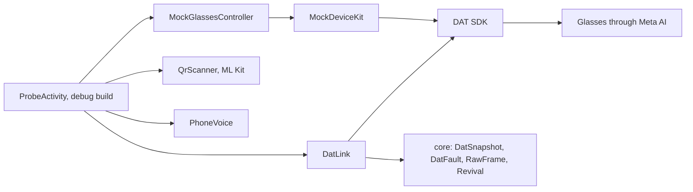
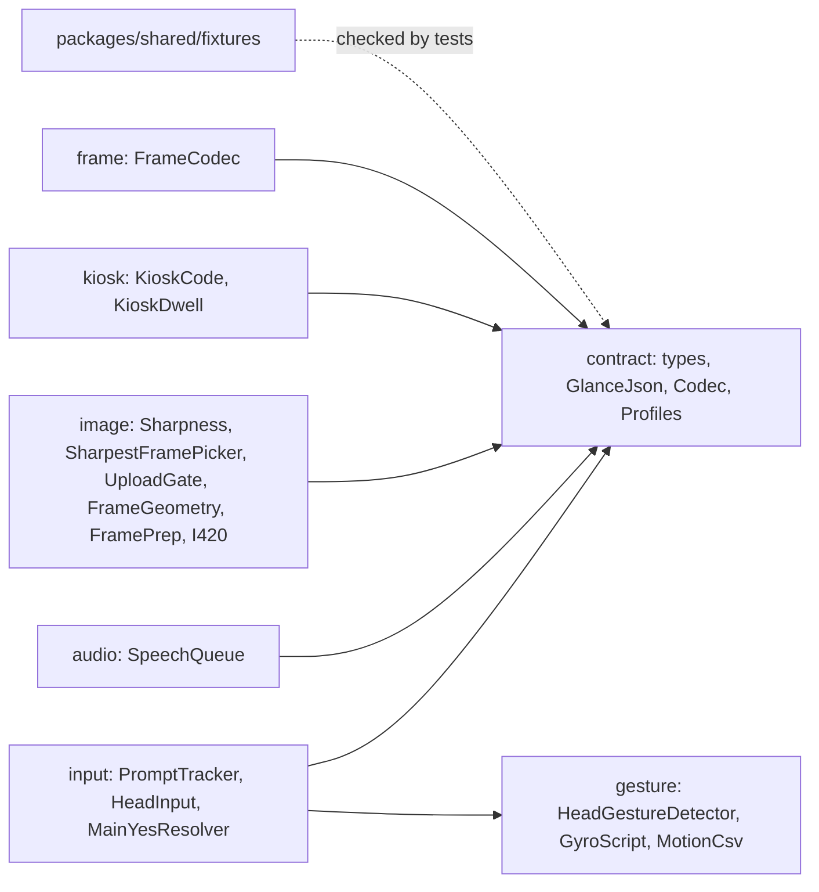

# Glance for Android

The Android app of Meta Glance. This folder holds a Gradle project with two modules.

- `core` is pure Kotlin on the JVM. It holds each rule that a unit test can check.
- `app` is the Android application `com.metaglance.android`. Its debug build holds the probe screen "Glance Probe".

The probe is the only screen at this time. It shows a list of buttons above a log. The debug APK has about 110 MB, because it holds the ML Kit models and the libraries of the DAT SDK. The probe writes each log line to Logcat with the tag `Glance`, and to `Android/data/com.metaglance.android/files/probe/probe-<start time>.log` on the phone.

## Parts

- `GlanceApp` owns one `DatLink` and one `MockGlassesController`.
- `DatLink` is the one connection to the DAT SDK. It gives a `snapshot` of the state, the `faults` of the SDK, and the `frames` of the stream. Call its functions on the main thread.
- A frame is a `RawFrame` in I420 layout. `frames` holds the newest frame only.
- `attachMotion`, `attachInputs`, and `attachSpeech` add a capability to a started session. `gyro`, `motionRows`, `touches`, and `transcripts` give their data.
- A capability that stops with no request from the app starts again, at most 3 times in a row. `Revival` in `core` holds this rule.
- `captureStill` takes a photo while the stream runs.
- `PhoneVoice` speaks a line with the speech engine of the phone, as media sound.
- `ProbeDecisions` holds the values that the probe run on the glasses decides: the capabilities that start, the input sources, and the gyroscope axes. Its values are defaults until that run.
- A stopped DAT session is final. `startSession` creates a new session each time.
- `MockGlassesController` pairs mock glasses of MockDeviceKit. Call `DatLink.initialize` after `enable` and after `disable`.

## The core module

`core` has no Android import and no DAT import. The app does not use these units yet, except `I420`, `RawFrame`, `GyroStats`, `MotionCsv`, `Revival`, and the gesture test of the probe.

| Package | Content |
|---|---|
| `contract` | The Kotlin mirror of `packages/shared`: one file for each TypeScript file, with the same type names and field names. `GlanceJson` is the one JSON format. `Codec` encodes and decodes the messages, and returns null for a message that it does not know. `Profiles.applyPatch` sets the keys of a profile patch. |
| `frame` | `FrameCodec` builds and reads the binary frame message: a 4-byte header length, the JSON header, the JPEG. |
| `kiosk` | `KioskCode` parses the QR text `GL1 <code>`. `KioskDwell` reports a kiosk code after 1500 ms in view, then one time each second. |
| `image` | `Sharpness` and `SharpestFramePicker` select the sharpest frame of each 500 ms. `UploadGate` gives the reason to skip an upload. `FrameGeometry` and `FramePrep` crop and scale a frame to a long side of 768 pixels at most. `I420.cropScaleToArgb` converts with BT.709 limited range. |
| `gesture` | `HeadGestureDetector` finds a nod and a shake in gyroscope samples. `HeadGestureConfig.of` gives the limits of the levels `GENTLE`, `NORMAL`, and `FIRM`. `GyroScript` builds samples of head movements for tests and for mock glasses. |
| `audio` | `SpeechQueue` plays one line at a time through a `LinePlayer`, with interrupt and priority. It reports each prompt whose line ended. A line with no clip uses the phone voice. |
| `input` | `PromptTracker` follows the prompts of the server. `HeadInput` turns a gesture into a yes or a no while the head window of a prompt is open. `MainYesResolver` selects the yes input that works. |

The detector cuts the angle of each axis into strokes. A nod is a stroke down and a stroke back up to the start, then quiet. A shake is two strokes to opposite sides.

### Tests of the contract

`FixturesTest` reads each file of `packages/shared/fixtures` and compares it with the Kotlin types. The Gradle build gives the folder to the test as the system property `glance.fixtures`. A new message variant in `packages/shared` needs its Kotlin class, or this test fails on the fixture count.

`MotionReplayTest` replays each motion recording in `core/src/test/resources/motion`. A file name ends with `__nod<n>_shake<n>.csv`, and the test expects these counts. The folder is empty until the probe run on the glasses.

## The probe

Open "Glance Probe" on the phone. The text field above the buttons gives the label of a saved frame and of a motion recording.

| Button | Action |
|---|---|
| `Bluetooth permission` | Asks for `BLUETOOTH_CONNECT`, then starts the DAT SDK |
| `Register` | Starts the registration in the Meta AI app |
| `Camera permission`, `Mic permission` | Asks for the DAT permission in the Meta AI app |
| `Start session`, `Start session (no camera)`, `Stop session` | Starts a session with or without the stream at 720 x 1280 and 7 frames per second, or stops it |
| `Save frame` | Saves the next frame as `probe/frames/<label>-<nn>.jpg` |
| `QR log` | Logs each QR code in the stream, at most 2 lines each second |
| `Motion`, `Inputs`, `Speech` | Adds the capability to the session. `Speech` needs the microphone permission. |
| `Speak line` | Speaks one product line with `PhoneVoice`. Logs the audio outputs, and the frame size before and after the line. |
| `Axis test` | Reads the gyroscope for 4 seconds. Logs the RMS rate of each axis, the strongest axis, and the sign of its first movement. |
| `Gesture test` | Runs the head gesture detector on the gyroscope with no head window. Logs each nod and each shake with a count. |
| `Still` | Takes a photo. Logs its size, its variant, and the time. |
| `Record motion` | Appends each motion sample to `probe/motion/<label>.csv`, in the CSV format of MockDeviceKit |
| `Endurance 10 min` | Speaks the line each 30 seconds. Logs battery, thermal level, frame count, frame size, and motion sample count each minute. |
| `Mock: enable and pair` | Enables MockDeviceKit and pairs mock glasses that are on, open, and on the face |
| `Mock: phone camera` | Uses the back camera of the phone as the stream of the mock glasses |
| `Mock: motion` | Feeds 60 samples with a gyroscope rate of 1 rad/s on the x axis, in a loop |
| `Mock: double tap`, `Mock: swipe` | Sends a select event and a navigation event from the touchpad |
| `Mock: say add` | Sends the final transcript "add" |
| `Mock: still image` | Uses the newest saved frame as the next photo |
| `Mock: disable` | Stops the session and disables MockDeviceKit |

The probe folder on the phone is `/sdcard/Android/data/com.metaglance.android/files/probe`. Get it with `adb pull` in PowerShell.

The second tap on `QR log`, `Gesture test`, `Record motion`, or `Endurance 10 min` stops it.

## Machine needs

- A JDK from 17 to 24. Gradle 8.14.1 does not run on JDK 25 or later.
- The Android SDK with Platform 36. Set `ANDROID_HOME` to its folder, or write `sdk.dir` in `local.properties`.
- A phone or an emulator with Android 10 or later, for the install only.

## Build commands

Run each command in `apps/mobile/android`. PowerShell uses `.\gradlew.bat` in place of `./gradlew`.

| Command | Result |
|---|---|
| `./gradlew --version` | Prints the JVM that Gradle uses |
| `./gradlew ktlintFormat` | Formats the Kotlin files |
| `./gradlew ktlintCheck` | Checks the Kotlin style. The pre-commit hook of the repository runs it. |
| `./gradlew :core:test` | Runs the unit tests of `core` |
| `./gradlew :core:test --tests "*gesture*"` | Runs the tests of one package |
| `./gradlew :app:assembleDebug` | Builds `app/build/outputs/apk/debug/app-debug.apk` |
| `./gradlew :app:installDebug` | Installs the debug build on each attached phone |

Run `ktlintFormat` and `ktlintCheck` as two commands. In one command, the check can read a file before the format task writes it.

## Keys of `local.properties`

Git ignores `local.properties`. Each key is optional.

| Key | Default | Use |
|---|---|---|
| `mwdat_application_id` | `0` | DAT application ID. `0` is Developer Mode. |
| `mwdat_client_token` | `0` | DAT client token. `0` is Developer Mode. |
| `glance.serverUrl` | `http://10.0.2.2:8080` | Address of the Glance server, as `BuildConfig.SERVER_URL` |
| `glance.uiDevUrl` | empty | Address of the dev server of the phone UI, as `BuildConfig.UI_DEV_URL` |

## Notes

- JDK: a terminal outside Android Studio needs `JAVA_HOME`. With Android Studio, its JDK is in `C:\Program Files\Android\Android Studio\jbr`. If `./gradlew --version` prints JVM 25 or later, select a JDK 21.
- `adb`: run each `adb` command that names a device path in PowerShell. Git Bash rewrites `/sdcard/...` to a Windows path.
- More than one phone: set `ANDROID_SERIAL` to the serial of the test phone, and pass `-s <serial>` to `adb`. Without it, `installDebug` installs on each attached phone.
