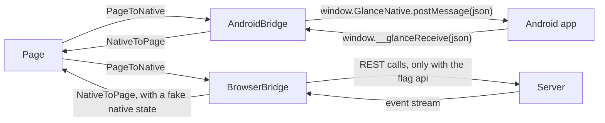
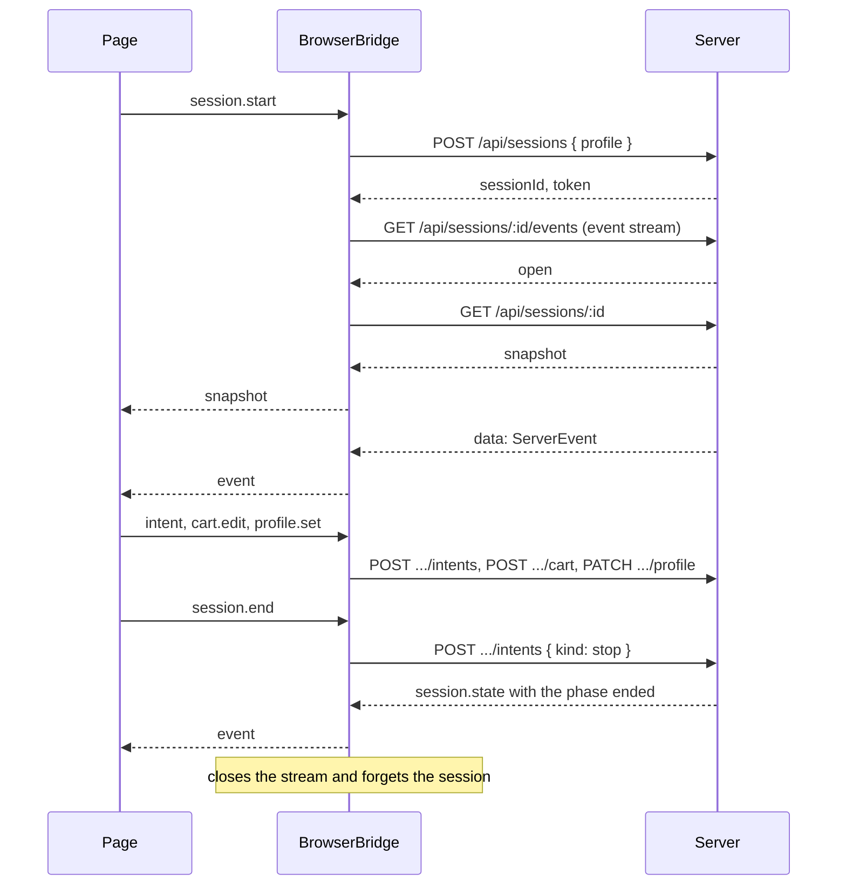
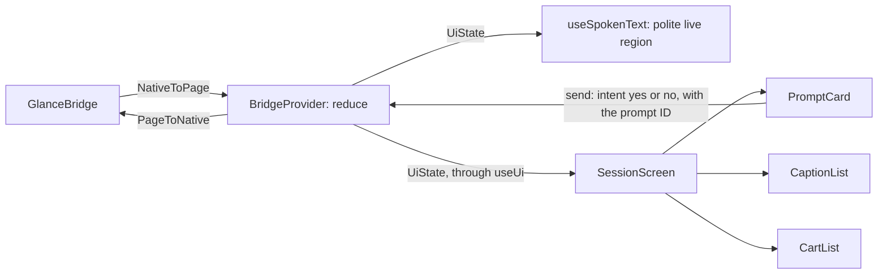
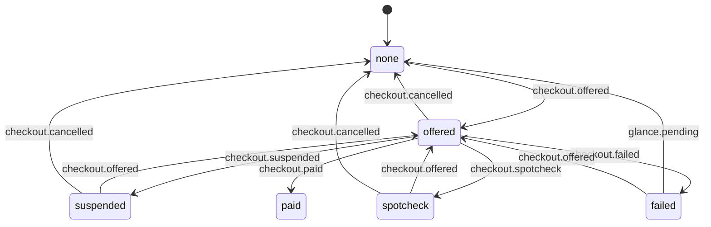

# @glance/phone-ui

The phone UI of Meta Glance: a Vite app with React 19 and Astryx. The Android app shows its build in a WebView. A desktop browser can also open it.

The app shows the session screen: the product card of the current prompt, the last spoken lines as text, and the cart. The setup screen, the checkout sheet, and the settings come with the later tasks of Plan 3.

## Run it

Run each command at the repository root, after `npm install`.

```bash
npm run dev --workspace @glance/phone-ui      # dev server on port 5173, on each network address of this machine
npm run build --workspace @glance/phone-ui    # writes apps/mobile/ui/dist
```

- The dev server listens on each network address, so that a phone on the same network can load it. To keep it on this machine only, run `npx vite --host 127.0.0.1` in `apps/mobile/ui`.
- The build uses relative asset paths (`base: './'`), so the Android app can load it from each asset path.
- The dev server uses port 5173 only. If the port is in use, the dev server stops with an error.

## Settings

| Setting | Default | Effect |
|---|---|---|
| `GLANCE_SERVER_ORIGIN` (environment) | `http://localhost:8080` | The dev server sends each `/api` request to this origin. |

## Bridges

The page has no network code of its own. Each action leaves through a `GlanceBridge` of `@glance/shared`, and each message for the page arrives through it. `createBridge(window, location.search)` in `src/bridge/createBridge.ts` selects the bridge.



- `AndroidBridge` serves the WebView. `createBridge` selects it when `window.GlanceNative` exists.
- `BrowserBridge` serves each other browser. It fakes the native state: the link step, the camera permission, and the session state.
- Both bridges drop text that is not JSON and a message that the shared package does not know.

Query flags of the page in a browser:

| Flag | Effect |
|---|---|
| none | No server and no network call. `session.start` gives a snapshot with the session ID `offline` and an empty cart. |
| `ready=1` | The page starts with the glasses linked and the camera allowed. |
| `api=<origin>` | `BrowserBridge` uses the server at this origin. `api=/` means the origin of the page, through the `/api` proxy of the dev server. |
| `replay=1` | The page plays `DEMO_RUN` of `src/debug/demoRun.ts`: one shop of 13 seconds, from the first glance to the payment. It needs no server. |

With `api`, `BrowserBridge` does these calls. Each call after the first carries `?token=<token>`.



Rules of `BrowserBridge` that a reader does not see at once:

- The stream opens before the snapshot loads, so that no event is lost between the two. Each new `open` of the stream loads the snapshot again.
- A stream error, or a call with no answer, sets `network` to `offline` in the fake native state. The next `open` of the stream sets `online`.
- An answer with a status of 400 or more logs `bridge: <method> <path> failed with <status>`. The line holds no token.
- Two fast `session.start` messages make one session. The fake native state says `starting` until the server answers.
- `data.delete` sends `DELETE /api/sessions/:id`, forgets the session, and sets the profile to the default.
- `bridge.sent` holds each message of the page. `bridge.inject(message)` delivers a message to the page. Tests and the debug panel use both.

In development, the bridge is `window.glanceBridge`. To try it, run this in the browser console:

```js
glanceBridge.subscribe(console.log);
glanceBridge.send({ t: 'ui.ready' });   // prints one native.state message and one profile message
```

Test tools: `src/test/fakes.ts` has `fakeFetch` and `fakeSources` (a fake `EventSource`). `src/debug/fixtures.ts` has the 16 event fixtures of `@glance/shared` as typed values (`eventFixture`, `eventMessage`, `SNAPSHOT`). It throws at load time if a fixture does not parse.

## State

`src/state/uiState.ts` holds the state of the page as one object, `UiState`. `reduce(state, action)` is a pure function. An action is a `NativeToPage` message of the bridge, or one of three local actions: `local.reset`, `local.profile`, and `local.attempt`.



- `BridgeProvider` in `src/bridge/BridgeContext.tsx` listens to the bridge, and then it sends `ui.ready`. A component reads the state and sends a message through `useUi()`. A component never calls `fetch`.
- The page never changes the cart. `reduce` stores the cart and the total that the server sends, and `CartList` shows that total.
- `glance.cleared` clears the prompt only if the IDs are equal. An event that ends a checkout clears only a pay prompt. So a newer product prompt stays when an older event arrives late.
- `PromptCard` sends one answer for each prompt ID, and then it disables both buttons. A second answer can undo an add on the server.
- A snapshot replaces the session data, and it clears the error, the budget warning, and the look-alike list.
- An error stays until a sign of recovery: a stream that starts, a new prompt, a snapshot, a payment, or `local.attempt`. `send` runs `local.attempt` before `setup.register`, `setup.requestCamera`, and `session.start`.
- The list of captions holds the last 20, and the screen shows the last 4. A caption with a known ID replaces the old one.
- `useSpokenText` announces each new caption, and the line `Cart: 2 items, 4.49 EUR.` after each cart change. It does not announce the captions of the snapshot that brings a session.
- Each string of the page is in `src/text/strings.ts`. `src/text/format.ts` formats an amount as `1.89 EUR`.

The field `checkout` follows the checkout events:



`reduce` does not test the old value of `checkout`, so each checkout event sets its value from each state. The diagram shows the order in which the server sends the events. A snapshot sets `offered` for a pay prompt, `paid` for the phase `paid` with a receipt, and `none` for each other case. No screen shows the pay prompt or the receipt yet.

Test tool: `renderWithUi(ui, { native, messages })` in `src/test/render.tsx` renders a component with a `BrowserBridge` that has no server. It returns `bridge`, `user`, and `deliver(...messages)`.

## Checks

```bash
npm test --workspace @glance/phone-ui         # Vitest with jsdom
npm run typecheck --workspace @glance/phone-ui
npx eslint apps/mobile/ui
```

`build` runs no typecheck, so run `typecheck` before each commit.

## Touch targets of 48 px

The design requires touch targets of 48 px or more. Astryx controls are 28, 32, and 36 px high.

- `src/styles/touch.css` raises the three Astryx height tokens to 48, 48, and 56 px, and gives each `Button` a minimum width of 48 px.
- `SegmentedControl` needs `size="lg"`. `CheckboxList` needs `density="spacious"`. A smaller variant is below 48 px.
- Do not use `Switch`, `Slider`, or a raw `button`. No rule covers them.
- jsdom has no layout, so a test cannot measure a control. `uncoveredTouchTargets(root)` in `src/test/touchTargets.ts` lists each control that none of these rules covers. A screen test expects an empty list.
- To measure in a browser, open the dev server and run this in the console. It must print `true`.

```js
[...document.querySelectorAll('.astryx-button')].map((b) => b.getBoundingClientRect()).every((r) => r.width >= 48 && r.height >= 48)
```

## Astryx

- The theme is the stock Neutral theme. `npx @astryxdesign/cli theme add neutral` wrote `src/astryx-themes.ts`. Do not edit that file.
- The app uses the prebuilt CSS of Astryx (`src/styles/globals.css`). It has no StyleX compiler, so `xstyle` does not work here.
- Before the first use of a component, run `npx @astryxdesign/cli component <Name>` in this folder.
- `AGENTS.md` holds the Astryx rules for agents, and the Glance rules that win over them.
- `src/test/render.tsx` exports `renderWithTheme`. Use it in each test that renders an Astryx component.
- `src/test/setup.ts` adds `showModal`, `show`, and `close` to the dialog element of jsdom, because `BottomSheet` and `AlertDialog` call them.
