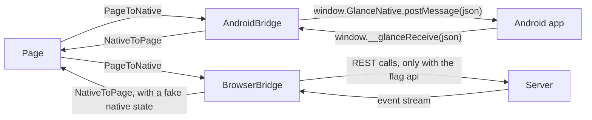
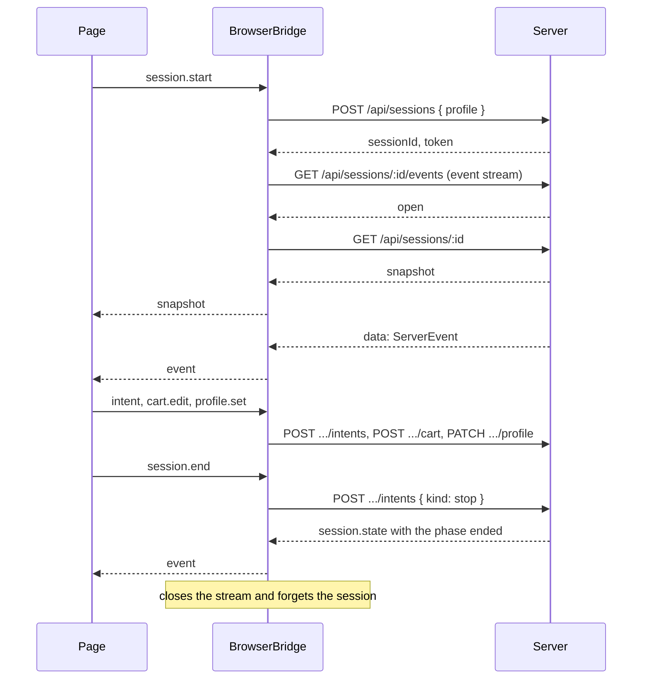

# @glance/phone-ui

The phone UI of Meta Glance: a Vite app with React 19 and Astryx. The Android app shows its build in a WebView. A desktop browser can also open it.

The app shows one heading and one button, and it makes its bridge at load. The screens come with the later tasks of Plan 3.

## Run it

Run each command at the repository root, after `npm install`.

```bash
npm run dev --workspace @glance/phone-ui      # dev server on port 5173, on each network address of this machine
npm run build --workspace @glance/phone-ui    # writes apps/mobile/ui/dist
```

- The dev server listens on each network address, so that a phone on the same network can load it. To keep it on this machine only, run `npx vite --host 127.0.0.1` in `apps/mobile/ui`.
- The build uses relative asset paths (`base: './'`), so the Android app can load it from each asset path.
- The dev server uses port 5173 only. If the port is in use, the dev server stops with an error.

## Settings

| Setting | Default | Effect |
|---|---|---|
| `GLANCE_SERVER_ORIGIN` (environment) | `http://localhost:8080` | The dev server sends each `/api` request to this origin. |

## Bridges

The page has no network code of its own. Each action leaves through a `GlanceBridge` of `@glance/shared`, and each message for the page arrives through it. `createBridge(window, location.search)` in `src/bridge/createBridge.ts` selects the bridge.



- `AndroidBridge` serves the WebView. `createBridge` selects it when `window.GlanceNative` exists.
- `BrowserBridge` serves each other browser. It fakes the native state: the link step, the camera permission, and the session state.
- Both bridges drop text that is not JSON and a message that the shared package does not know.

Query flags of the page in a browser:

| Flag | Effect |
|---|---|
| none | No server and no network call. `session.start` gives a snapshot with the session ID `offline` and an empty cart. |
| `ready=1` | The page starts with the glasses linked and the camera allowed. |
| `api=<origin>` | `BrowserBridge` uses the server at this origin. `api=/` means the origin of the page, through the `/api` proxy of the dev server. |

With `api`, `BrowserBridge` does these calls. Each call after the first carries `?token=<token>`.



Rules of `BrowserBridge` that a reader does not see at once:

- The stream opens before the snapshot loads, so that no event is lost between the two. Each new `open` of the stream loads the snapshot again.
- A stream error, or a call with no answer, sets `network` to `offline` in the fake native state. The next `open` of the stream sets `online`.
- An answer with a status of 400 or more logs `bridge: <method> <path> failed with <status>`. The line holds no token.
- Two fast `session.start` messages make one session. The fake native state says `starting` until the server answers.
- `data.delete` sends `DELETE /api/sessions/:id`, forgets the session, and sets the profile to the default.
- `bridge.sent` holds each message of the page. `bridge.inject(message)` delivers a message to the page. Tests and the debug panel use both.

In development, the bridge is `window.glanceBridge`. To try it, run this in the browser console:

```js
glanceBridge.subscribe(console.log);
glanceBridge.send({ t: 'ui.ready' });   // prints one native.state message and one profile message
```

Test tools: `src/test/fakes.ts` has `fakeFetch` and `fakeSources` (a fake `EventSource`). `src/debug/fixtures.ts` has the 16 event fixtures of `@glance/shared` as typed values (`eventFixture`, `eventMessage`, `SNAPSHOT`). It throws at load time if a fixture does not parse.

## Checks

```bash
npm test --workspace @glance/phone-ui         # Vitest with jsdom
npm run typecheck --workspace @glance/phone-ui
npx eslint apps/mobile/ui
```

`build` runs no typecheck, so run `typecheck` before each commit.

## Touch targets of 48 px

The design requires touch targets of 48 px or more. Astryx controls are 28, 32, and 36 px high.

- `src/styles/touch.css` raises the three Astryx height tokens to 48, 48, and 56 px, and gives each `Button` a minimum width of 48 px.
- `SegmentedControl` needs `size="lg"`. `CheckboxList` needs `density="spacious"`. A smaller variant is below 48 px.
- Do not use `Switch`, `Slider`, or a raw `button`. No rule covers them.
- jsdom has no layout, so a test cannot measure a control. `uncoveredTouchTargets(root)` in `src/test/touchTargets.ts` lists each control that none of these rules covers. A screen test expects an empty list.
- To measure in a browser, open the dev server and run this in the console. It must print `true`.

```js
[...document.querySelectorAll('.astryx-button')].map((b) => b.getBoundingClientRect()).every((r) => r.width >= 48 && r.height >= 48)
```

## Astryx

- The theme is the stock Neutral theme. `npx @astryxdesign/cli theme add neutral` wrote `src/astryx-themes.ts`. Do not edit that file.
- The app uses the prebuilt CSS of Astryx (`src/styles/globals.css`). It has no StyleX compiler, so `xstyle` does not work here.
- Before the first use of a component, run `npx @astryxdesign/cli component <Name>` in this folder.
- `AGENTS.md` holds the Astryx rules for agents, and the Glance rules that win over them.
- `src/test/render.tsx` exports `renderWithTheme`. Use it in each test that renders an Astryx component.
- `src/test/setup.ts` adds `showModal`, `show`, and `close` to the dialog element of jsdom, because `BottomSheet` and `AlertDialog` call them.
