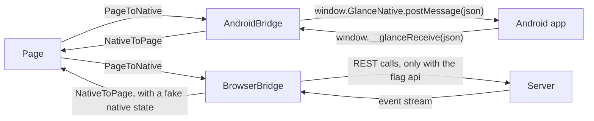
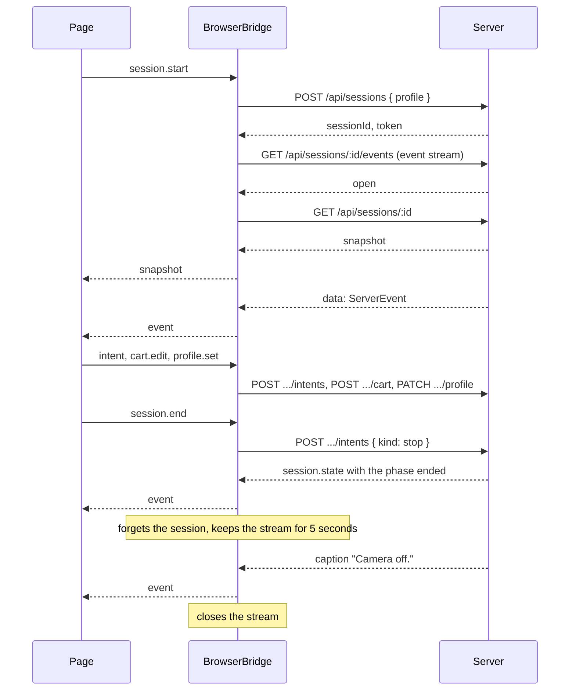
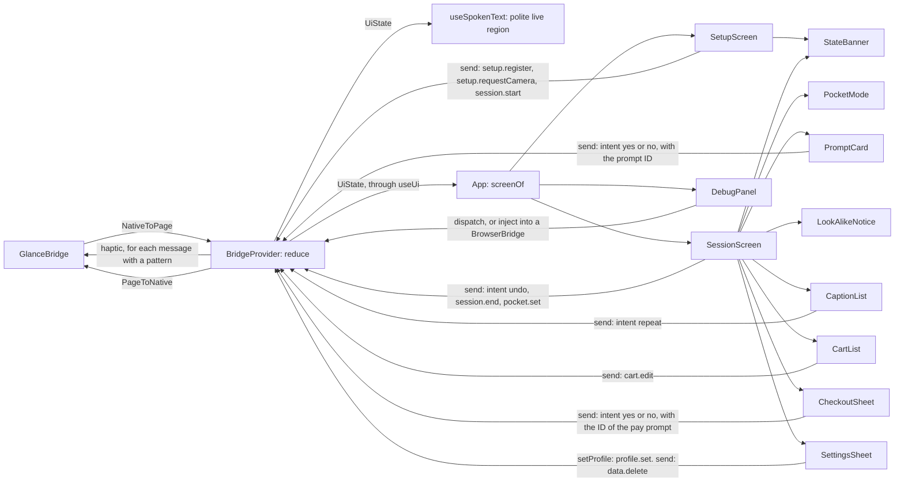
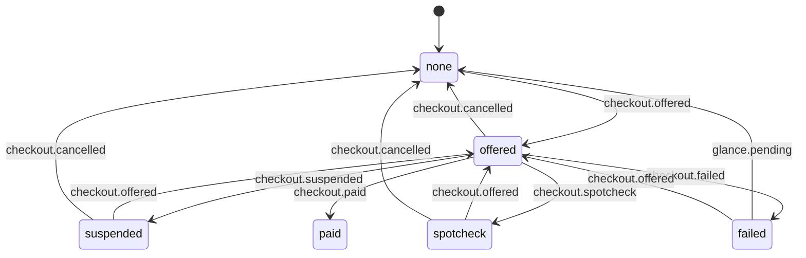
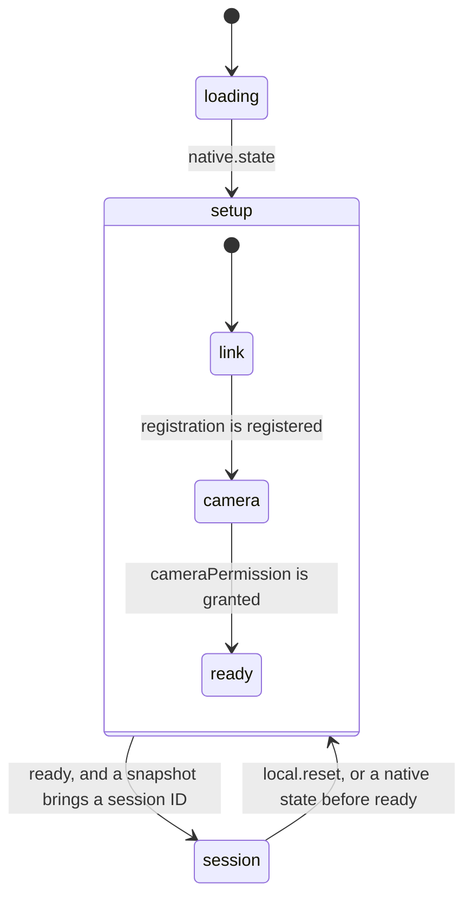

# @glance/phone-ui

The phone UI of Meta Glance: a Vite app with React 19 and Astryx. The Android app shows its build in a WebView. A desktop browser can also open it.

The app has two screens. The setup screen links the glasses and asks for the camera in three steps. The session screen shows the product card of the current prompt, the last spoken lines as text, the cart, the checkout sheet with the receipt, and the settings sheet. It has a phone button for each action of the shopper, and a pocket mode. One banner on each screen states the device and error states. A debug panel sends events into the page.

## Run it

Run each command at the repository root, after `npm install`.

```bash
npm run dev --workspace @glance/phone-ui      # dev server on port 5173, on each network address of this machine
npm run build --workspace @glance/phone-ui    # writes apps/mobile/ui/dist
```

- The dev server listens on each network address, so that a phone on the same network can load it. To keep it on this machine only, run `npx vite --host 127.0.0.1` in `apps/mobile/ui`.
- The build uses relative asset paths (`base: './'`), so the Android app can load it from each asset path.
- The dev server uses port 5173 only. If the port is in use, the dev server stops with an error.

## Settings

| Setting | Default | Effect |
|---|---|---|
| `GLANCE_SERVER_ORIGIN` (environment) | `http://localhost:8080` | The dev server sends each `/api` request to this origin. |

## Bridges

The page has no network code of its own. Each action leaves through a `GlanceBridge` of `@glance/shared`, and each message for the page arrives through it. `createBridge(window, location.search)` in `src/bridge/createBridge.ts` selects the bridge.



- `AndroidBridge` serves the WebView. `createBridge` selects it when `window.GlanceNative` exists.
- `BrowserBridge` serves each other browser. It fakes the native state: the link step, the camera permission, and the session state.
- Both bridges drop text that is not JSON and a message that the shared package does not know.

Query flags of the page in a browser:

| Flag | Effect |
|---|---|
| none | No server and no network call. `session.start` gives a snapshot with the session ID `offline` and an empty cart. |
| `ready=1` | The page starts with the glasses linked and the camera allowed. |
| `api=<origin>` | `BrowserBridge` uses the server at this origin. `api=/` means the origin of the page, through the `/api` proxy of the dev server. |
| `replay=1` | The page plays `DEMO_RUN` of `src/debug/demoRun.ts`: one shop of 13 seconds, from the first glance to the payment. It needs no server. |
| `debug=1` | The debug panel also shows inside the WebView. In a browser it shows with no flag. |
| `native=<key>` | The page starts in one native state of `NATIVE_PRESETS` in `src/bridge/fakeNative.ts`. It wins over `ready`. The keys are `ready`, `metaAiMissing`, `notRegistered`, `cameraDenied`, `glassesNotFound`, `updateRequired`, `paused`, `stopped`, `offFace`, `battery20`, `battery10`, `tooWarm`, `batteryFlat`, and `offline`. |

The session screen shows only with a session. So open `?replay=1&ready=1` for the session screen with the checkout sheet, and `?native=stopped&replay=1` for the banner of a stopped session.

With `api`, `BrowserBridge` does these calls. Each call after the first carries `?token=<token>`.



Rules of `BrowserBridge` that a reader does not see at once:

- The stream opens before the snapshot loads, so that no event is lost between the two. Each new `open` of the stream loads the snapshot again.
- A stream error, or a call with no answer, sets `network` to `offline` in the fake native state. The next `open` of the stream sets `online`.
- An answer with a status of 400 or more logs `bridge: <method> <path> failed with <status>`. The line holds no token.
- `session.state` with the phase `paid` or `ended` ends the session for the page at once: `sessionQuery()` gives null, and the fake native state says `stopped`. The server sends its last spoken line after that event, when the clip is ready. So the stream stays open for `LAST_LINE_GRACE_MS` (5000 ms) and delivers `caption` events only. The next `session.start`, `data.delete`, or a stream error closes it at once.
- Two fast `session.start` messages make one session. The fake native state says `starting` until the server answers.
- A `session.end` or a `data.delete` while `POST /api/sessions` is open makes that call stale. When the server answers with a session, the bridge sends `DELETE /api/sessions/:id` for it, and the page does not get it.
- `data.delete` sends `DELETE /api/sessions/:id`, forgets the session, and sets the profile to the default.
- `bridge.sent` holds each message of the page. `bridge.inject(message)` delivers a message to the page. Tests and the debug panel use both.

In development, the bridge is `window.glanceBridge`. To try it, run this in the browser console:

```js
glanceBridge.subscribe(console.log);
glanceBridge.send({ t: 'ui.ready' });   // prints one native.state message and one profile message
```

Test tools: `src/test/fakes.ts` has `fakeFetch` and `fakeSources` (a fake `EventSource`). `src/debug/fixtures.ts` has the 16 event fixtures of `@glance/shared` as typed values (`eventFixture`, `eventMessage`, `SNAPSHOT`). It throws at load time if a fixture does not parse.

## State

`src/state/uiState.ts` holds the state of the page as one object, `UiState`. `reduce(state, action)` is a pure function. An action is a `NativeToPage` message of the bridge, or one of three local actions: `local.reset`, `local.profile`, and `local.attempt`.



- `BridgeProvider` in `src/bridge/BridgeContext.tsx` listens to the bridge, and then it sends `ui.ready`. A component reads the state and sends a message through `useUi()`. A component never calls `fetch`.
- The page never changes the cart. `reduce` stores the cart and the total that the server sends, and `CartList` shows that total.
- `glance.cleared` clears the prompt only if the IDs are equal. An event that ends a checkout clears only a pay prompt. So a newer product prompt stays when an older event arrives late.
- `PromptCard` sends one answer for each prompt ID, and then it disables both buttons. A second answer can undo an add on the server.
- `PromptCard` shows one warning banner for each entry of `prompt.warnings`. `warningText` in `src/text/format.ts` writes the sentence that the voice speaks: "Warning: contains gluten and milk.", "Warning: not vegan.", or "Allergen data is missing for this product.". With no warning the card shows nothing, and it never says that a product is safe.
- The server sends `budget.exceeded` one time, when an add crosses the budget. `reduce` keeps the warning, and `CartList` shows "Warning: over your budget." with the total of the cart and the budget above the total. The warning ends when a `cart.updated` has a total at or under the budget, and when a new budget is `null` or not under the total.
- `glance.ambiguous` sets `lookAlikes`. While no product prompt is current, the prompt area shows `LookAlikeNotice`: "I cannot tell which product this is.", "Turn the front to me.", and the name and the pack size of each candidate. It shows no price, because the voice never guesses a price. The next `glance.pending`, the next `cart.updated`, and a snapshot clear it.
- `checkout.spotcheck` sets `spotCheck` to its product. While it is set, the session screen shows one info banner above the prompt area: "Quick check." and "Show me the <product>.". A product prompt keeps its card under the banner. `checkout.offered`, `checkout.cancelled`, `checkout.paid`, and a snapshot clear it.
- `useStrings()` gives the strings to a component that needs no other part of `useUi()`. With no `BridgeProvider` above, it gives the English strings.
- A snapshot replaces the session data, and it clears the error, the budget warning, and the look-alike list.
- A product of a barcode scan has the ID `gtin-<13 digits>`, and its name comes from Open Food Facts. The page handles it as each other product: it shows the name as the server sends it, and it sends the ID back in `cart.edit`. Such a name can have 80 characters, so the card, the cart, and the receipt wrap it and never cut it. `src/test/scanned.ts` has two such products for the tests.
- An error stays until a sign of recovery: a stream that starts, a new prompt, a snapshot, a payment, or `local.attempt`. `send` runs `local.attempt` before `setup.register`, `setup.requestCamera`, and `session.start`.
- The list of captions holds the last 20, and the screen shows the last 4. A caption with a known ID replaces the old one.
- `useSpokenText` announces each new caption, and the line `Cart: 2 items, 4.49 EUR.` after each cart change. It does not announce the captions of a snapshot, also when the snapshot loads again after a lost connection. `BridgeProvider` gives it the captions of the last snapshot.
- Each string of the page is in `src/text/strings.ts`: the table `EN`, and the table `IT` with the same keys. `stringsFor(lang)` selects the table of `profile.lang`, so a change of the language shows at once. `src/text/format.ts` formats an amount as `1.89 EUR` in both languages.
- `BridgeProvider` sets the `lang` attribute of the document to `profile.lang`. A screen reader selects its voice from it.
- These texts stay English in the Italian page: the words of Astryx itself (for example "completed" in the list of steps and "Clear" in the name of the clear button), and the debug panel. The page shows a caption as the server sends it, and the server writes it in the language of the profile. A product with no Italian text in the catalog keeps its English name.
- `src/text/strings.test.ts` expects an Italian text for each English text, and the copy rules in both tables. No native speaker has read the Italian table yet.

The field `checkout` follows the checkout events:



`reduce` does not test the old value of `checkout`, so each checkout event sets its value from each state. The diagram shows the order in which the server sends the events. A snapshot sets `offered` for a pay prompt, `paid` for the phase `paid` with a receipt, and `none` for each other case.

## Screens

`screenOf(state)` in `src/state/selectors.ts` selects the screen, and `App` renders it. `setupStepOf(native)` gives the setup step.



- `loading` shows until the host sends the first `native.state`.
- The list of steps shows only the three labels. The text and the button of the current step sit below the list, under a heading with the label of the step. Inside a vertical step the content is indented, and "Start shopping" did not fit at a root font size of 200 percent on a 360 px screen.
- Step 1, link: the page says that Meta AI opens, what to confirm there, and how to return. If the Meta AI app is missing, the step shows a link to its Play Store page (`META_AI_STORE_URL`). With no network it shows Try again. While the registration runs, it shows no button.
- Step 2, camera: the page states the purpose of the camera before it asks. A denied permission adds one line, and the button asks again.
- Step 3, ready: Start shopping sends `session.start`. The session screen shows when the snapshot arrives.
- `local.reset` returns to step 3. The Done button of the receipt, the banner of an ended session, and Delete my data run it.

### Phone buttons and haptics

Each action that the shopper can do with the head or the voice also has a button on the session screen.

| Button | Where | Sends |
|---|---|---|
| Ask, with a microphone icon and the name "Ask a question" | Action row. Shown in the phases `shopping` and `checkout`. | `ASK_MESSAGE` of `src/bridge/askMessage.ts`: `{ t: 'intent', kind: 'ask' }` |
| Undo | Action row. Hidden while the cart is empty. | `{ t: 'intent', kind: 'undo' }` |
| Repeat, with the name "Repeat the last line" | Under the captions. Hidden with no caption. | `{ t: 'intent', kind: 'repeat' }` |
| Remove, with the name "Remove <product>" | Each cart line | `{ t: 'cart.edit', productId, qty }` with one unit less. The quantity 0 removes the line. |
| Pocket mode | Action row | `{ t: 'pocket.set', on: true }` |
| End | Action row | Opens an `AlertDialog`. End sends `{ t: 'session.end' }`, and "Keep shopping" sends nothing. |

End asks first, because the server takes no input for a session that ended.

"Ask a question" needs no prompt ID. The Android app relays the intent, and `BrowserBridge` posts it as each other intent. The server opens a question window of 10 seconds for it and says "Listening." A browser has no microphone, so with `BrowserBridge` the window closes with no question.

`hapticFor(before, action, after)` in `src/state/haptics.ts` returns the pattern for one message, or `null`. `BridgeProvider` calls it for each message of the bridge and sends `{ t: 'haptic', pattern }` for a result. The Android app vibrates only for these messages.

| Message | Pattern |
|---|---|
| `glance.pending` with a warning | `warning` |
| `glance.pending` with no warning, `checkout.offered` | `prompt` |
| `cart.updated` with the change `add` or `remove` | `added` or `removed`. No pattern for the add that brings the total over the budget of the profile: `budget.exceeded` follows it |
| `budget.exceeded` | `warning` |
| `checkout.paid` | `paid` |
| `checkout.failed`, `error` | `error` |
| `native.state` with a stream that changes to `paused` | `cameraPaused` |
| `native.state` with a stream that changes from `streaming` or `paused` to `stopped` | `cameraOff` |

- Each other message gives no pattern: a caption, a snapshot, a `cart.updated` with no change, the first native state, and a native state with the same stream value.
- One event of the shop gives one pattern. `apps/server/README.md` lists each sound and each vibration with its trigger, in "A guard for the voice".
- With `profile.haptics` off, no message gives a pattern.
- `BridgeProvider` keeps the newest state in a ref. Two messages can arrive before the next render, and each pattern needs the state before its message.

### Pocket mode

The button "Pocket mode" sends `pocket.set` with `on: true`. `SessionScreen` then renders `PocketMode` in place of all its other content: a black screen in the dark mode of the theme, with the total of the server, the item count, and the button Unlock.

- Unlock opens an `AlertDialog`, and Leave returns to the session screen. The two taps are in two places, so a touch through cloth does not leave the mode.
- `PocketMode` sends `pocket.set` with `on: false` when it goes away: after Leave, and when the page changes the screen with no tap.
- The checkout sheet and the receipt do not show in pocket mode. The shopper pays with the head, and the receipt shows after Leave.
- The live region still announces each caption and each cart change, because `BridgeProvider` owns it.
- `src/styles/pocket.css` paints the screen black. No Astryx token is pure black.

### Debug panel

`App` renders `DebugPanel` after the screen when the bridge is a `BrowserBridge`, or when the address has `debug=1`. The button Debug opens a sheet that stays open after a tap. Its text is English only and is not in `strings.ts`.

| Part | Content |
|---|---|
| Events | One button for each of the 16 event types. A tap delivers that fixture of `@glance/shared`. |
| Native state | One button for each key of `NATIVE_PRESETS`. A tap delivers that native state. |
| Run | "Play the demo run" plays `DEMO_RUN`. Reset runs `local.reset`. |
| Sent | For a `BrowserBridge` only: the last 10 messages of the page as JSON, and `Session query: s=...&t=...` while a server session exists. |

- With a `BrowserBridge`, a tap delivers the message through `bridge.inject`. The message then takes the path of a message of the app, and the list Sent shows its haptic message. Inside the WebView, a tap runs `dispatch`, and the app gets no haptic message.
- The session query opens the mirror page of the website: `/mirror?<query>`.
- A sheet under another sheet measures smaller in the browser: a segment of the settings sheet gave 46 px under the checkout sheet, and 48 px alone. Measure a sheet only while it is the top one.

### Checkout sheet

`CheckoutSheet` is one Astryx `BottomSheet`. It is open while the prompt is a pay prompt, and while `checkout` is `paid`.

- The pay view names the kiosk, the store, the item count, and the total of the server. Pay sends `intent` with `yes` and the ID of the pay prompt. Cancel sends `no`.
- The server sends no event when a payment starts. So the sheet keeps its answer to each prompt ID: after Pay the button shows a spinner, and the sheet sends nothing more for that ID. A new `checkout.offered` has a new ID, and the sheet takes one answer again.
- With `needsBiometric` in the pay prompt, the pay view shows the info banner "Over fifty euros. Confirm with your fingerprint on the phone.", and the pay button has the name "Pay with fingerprint". Its visible text stays "Pay", because the full name is cut at a font scale of 200 percent. The button sends the same yes. The page shows no fingerprint prompt of its own.
- After Cancel the sheet closes at once. A dismissed pay view (the back key, Escape) counts as Cancel. A dismissed sheet after Pay sends nothing.
- An `error` event shows inside the pay view, because the main screen is under the sheet then.
- The receipt view shows the total, the kiosk, each line, the order ID, the time, and the line "Demo payment. No money moved.". Done runs `local.reset`.

### Settings sheet

The Settings button of the session screen opens `SettingsSheet`. `useUi().setProfile(patch)` shows the new value at once (`local.profile`) and then sends `profile.set` with the same patch. The host answers with the full profile.

| Preference | Control | Patch |
|---|---|---|
| Voice detail | 3 segments | `{ detail }` |
| Speech speed | 5 segments, one for each value of `SPEECH_RATES` | `{ speechRate }` |
| Head gestures, haptics | 2 checkboxes | `{ headGestures }` or `{ haptics }`: only the key that changed |
| Gesture meaning | 2 segments | `{ yesGesture }` |
| Head window | 3 segments | `{ headWindowMs }`: 8000, 15000, or `null` for "While in view" |
| Main yes input | 5 segments | `{ mainYes }` |
| Allergens | 14 checkboxes, one for each value of `EU_ALLERGENS` | `{ allergens }`: the full new list, in the order of `EU_ALLERGENS` |
| Diet | 2 checkboxes: Vegan, Vegetarian | `{ vegan }` or `{ vegetarian }`: only the key that changed |
| Budget | A number input in whole euros, from 1, with a clear button | `{ budgetCents }`: the value times 100, or `null` after Clear Budget |
| Language | 2 segments: English, Italiano. Each name is in its own language (`LANGUAGE_NAMES`). | `{ lang }` |

- A speech rate that is not in `SPEECH_RATES` marks the nearest value.
- Play sample sends `intent` with the kind `help`. The bridge has no message for a speech sample, so the voice speaks the help line at the new speed.
- Delete my data asks in an `AlertDialog`. Delete sends `data.delete`, runs `local.reset`, and closes the dialog and the sheet.
- The last line of the sheet is the attribution that the Open Database License asks for: "Product data: Open Food Facts (ODbL)", and a link to `https://openfoodfacts.org` (`OPEN_FOOD_FACTS_URL`). The link has the name "Open website of Open Food Facts" and the visible text "Open website", because a longer text is cut at a font scale of 200 percent. In the WebView the link has no `target`, and the Android app opens it outside the app, as it does for the Play Store link of the setup screen. With a `BrowserBridge` the link has `target="_blank"` and opens a new tab, because a page that goes to another address loses its session.
- `src/styles/narrow.css` sets the inline padding of a segment to 4 px. With the stock 12 px, "While in view" and "Phone" are cut at a width of 360 px. The Italian table uses "In vista" and "App" there, because "Telefono" is cut also with 4 px.

### State banner

`bannerOf(state, strings)` in `src/state/banner.ts` returns one banner or `null`. `StateBanner` renders it as the first child of each screen. Before setup is done, only the row `error` applies, because the setup steps show the other states. After that, the first row that applies wins:

| ID | Condition | Action |
|---|---|---|
| `paymentFailed` | `checkout` is `failed` | |
| `serverUnreachable` | `network` is `offline` | |
| `regularCheckout` | `session` is `stopped`, and the battery is 5 percent or less or the thermal level is 6 or more | |
| `glassesNotFound` | no device, or its link is `disconnected` | |
| `updateRequired` | `device.updateRequired` | "Open the update in Meta AI" sends `setup.openUpdate` |
| `ended` | the phase is `ended` | "Start a new shop" runs `local.reset` |
| `resting` | the phase is `resting` | "Start camera" sends `session.start` |
| `stopped` | a session exists, `session` is `stopped`, and the phase is not `paid` | "Start camera" sends `session.start` |
| `paused` | `session` or `stream` is `paused` | |
| `offFace` | `device.worn` is `false` | |
| `error` | an error is set | |
| `batteryLow` | the battery is 20 percent or less | |

- The title and the description of a banner together hold the spoken line of the design. The texts are in `src/text/strings.ts` under `banner`.
- `NativeState` has no cause for a stopped stream. So `regularCheckout` uses the limits of the server: `REGULAR_CHECKOUT_BATTERY` and `REGULAR_CHECKOUT_THERMAL`. The `stopped` banner shows the message of an `error` event of the app as its cause.
- `StatusRow` shows four statuses as words under the heading of the session screen: glasses, battery, camera, and network.

Test tool: `renderWithUi(ui, { native, messages })` in `src/test/render.tsx` renders a component with a `BrowserBridge` that has no server. It returns `bridge`, `user`, and `deliver(...messages)`.

## Checks

```bash
npm test --workspace @glance/phone-ui         # Vitest with jsdom
npm run typecheck --workspace @glance/phone-ui
npx eslint apps/mobile/ui
```

`build` runs no typecheck, so run `typecheck` before each commit.

## Accessibility checks

`src/a11y.test.tsx` opens 12 scenes of the app: the setup steps, the session, the checkout sheet, the receipt, the settings sheet, the end dialog, pocket mode, a banner with an action, and the debug panel. For each scene it expects one `main` landmark, one `h1`, a name for each control, no control that the 48 px rules do not cover, and no `Switch`, `Slider`, or `StatusDot`. One more test expects that the assertive live region stays empty.

jsdom has no layout and no colors. Measure these three in a browser, at 360 x 800 px with a touch device, on `?replay=1&ready=1`:

1. Touch targets, with Settings open. The line must print `[]`.

```js
[...document.querySelectorAll('.astryx-button, .astryx-segmented-control-item, li.astryx-list-item:has(input)')]
  .map((el) => [el, el.getBoundingClientRect()])
  .filter(([, box]) => box.width > 0 && (box.width < 48 || box.height < 48))
  .map(([el, box]) => `${el.textContent.trim()} ${Math.round(box.width)}x${Math.round(box.height)}`)
```

2. Font scale. Assign `'200%'` to `document.documentElement.style.fontSize` on each screen and each sheet. No element may end to the right of 360 px, and no label may be cut. Do not test with `scrollWidth <= innerWidth` in the device toolbar: with a mobile viewport both numbers grow together.
3. Contrast: the Lighthouse accessibility audit of the browser, in light mode and in dark mode.

On 2026-11-14 headless Chrome ran check 2 with two scanned products (names of 80 characters with accents, one with a word of 33 characters), in English and in Italian, at 100 and at 200 percent. On the product card, the cart, the checkout sheet, the receipt, and the attribution of the settings sheet, no element ended to the right of 360 px and no text was cut. A word that is longer than a line breaks inside the word.

## Touch targets of 48 px

The design requires touch targets of 48 px or more. Astryx controls are 28, 32, and 36 px high.

- `src/styles/touch.css` raises the three Astryx height tokens to 48, 48, and 56 px, and gives each `Button` a minimum width of 48 px.
- `src/styles/touch.css` also sets the clear button of an input to a height of 48 px. Its stock height is 20 px, and Astryx grows its hit area to 44 px at most. In Chrome at 360 px the button "Clear Budget" then measured 48 x 48 px.
- `SegmentedControl` needs `size="lg"`. `CheckboxList` needs `density="spacious"`. A smaller variant is below 48 px.
- Do not use `Switch`, `Slider`, or a raw `button`. No rule covers them.
- jsdom has no layout, so a test cannot measure a control. `uncoveredTouchTargets(root)` in `src/test/touchTargets.ts` lists each control that none of these rules covers. A screen test expects an empty list.
- To measure in a browser, open the dev server and run this in the console. It must print `true`.

```js
[...document.querySelectorAll('.astryx-button')].map((b) => b.getBoundingClientRect()).every((r) => r.width >= 48 && r.height >= 48)
```

## Astryx

- The theme is the stock Neutral theme. `npx @astryxdesign/cli theme add neutral` wrote `src/astryx-themes.ts`. Do not edit that file.
- The app uses the prebuilt CSS of Astryx (`src/styles/globals.css`). It has no StyleX compiler, so `xstyle` does not work here.
- Before the first use of a component, run `npx @astryxdesign/cli component <Name>` in this folder.
- `AGENTS.md` holds the Astryx rules for agents, and the Glance rules that win over them.
- `src/test/render.tsx` exports `renderWithTheme`. Use it in each test that renders an Astryx component.
- `src/test/setup.ts` adds `showModal`, `show`, and `close` to the dialog element of jsdom, because `BottomSheet` and `AlertDialog` call them.
