# @glance/server

The server of Meta Glance. One Node process runs TypeScript sources with `tsx`. The message types come from `@glance/shared`.

This file describes only the parts that exist. The plan is `docs/superpowers/plans/2026-11-14-glance-1-server.md`.

## What exists

| Path | Content |
|---|---|
| `src/config.ts` | `loadConfig` reads the settings from the environment and the command line. |
| `src/app.ts` | `buildApp` makes the Fastify app: the CORS headers, the JSON error bodies, the request log with no query string, `GET /healthz`, the paths, and the device socket. |
| `src/bus.ts` | `EventBus` delivers messages inside the process, by topic. |
| `src/clock.ts` | The time source of the runtime. |
| `src/main.ts` | Opens the store, starts the server, and closes it on `SIGTERM` and `SIGINT`. |
| `src/catalog/catalog.ts` | `readCatalogFile` reads a catalog file, and `indexCatalog` finds a product by its ID. |
| `src/catalog/check.ts` | `checkCatalog` finds the errors of a catalog file. See "Catalog". |
| `scripts/catalog-check.ts`, `scripts/catalog-seed.ts` | `npm run catalog:check` and `npm run catalog:seed`. See "Catalog". |
| `catalog/catalog.dev.json` | The dev catalog with four products. The tests use its IDs and prices. |
| `catalog/store-list.dev.json` | The dev store list: 10 real barcodes with invented prices. See "Barcode scan". |
| `catalog/catalog.demo.json`, `catalog/store-list.demo.json` | The files of a demo with real products: a catalog with no invented product, and the store list of the products on the demo table. See "A demo with real products". |
| `src/products/` | The store list, the product details of Open Food Facts, and the lookup of a barcode. See "Barcode scan". |
| `src/label/` | The model call that reads the still of a label, and its match against the store list. See "Label frames". |
| `src/reference/images.ts` | `ReferenceImages`: the reference pictures of the store items, as a folder. See "Reference pictures". |
| `scripts/reference.ts` | `npm run reference`: takes a reference picture through the glasses of a running server. See "Reference pictures". |
| `agents/label.md` (repository root) | The instruction for the label call, with the placeholder `{{storeList}}`. |
| `fixtures/product-info/` | One saved answer of Open Food Facts for each item of the dev store list. `FAKE_PRODUCT_INFO` and the tests read them. |
| `catalog/catalog.json` | The 12 product slots of the demo, with `FILL_` texts and the price 0. A person fills them, and `catalog:check` reports each price of 0 as an error. |
| `src/recognition/` | The recognition of a frame, and the script player that stands in for it. See "Recognition" and "Fake mode". |
| `agents/recognition.md` (repository root) | The instruction for the recognition model, with the placeholders `{{catalog}}` and `{{storeItems}}`. |
| `fixtures/fake-script.json` | The default script of fake recognition. |
| `scripts/check-model.ts` | `npm run model:check`: a check of the model ID with the real service. |
| `src/ask/` | The answer to a spoken question about one product. See "Questions about a product". |
| `agents/answers.md` (repository root) | The instruction for the model that answers a question. |
| `scripts/check-ask.ts` | `npm run ask:check`: one question to the real service. See "Checks". |
| `scripts/replay.ts` | `npm run replay`: the accuracy of the real service on a folder of frames. See "Replay a test set". |
| `scripts/live-probe.ts` | `npm run live:probe`: the delay and the answers of a Gemini Live session on saved frames. See "Measured: a Gemini Live session". |
| `scripts/smoke.ts` | `npm run smoke`: a check of a running server through its REST paths, its device socket, and its events stream. See "Checks". |
| `src/sessions/` | The cart rules as the pure function `step`, the session runtime, and the registry. See "Rules" and "Session runtime". |
| `src/speech/` | The text of each spoken line, and the speech clips. See "Spoken text" and "Speech clips". |
| `src/kiosk/` | The kiosks and the mock payment. See "Kiosk and payment". |
| `src/db/` | The `Store` interface with a memory store and a MongoDB store. See "Storage". |
| `src/http/` | The session paths, the kiosk paths, the speech path, the demo path, the events streams, and the token check. See "REST paths". |
| `src/ws/device.ts` | The socket of the phone. See "Device socket". |
| `src/testing.ts` | Test helpers: an app on a free port, a reader for an events stream, and a phone on the device socket. |

## Run it

Run `npm install` at the repository root first. Then run the commands in `apps/server`, or add `--workspace @glance/server` at the root.

```bash
npm run dev:fake    # port 8080, the three fake switches on, needs no key and no database
npm run dev         # reads .env if the file exists, and restarts on a change
npm start           # runs with the environment of the shell
PORT=18473 npm run dev:fake   # another port, when 8080 is in use
```

Check it:

```bash
curl http://localhost:8080/healthz
# {"ok":true,"fakeRecognition":true,"fakeSpeech":true,"fakeProductInfo":true,"store":"memory","saveFrames":false}
curl -X POST http://localhost:8080/api/sessions
# {"sessionId":"...","token":"...","wsUrl":"ws://localhost:8080/ws/device?session=...&token=..."}
```

At the start the server logs `store: memory` or `store: mongo`, the number of products, `store list: <path>, <n> items`, `reference pictures: <dir>, <n> items, <m> pictures, <k> in a frame call`, `product info: fake` or the address of Open Food Facts, `recognition: fake` or the model, and `speech: fake` or the speech model. With real product details it also logs the start and the end of the warm-up of the product cache. See "Product details from Open Food Facts".

With real recognition and real speech (`npm run dev` with both keys in `.env` and both fake switches empty), each frame is one paid Gemini call, and each new line is one paid ElevenLabs call. A phone sends one frame each 150 ms, and at most one label still each 6 seconds with the default still gap of the app.

## Settings

`.env.example` lists each variable. Copy it to `.env`. Git ignores `.env`, and the pre-commit hook stops a commit that holds one.

| Variable | Default | Meaning |
|---|---|---|
| `PORT` | `8080` | The port. The server listens on each network interface. |
| `PUBLIC_BASE_URL` | `http://localhost:<PORT>` | The address that clients use. |
| `MONGODB_URI` | not set | With no address, the server keeps its data in memory. |
| `MONGODB_DB` | `glance` | The database name. |
| `CATALOG_PATH` | `catalog/catalog.dev.json` | The catalog file. |
| `GEMINI_API_KEY` | not set | Needed when `FAKE_RECOGNITION` is off. |
| `GEMINI_MODEL` | `gemini-3.5-flash-lite` | The recognition model. |
| `GEMINI_MEDIA_RESOLUTION` | `default` | `default` or `low`. |
| `RECOGNITION_CONCURRENCY` | `8` | An integer from 1 to 12. The number of recognition calls that one session runs at the same time. See "Recognition". |
| `RECOGNITION_REFERENCES` | `3` | An integer from 0 to 3. The number of reference pictures of one store item in each recognition call for a frame. `0` means none. See "Reference pictures in a frame call". |
| `RECOGNITION_MIN_CONFIDENCE` | `0.6` | A number from 0 to 1. An `identified` answer below it counts as `unsure`. |
| `LABEL_MIN_CONFIDENCE` | `0.7` | A number from 0 to 1. The label call chooses one item of the store list, and the server takes it from this confidence on. See "Label frames". |
| `REQUIRE_BLUR` | off | `1` means on. The server then drops each frame that the phone sent with `blurred: false`. |
| `FAKE_RECOGNITION` | off | `1` selects `fixtures/fake-script.json`. Each other value is the path of a script file. |
| `FAKE_SPEECH` | off | `1` means on. |
| `ELEVENLABS_API_KEY` | not set | Needed when `FAKE_SPEECH` is off. |
| `ELEVENLABS_VOICE_EN` | not set | Needed when `FAKE_SPEECH` is off. |
| `ELEVENLABS_VOICE_IT` | not set | The voice for Italian lines. With no value, they get the English voice. |
| `SPEECH_CACHE_DIR` | `.cache/speech` | The folder for speech clips. |
| `SAVE_FRAMES` | not set | A directory for frames. When it is set, the server writes each frame there. See "Stored frames". Keep it not set for the demo and on the deployed server. |
| `PAYMENT_DELAY_MS` | `1500` | The length of the mock payment. |
| `SECOND_LOOK_WAIT_MS` | `0` | How long the look-alike line waits for the result of a still, in milliseconds, from 0 to 10000. `0` means off. See "Sharp second look". |
| `BIOMETRIC_ABOVE_CENTS` | not set | A total above this number of cents needs a fingerprint check on the phone before the payment. An integer from 0 to 100000000. With no value, no payment needs a fingerprint. See "Fingerprint above a limit". |
| `DEMO_KEY` | not set | The key of the paths under `/api/demo`. With no key, those paths answer 404. |
| `REFERENCE_DIR` | `catalog/reference` | The folder with the reference pictures of the store items. See "Reference pictures". |
| `STORE_LIST_PATH` | `catalog/store-list.dev.json` | The items that the store sells, with the barcode and the price of each. See "Barcode scan". |
| `FAKE_PRODUCT_INFO` | off | `1` means on. The server then reads the details of a scanned product from `fixtures/product-info`. |
| `OFF_BASE_URL` | `https://world.openfoodfacts.org` | The address of Open Food Facts. It must start with `http://` or `https://`. |
| `PRODUCT_INFO_USER_AGENT` | `MetaGlance/0.1 (https://github.com/mrBymax/glance)` | The `User-Agent` of each call to Open Food Facts: the name of the app, its version, and a contact. |
| `PRODUCT_CACHE_DIR` | `.cache/products` | The folder for the answers of Open Food Facts. |

- An empty value counts as not set.
- The flag `--fake` turns the three fake switches on. A variable that is set wins over the flag.
- Each path is relative to the working directory, which is `apps/server`. The server also reads `../../agents/recognition.md`, `../../agents/answers.md`, and `../../agents/label.md` from there when recognition is real.
- With a missing key the server prints `config: <message>` and exits with code 1. The message names the variable and the switch that removes the need. Open Food Facts needs no key.
- A store list file that the server cannot use stops the start. The message names the file and the entry.
- With `MONGODB_URI` the products come from the database, and `CATALOG_PATH` has no effect. If the database holds no product, the server prints `products is empty. Run npm run catalog:seed.` and exits with code 1. See "Catalog" for the seed.

## Fake mode

Three switches let the other apps work with no key and no call to another service. `npm run dev:fake` turns each one on.

`FAKE_RECOGNITION`:

- The server makes no Gemini call and does not read `GEMINI_API_KEY`.
- A question about a product gets the answer "I do not have that information.", or "Non ho questa informazione." for the profile language `it`.
- One script player runs for each session. It starts when the phone opens the device socket, or when the first client opens the events stream of the session, whichever comes first.
- Each 150 ms the player gives the rules the result that the script holds for the time since its start. Outside each step the result is `none`.
- A session that starts from the events stream, with no phone, first gets the state of glasses that stream. A browser client then gets the "Camera on" caption. A phone that opens its socket to this session later hears "Back online.", because the session already has a device state.
- In a `kiosk` step the session sees the kiosk one time each second. `"newest"` names the kiosk that registered last. Each other value is a kiosk code.
- In a `barcode` step the session gets the code one time each second, as `barcode.seen` of a phone with the source `barcode`.
- A `result` step can set `code`, with `visible` and `digits`. Digits go to the lookup with the source `model`.
- A `result` step with the status `unknown` or `unsure` asks a phone for a still after its second frame, as real recognition does. The unknown line waits for that still. See "A product that sight cannot name".
- The device socket still decodes each frame. It logs `frame seq=<n> w=<w> h=<h> blurred=<b> kind=<k> bytes=<n>` at `info` level and drops the frame. With `SAVE_FRAMES` it saves the frame first.
- A frame with the kind `label` goes to a fake label reader. Its answer is the field `label` of the script. With no such field it reads nothing. See "Label frames".
- The server has one kiosk from the start: `Checkout 3` at `Demo Market` with the code `K3X7`. A printed `GL1 K3X7` code starts a checkout.

A script file, as `fixtures/fake-script.json`:

```json
{
  "loop": true,
  "lengthMs": 60000,
  "steps": [
    { "atMs": 3000, "forMs": 6000, "result": { "status": "identified", "productId": "oat-drink-1l" } },
    { "atMs": 10000, "forMs": 3000, "barcode": "8076800195057" },
    { "atMs": 24000, "forMs": 3000, "result": { "status": "unsure", "aimHint": "left" } },
    { "atMs": 40000, "forMs": 15000, "kiosk": "newest" }
  ]
}
```

- A step covers the times from `atMs` up to, and not including, `atMs + forMs`. With `loop`, the script starts again after `lengthMs`.
- A `result` holds some fields of a recognition result. The other fields come from the empty result, with the confidence 0.95.
- A `barcode` holds 8 to 14 digits. The script does not check them: a code with a wrong check digit, and a code that the store does not sell, are valid steps.
- The optional field `label` beside `steps` holds `digits`, `brand`, `name`, `packSize`, and `confidence`. It can also hold `item` and `itemConfidence`: with none, they are `null` and 0.
- A product ID is an ID of the catalog, or `gtin-<13 digits>` for an item of the store list that the catalog does not hold.
- A file that is no script, an unknown key, and a product ID that the catalog and the store list do not have stop the server at its start. The message names the file and the step, counted from 1.

`FAKE_PRODUCT_INFO`:

- The server makes no call to Open Food Facts.
- The details of a scanned product come from `fixtures/product-info/<13 digits>.json`. Each file is a saved answer of Open Food Facts, with the fields that the server reads.
- A code with no file counts as "not found": the product then has no allergen data.
- The store list is real in each mode. It is a file, and it needs no service.

`FAKE_SPEECH`:

- The server makes no ElevenLabs call and reads no ElevenLabs variable.
- Each `speak` message and each `caption` event has `url: null`. The `text` is the real line. The phone reads it with its own voice.
- `GET /api/speech/<hash>.mp3` answers 404.

Try the fake server with no phone. The second call prints the events of the script:

```bash
curl -s -X POST http://localhost:8080/api/sessions -H "content-type: application/json" -d "{}"
curl -N "http://localhost:8080/api/sessions/<sessionId>/events?token=<token>"
# after 3 seconds: glance.pending for the oat drink. Answer it with its promptId:
curl -s -X POST "http://localhost:8080/api/sessions/<sessionId>/intents?token=<token>" -H "content-type: application/json" -d '{"kind":"yes","source":"phone","promptId":"<promptId>"}'
# at second 10: glance.pending for the barcode of the Barilla spaghetti. See "Barcode scan".
# at second 33: glance.ambiguous for the two oat drinks.
# at second 40: checkout.offered. The same call with its promptId gives checkout.paid.
```

## Recognition

With `FAKE_RECOGNITION` off, each frame of the phone goes to Gemini, and the answer goes to the rules.

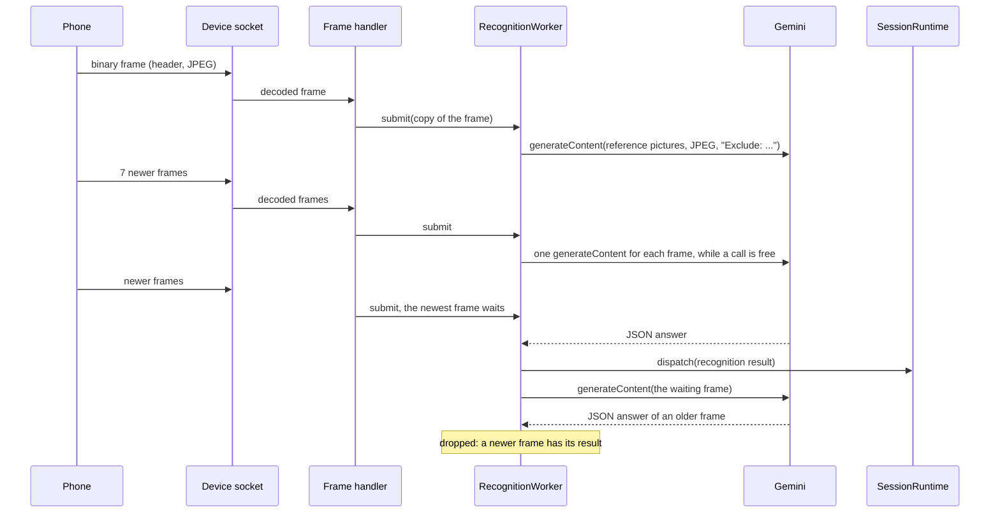

| File in `src/recognition` | Content |
|---|---|
| `result.ts` | `RecognitionResult` with the code of the frame, and `normalizeResult`, which checks an answer of the model |
| `prompt.ts` | The system instruction with the catalog and the store items, the JSON Schema of the answer, and the text of a request |
| `gemini.ts` | `createGeminiRecognizer`: one `generateContent` call of `@google/genai` for each frame |
| `references.ts` | `createFrameReferences`: the parts of the reference pictures that each frame call starts with, and `createPictureUploader` |
| `worker.ts` | `RecognitionWorker`: the calls of one session |
| `intake.ts` | `createFrameHandler`: one worker for each session, between the device socket and the rules |
| `save.ts` | `createFrameSaver`: the writer of the `SAVE_FRAMES` switch |
| `fake.ts` | The script file and `ScriptPlayer` of fake recognition |
| `replay.ts` | `listFrames`, `replayFrames`, `summarize`, and `formatTable` of the replay tool |
| `liveReport.ts` | The function `report_view` of a Gemini Live session, its instruction, and the answer that a call gives. Only `scripts/live-probe.ts` uses it |

The request:

- The system instruction is `agents/recognition.md` with one line for each product in place of `{{catalog}}`: ID, name, brand, pack size, look, and look-alikes. It holds no price.
- `{{storeItems}}` gets one line for each item of the store list that the catalog does not hold: the ID `gtin-<13 digits>`, the name, and the brand and the pack size when the store list or the product cache has them. A store item has no look. The instruction says that the package text can be in another language than the name, and that a similar product is no match. See "Recognition knows the store list".
- The answer is JSON with the six fields of spec section 11.1 and the field `code`. Its schema lets `productId` and `candidates` take only the IDs of the catalog and of the store items. With no ID at all, `productId` can only be `null`.
- `code` is `{ visible, digits }`: the barcode of the frame, as the model sees it. See "The model also reads the code".
- The text part is `Exclude: none.` or `Exclude: <id>, <id>.`, with the products that the shopper skipped in the last 10 seconds (R9).
- With reference pictures, the request starts with them, and the instruction gets their rules. See "Reference pictures in a frame call".
- The call makes one attempt, with a time limit of 4 seconds. The SDK default is 5 attempts.
- `GEMINI_MEDIA_RESOLUTION=low` asks for the low resolution for a stream frame. A still keeps the default.
- The request sets no thinking level. See "Measured: thinking and media resolution".

Measured: thinking and media resolution. The Gemini documentation (read on 2026-11-14) says that `gemini-3.5-flash-lite` thinks by default at the level `minimal`, which is its lowest level. It lists no setting that turns thinking off for a Gemini 3 model. It gives an image 1120 tokens at the default media resolution and 280 tokens at `low`.

18 calls on 2026-11-14 checked this: 3 stream frames of the test of that day (402 x 626 to 494 x 768, a pack of paper cups in a hand), 2 calls for each frame and each setting, one call at a time, with the demo catalog and the demo store list.

| Setting | Median | Fastest and slowest | Prompt tokens | Thought tokens | Answers |
|---|---|---|---|---|---|
| The request as it is | 1116 ms | 1030 to 1350 ms | 2683 | 0 | 6 of 6 `identified` with the right item. Digits of the code read in 1 of 4 calls with a code in view |
| `thinkingConfig.thinkingLevel: MINIMAL` | 1052 ms | 990 to 1141 ms | 2683 | 0 | The same: 6 of 6, and digits in 1 of 4 |
| `MINIMAL` and `mediaResolution: MEDIA_RESOLUTION_LOW` | 1313 ms | 1046 to 1620 ms | 1877 | 0 | 6 of 6 `identified` with the right item. Digits in 0 of 4 |

- The model wrote no thought token with the request as it is. The level `MINIMAL` changed nothing that 6 calls can show: the difference of 64 ms is smaller than the spread of one setting.
- The low media resolution saved 806 prompt tokens and no time, and no call read the digits of the code with it.
- So the request stays as it is, and `GEMINI_MEDIA_RESOLUTION` keeps the default `default`. No setting for thinking exists.
- Each answer has about 90 output tokens. The measurement did not test a shorter answer.

### Reference pictures in a frame call

A store item has no description of its package, and a stream frame is small. With photos of the item in the request, the model can name the item by its look, also from its back side.

- `RECOGNITION_REFERENCES` is the number of pictures of one item in a frame call: its newest ones. The default is 3, and `0` turns the pictures off.
- The pictures are those of `REFERENCE_DIR`. See "Reference pictures" for how to take them.
- Each picture is one image part at the media resolution `MEDIA_RESOLUTION_LOW` (280 tokens), after the text part `Reference picture of <product ID>: <name>`. Then come the text `The frame`, the frame, and the exclude line. A store item that the catalog holds has the ID and the name of its catalog product.
- A call with pictures gets the section "Reference pictures" at the end of its instruction. The text is `REFERENCE_RULES` in `src/recognition/prompt.ts`. It says: the last image is the frame, a picture can show another side or other light, a match of shape, colors, and print gives `identified` also when the text is too small to read, a package that is only similar gives `unsure`, and no answer is about a picture alone.
- For store items that look alike, `agents/recognition.md` and `REFERENCE_RULES` say: name such an item only when the frame shows the part that tells it apart, prefer the flavor text because the light of the room can change a color, and answer `unsure` in each other case.
- With no picture, the request and the instruction are those of a server with no reference picture.
- A frame call gets at most 12 pictures and at most 2 MB of JPEG bytes (`MAX_FRAME_REFERENCES`, `MAX_FRAME_REFERENCE_BYTES`). Each item gets its newest picture before an item gets a second one, in the order of the store list. So 4 items get 3 pictures each, 6 items get 2 each, and 12 items get 1 each. With more than 12 items, only the first 12 items of the store list get a picture, and the log line of the pictures ends with `<n> items with pictures get none in a frame call`.
- The server sends each picture to the Files API of Gemini one time (`createPictureUploader`), and a frame call holds the address of the file. So a frame call uploads no picture. 3 pictures of 130 kB in each of 7 calls a second would be 27 Mbit/s.
- The API deletes a file after 48 hours. The server sends the pictures again after 24 hours.
- `createFrameReferences` holds the parts in memory. No frame call reads the folder or a file. A frame call checks the state of the folder when the last check is 10 seconds old, and that call still gets the older parts. The server reads a file and uploads it only when a selected picture changed. A picture that the server saves or removes through `/api/demo/reference` counts at once.
- Each change of the pictures gets the log line `reference pictures: <dir>, <n> items, <m> pictures, <k> in a frame call`. `<n>` and `<m>` count the folder, and `<k>` counts the pictures of a frame call. A picture that a person copies into the folder after the start gets this line with the next check.
- A read or an upload that fails gets the line `reference pictures not read. <message>`. The frame calls keep the parts that they had, and the next check tries again.
- With `FAKE_RECOGNITION` the server uploads no picture, and `<k>` is 0.

Measured on 2026-11-14 with `npm run reference:probe`: 48 stream frames of two tests of that day, one call at a time, with the demo catalog and a store list of one item (a white and red energy drink can). The item had 4 reference pictures, and a call got the newest 1 or 3: the top of the can in a hand, then its front, then its back. The room had purple light. A person labeled each frame by eye: 7 show the front of the can in a hand, 25 show the can in a hand from the back or cut off, 11 show no product in a hand (in 2 of them the can stands on the table), and 5 show a pack of paper cups in a hand.

| Pictures for the item | 32 frames with the can: `identified`, `unsure`, `none` | Wrong names in the 16 other frames | Median | 90th percentile | Prompt tokens |
|---|---|---|---|---|---|
| 0, the request before this change | 3, 11, 18 | 0 | 958 ms | 1264 ms | 2225 |
| 1, the bytes in the request | 11, 5, 16 | 0 | 1056 ms | 1294 ms | 2698 |
| 3, the bytes in the request | 13, 13, 6 | 0 | 1253 ms | 1560 ms | 3276 |
| 3, as files of the Files API | 13, 12, 7 | 0 | 1125 ms | 1456 ms | 3276 |
| 3 for each of 4 items, as files, with the rule for items that look alike | 4, 19, 8 and 1 `ambiguous` | 0 | 1267 ms | 1521 ms | 6150 |

- The first three rows come from one run: each frame got its three calls one after the other. The fourth row is a second run of 48 calls, some minutes later. The last row is a third run, after the store list got three cans of one design (12 pictures in a call) and the instruction got the rule for items that look alike.
- With one item and 3 pictures the model named the can in 13 of 32 frames, and without pictures in 3. No call named a product in a frame with no can in a hand.
- 3 pictures as files cost about 170 ms more than no picture at the median, and 1051 prompt tokens. 12 pictures cost about 310 ms and 3925 tokens.
- With four items and the rule for items that look alike, the model named the can only in 4 of the 7 frames that show its front, and in no frame that shows its back. It answered `unsure` for 19 frames, and `none` for 8 in place of 18 without pictures. An `unsure` answer asks the phone for a still, and the label call names the product. The run does not tell the effect of the rule from the effect of the three more items.
- An `unsure` answer never held a product: each `unsure` answer of the 240 calls had `productId: null`, with a confidence of 0.3 to 0.8. So no rule can count two `unsure` answers as one `identified`, and the server has none.
- Not measured: a choice between store items that look alike. No frame of the three cans of one design exists, so no call had one of them in a hand. A wrong name is worse than no name. Record frames of each can, label them, and run the probe before a demo with them. Set `RECOGNITION_REFERENCES=0` if the model names the wrong one. See the rule R2 in "Rules" for results that change between two products.

```bash
CATALOG_PATH=catalog/catalog.demo.json STORE_LIST_PATH=catalog/store-list.demo.json npm run reference:probe --workspace @glance/server -- --labels <labels.json> --pictures 0,3 --upload
```

- The labels file is `{ "expect": "<product ID>", "frames": { "clear": [], "partly": [], "none": [], "other": [] } }`. Each list holds JPEG paths, relative to the folder of the file. `clear` and `partly` show the expected product in a hand, `none` shows no product in a hand, and `other` shows another product in a hand.
- `--pictures` lists the numbers of pictures for each item to compare. `--upload` sends the pictures through the Files API, as the server does. Without it, each call holds the bytes.
- Each frame is one paid Gemini call for each number of `--pictures`. The exit code is 1 when a call named a wrong product.
- The frames of a test show a room and people. Keep the labels file and the frames outside the repository.

`normalizeResult` never turns another status into `identified`:

- An answer that fails the schema counts as no product.
- `identified` with an ID outside the catalog and the store items becomes `unknown`. With an excluded ID it becomes `none`. Below `RECOGNITION_MIN_CONFIDENCE` it becomes `unsure`.
- `ambiguous` keeps the candidates that are in the catalog or the store items and not excluded. With one candidate left it becomes `unsure` with the aim hint `turn`. With none it becomes `unknown`.
- Each status keeps the code. The digits lose their spaces, and digits with another character become `null`. A code with digits counts as visible. An answer with no code, or with a bad one, keeps its other fields.

The worker:

- Up to `RECOGNITION_CONCURRENCY` calls run at the same time for each session. The default is 8. A frame starts its call at once while a call is free.
- With no free call, one frame waits, and a newer frame takes its place. A stream frame does not replace a waiting still.
- The answers can arrive in another order than the frames. The rules get the results in the order of the frames. The worker drops the result of a stream frame when a newer frame has its result, with the `debug` line `recognition result dropped: a newer frame has its result. seq=<n> session=<id>`.
- The result of a still is never dropped for its order. A still answers a request, and the rules read it apart from the stream.
- Each call has its own time limit. A call that takes 4 seconds is dropped: the worker aborts it and ignores a late answer.
- A phone sends one frame each 150 ms, and a call takes 1.1 to 1.5 seconds. So a session needs 8 to 10 calls at the same time to start a call for each frame. With fewer calls, the newest frame waits, and a newer frame takes its place.
- A frame that a newer frame replaced while it waited is no failed call. Only a call that fails or takes 4 seconds counts toward `recognition.slow`.
- Each session costs up to `RECOGNITION_CONCURRENCY` calls at the same time. The rate limit of the Gemini key must allow that for each shopper.
- A call that fails gets one log line with the name of the error and at most 200 characters of its message.
- The count of failed calls follows the order in which the calls end. After 3 failed calls in a row the server logs `recognition is slow for the session <id>` and gives the rules the input `recognition.slow`. The voice says "Recognition is slow right now.", and the clients get the event `error` with the code `recognition.slow`. A good call starts the count again. The rules pass at most one such report each 60 seconds.
- The worker holds a frame only for the time of its call.
- The worker stops when its session stops and when the app closes. It then aborts each call.
- Each result gets the log line `recognition session=<id> seq=<n> status=<status> code=<digits|visible|no> ms=<n>`. `code` is what the model said about a barcode in the frame. Each request for a still gets the line `still.request session=<id>`. It gives the server share of the time from glance to voice.
- The digits of the code of a result go to the lookup of a barcode. A frame with the kind `label` never reaches the worker.
- A result that names a store item goes through `ProductResolver.resolve` before it reaches the rules. With the details in the cache, this takes no time. See "Recognition knows the store list".

### Stored frames

Without `SAVE_FRAMES` the server stores no frame of a shop. A frame lives in memory from its socket message to the end of its recognition call. The server writes no such frame to disk, to the store, or to a log.

- A log line about a frame holds its sequence number, its width and height, the `blurred` value, its kind, and its byte count. It holds no bytes of the image. With real recognition this line has the `debug` level.
- `SAVE_FRAMES=<directory>` is for the test set of the recognition model. The server then writes each frame that it accepts to `<directory>/<sessionId>/<seq>.jpg`. A frame with a sequence number that the folder already holds replaces the older file.
- With `REQUIRE_BLUR=1`, the server writes no frame with `blurred: false`, with real and with fake recognition.
- The switch also works with fake recognition, which makes no recognition call. So the team can collect frames with no cost.
- A write that fails gets the log line `frame not saved. seq=<n> <message> session=<id>`, and the recognition call goes on.
- At its start the server logs `SAVE_FRAMES is on. The server writes each frame to <directory>.` at `warn` level.
- `GET /healthz` answers `"saveFrames": true` while the switch is on. Check for `false` before the demo (spec section 11.1).
- `src/recognition/save.ts` is the only file on the path of a stream frame that imports the file system. A test checks this. A label frame of a marked session is the one other frame that the server writes: a person asked for it. See "Reference pictures".

### Replay a test set

`npm run replay` sends a folder of frames to the real recognition service and prints how many answers are correct. Each frame is one paid Gemini call, so set `--limit` for a first run.

```bash
npm run replay --workspace @glance/server -- --frames testdata/frames
npm run replay --workspace @glance/server -- --frames testdata/frames --media-resolution low --limit 20
```

- The frames lie in `<dir>/<label>/<name>.jpg`. A label is a product ID of the catalog, `unknown` for a product outside the catalog, or `none` for a frame with no product. Each other folder name stops the command. Git ignores `testdata/`.
- `SAVE_FRAMES` collects frames as `<dir>/<sessionId>/<seq>.jpg`. A person moves each one to the folder of its label.
- `--media-resolution default|low` and `--min-confidence <n>` take the place of `GEMINI_MEDIA_RESOLUTION` and `RECOGNITION_MIN_CONFIDENCE`. `--limit <n>` sends at most n frames, taken from each label in turn.
- The command reads `apps/server/.env` for the key, the model, and `CATALOG_PATH`. The fake switches have no effect on it.
- It sends one frame at a time, with the time limit of 4 seconds and the request of the live path. So the times match those of a shop.

The output is one line for each frame, then a table with one row for each label, then three lines:

```text
label         frames  correct  wrong  ambiguous  unsure  unknown  none  failed
oat-drink-1l      10        9      0          0       1        0     0       0
none               5        5      0          0       0        0     0       0
accuracy: 93.3% (14 of 15)
wrong identified: 0
latency: median 1340 ms, p95 2210 ms
```

- `correct`: for a product label, `identified` with that ID. For `unknown` and `none`, the status with that name.
- `wrong`: `identified` with another ID, and each `identified` for the labels `unknown` and `none`. Spec section 15 wants 0. With 1 or more, the exit code is 1: raise `--min-confidence` and replay again.
- `failed`: the call failed or took more than 4 seconds. The latency counts these calls too.
- The numbers of the table above are an example of the format. No replay with the real service has run yet.

Frames with `blurred: false` did not go through face detection on the phone. Without `REQUIRE_BLUR` they still go to Gemini, and the server logs `frame not blurred: the phone did not run face detection` one time for each session. With `REQUIRE_BLUR=1` the server drops them and logs `frame dropped: not blurred` one time for each session.

### Measured: a Gemini Live session

The server has no Live path. A Live session was measured on 2026-11-14 as a second path beside the call for each frame, and it gave no gain that the server can use. `scripts/live-probe.ts` repeats the measurement.

What the documentation says (read on 2026-11-14):

- Models: `gemini-3.8-live` (the default), `gemini-3.8-live-extended-thinking`, `gemini-3.1-flash-live-preview` (called legacy), and `gemini-2.5-flash-native-audio-preview-12-2025`. See https://aistudio.google.com/docs/models and https://aistudio.google.com/docs/live-api/capabilities.
- Input: audio, text, and JPEG images at 1 frame each second at most. Output: audio only. So a structured answer must be a function call. See https://aistudio.google.com/docs/live-api.
- Function calls: each model has them. `gemini-3.1-flash-live-preview` waits for the answer of the client, and `gemini-3.8-live` does not wait by default. See https://aistudio.google.com/docs/live-api/tools.
- Limits: a session with video ends after 2 minutes without `contextWindowCompression`. A connection lives for about 10 minutes, and the server sends `goAway` before its end. A new connection continues the session with the handle of `sessionResumption`, which is valid for 2 hours. See https://aistudio.google.com/docs/live-api/session-management.
- The pages give no delay in milliseconds and no rate limit.

What the service did, with `@google/genai` 3.3.0:

- `ai.live.connect` needs `httpOptions: { apiVersion: 'v1beta' }`. Without it the socket answered 404.
- The key of the team opens a session of 3 of the 4 models. Its model list shows none of them. `gemini-3.8-live-extended-thinking` needs a thinking level and was not measured.
- A model starts no turn for a frame. With frames only, and an instruction to report each change or each second, no report came in 20 seconds (2 runs).
- `proactivity.proactiveVideo` would start a turn for an image. The service refuses it for `gemini-3.8-live` and for the 2.5 model: "Proactive video is not supported for this model."
- `activityStart`, one frame, and `activityEnd` with the automatic activity detection off closed the socket of both models: "Precondition check failed."
- The text `report` through `sendRealtimeInput` starts a turn, and the model then calls `report_view`. This is the only form that gave reports.
- A new `report` before the report of the last one stops that turn. With one `report` each 500 ms, `gemini-3.8-live` gave 1 report in 44 seconds. So the client sends the next `report` when a report arrives.
- The service took 2.6 frames each second, above the documented 1.
- No session sent audio.

The measurement: session `9c6f46c1` of the test of 2026-11-14, stream frames 300 to 400 at the gaps of their file times (about 380 ms), with `CATALOG_PATH=catalog/catalog.demo.json` and `STORE_LIST_PATH=catalog/store-list.demo.json`. The model can name 2 products: the oat drink and the can. A person looked at the frames:

- No hand holds a product before frame 316 and from frame 389 on.
- A hand holds the can with its back to the camera in frames 316 to 349 and 358 to 361.
- The front of the can is in view from frame 362 to frame 384. The can moves in frames 385 to 388.

| Path | Runs | First name after frame 362 | Results | Names in frames 362 to 384 | Wrong names |
|---|---|---|---|---|---|
| Call for each frame, the log of the test (3 calls at a time) | 1 | 1466 ms | one for each frame, each about 1.3 s old | 18 of 22 results | 0 |
| Call for each frame, one call at a time, 52 calls | 1 | 988 ms | median 1071 ms for each call | 17 of 23 frames | 0 |
| `gemini-3.1-flash-live-preview`, next `report` after each report | 4 | 1054, 1589, 1633, 2641 ms | one each 750 ms (median) | each report after the first name | No name before the can came. The name stayed for 1 to 3 reports after the can left |
| The same with `mediaResolution` low | 1 | 1477 ms | one each 720 ms | each report after the first name | 1: the first report named the can with no product in a hand |
| `gemini-3.1-flash-live-preview`, one `report` each second | 1 | 2325 ms | one each second | each report after the first name | 0 |
| `gemini-3.8-live`, next `report` after each report | 3 | 713, 893, 956 ms | one each 810 ms (median) | each report but 1 after the first name | In 2 of 3 runs the first report named the oat drink with no product in a hand. In each run it named the can with no can in a hand, up to 4 seconds after the can left |
| `gemini-3.8-live`, one `report` each second | 1 | 912 ms | one each second | each report after the first name | 1: the can 3.7 seconds after the last frame |

- `gemini-3.1-flash-live-preview` is not faster. Its first name came 1.05 to 2.6 seconds after the first frame with the front. The call for each frame gave it after 1.0 to 1.5 seconds. Each report needs 0.5 to 1.2 seconds, and a frame also waits for the next `report`.
- `gemini-3.8-live` gave the first name 0.1 to 0.7 seconds earlier than the call for each frame. It also named a product with no product in view. In the long run, 25 of its 52 reports gave the 13 digits of the product ID as the digits of a barcode, and no frame shows readable digits. The voice says a name and a price, so the server cannot use these reports.
- A session keeps its frames as context. After the first name, a Live model named the can in each report, also in the frames where the can moves and the call for each frame answered `unsure`. For the same reason the name stayed after the can left.
- For the back of the can, `gemini-3.1-flash-live-preview` answered `none` with a visible code, as the call for each frame does.
- Tokens: the context grew by about 147 tokens each second with `gemini-3.1-flash-live-preview` (8056 after 43 seconds), and by about 443 with `gemini-3.8-live` (20878 after 43 seconds). `gemini-3.8-live` also wrote 33 to 423 thought tokens for each report.
- Not measured: a session longer than 45 seconds, `goAway`, a new connection with a resumption handle, the effect of the context compression on the delay, two sessions at the same time, and a rate limit.
- In the test of 2026-11-14 the call for each frame named the can in the first frame that showed its front. Before that frame the can lay at the lower edge of the picture, or showed its back.

Run it again. Each run opens one paid Live session for the length of the frames plus 4 seconds:

```bash
npm run live:probe --workspace @glance/server -- --frames <SAVE_FRAMES dir>/<sessionId> --from 352 --to 392 \
  --first 362 --product gtin-5999571058020 --form tick --tick-ms loop --model gemini-3.1-flash-live-preview
```

- `--form tick` sends the text `report`: one each `--tick-ms` milliseconds (default 1000). With `--tick-ms loop` the next one goes out when a report arrives, and after 2 seconds with no report.
- The forms `change` and `pace` send frames only, and `activity` marks each frame as an activity of the user. These three gave no report.
- `change` and `pace` also ask for `proactiveVideo`, which the service refuses. `--no-proactive-video` leaves it out.
- `--model <id>` selects the Live model (default `gemini-3.8-live`), `--media-resolution low` sets the resolution of the session, and `--every <n>` sends each n-th frame.
- `--first` is the first frame that shows the product `--product`. The summary line counts the delay from that frame.
- `--per-frame` opens no session. It sends each frame to the call for each frame, one call at a time.
- The output has one line for each report: the time, the newest frame that the session had, the status, the product, and the arguments of the call. A `usage` line follows each turn.
- The command reads `apps/server/.env` for the key, `CATALOG_PATH`, and `STORE_LIST_PATH`. The frames of a test show a room and people: keep them outside the repository.

## Barcode scan

The shopper shows the barcode of a product. The phone reads the code and sends `barcode.seen`. The server finds the product and gives the usual prompt, with the price of the store. The design is `docs/superpowers/specs/2026-11-14-barcode-lookup-design.md`.

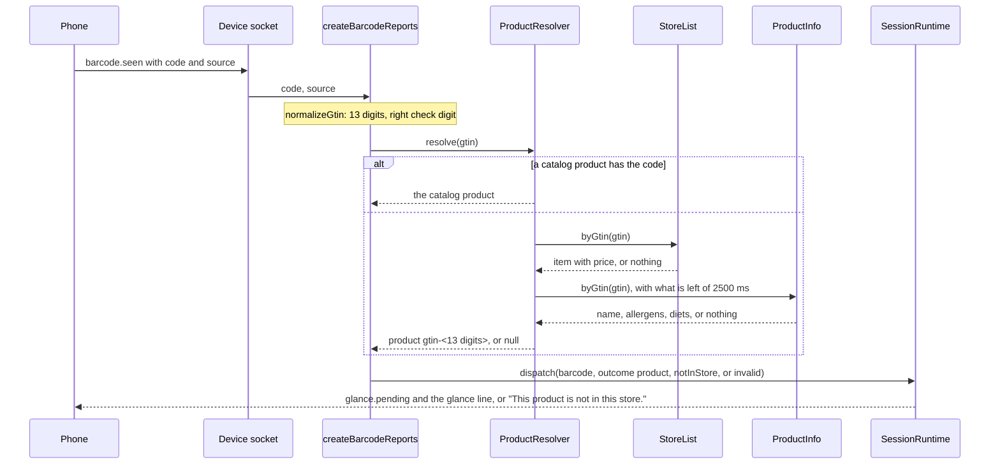

| File | Content |
|---|---|
| `src/products/storeList.ts` | `StoreList`, and `readStoreListFile`, which reads the file of `STORE_LIST_PATH` |
| `src/products/productInfo.ts` | `ProductInfo`, `ProductDetails`, and `parseOffAnswer`, which reads an answer of Open Food Facts |
| `src/products/openFoodFacts.ts` | `createOpenFoodFactsInfo`: the call, the time limit, and the cache |
| `src/products/fakeProductInfo.ts` | `createFakeProductInfo`: the reader of `FAKE_PRODUCT_INFO` |
| `src/products/scanned.ts` | `scannedProduct` builds the product of a store item. `ScannedProducts` keeps these products, and `withScanned` adds them to the index of the rules |
| `src/products/resolver.ts` | `ProductResolver.resolve`: the catalog, then the store list, then the details |
| `src/products/warmup.ts` | `startWarmUp`: the reads of the start, for each store item that the product cache does not hold |
| `src/products/storeEntries.ts` | `readStoreEntries`: the store list as the server reads it one time at its start, with the details that the product cache holds |
| `src/products/barcodes.ts` | `createBarcodeReports`: the check of a code, its lookup, and the rule input `barcode` |
| `src/sessions/barcode.ts`, `src/sessions/code.ts` | The rules |
| `src/label/` | The label frame: the model call, the match against the store list, and the frame handler |

### The store list

The store list decides what the store sells. A code that the list does not hold is never added to a cart.

`catalog/store-list.dev.json` is a JSON array. Each entry has `gtin` (8, 12, or 13 digits), `priceCents`, `name`, and the optional fields `brand` and `packSize`:

```json
[
  { "gtin": "3017624010701", "priceCents": 399, "name": "Nutella", "brand": "Ferrero", "packSize": "400 g" }
]
```

- The server keeps each code as 13 digits. A wrong check digit, a price of 0, an unknown key, and a code that the file holds two times stop the server at its start. The message names the file and the entry.
- `name` is the name that the shopper reads and hears, in English and in Italian. The list has one name for each item, and no name for each language.
- The dev list has 10 products that Italian supermarkets sell. Each code was read from Open Food Facts on 2026-11-14. The prices are invented for the demo.
- `8076809513753` is the Barilla pesto alla genovese, and `8076800195057` is the Barilla spaghetti n.5.
- A catalog product with a `gtin` wins over the store list: a barcode then gives the catalog product, with the price and the spoken texts of the catalog. The Barista oat drink of the dev catalog has the code `7394376616037`. If the two prices of one code differ, the server logs one `store list:` warning at its start.
- `brand` and `packSize` are optional. The label call and recognition by sight get each item with the fields that it has, and choose an item by the meaning of the package text. See "Label frames" and "Recognition knows the store list".
- `catalog/store-list.demo.json` holds the products on the demo table, each with the digits under its barcode and a price. See "A demo with real products".

### An ERP in place of the file

The file stands in for the ERP of a supermarket. `StoreList` is the interface:

```ts
export interface StoreList {
  byGtin(gtin13: string): Promise<StoreItem | undefined>;
  all(): Promise<readonly StoreItem[]>;
}
export type StoreItem = { gtin: string; priceCents: number; name: string; brand?: string; packSize?: string };
```

To use an ERP, write a function that returns a `StoreList`, and return it from `openStoreList` in `src/main.ts`.

- `byGtin` gets 13 digits with a right check digit. It resolves `undefined` for a code that the store does not sell, and it rejects when the ERP fails.
- The answer must come inside 2500 ms, and the product details share that time. A late or failed answer drops the report, with the log line `barcode lookup failed`. The phone repeats its report each second, so the next one tries again.
- The phone reports a code one time each second while it is in view, and each report calls `byGtin`. So the client must cache its answers.
- `all` runs for each label frame. The client must keep the list in memory.
- `gtin` of each item has 13 digits. `priceCents` is an integer above 0.

### Product details from Open Food Facts

The store list gives the name and the price of a product. Open Food Facts gives the allergens and the diets, and the brand and the pack size when the store list has none.

Contains data from Open Food Facts, available under the Open Database License. See https://world.openfoodfacts.org and https://opendatacommons.org/licenses/odbl/1-0/.

- The call is `GET <OFF_BASE_URL>/api/v2/product/<code>?fields=code,brands,quantity,allergens_tags,traces_tags,ingredients_analysis_tags`, with the header `User-Agent` from `PRODUCT_INFO_USER_AGENT` and a time limit of 2000 ms. It needs no key.
- The status 404, and a body with `"status": 0`, mean "not found". Each other status than 200, a body that is no JSON, a body with the status 200 and no product, and a network error are a failed read.
- The name of a product is always the `name` of the store list, in each language. The server does not read the name of Open Food Facts: it is often in another language, or only a part of the name ("bueno" for Kinder Bueno, "Spaghetti Nº5").
- `allergens_tags` and `traces_tags` map to the 14 allergens of `@glance/shared`, as one list. With no allergen in `allergens_tags` the product has no allergen data (`null`), also when traces exist. A wheat pasta with traces of mustard and no entry for gluten would else read as "no gluten".
- `vegan` is true for the tag `en:vegan`, false for `en:non-vegan`, and `null` for each other case. `vegetarian` works the same way.
- The parser reads each field alone. A field with a wrong type counts as no data, and the other fields stay.
- A product that Open Food Facts does not have, a failed read, and a late answer all give a product with no allergen data. A shopper with an allergen or a diet in the profile then hears "Allergen data is missing for this product."
- The server never asks for a code that starts with `2`, `02`, or `04`. Such a code belongs to one store, and only the store list can know it.

The cache:

- A hit stays for 30 days and a miss for 1 day, in memory and as the file `<PRODUCT_CACHE_DIR>/<13 digits>.json`. A failed read is not kept as an answer.
- After a failed read, the next request for that code waits 30 seconds. The phone repeats a code each second, and each report in that time gets a product with no allergen data and no new call.
- After the status 429, the server makes no request for each code for 60 seconds.
- The calls for one code that run at the same time share one request.
- A new process reads the files, so a restart makes no new call for a known code. To read a product again, delete its file and restart the server.
- A cache file that the server cannot write gets the log line `product info: cache file not written`, and the lookup goes on.

The warm-up of the start:

- With `FAKE_PRODUCT_INFO` off, the start reads the details of each store item that the cache does not hold, and that the catalog does not hold. The reads run in the background, one read each 5 seconds, which is 12 reads each minute.
- The server listens before the first read ends. The warm-up has no effect on the start time.
- The log has `product info: warm-up started. <n> of <m> store items are not in the cache, one read each 5 s` and `product info: warm-up ended. read=<n> failed=<n> ms=<n>`, at `info` level.
- Each read puts the product with its details into the index of the rules. So an `identified` store item whose details are in the cache opens its prompt with no wait.
- An item whose read failed, and an item that a prompt names before its turn, get their read with the first prompt, as before. That prompt waits up to 2500 ms.
- The warm-up reads each item one time. After the status 429 its reads of the next 60 seconds fail with no call.
- A list of 60 new items needs 5 minutes. A restart reads only the items that the cache files do not hold.

Limits of Open Food Facts:

- It allows 15 product reads each minute for one address, and it can block an address that reads more. Each shopper shares the address of the server. The guards are the cache, the wait of 30 seconds after a failed read, and the pause of 60 seconds after the status 429. The warm-up of the start makes 12 reads each minute at most. The server does not count its other calls, so new codes of shoppers in the minutes of the warm-up can pass the limit one time.
- Its users write the data. The terms say that it is "for indicative information" and not for medical use. No line says that a product is safe.
- An allergen list can be empty for a product with allergens. A person must check each product of the store list before a real shop.
- It has no price, and the server makes no search by brand and name.
- The documentation calls the v2 path deprecated and still supported.
- Each test uses a fetch function of its own, or the fixtures. The one run against the real database was the warm-up of a list of 3 items on 2026-11-14: 3 reads in 10.8 seconds, each with an answer.

### Rules

- The server makes 13 digits of each code: a UPC-A code gets a leading 0, and an EAN-8 code gets five. A code of 8 digits counts as EAN-8, so the phone must expand a UPC-E code to 12 digits before it sends it.
- The lookup runs before the rules, as the lookup of a kiosk code does. Its outcome is the rule input `barcode`.
- `product`: the product takes the path of a product that recognition named. One appearance gets one prompt (R1), a yes adds one unit at the price of the store (R7), and a no skips it (R8, R9). The phone repeats its report each second, and reports less than 3 seconds apart are one appearance.
- `notInStore`: the voice says "This product is not in this store." one time for each appearance of that code, and at most one time each 20 seconds. No prompt and no event follows. The line waits while the product of a prompt is in view.
- `invalid`: a code with a wrong check digit, or with 14 digits, has no effect.
- A scanned product has the ID `gtin-<13 digits>`. The cart, the warnings, the snapshot, a question, the cart by voice, the spot check, and a new profile language find it by that ID as they find a catalog product.
- The clip seed makes no clip for a scanned product. With real speech, each new line of a scanned product is one ElevenLabs call.
- One voice: while barcode reports or label frames arrive, or the model sees a code, and for 3 seconds after, recognition by sight gives no unknown line and no aim hint. So a shopper who shows a barcode does not hear "Turn the front to me." The same holds while the server waits for a still that it asked for (5 seconds), and for the label call of that still (6.5 seconds at most).
- A result that arrives after the session stopped is dropped. A result that arrives after the result of a later report of another code is dropped too: the shopper shows the other code now.
- The scanned products live in the memory of the process. The start puts each item of the store list there, with the details that the product cache holds, and each lookup puts the product there again with the details of that time. When a stored session loads after a restart, the server resolves the scanned products of its cart again. A product that the store list no longer holds stays a cart line with its old price: the shopper can remove it, and the voice does not name it.

Each lookup gets the log line `barcode session=<id> source=<barcode|ocr|model|label> gtin=<digits> outcome=<product|notInStore|invalid|dropped> ms=<n>`. `dropped` is the late result of the rule above.

### The model also reads the code

The scanner of the phone can miss a barcode. So the recognition call of each stream frame also answers `code: { visible, digits }`.

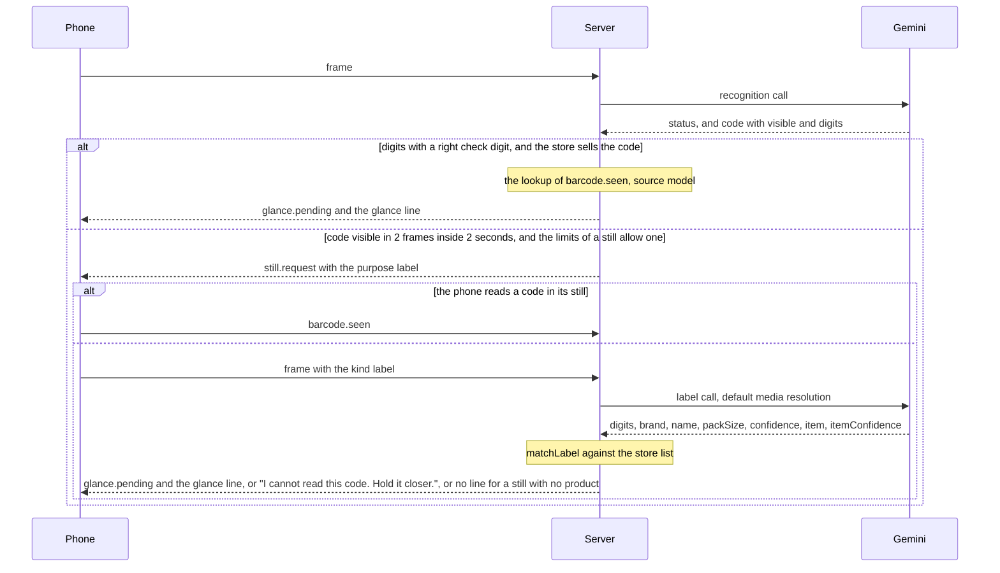

- `visible` is true when a hand holds a product up and the frame shows its barcode, or the package side with its barcode. The instruction gives false to a barcode on a shelf label, on a price tag, and on a product that stays on the shelf. `digits` holds the printed digits when the model can read each one. `agents/recognition.md` says: never guess a digit.
- A model reads print and can write digits that are not there. So digits of the model count only with a right check digit and a product of the catalog or the store list. Then one frame is enough. Each other code of the model has no effect: the voice never says "not in this store" for digits that only the model read.
- A package shown with its barcode side gets the status `none`, so the voice does not ask for the front.
- The server sends `still.request` when the model saw a code in 2 frames less than 2 seconds apart, and the limits of a still allow one. The rule is `onFrameCode` in `src/sessions/code.ts`.

A still is the exception. A still stops the head-motion stream of the glasses. In the test of 2026-11-14 the stream stopped for 5.9 seconds for one still, and for 10 seconds when the capture failed. A nod or a shake in that time is lost. So `stillAllowed` in `src/sessions/code.ts` gives each still request these limits, for a code and for a product that sight cannot name:

- None while a product prompt is open: from its start to its answer, or to its end by R5. The shopper answers it with the head.
- None while sight named a product in the last 3 seconds (`PRODUCT_KNOWN_MS`). The product is known, so its digits are not needed. In the test, the server asked for a still for a product that recognition had named.
- None in the 8 seconds after a yes or a no to a product prompt (`STILL_AFTER_ANSWER_MS`). The shopper still holds the product, and a no can still remove the unit (R10).
- None while a code was read in the last 3 seconds, and none while the payment runs.
- One request each 6 seconds at most.
- After 2 requests with no code read, the next request waits 30 seconds. A code that no reader can read must not cost the motion stream each 6 seconds. A code that was read brings the 6 seconds back.

- The lookup of the digits can take up to 2500 ms for a product that the cache does not hold. A second frame in that time can still ask for a still. The still then gives the same product, and one appearance gets one prompt.

### A product that sight cannot name

The uploaded frame is small, and the catalog holds few products. So recognition often answers `unknown` or `unsure` for a product that the store sells. The label call can read the package text in a still, also with no barcode in view.

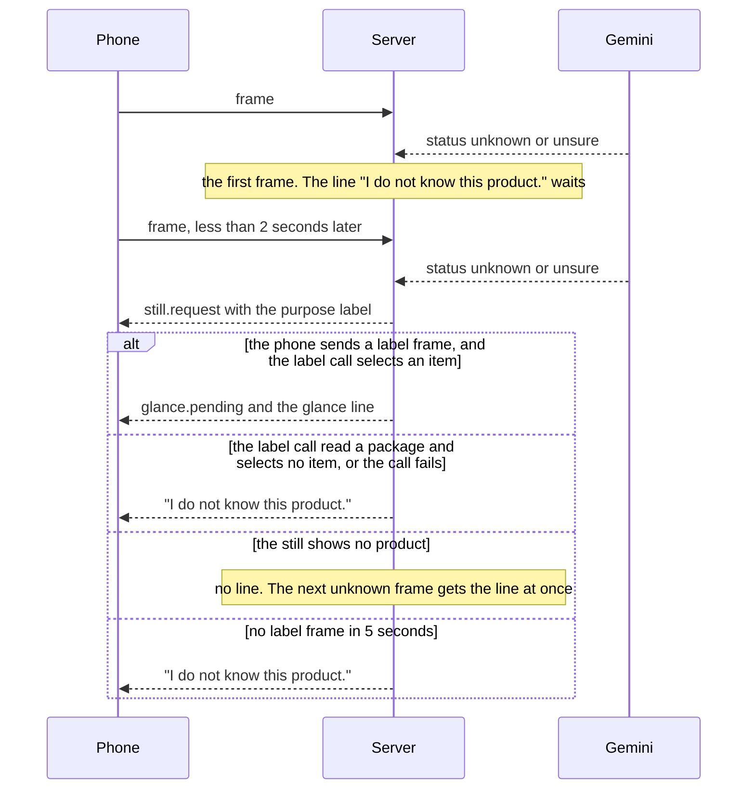

- 2 stream frames with the status `unknown` or `unsure`, less than 2 seconds apart, ask the phone for a still. The rule is `onUnnamedProduct` in `src/sessions/code.ts`. The still of the sharp second look does not count.
- The request has the limits of a still for a code, and shares them. See "The model also reads the code": no open product prompt, no product by sight in the last 3 seconds, no answer in the last 8 seconds, one request each 6 seconds, and 30 seconds after 2 requests with no code read.
- The unknown line of a new appearance waits while a still can follow. It plays after 2 seconds when no second frame asked for a still, after 5 seconds when no label frame came, and at the end of a label call that gave no product. A barcode report, a product by sight, and a look-alike answer drop it.
- When the limits allow no still, the unknown line plays at once, as before. This holds for an unknown product that the shopper shows while a prompt is open.
- An aim hint does not wait. It is quiet from the request to the end of the label call.
- A session with no phone gets no still. Its unknown line plays 5 seconds after the request.

### Recognition knows the store list

A store item has a name and a price, and no description of its package. With a clear frame, the model can still tell that a package is "Paper cups", also when its text is Finnish.

- At its start the server reads the store list one time, through `readStoreEntries`. Each item gets the details that `ProductInfo.cached` holds: the fixtures with `FAKE_PRODUCT_INFO`, else the cache files of Open Food Facts. This read makes no call to Open Food Facts, so the start does not wait. The warm-up then reads each item that the cache does not hold, in the background.
- Each item that the catalog does not hold by its `gtin` is a line of the recognition instruction and an ID of the answer schema. `ScannedProducts` holds its product from the start, so the rules and a fake script find it by its ID.
- `identified` with the ID of a store item opens the normal prompt. Before the result reaches the rules, `ProductResolver.resolve` reads the product again, as for a scanned barcode. After the warm-up read an item, this read comes from the cache and the prompt opens with no wait. Before that, the first prompt of the item makes the call to Open Food Facts for its allergens, inside the 2500 ms of a lookup.
- A result of a later frame can reach the rules before a result that waits for its read. An item that the store list no longer holds gets no prompt, with the log line `recognition result dropped: the store does not sell <id>`.
- The store list is read at the start. An ERP that changes its list needs a restart of the server before recognition and the label call know a new item. A barcode of the phone finds a new item at once.

### Label frames

A frame with the kind `label` is the still of a package that the phone could not read. It goes to one model call, and never to recognition.

- The call uses `GEMINI_API_KEY` and `GEMINI_MODEL`, the instruction `agents/label.md`, a response schema of its own, the default media resolution for the still, one attempt, and a time limit of 4 seconds.
- The call also gets the reference pictures of the store items, when the folder of `REFERENCE_DIR` holds some. See "Reference pictures".
- The instruction holds the store list in place of `{{storeList}}`: one line for each item, with its `gtin`, its name, and its brand and pack size when the store list or the product cache has them. It holds no price. The server builds the instruction and the schema one time, at its start.
- The answer is `digits` (a list of digit runs), `brand`, `name`, `packSize`, `confidence`, `item`, and `itemConfidence`. `item` is the `gtin` of the one store item that the package is, or `null`. The schema lets it take only a code of the store list. An answer that fails the schema counts as an empty one.
- The instruction says: the package text can be in another language than the name in the store list ("Kartonkipikari / Pappersmugg" is "Paper cups"), choose an item only when the package is that product and not a similar one, answer `null` when not sure, and never guess a digit.
- `matchLabel` in `src/label/match.ts` selects the store item. Free text of the model never becomes a product by itself:
  1. Digits count with a right check digit and an item of the store list. Two codes of two items give no product.
  2. Else `item` counts with an `itemConfidence` of `LABEL_MIN_CONFIDENCE` or more, when the store list holds it. Digits of one item and an `item` that is another one give no product.
  3. Else the brand and the name must select exactly one item. The brand, the name, and the pack size of the answer must together hold each word of the brand of the item, each word of its name, and each number of its name. The compare has no regard to case and accents, and words of 1 or 2 letters do not count. So "Pesto alla calabrese" never selects "Pesto alla genovese", and "Spaghetti n.3" never selects "Spaghetti n.5". An item with no brand in the store list matches by each word of its name alone, so give a demo item a name that is printed on its package. This way also needs a confidence of `RECOGNITION_MIN_CONFIDENCE` or more.
     Between items with one brand and one name, the pack size selects. Two matches or none give no product.
- A match goes through the lookup of `barcode.seen`, with the source `label`.
- An answer with no digits, no brand, no name, and no item is an empty answer: the still showed no product. The voice says nothing for it.
- With an answer that read something and matched nothing, and when the call fails or is late, the voice says "I cannot read this code. Hold it closer." When recognition by sight asked for the still, the voice says "I do not know this product." in its place. One appearance of a product or a code gets one such line, and not one line for each still. See "A guard for the voice".
- One label call runs at a time for each session, and a session starts at most one call each 5 seconds. A label frame that arrives during a call, or too early, is dropped with a `label frame dropped` warning.
- A label frame of a session that rests, is paid, or ended is dropped with no call.
- With `REQUIRE_BLUR=1` the server drops a label frame with `blurred: false`. With `SAVE_FRAMES` it saves each label frame that it accepts.
- Each label frame gets the frame log line at `info` level, and each call gets `label session=<id> seq=<n> match=<13 digits|none> ms=<n> references=<n>`, with the number of reference pictures in the request. Before it, the line `label answer seq=<n> digits=[...] brand=... name=... confidence=<n> item=<13 digits|null> itemConfidence=<n> session=<id>` shows what the model read, so a person can see why a still gave no product.
- With real recognition, each label call is one paid Gemini call. The phone sends at most one still each 6 seconds by default. A person can set that gap on the phone, down to 2 seconds, and the limit of 5 seconds on the server holds for a phone that sends more.

### Reference pictures

A store item has a name and no description of its package. So the label call can also compare the still with photos of the items: the reference pictures. A person takes them through the glasses before the demo.

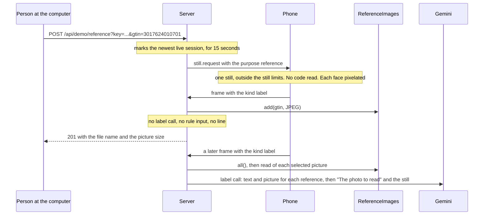

Take the pictures:

1. Start the server with `DEMO_KEY` set, and with the store list that holds the products.
2. Start a session on the phone, with the glasses on. The camera must run.
3. Hold one product up, with its front to the glasses, at the distance of a shopper.
4. Run the command with the code of the product. It prints the file name and the picture size.
5. Turn the product, and run the command again for the barcode side.
6. Do steps 3 to 5 for each product. Then run the command with `list`.

```bash
npm run reference --workspace @glance/server -- 3017624010701
# reference: saved 1763128800123.jpg for 3017624010701 Nutella, 1200 x 1600, 412345 bytes, 1 picture
npm run reference --workspace @glance/server -- list
# 3017624010701  2  Nutella
# 8076800195057  0  Spaghetti n.5
# reference: 10 items, 2 pictures
npm run reference --workspace @glance/server -- remove 3017624010701
# reference: removed 2 pictures of 3017624010701
```

- The command reads `apps/server/.env`. The key is `DEMO_KEY`. The address is `--url <address>`, else `PUBLIC_BASE_URL`, else `http://localhost:<PORT>`. The numbers in the example above show the format.
- A reference picture is a photo of the room of the person who takes it. It can show the room and people. The phone pixelates each face before the upload, and it drops a still when face detection fails. Git ignores `catalog/reference/`. Do not commit a picture, and delete the folder after a demo in a private room.
- The pictures need no restart: each label call reads the folder again, and the frame calls check it each 10 seconds.
- A person can also copy a JPEG into `<REFERENCE_DIR>/<13 digits>/`. Such a file has the time of its last change.

The paths. Each one needs `?key=<DEMO_KEY>`, and answers 404 with no `DEMO_KEY` and with a wrong key:

| Call | Answer |
|---|---|
| `POST /api/demo/reference?key=<key>&gtin=<digits>` | 201 with `gtin`, `name`, `file`, `bytes`, `width`, `height`, and `count`, when the picture is saved |
| `GET /api/demo/reference?key=<key>` | 200 with `items`: `gtin`, `name`, and `pictures` for each store item. Pictures of a code that the store list does not hold have the name `null` |
| `DELETE /api/demo/reference?key=<key>&gtin=<digits>` | 200 with `gtin` and `removed`, the number of pictures that the server removed |

- `POST` answers 400 for a code with a wrong check digit and for a code that the store list does not hold. A code of 8 or 12 digits becomes 13 digits, as for a barcode.
- `POST` answers 409 with `no_session` when no session is live, and with `no_phone` when the newest live session has no phone on its socket.
- `POST` marks the newest live session and sends `still.request` with the purpose `reference` at once. This request does not go through the rules, so the limits of a still for a code do not count for it.
- The next label frame of the marked session is the picture. It goes to no label call and to no rule, so the voice says nothing for it. `SAVE_FRAMES` does not save it a second time. With `REQUIRE_BLUR=1`, a frame with `blurred: false` is no picture, and the mark waits for the next frame.
- The mark ends after one frame, or after 15 seconds. Then `POST` answers 504 with `timeout`. A second `POST` for the session ends the first one with 409 and `replaced`.
- The log has `reference picture saved. gtin=<13 digits> file=<name> bytes=<n> seq=<n> session=<id>`.
- The server stores the still as the phone sent it: a JPEG with a long side of 1600 pixels at most. It has no image library and makes no smaller copy.

The label call with pictures:

- Each picture is one image part, after a text part with its item: `Reference picture of item <gtin>: <name>`. The still is the last image, after the text `The photo to read`. With no picture, the request is the still and the text `Read this label.`, as before.
- A reference part has the media resolution `MEDIA_RESOLUTION_LOW` of its part. `@google/genai` 3.3.0 has this field (`Part.mediaResolution`), and the documentation of Gemini gives it to Gemini 3 models and later, with 280 tokens for one image. The still keeps the default, because the digits under a barcode are small.
- A call gets at most 3 pictures of one item: the newest ones.
- A call gets at most 24 pictures and at most 9 MB of JPEG bytes. The Gemini API takes 20 MB in one request with inline data. Base64 makes 12 MB of 9 MB, and the still and the instruction fit in the rest. 24 pictures cost 6720 tokens.
- When the limits leave pictures out, each item gets its newest picture before an item gets a second one. The order is that of the store list.
- Only an item of the store list gets its pictures into a call.
- A reference store that fails costs the pictures of that call, with the log line `reference pictures not read. <message> session=<id>`. The call still runs.
- `agents/label.md` says: a reference picture can show the item from another side or in other light, the background of a reference picture means nothing, and `item` is the product of a reference picture or the match of the store list text. The model reads `digits`, `brand`, and `name` only from the photo to read.
- `matchLabel` does not change: digits with a right check digit first, then `item` from `LABEL_MIN_CONFIDENCE` on, then the words.
- Recognition by sight also gets reference pictures, with limits of its own. See "Reference pictures in a frame call".
- The upload of the pictures is part of the 4 seconds of a label call. With many large pictures on a slow line, a call can fail with `no answer in 4000 ms`. Then remove pictures.

Measured in the tests of 2026-11-14: the label call with 3 reference pictures ran with the real model. The calls took 1.4 to 1.9 seconds. `gemini-3.5-flash-lite` takes the media resolution of a part.

A database in place of the folder. `ReferenceImages` in `src/reference/images.ts` is the interface:

```ts
export interface ReferenceImages {
  list(gtin: string): Promise<ReferenceImage[]>;
  all(): Promise<Map<string, ReferenceImage[]>>;
  add(gtin: string, jpeg: Uint8Array): Promise<ReferenceImage>;
  read(image: ReferenceImage): Promise<Uint8Array>;
  remove(gtin: string): Promise<number>;
}
export type ReferenceImage = { gtin: string; file: string; bytes: number; addedAt: number };
```

- To use a database, write a function that returns a `ReferenceImages`, and give it to `buildApp` as `references` in `src/main.ts`.
- For example with MongoDB: GridFS holds each JPEG, with `gtin` and `addedAt` in the metadata of the file. `list` and `all` read the metadata only, and `read` opens the download stream of one file.
- A store with thousands of items cannot send a picture of each item. Then keep one embedding vector for each picture, with a vector index, and add a method that returns the nearest items for the still. The label handler then gives the call the pictures and the store list lines of these items only. This part is not built.
- `list` and `all` give the pictures newest first. `gtin` has 13 digits.

### Try it in fake mode

`npm run dev:fake` reads the details from `fixtures/product-info`, and the default script shows the barcode of the Barilla spaghetti from second 10 to second 13.

```bash
curl http://localhost:8080/healthz
# {"ok":true,"fakeRecognition":true,"fakeSpeech":true,"fakeProductInfo":true,"store":"memory","saveFrames":false}
curl -s -X POST http://localhost:8080/api/sessions -H "content-type: application/json" -d "{}"
curl -N "http://localhost:8080/api/sessions/<sessionId>/events?token=<token>"
# at second 10: {"type":"glance.pending","promptId":"p-0002","kind":"new","product":{"id":"gtin-8076800195057","name":"Spaghetti n.5","packSize":"500 g","priceCents":109},"warnings":[],"qtyInCart":0}
# then the caption "Spaghetti n.5, five hundred grams, one oh nine. Nod to add."
curl -s -X POST "http://localhost:8080/api/sessions/<sessionId>/intents?token=<token>" -H "content-type: application/json" -d '{"kind":"yes","source":"phone","promptId":"p-0002"}'
# cart.updated with one line of 109 cents, and the caption "Added Spaghetti n.5. Total one oh nine."
```

For a code that the store does not sell, and for a label frame, write a script of your own and start the server with `FAKE_RECOGNITION=<path> FAKE_SPEECH=1 FAKE_PRODUCT_INFO=1 npm start`:

```json
{
  "loop": false,
  "lengthMs": 60000,
  "label": { "digits": ["3017624010701"], "brand": "Ferrero", "name": "Nutella", "packSize": "400 g", "confidence": 0.9 },
  "steps": [
    { "atMs": 2000, "forMs": 3000, "barcode": "4006381333931" },
    { "atMs": 8000, "forMs": 4000, "result": { "code": { "visible": true, "digits": null } } }
  ]
}
```

- At second 3.3 the events stream gets the caption "This product is not in this store." The report of second 2.1 comes less than 3 seconds after "Camera on.", so the guard for the voice drops its line, and the next report speaks it.
- At second 8.4 a phone on the device socket gets `still.request`. A browser client has no device socket and gets nothing.
- `label` is the answer of the fake label reader for each label frame of a phone. Here a label frame gives `glance.pending` for the Nutella. A script with no `label` reads nothing, and the voice says nothing.

### A demo with real products

`catalog/catalog.dev.json` holds three invented products. In a test with the glasses on 2026-11-14, recognition named a pack of paper cups "Rye bread", which is one of them. For a demo with products on a table, use the two demo files:

```bash
CATALOG_PATH=catalog/catalog.demo.json STORE_LIST_PATH=catalog/store-list.demo.json npm run dev
```

- `catalog/catalog.demo.json` holds the one product of the dev catalog that has a barcode: the Barista oat drink of Oatly.
- `catalog/store-list.demo.json` holds only the products on the demo table. Its prices are invented. Add a product with its barcode digits, a price, and a name. `README.md` at the repository root says how.
- The start log has `catalog: 1 products` and `store list: catalog/store-list.demo.json, <n> items`.
- The server starts with a catalog that holds one product, or none. Recognition by sight then names only store items.
- The demo catalog is no input for `catalog:check` and `catalog:seed`: the check wants a look-alike pair and 12 products.
- The default script of `--fake` names products of the dev catalog. So use the demo catalog with real recognition, or with a script of your own.

Measured in the test of 2026-11-14, with Ray-Ban Meta glasses and the real model:

- The stream fell to 504 x 896, so the uploaded frames were about 402 x 626 and blurred. The scanner of the phone read no code at the length of an arm.
- A label still was 1080 x 1440 and took 2.3 to 2.9 seconds. The label call took 1.5 to 2.3 seconds.
- In one still the barcode was about 95 pixels wide, which is too small to read. The model read the name on the package right.

Not measured: the label call with `item`, the store items in the recognition instruction, and the still for an unknown product have not run with the real model. The distance at which the phone or the model reads a code is not known.

## Speech clips

With `FAKE_SPEECH` off, each line gets an MP3 clip from ElevenLabs, and the `speak` message carries its address.

- The name of a clip is the SHA-256 hash of its text, language, voice ID, and model. One line in one voice is one file, `<SPEECH_CACHE_DIR>/<hash>.mp3`.
- A clip in the directory needs no call. So a line costs one call, the first time a session needs it.
- A miss calls `POST https://api.elevenlabs.io/v1/text-to-speech/<voiceId>/stream?output_format=mp3_44100_128` with the model `eleven_flash_v2_5` and a time limit of 3 seconds.
- Two requests for one clip at the same time share one call.
- If the call fails, the line goes out with `url: null`, and the server logs `speech: no clip. <cause>`. The prompt still takes a yes. The next line with that text tries again.
- The voice is `ELEVENLABS_VOICE_IT` for Italian text when it is set. In each other case it is `ELEVENLABS_VOICE_EN`.
- `GET /api/speech/<hash>.mp3` serves a clip with `content-type: audio/mpeg` and a cache time of one year. A name that is not 64 hex characters plus `.mp3` gets 404, and the server reads no file for it.
- The address of a clip starts with `PUBLIC_BASE_URL`. The phone must reach that address.

## Kiosk and payment

A kiosk is a checkout screen with a QR code. The kiosk page registers with `POST /api/kiosks`, shows `GL1 <code>`, and reads its events stream.

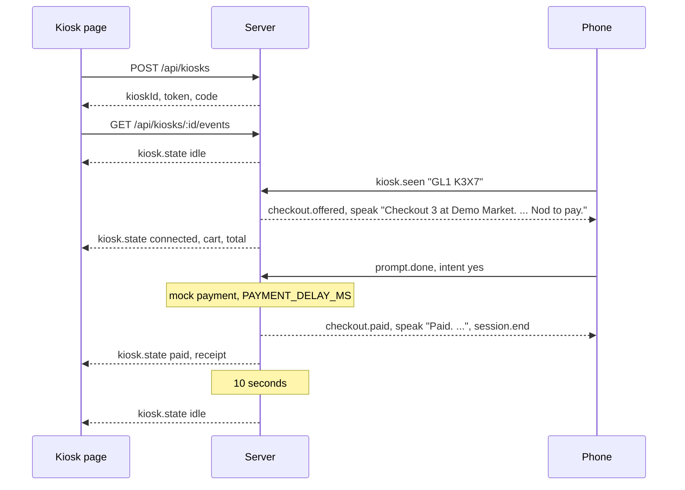

- A kiosk gets a random ID, a random token, and a code of 4 characters from `ABCDEFGHJKLMNPQRSTUVWXYZ23456789`. No two kiosks have one code.
- `kiosk.seen` of the phone carries the text of a QR code. A text that is no code of a kiosk has no effect (R14). Upper and lower case both count.
- One session holds a kiosk for the time of its checkout. A second shopper hears "This checkout is busy." The kiosk is free again when the checkout ends, and when a client deletes the session.
- The kiosk stream sends a `KioskEvent` each time its view changes: `idle`, `connected` with the cart and the total, then `paid` with the receipt or `failed`. A result stays for 10 seconds, or until the next checkout starts.
- The payment is a mock. No money moves. After `PAYMENT_DELAY_MS` the server writes an order (`ord-` plus 8 hex characters, `method: "demo"`) and gives the rules the result.
- A kiosk that registered with `failPayment: true` declines each payment and makes no order. The cart stays.
- A second yes while the payment runs has no effect, so one checkout makes one order.
- The store keeps each kiosk. After a restart of the server, no session holds a kiosk. A session that was in a checkout loads with no checkout, and its shopper starts again at the code.
- If the server stops while a payment waits, that payment fails when the session loads again. No order exists for it.
- A kiosk that registered with `spotCheck: true` asks for one product before the pay prompt. See "Spot check".

## Catalog

A catalog file is a JSON array. Each entry is a `Product` of `@glance/shared`. Prices are integers in cents.

- `readCatalogFile` stops at the first entry that fails the schema. Its message names the file, the index of the entry, and the ID.
- `indexCatalog` rejects a catalog that holds one ID two times.
- In `allergens`, `null` means "no data", and an empty list means "no allergen". The potato crisps of the dev catalog have no data.
- A product with a `gtin` also answers its barcode. The Barista oat drink of the dev catalog has the code `7394376616037`, read from Open Food Facts. The other three products are invented and have no code. `catalog/catalog.demo.json` holds the Barista oat drink alone. See "A demo with real products".

### Check a catalog

```bash
npm run catalog:check --workspace @glance/server                              # the file of CATALOG_PATH
npm run catalog:check --workspace @glance/server -- catalog/catalog.json
npm run catalog:check --workspace @glance/server -- catalog/catalog.json --lang it
# warning: potato-crisps: no allergen data
# warning: catalog: 4 products, the demo needs 12
# catalog: 4 products, 0 errors, 2 warnings
```

The command prints one line for each finding and then the counts. Its exit code is 1 with one error or more. Each message starts with the product ID, with `entry <index>` for an entry with no ID, or with `catalog`.

Errors:

- The file holds no JSON array, or an entry fails `ProductSchema`. The message names the field.
- Two entries have one ID. The check keeps the first one.
- A price is 0.
- A look-alike does not exist, is the product itself, or does not list the product back.
- No look-alike pair differs in price or in allergens (spec section 11.3). A product with no allergen data differs from its look-alike only by its price.
- A GTIN has another length than 8, 12, 13, or 14 digits, or a wrong GS1 check digit.
- With `--lang it`: `name`, `spokenName`, `spokenPack`, or `spokenPackDetailed` has no Italian text.

Warnings:

- A product has no allergen data.
- A `visual` text has fewer than 20 characters, a line break, or a vertical bar. The recognition prompt prints each product on one line, with bars between its fields.
- The catalog has fewer than 12 products.

### Seed

```bash
npm run catalog:seed --workspace @glance/server -- catalog/catalog.dev.json --no-clips
# seed: no MONGODB_URI, products not stored
# seed: --no-clips is set, no clip made
# seed: 4 products, 0 clips, 0 failed
npm run catalog:seed --workspace @glance/server -- catalog/catalog.json --lang it      # also the Italian clips
```

`catalog:seed` reads `apps/server/.env`. It does these steps:

1. It runs the check, prints its lines, and stops on an error.
2. With `MONGODB_URI` it replaces the products of the database. Without it, it stores nothing: the memory store reads `CATALOG_PATH` at each start of the server.
3. It makes the speech clips of the lines that each shop needs, one at a time, in `SPEECH_CACHE_DIR`. With `--no-clips` or `FAKE_SPEECH=1` it makes no clip.
4. It prints the counts. Its exit code is 1 if a clip failed.

The clips:

- `seedLines` in `src/speech/seed.ts` lists the texts: 3 for each product (the glance line with and with no hint, and the "in your cart" line) and 34 lines that have no product. That is 46 texts for the dev catalog and 70 for 12 products. A scanned product gets no clip from the seed.
- With `--lang it`, the check runs with `--lang it` and stops the seed when a product has no Italian text. Then the seed makes the English clips and the same number of Italian clips, with the voice `ELEVENLABS_VOICE_IT`. The dev catalog fails that check: only the oat drink has Italian texts.
- With no `--lang`, the texts are in English, for the default profile. A line with a total, the pay prompt, and each line for another input than the nod get their clips during the shop.
- Each text with no clip in the cache is one paid ElevenLabs call. Before the calls, the command prints the number of lines and characters. A second run makes no call for the clips that exist.
- A clip belongs to one voice. A new `ELEVENLABS_VOICE_EN` makes each clip again.
- The seed needs no Gemini key. With `--no-clips` it needs no ElevenLabs key.

## Rules

`step(state, input, ctx)` in `src/sessions/step.ts` holds the interaction rules of spec section 6.2. It returns the new state and a list of effects. It reads no clock and does no I/O: each input carries its time as `now`. The session runtime calls it for each input.

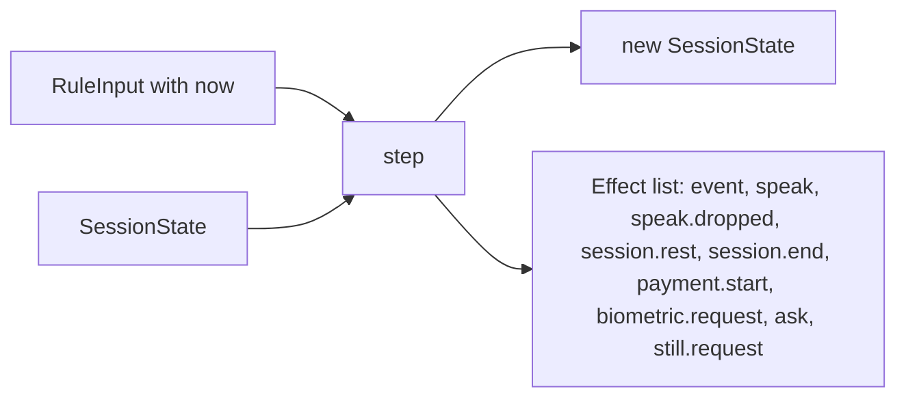

| File in `src/sessions` | Content |
|---|---|
| `types.ts` | `SessionState`, `RuleInput`, `Effect`, and `Line`, a spoken line before it has a text |
| `step.ts` | `createSessionState`, `step`, and the rules that depend on time alone |
| `glance.ts` | Recognition results: the glance prompt, the unknown line, the look-alike answer, and the aim hint |
| `answers.ts` | The answers: yes, no, undo, the cart edit, and `accepts`, which tells if an answer counts |
| `checkout.ts` | The kiosk code, the pay prompt, and the result of the payment |
| `general.ts` | The device state, the profile patch, and the intents stop, repeat, total, cart, help, and ask |
| `ask.ts` | The question window, the product that a question is about, and the answer line |
| `barcode.ts` | The outcome of a barcode lookup, and the label frame that gave no product |
| `code.ts` | The code state of a session: the quiet time of recognition, and the request for a still |
| `say.ts` | The priority, the sound, and the interrupt value of each line |
| `guard.ts` | The guard against a voice that repeats itself: which line is unsolicited, and when the voice drops it. See "A guard for the voice" |
| `view.ts` | `inView`, `excludeList` for the recognition worker, and `toSnapshot` for a client that connects |
| `warnings.ts` | `warningsFor`: the allergen and diet warnings of a product for one profile |
| `turn.ts` | The helpers that the handlers share |
| `harness.ts` | A test helper that plays inputs with a clock of its own |
| `runtime.ts` | `SessionRuntime`: one session in the process. It runs `step` and then the effects |
| `registry.ts` | `SessionRegistry`: creates, finds, and removes sessions, and sends the tick |
| `voice.ts` | `parseVoiceCommand`: the spoken command words |

The rules that exist:

- A recognized product gets a glance prompt with a new ID (R1). A new product replaces the pending product (R2).
- The product that a prompt replaced gets no prompt by sight while sight named the product of that prompt in the last second (`GO_BACK_AFTER_MS` in `src/sessions/glance.ts`). Two store items that look alike can get their names in turn, frame by frame. They then get two prompts, and the second one stays. A barcode and a label match are sure, so they bring the first product back at once.
- Results inside the view time belong to one appearance. A product that comes back after it left the view gets a new prompt.
- A product prompt ends when its product left the view for 15 seconds (R5).
- A product in the cart gets the prompt for "add another" (R11).
- A glance prompt carries the warnings of its product for the profile of the shopper. See "Allergen guard".
- An unknown product gets one line for each appearance (R13). The line waits while a still can name the product. See "A product that sight cannot name". An aim hint plays at most one time each 5 seconds.
- Each line goes through the guard for the voice. It drops a line that the shopper did not ask for when the line repeats a text, follows another line too closely, or names a failed read a second time. See "A guard for the voice".
- An `ambiguous` result gets the look-alike answer, and never a prompt. See "Look-alike products".
- A yes or a no counts only with the ID of the current prompt (R3). From voice, touchpad, key, or camera it also needs a finished prompt (R5). From the phone or the HUD it needs the ID alone (R6).
- A yes or a no from the head (R4) for a product prompt needs the ID of the current prompt, and no more. The ID is the guard: the shopper heard the name and the price of that prompt. The product can be out of view, because recognition names a held product in few frames, and the shopper lowers it while the line plays. In the test of 2026-11-14 one frame named the product 8 seconds before the nod, and the old rule "product in view" dropped that nod.
- A head answer for a product prompt also counts before `prompt.done`. The phone opens its head window 1200 ms after the line starts to play, and stops the line at a head answer. It then sends no `prompt.done`. Each other source keeps its rule: voice, touchpad, key, and camera need a finished prompt (R5).
- The phone is the judge of the head window. It reads the window in the time of the motion samples of the glasses. After a stall of the link it sends the answer seconds late. So the server has no head window of its own. It keeps one last time: the answer must arrive less than the head window of the profile plus 21 seconds after `prompt.done`. With no `prompt.done`, the time counts from the start of the prompt. `answers.ts` has the 21 seconds as two values. `HEAD_MAX_EXTRA_MS` is 15 seconds: the longest time that a stall or a still adds to a window. `HEAD_LATE_MS` is 6 seconds: the longest wait for a late sample. They repeat `MAX_EXTRA_MS` and `LATE_MS` of `HeadInput` in the Android app. A profile with no head window has no last time.
- A head answer to the pay prompt keeps each condition: a finished prompt, the longer time, and a report of the kiosk code in the last 3 seconds. A movement during the line never pays. Each other rule of the checkout stays (R16 to R19, the spot check, the fingerprint).
- An accepted yes adds one unit (R7). An accepted no skips the product, and recognition excludes it for 10 seconds (R8, R9).
- After an add, a no removes that unit for 8 seconds (R10). A second yes does nothing: the shopper holds the product up again for another unit. On the prompt for "add another", a no removes one unit (R11).
- An undo removes the last added unit that the cart still holds (R12). A cart edit sets the quantity of a cart line from 0 to 99.
- An add that crosses the budget of the profile warns one time. See "Budget guard".
- A yes or a no with no prompt to answer says nothing. The lines "Hold it up again." and "Hold it up again to add another." do not exist any more: in the test of 2026-11-14 the shopper heard one for a nod that must add. The log line `intent` names the reason. See "Session runtime".
- One hint stays (R20): a yes or a no less than 15 seconds after a pay prompt finished, with the kiosk code out of view, gets "Look at the checkout code, then nod." one time. Silence adds nothing (R21).
- A double tap with no current prompt opens the question window. See "Questions about a product".
- A kiosk code starts a checkout when the cart has items and no product prompt is current (R15). A busy kiosk and an empty cart get one line for each appearance of the code, and at most one each 20 seconds. With its line, a busy kiosk also gives the event `error` with the code `kiosk.busy`.
- A yes pays only as an answer to the pay prompt (R16). The effect `payment.start` asks the runtime for the payment, and the input `payment.result` brings its result.
- A product held up during a checkout suspends it. The pay prompt returns with the new total when the product has left the view and the code is in view (R17).
- A no on the pay prompt cancels the checkout, and the kiosk is muted until its code has left the view (R18).
- A checkout ends when its code was out of view for 30 seconds (R19). The cart stays.
- A cart change during a pay prompt gives a new pay prompt with the new total. The old prompt cannot pay.
- A checkout needs items in the cart. When the cart gets empty, the checkout ends, also while a product suspends it. So an empty cart never gets a pay prompt.
- While the payment runs, no answer, no undo, and no cart edit has an effect.
- By default, no payment needs a fingerprint: a nod pays each total. With `BIOMETRIC_ABOVE_CENTS` set, a total above that limit needs a fingerprint check on the phone before the payment. See "Fingerprint above a limit".
- A barcode of a product that the store sells gets the prompt of that product. A code that the store does not sell gets one line. See "Barcode scan".
- While the shopper shows a barcode, and for 3 seconds after, recognition gives no unknown line and no aim hint. The same holds while the server waits for a still and its label call.
- 2 frames with a product that sight cannot name ask the phone for a still, and the label call reads the package. See "A product that sight cannot name".

### A guard for the voice

The shopper wears the voice in the ear. A line that repeats, or a row of lines about one product, is noise. `src/sessions/guard.ts` holds one guard for each line of the rules. `speak` in `turn.ts` asks it before a line becomes an effect.

Solicited and unsolicited. This is the one definition, as `isSolicited` in `guard.ts`:

- A line is solicited when the handler of an action of the shopper speaks it, in the step of that action. The actions are the inputs `intent` (yes, no, undo, repeat, total, cart, help, ask, stop), `cart.edit`, `profile.set`, `question`, `answer` (the answer of the model to a question), and `biometric.result`.
- Each other line is unsolicited: a line for a recognition result, a barcode, a label frame, a kiosk code, a device state, a socket, a payment result, or slow recognition.
- A line of a time rule is unsolicited, also when the time rule runs in the step of an action. An example is the unknown line that waited for a still.

The rules of the guard:

- A solicited line always plays. `repeat` always replays the last line that the shopper heard.
- An unsolicited line with the text of a line of the last 20 seconds is dropped (`SAME_TEXT_MS`). The compare uses the text that the shopper hears, and it counts solicited lines too.
- An unsolicited line less than 3 seconds after another unsolicited line is dropped (`UNSOLICITED_GAP_MS`). The guard does not keep it for later.
- Three kinds of unsolicited lines always play, inside the 3 seconds and with a repeated text: a product prompt (`glance.new`, `glance.inCart`), a checkout line (`checkout.offer`, `checkout.cancelled`, `checkout.paid`, `checkout.failed`, `checkout.biometric`, `spotcheck.ask`, `spotcheck.thanks`), and a state line (`session.start`, `session.rest`, `device.cameraOff`, `device.regularCheckout`, `device.paused`, `device.battery`, `net.backOnline`). `LINE_KIND` in `guard.ts` gives each line its kind.
- A line about a read that failed in the background (`glance.unknown`, `barcode.unreadable`) plays one time for each appearance of a product or a code. The appearance ends when the view was empty for the view time of the rules, 3 seconds: no recognition result with a product or a visible code, no barcode report, and no label frame. A product prompt also ends it. So a product that stays in view gets one such line, and not one line for each still.
- The sound of a line is a field of its `speak` message. A dropped line sends no message, so its sound does not play.
- A dropped line is not the last line for `repeat`.
- An event still goes out when its line is dropped. For example, `glance.ambiguous` still asks the phone for a still.
- A rule that speaks one time for each appearance gets a new chance after a drop for the 3 seconds: the lines `checkout.busy`, `checkout.empty`, and `barcode.notInStore`. The phone reports a code that stays in view one time each second, and a later report speaks the line. The `error` event `kiosk.busy` goes out with the line that plays.

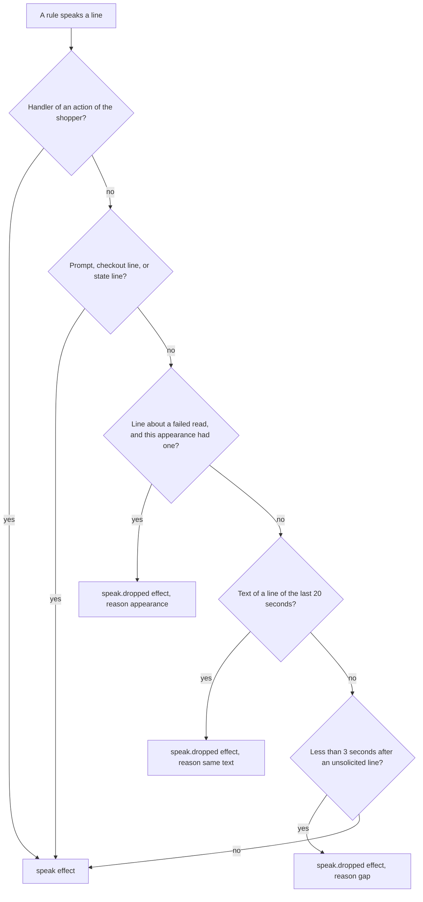

The log shows what the shopper heard, at `info` level:

```text
speak session=<id> key=glance.new text=Nutella, four hundred grams, three ninety-nine. Nod to add. prompt=p-0002
speak dropped session=<id> key=barcode.unreadable reason=appearance
```

- `speak` has the line key, the first 80 characters of the text, and the prompt ID or `none`. The runtime writes it when the line goes to the phone, so the order is that of the phone.
- `speak dropped` has the line key and the reason: `same text`, `gap`, or `appearance`.

Each product prompt also gets one line that shows where the time went, after its `speak` line:

```text
glance timing session=<id> product=oat-drink-1l frameToResultMs=1420 resolveMs=0 clipMs=310
glance timing session=<id> product=gtin-3017624010701 frameToResultMs=none resolveMs=35 clipMs=2
```

The line that answers a yes or a no to a product prompt gets its own line: `cart.added`, `cart.removed`, or `glance.skipped`.

```text
answer timing session=<id> key=cart.added clipMs=3
```

- `clipMs` of an answer line is small when its clip was made in advance. See "Session runtime".
- `frameToResultMs`: from the arrival of the frame at the recognition worker to the result of its call. It holds the wait for a free call and the call. The numbers above are an example of the format.
- `resolveMs`: the read of the product. It is 0 for a catalog product, a few milliseconds for a store item in the product cache, and up to 2500 for an item that the cache does not hold.
- `clipMs`: from the rules to the `speak` message of the phone. It holds the wait behind an older line in the outbox, and the clip.
- A prompt from a barcode of the phone or from a label still has `frameToResultMs=none`: no stream frame of the server belongs to it. Its `resolveMs` is the lookup of the code.
- The sum is the server share of the time from the frame to the spoken line. The upload of the frame and the play of the clip on the phone are not in it.

What the guard costs. These cases are silent now:

- A second product that the store does not sell, less than 20 seconds after the first one, gets no line: both lines have the text "This product is not in this store." The same holds for a second unknown product and for a second unreadable code.
- A look-alike line less than 3 seconds after a prompt line is dropped. Its prompt still ends, and the phone UI shows the look-alike notice.

The audit of 2026-11-14: each line that the server speaks with no action of the shopper, with its trigger and its limits. Each row also has the guard: "always" for a line that always plays, else the limits of 20 seconds and 3 seconds.

| Line | Trigger | Limit of its rule | Guard |
|---|---|---|---|
| `glance.new`, `glance.inCart`: the product prompt. Sound `warning` with a warning | An `identified` result, a barcode of the store, or a label match | One for each appearance of the product (R1). A new product takes the place of the prompt (R2) | always |
| `glance.unknown`: "I do not know this product." | An `unknown` result, or a failed label read of a still that sight asked for | One for each appearance (R13). It waits for a still | one for each appearance, then 20 s and 3 s |
| `glance.partial`: "I can see part of it. ..." | An `unsure` result with an aim hint | One each 5 seconds. None while a barcode has the voice | 20 s for one hint text, 3 s |
| `glance.ambiguous`: the look-alike line | An `ambiguous` result | One for each appearance of the same candidates | 20 s, 3 s |
| `barcode.notInStore` | A barcode of the phone that the store list does not hold | One for each appearance of that code | 20 s, 3 s, new chance after 3 s |
| `barcode.unreadable`: "I cannot read this code. Hold it closer." | A label read that matched nothing or failed | None of its own. Before the guard: one each 10 seconds | one for each appearance, then 20 s and 3 s |
| `checkout.empty`, `checkout.busy` | A kiosk code with an empty cart, or of a busy kiosk | One for each appearance of the code | 20 s, 3 s, new chance after 3 s |
| `checkout.offer`: the pay prompt. Sound `found` | A kiosk code with items in the cart. Again after a cart change, after the product of R17 left the view, and when the code comes back after the head window | One for each of these events | always |
| `spotcheck.ask`, `spotcheck.thanks` | A kiosk that asks for a spot check, and the product of the check | One for each check, and one more when its product leaves the cart | always |
| `checkout.cancelled` | The code was out of view for 30 seconds (R19) | One for each checkout | always |
| `checkout.paid` with the sound `paid`, `checkout.failed` | The result of the payment | One for each payment | always |
| `session.start`: "Camera on. ..." | The stream state changes to `streaming` | One for each change | always |
| `device.cameraOff`, `device.regularCheckout`, `device.paused` | The stream state changes to `stopped` or `paused` | One for each change | always |
| `device.battery` | The battery of the glasses at 20 percent and at 10 percent | One for each level | always |
| `session.rest`: "Camera off. Your cart is safe." | 3 minutes with no product and no kiosk in view (R22) | One for each rest | always |
| `net.backOnline`: "Back online." | The device socket opens for a session that has a device state | One for each socket. The phone waits 500 ms to 8 seconds between two attempts | always |
| `recognition.slow` | 3 failed recognition calls in a row | One each 60 seconds, with its `error` event (`SLOW_REPORT_EVERY_MS`). Before: one for each 3 failed calls, about each 12 seconds | 20 s, 3 s |

- A warning has no line of its own. The allergen and diet warnings are part of the product prompt, and the budget warning is part of `cart.added`, which answers a yes.
- The lines `cart.added`, `cart.removed`, `glance.skipped`, `undo.nothing`, `hint.lookAtCode`, `info.total`, `info.cart`, `info.help`, the four `ask` lines, and `checkout.biometric` answer an action. The guard never drops them.
- Results that change between two products give two prompt lines, and no line for the changes after them: see R2 in "Rules". A third product gets its prompt line at once. The guard lets each prompt play, because a prompt with no line cannot take a nod.
- Not limited: a connection that drops again and again gives "Connection lost" on the phone and "Back online." for each drop of 3 seconds or more.

What the phone plays by itself. The Android app and the phone UI were read for this audit on 2026-11-14:

| Sound or vibration | Trigger | Limit |
|---|---|---|
| The sound and the clip of a line (`SpeechQueue`, `ExoLinePlayer`) | A `speak` message of the server | One for each message. The app plays no line again by itself |
| The answer sound: `added` for a yes, `removed` for a no (`AnswerSound`) | The app sends a head answer. The sound does not wait for the server | One for each answer. The next line of the server then plays with no sound, when it has the same sound and arrives less than 3 seconds later (`AnswerSoundOnce`) |
| The phone voice in place of a clip (`PhoneVoice`) | A line with no clip, or a clip that does not load in 3 seconds | One for each line |
| "Connection lost. Your cart is safe. Glances are paused." (`ConnectionAnnouncer`) | The socket was down for 3 seconds | One for each drop |
| The pattern `prompt` or `warning` | The event `glance.pending` or `checkout.offered` | One for each prompt. A repeated barcode report gives no new event |
| The pattern `added` or `removed` | The event `cart.updated` with a change | One for each change. The add that crosses the budget gives only `warning` |
| The pattern `warning` | The event `budget.exceeded` | One for each add that crosses the budget |
| The pattern `paid` or `error` | `checkout.paid`, `checkout.failed`, or an `error` event | One for each event. The server sends `recognition.slow` at most one time each 60 seconds |
| The pattern `cameraPaused` or `cameraOff` | The stream state of the app changes | One for each change |

- The Android app selects each vibration itself, with `HapticRules`, and it vibrates only for the rows above. The page sends no message for a vibration, so the patterns also play with the screen off.
- A still, a label upload, a reference picture, and a barcode report play no sound and give no vibration on the phone.
- The answer sound came with the rework of the head gestures, after the audit. The line "Added" or "Removed" that answers the nod keeps its sound field in the `speak` message. The app plays the clip alone, so the shopper hears one sound for one answer. An answer that the rules reject has its answer sound, and no "Added" line follows.
- One fault was found and fixed: the add that crosses the budget gave two patterns, `added` and then `warning`. It gives one now.
- With TalkBack on, the phone UI also writes each caption into a live region, so TalkBack can read a line that the voice speaks. This audit did not change that.

### Allergen guard

`warningsFor(product, profile)` in `src/sessions/warnings.ts` compares a product with the allergens and the diets of the profile.

| Profile | Product | Warning |
|---|---|---|
| Lists allergens | Holds one or more of them | `allergen`, with those allergens in the order of the profile |
| Lists allergens | `allergens: null` | `allergenDataMissing` |
| `vegan` | `vegan: false` | `diet` with `vegan` |
| `vegetarian`, and no vegan warning | `vegetarian: false` | `diet` with `vegetarian` |
| `vegan` or `vegetarian` | `null` for that diet | `allergenDataMissing`, because the contract has no warning for missing diet data |

- The order of the list is: the allergen warning, the diet warning, the missing data warning. Each kind is in the list one time at most.
- An empty list means that the guard found no match. The guard has no value and no line for "safe".
- The event `glance.pending`, the lines `glance.new` and `glance.inCart`, and the prompt of the snapshot carry the list.
- A glance line with a warning has the sound `warning`.
- A profile patch does not change a prompt that is already spoken. The snapshot computes the list with the profile of that moment.

### Look-alike products

An `ambiguous` result names two or more candidates. The model cannot tell which of them the frame shows.

- If the product of the current prompt is one of the candidates, the prompt ends with `glance.cleared`. The shopper cannot add a product that the model is no longer sure of.
- If the current prompt is for another product, and that product is in view, the result has no effect.
- In each other case the event `glance.ambiguous` carries the candidates as product references, and the voice speaks the line `glance.ambiguous`. The line has the priority `normal`, no sound, and no interrupt. It is no prompt, so a yes adds nothing.
- One appearance gets one line. Results with the same candidates, each less than 3 seconds after the one before, are one appearance. The order of the candidates does not count. The guard for the voice can drop the line of a new appearance, and the event still goes out.
- A new product prompt ends the appearance. If the model then gives the same `ambiguous` result again, the prompt ends. The line plays again when 20 seconds passed since its last time, and 3 seconds since the prompt line.
- The line names the words that end each spoken name: "I cannot tell which oat drink this is. Turn the front to me." Names with no common last word give "I cannot tell if this is oat drink or rye bread. Turn the front to me.", with the first two candidates.
- The line and the event say no price.
- The default script of fake mode has such a result at second 33.

### Sharp second look

A stream frame is small and compressed. For look-alike products the phone can take a still photo with more pixels, and the model reads that still at the default media resolution. The message `still.request` asks only for the still of a barcode, so the event `glance.ambiguous` is the signal for the phone. `SECOND_LOOK_WAIT_MS` tells the server to wait for the result of the still before it speaks the look-alike line.

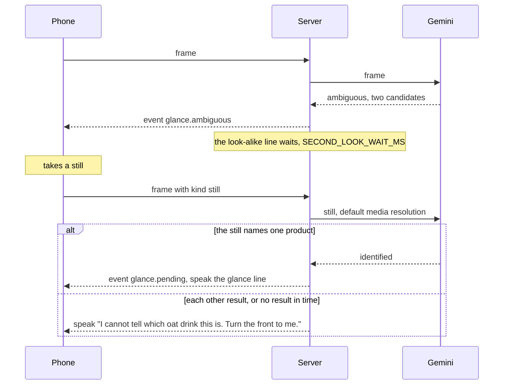

- With `SECOND_LOOK_WAIT_MS=0`, which is the default, the look-alike line plays at once, and the result of a still counts as the result of a stream frame.
- With a wait, an `ambiguous` result of a stream frame gives the event `glance.ambiguous` at once. The line waits in `SessionState.heldAmbiguous`.
- An `identified` result drops the line that waits, for a still and for a stream frame. The product gets its usual prompt (R1).
- Each other result of a still speaks the line at once: `ambiguous`, `unknown`, `unsure`, `none`, and a product ID that the catalog does not hold. That result has no other effect, so no second line and no second event follows.
- With no result of a still, the line plays when the wait is over. The server checks the time with each input and with each tick, so the line can be up to one tick late.
- A sure still that comes after the line still gives the usual prompt. A still that is not sure, with no line that waits, has no effect.
- Results with the same candidates inside the view time are one appearance: one event, and one line that waits. Other candidates give a new event, and their line waits from the time of their result.
- A session that stops, rests, or waits for a payment drops the line.
- The worker keeps a still in its own slot, so a stream frame does not replace a still that waits for its call.
- Set `SECOND_LOOK_WAIT_MS=2500` only when the phone sends stills. With no still, each look-alike line is late by the wait. One test took about 1 second for the capture (spec section 11.1). The recognition call of the still follows, and a call can take 4 seconds at most.
- In fake mode the server drops each frame, also a still. With a wait, the look-alike line of the script plays after the wait.

### Questions about a product

The shopper asks a question about one product, and a text call of the model answers it from the catalog data of that product. The rules are in `src/sessions/ask.ts`, and the call is in `src/ask`.

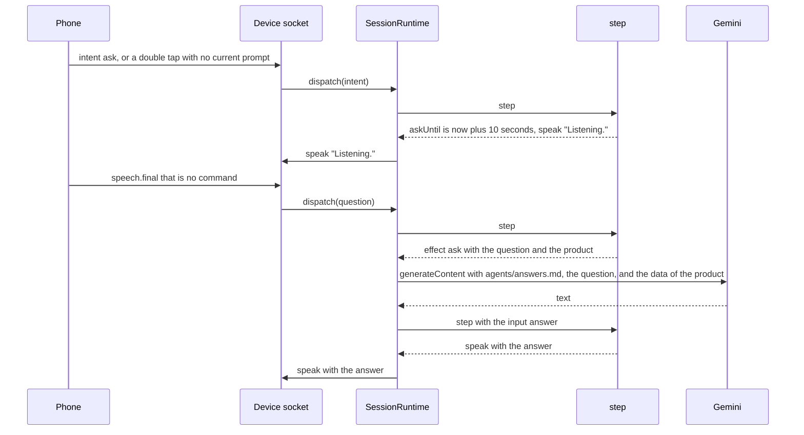

- The question window opens for 10 seconds (`ASK_WINDOW_MS`) with the line "Listening." Two inputs open it: the intent `ask` from each source, and a yes from the touchpad while no prompt is current.
- The intent `ask` needs no prompt ID, and a current prompt stays current. The microphone button of the phone UI sends it.
- A double tap still answers a current prompt. After an add, with no current prompt, a double tap opens the window.
- The device socket turns a `speech.final` that is no command, with a confidence of 0.5 or more, into the input `question`. A command word stays a command, also inside the window.
- A question outside the window has no effect. A question inside it closes the window.
- The question is about the product of the current prompt. With no product prompt it is about the product in view that was seen last. With no product in view it is about the product of the last add. With no such product the voice says "Hold a product up, then ask."
- The runtime gives the call 4 seconds (`ASK_TIMEOUT_MS`). An answer gets the line `ask.answer` with its text, at the priority `low`. A failed or late call gets "I could not answer that."
- The request names the language of the profile, the question, and one product as JSON: `name`, `brand`, `packSize`, `price`, `allergens`, `vegan`, and `vegetarian`. It holds no other product and no image.
- `agents/answers.md` tells the model to answer only from that data, to say "I do not have that information." when the data does not hold the answer, and never to say that a product is safe.
- `answerQuestion` cuts the answer at a sentence end to 200 characters or fewer.
- The call uses `GEMINI_API_KEY` and `GEMINI_MODEL`. It makes one attempt and sets no response schema.
- With real speech, each new answer text is one ElevenLabs call.
- A browser client has no microphone. Its question window closes after 10 seconds with no question.

### Budget guard

The profile holds `budgetCents`, or `null` for no budget. The rule is in `changeQty` of `src/sessions/answers.ts`.

- An add crosses the budget when the total before it is at most the budget and the total after it is more.
- For that add, the event `budget.exceeded` follows `cart.updated`. It holds the budget and the new total.
- The line of that add is `cart.added` with `budgetCents`, and its sound is `warning` in place of `added`.
- Each other add has `budgetCents: null`, also when the total is already over the budget. So the warning plays one time.
- The rule holds for a yes and for a higher quantity in a cart edit.
- When a removal brings the total back to the budget or under it, the next add that crosses the budget warns again.
- A profile patch that lowers the budget under the total gives no event. The phone UI compares the two numbers by itself.

### Fingerprint above a limit

By default, no payment needs a fingerprint. An accepted yes on the pay prompt pays each total, and `needsBiometric` is always false. The phone gets no `biometric.request`.

A nod is consent, not authentication. The setting `BIOMETRIC_ABOVE_CENTS` adds a fingerprint check on the phone for a total above its value. The value is a number of cents, and `BIOMETRIC_ABOVE_CENTS=5000` gives a limit of 50 EUR. A value of `0` asks for a fingerprint for each payment. A value that is not an integer from 0 to 100000000 stops the server at its start. `loadConfig` reads the value, and the rules in `src/sessions/checkout.ts` get it in their context as `biometricAboveCents`.

With the setting, these rules apply:

- `needsBiometric` in `checkout.offered` and in the pay prompt of the snapshot is true for a total above the limit. A total of exactly the limit needs no fingerprint.
- An accepted yes on such a pay prompt starts no payment. The checkout gets the step `biometric`, and the pay prompt ends. The voice says "Confirm with your fingerprint on the phone." Then the phone gets the message `biometric.request`.
- The phone answers with `biometric.result`. With `ok: true` the payment starts. With `ok: false` the checkout ends as for a no: the line is "Checkout cancelled. Your cart is safe.", and the kiosk is muted until its code has left the view.
- A `biometric.result` counts only in the step `biometric`. Each other one has no effect, so a result alone never pays.
- In the step `biometric`, a yes, a no, an undo, a cart edit, and a recognition result have no effect. A stopped camera stream does not end the checkout, because the shopper looks at the phone.
- The checkout still ends when its code was out of view for 30 seconds (R19), and with a stop intent. A result that arrives later has no effect.
- A browser client has no fingerprint check. Its checkout above the limit ends after those 30 seconds.
- After a restart of the server, a session that waited for the fingerprint loads with no checkout.

The steps of a checkout:

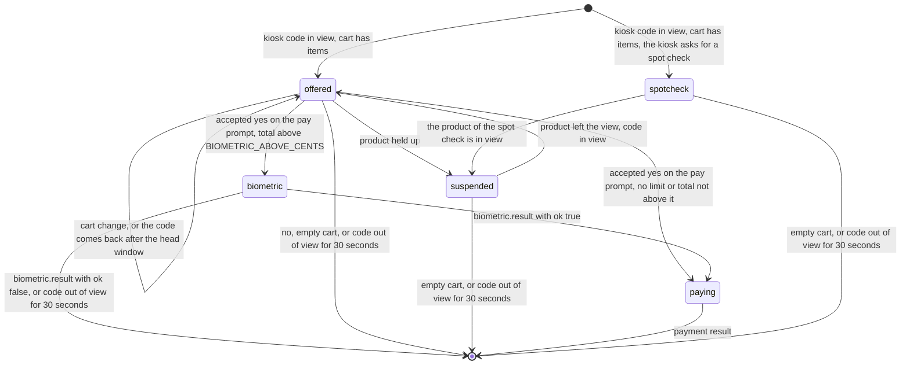

### Spot check

A kiosk that registered with `spotCheck: true` wants to see one product of the cart before the payment. The rules are in `src/sessions/checkout.ts`.

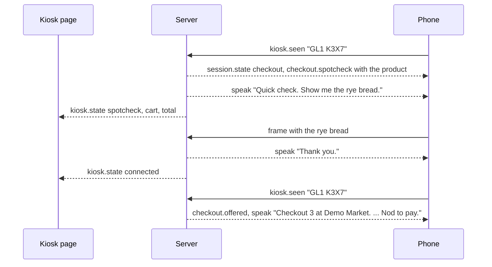

- The checkout starts in the step `spotcheck`, with no pay prompt. So a yes cannot pay, and a no cancels nothing.
- The product to show is the cart line with the highest unit price. The first line wins a tie.
- The start gives `session.state`, then `checkout.spotcheck` with the product reference, then the line `spotcheck.ask`: "Quick check. Show me the rye bread." The line has the priority `high` and interrupts.
- An `identified` result for that product passes the check. The voice says "Thank you." (`spotcheck.thanks`, priority `high`, no interrupt). The product gets no prompt until it has left the view, also when the shopper added it a moment before and still holds it.
- The step is then `suspended` with `suspendedBy: null`, and the next `kiosk.seen` gives the pay prompt. No event reports the passed check: `checkout.offered` follows when the shopper looks at the code.
- Another product in view gets its usual prompt, and a yes adds it. The step stays `spotcheck`.
- If the product of the check leaves the cart, the check asks for the line that now has the highest price, with a new `checkout.spotcheck` and a new ask line. An empty cart ends the checkout.
- The checkout ends when its code was out of view for 30 seconds (R19), when the camera stops, at rest, and with a stop intent, as in each other step.
- The kiosk page gets `kiosk.state` with the state `spotcheck`, the cart, and the total. `KioskEvent` does not name the product.
- A snapshot has no field for the spot check. A client that connects in the step `spotcheck` sees the phase `checkout`, the kiosk, and no prompt.
- To try it with the fake server: register a kiosk with `POST /api/kiosks` and the body `{"name":"Checkout 4","store":"Demo Market","spotCheck":true}`. The `kiosk` step of the default script reports the kiosk that registered last. The kiosk `K3X7` of the fake server asks for no spot check.

A paid checkout sets the phase `paid`, empties the cart, and ends the session. A failed payment keeps the cart, and the shopper looks at the code again.

The session rules:

- The camera counts as on when the phone reports the stream state `streaming`. The voice then says the start line.
- When the phone reports `stopped`, an open checkout ends and the cart stays (R24). The line is "Camera off. Please use a regular checkout." when the battery is at 5 percent or less, or the thermal level is 6 or more. `DeviceState` has no stream error, so `general.ts` holds these two limits. In each other case the line is "Camera off."
- When the phone reports `paused`, and the state before was not `paused`, the line is "Paused. Tap the side of your glasses to resume." The camera still counts as on, so the stream that returns gets no "Camera on" line.
- The voice reports the battery of the glasses one time at 20 percent and one time at 10 percent. A level above 20 percent starts the two warnings again. A state with a stopped stream gives no battery line.
- The input `socket.open` gives "Back online." when the session already has a device state. The stored session holds that state, so the line also comes after a restart of the server. The first socket of a new session gets no line.
- After 3 minutes with no product and no kiosk in view, the camera rests and the cart stays (R22). The effect `session.rest` tells the phone.
- The intent `stop` ends the session. The intent `repeat` speaks the last line again.
- The intents `total` and `cart` speak the cart. The cart by voice has at most five lines (R23).
- In the phase `paid` or `ended`, the session takes only the device state and a profile patch.

The phases of a session:

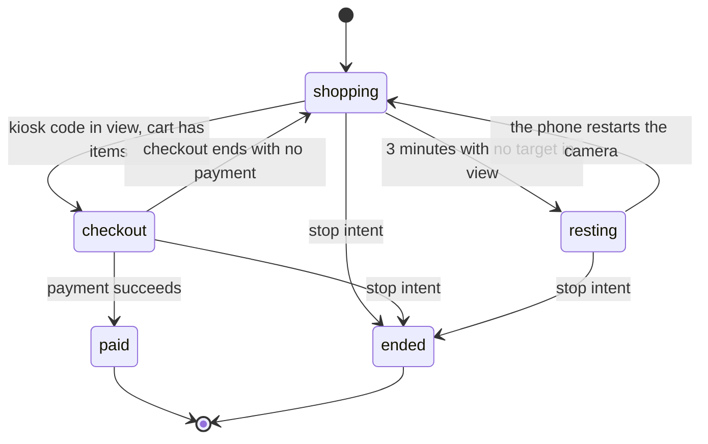

Only the server computes a total, and each price comes from the catalog or from the store list. Each timing number comes from `TIMING` of `@glance/shared`.

## Session runtime

`SessionRuntime` holds one session. `dispatch(input)` adds the clock time, runs `step`, and runs the effects in their order.

- An event goes to the bus at once, on the topic of the session. The events stream and the device socket listen there.
- Each intent gets the log line `intent session=<id> kind=<kind> source=<source> prompt=<id|none> accepted=<true|false> reason=<reason|none>`, at `info` level. `step` returns the verdict with the state and the effects. `accepted` is true for a yes or a no that answered the current prompt, for a no that took back the last add, for a double tap that opened the question window, and for each command. See the reasons below.
- The effect `speak.dropped` is a line that the guard for the voice dropped. The runtime logs `speak dropped session=<id> key=<key> reason=<reason>`, and the phone gets nothing.
- Each line that goes to the phone gets the log line `speak session=<id> key=<key> text=<first 80 characters> prompt=<id|none>`.
- Each product prompt gets the log line `glance timing session=<id> product=<id> frameToResultMs=<n|none> resolveMs=<n|none> clipMs=<n>`. The caller of `dispatch` gives the first two numbers, and the rules hold no state for them. See "A guard for the voice".
- A product prompt also asks for the clips of its answer lines, at the moment its own clip is requested: "Added ..." with the total that the add gives, and "Skipped." or "Removed ...". The runtime gets the texts from `step`: it runs a yes and a no on the state of now and drops the results. The prompt line does not wait for these clips. So the line after a nod waits for no synthesis, and its `answer timing` line shows a small `clipMs`. The clip cache and the one request for each text keep this at one call for each new text. With `FAKE_SPEECH` no call goes out.
- `cart.added`, `cart.removed`, and `glance.skipped` interrupt: the phone stops the line that plays and starts the answer line. They answer an action of the shopper, so the guard for the voice never drops them.
- A line gets its text at once. Then it waits in the outbox of the session for its clip. The outbox sends one message at a time, so the phone gets the lines in the order of the rules, also when an early clip is slow.
- Each line goes to the phone as `speak` and to the bus as a `caption` event with the same ID (`s-1`, `s-2`). If the clip fails, the line goes out with `url: null`.
- The effect `payment.start` starts the mock payment. After each step, the kiosk service reads the checkout of the session and updates the kiosk.
- The effect `biometric.request` goes to the phone as the message `biometric.request`, through the outbox, so it follows the fingerprint line.
- The effect `still.request` goes to the phone at once as the message `still.request` with the purpose `label`. It does not wait in the outbox. `POST /api/demo/reference` sends the same message with the purpose `reference`, with no rule.
- The effect `ask` starts the text call for a question. The runtime dispatches the input `answer` with the text, or with `null` after a failure or after 4 seconds. A stopped session gets no answer.
- The runtime keeps the last 20 captions for the snapshot.
- With no phone attached, the runtime drops the device messages. Events and captions still go to the bus.
- After a step with an event, and after a profile patch, the runtime writes the session to the store. `dispatch` does not wait for the write. A sighting alone writes nothing.
- After `session.end` the runtime stops: its stop listeners run one time. A stopped session still answers a snapshot, for the receipt.

The reasons of an intent with `accepted=false`:

| Reason | Meaning |
|---|---|
| `no-prompt-id` | The yes or the no names no prompt |
| `no-prompt` | No prompt waits for an answer |
| `other-prompt` | The answer names a prompt that ended, or that another prompt replaced |
| `line-plays` | No `prompt.done` arrived yet. Voice, touchpad, key, and camera need it, and a nod on the pay prompt |
| `head-off` | The profile has the head gestures off |
| `code-not-in-view` | A nod on the pay prompt, with no report of the kiosk code in the last 3 seconds |
| `late` | A head answer after its last time (R4) |
| `payment-confirmed` | The payment runs |
| `session-closed` | The session is paid or ended |

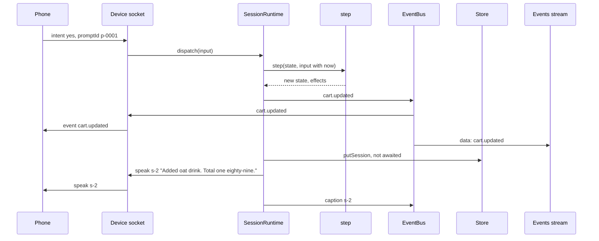

`SessionRegistry` keeps the runtimes of the process.

- `create` makes the session ID with `randomUUID()` and the token from 24 random bytes, and writes the first record.
- `get` looks in the memory first and then in the store. So a phone that connects again after a restart of the server finds its session and its cart.
- A stored session with an open checkout comes back with no checkout and no pay prompt. Its kiosk is free after the restart, so the shopper looks at the code again. The cart stays.
- A stored session with a payment that the restart cut off gets a failed payment. The cart stays.
- Before a stored session becomes a runtime, the server resolves the scanned products of its cart, its prompt, and its last add again. The memory of the old process held them.
- One timer sends a `tick` each second to each session in the phase `shopping` or `checkout`. The rules that depend on time alone need it.
- The speak counter starts again at `s-1` after a restart, and the captions of the old process are gone.

## Spoken text

The rules select a line by its key, and `renderLine(line, profile)` in `src/speech/render.ts` writes its text in the language of the profile. `lines.en.ts` holds one template for each key, with the text of the table "Spoken lines" of the plan. `lines.it.ts` holds the Italian templates.

- `spokenPrice` in `numbers.ts` writes a price as words. The short form is "one eighty-nine". The full form is "one euro eighty-nine". The pay prompt and the paid line use the full form.
- `yesPhrases` in `phrases.ts` names the input of the shopper: "Nod to add.", "Double tap to add.", "Say add.", "Press Add on your phone.", or "Press volume up to add.". A shopper with `headGestures: false` gets the phone phrases.
- The glance line is short, because the shopper waits for it: "Oat drink, one litre, one eighty-nine." In the test of 2026-11-14 the line "Hell Classic Zero Sugarfree, two hundred fifty millilitres, one forty-nine. Nod to add." took about 6 seconds.
- At the level `standard`, a product whose spoken name has more than 3 words gets no pack size: "Hell Classic Zero Sugarfree, one forty-nine." (`LONG_NAME_WORDS` in `lines.en.ts`). English and Italian have the same rule.
- The yes phrase is in the first 2 glance prompts of a session only (`YES_HINT_GLANCES` in `glance.ts`). After them the shopper knows the input. The level `detailed` has the yes phrase and the pack size in each glance prompt.
- The detail level `brief` shortens the glance line, the added line, and the removed line. The level `detailed` adds the brand, the long pack text, and "Contains gluten." for a product that lists allergens.
- The add that crosses the budget says "Added oat drink. Total twenty-one ten. That is over your budget of twenty euros." The budget has the full price form. The level `brief` also names the total in this line.
- No level shortens the pay prompt.
- The spot check says "Quick check. Show me the oat drink." and "Thank you." The Italian texts are "Controllo rapido. Mostrami questo prodotto: bevanda di avena." and "Grazie."
- A warning follows the price and comes before the yes phrase, at each detail level: "Oat drink, one litre, one eighty-nine. Warning: contains gluten. Nod to add." In the line for a product in the cart it follows the count.
- The warning texts are "Warning: contains gluten, milk and nuts.", "Warning: not vegan.", "Warning: not vegetarian.", and "Allergen data is missing for this product." They equal the texts of the phone UI.
- At the level `detailed`, an allergen warning names each allergen of the product, and the "Contains" sentence is left out.
- With no allergen in the profile, the voice says nothing about allergens for a product with no allergen data. It never says that a product is safe.
- The barcode lines are "This product is not in this store." and "I cannot read this code. Hold it closer." The Italian texts are "Questo prodotto non è in questo negozio." and "Non riesco a leggere questo codice. Avvicinalo."
- A scanned product has no spoken texts of its own. Its spoken name is its name, and its name stays as the database writes it inside a sentence: "Added Nutella."
- A plus sign in the name of a store item is the word "plus" in a spoken line, and "più" in Italian: "Kili Cascara Yuzu plus Sitruuna, two forty-nine." (`spokenStoreName` in `src/products/scanned.ts`). A speech service can skip the sign or read it in another language. The shown name keeps the sign, and the caption text is the spoken line. Each word counts for the rule of the long name, also the word "plus".
- `spokenPack` in `src/products/scanned.ts` writes the pack size of a scanned product as words: "500 g" is "five hundred grams" and "cinquecento grammi". It knows one number and the units g, kg, ml, cl, and l. Each other text stays as it is.

Italian, for the profile language `it`:

- Each line has an Italian text, and `speak.lang` and `caption.lang` are `it`. A native speaker has not read `lines.it.ts` yet.
- A product name, a pack text, and a kiosk name come from the data. A product with no Italian text keeps its English text.
- `numberToWords` writes an Italian number as one word: "ventuno", "ventitré", "centottanta", "milleduecentotrentaquattro".
- The short price is "uno e ottantanove", and "uno e zero cinque" for 1.05. The full price is "un euro e ottantanove", "venti euro", "sei euro e cinque centesimi", or "novantanove centesimi".
- No sentence agrees with the gender of a product name: "Aggiunto: bevanda di avena.", "Nel carrello: due pezzi.", "Annuisci per aggiungerne ancora."
- The look-alike line names both products: "Non distinguo tra bevanda di avena e rye bread. Mostrami il davanti." An Italian name starts with the words that two look-alike products share, so the line has no common name.
- The warnings are "Attenzione: contiene glutine, latte e frutta a guscio.", "Attenzione: non per vegani.", "Attenzione: non per vegetariani.", and "Mancano i dati sugli allergeni di questo prodotto."
- Voice commands stay English. The yes phrases for the voice input are "Di' add per aggiungere." and "Di' pay per pagare."
- A profile patch that changes the language writes each cart name again in the new language, and gives the event `cart.updated` with `change: null`.
- The answer to a question comes from the model in the language of the profile.

## Storage

`Store` in `src/db/store.ts` is the interface for the data of spec section 8.6: products, sessions, kiosks, orders, and speech clips.

- `MemoryStore` keeps the data in the process. A restart loses it. The server uses it when `MONGODB_URI` is not set.
- `MongoStore` keeps the data in MongoDB, in the collections `products`, `sessions`, `kiosks`, `orders`, and `speech_clips`. It creates a unique index on `kiosks.code` and an index on `orders.sessionId`. `connect` rejects after 5 seconds if no server answers.
- Each record that a store gives or takes is a copy.
- `deleteSession` also deletes the orders of the session.
- `src/db/contract.ts` holds the tests that each store must pass. No test has run them against a MongoDB server yet.

## REST paths

The paths are those of spec section 8.1. Each body and each answer is a type of `@glance/shared`.

| Call | Body | Answer |
|---|---|---|
| `POST /api/sessions` | `CreateSessionRequest`, or no body | 201, `CreateSessionResponse` |
| `GET /api/sessions/:id` | | 200, `SessionSnapshot` |
| `PATCH /api/sessions/:id/profile` | `ProfilePatch` | 200, the new `Profile` |
| `POST /api/sessions/:id/intents` | `WebIntentRequest` | 204 |
| `POST /api/sessions/:id/cart` | `CartEditRequest` | 204 |
| `GET /api/sessions/:id/events` | | a stream of `ServerEvent` |
| `DELETE /api/sessions/:id` | | 204 |
| `POST /api/kiosks` | `CreateKioskRequest` | 201, `CreateKioskResponse` |
| `GET /api/kiosks/:id/events` | | a stream of `KioskEvent`. The first message is the current view. |
| `GET /api/speech/<hash>.mp3` | | 200, the MP3 of a clip |
| `GET /api/demo/latest?key=<DEMO_KEY>` | | 200, `LatestSessionResponse` |
| `POST`, `GET`, `DELETE /api/demo/reference?key=<DEMO_KEY>` | | The reference pictures. See "Reference pictures". |
| `GET /healthz` | | 200, the state of the switches: `fakeRecognition`, `fakeSpeech`, `fakeProductInfo`, `store` (`memory` or `mongo`), and `saveFrames` |

- `wsUrl` of a new session is `PUBLIC_BASE_URL` with `ws` in place of `http`, plus `/ws/device?session=<id>&token=<token>`.
- A body that fails its schema gets 400 with `{ "error": "bad_request" }`. An unknown session gets 404 with `{ "error": "not_found" }`. An unknown key in a profile patch is dropped.
- A 204 says only that the server took the input. The outcome arrives as events.
- Each path with a session ID needs `?token=<token>` with the token of that session. `GET /api/kiosks/:id/events` needs the token of the kiosk. `POST /api/sessions`, `POST /api/kiosks`, the speech path, and `GET /healthz` need no token.
- A missing or wrong token gets 401 with `{ "error": "unauthorized" }`. So does a query string with two `token` keys. The server checks the ID first and the token second, and reads the body last: an unknown ID gets 404, and a wrong token with a bad body gets 401, also when the body is no JSON. Two cases get 400 before the check: a body above the size limit of Fastify, and a body with a content type that is not JSON.
- `tokenMatches` in `src/http/auth.ts` compares a token in constant time.
- The request log holds the method and the path with no query string, because the query string holds the token.
- `GET /api/demo/latest` gives the ID and the token of the newest session that has not stopped. The mirror page follows the session of the phone with it. The path answers 404 with `{ "error": "not_found" }` when `DEMO_KEY` is not set, when the key is wrong, and when no session is live. The key opens each session, so use a long random value.
- The events stream sends `data: <json>` for each event, and the comment `: ping` at the start and then each 15 seconds. A web client opens the stream first and then gets the snapshot, so it loses no event.
- `DELETE` sends `session.end` to the phone, closes its socket, ends each events stream of the session, frees its kiosk, and deletes the session with its orders.
- An unknown kiosk gets 404.
- The stream of a session that is paid or ended stays open and sends only pings.
- A call with the JSON content type and an empty body counts as a call with no body.

## Device socket

The phone opens `/ws/device?session=<id>&token=<token>`, as in spec section 8.2. The messages are `DeviceToServer` and `ServerToDevice` of `@glance/shared`.

- An upgrade for another path or for an unknown session gets `404 Not Found`. An upgrade with a missing or wrong token gets `401 Unauthorized`. The server writes the answer and lets the client close the connection, with a limit of 5 seconds. If the server closes first, a client under load can get a connection reset in place of the status.
- On open, the server sends a `snapshot`. Then it sends each event of the session as `event`, and each line as `speak`. A phone that comes back hears "Back online." after the snapshot.
- One phone holds a session. A second socket for the same session takes over, and the server closes the older one. No message goes to both.
- `intent`, `prompt.done`, `device.state`, `cart.edit`, and `profile.set` go to the rules. After `profile.set` the phone gets a new `snapshot`.
- `speech.final` with a confidence of 0.5 or more goes through the command table below. A command becomes an intent with the source `voice` and the ID of the last prompt that finished. Each other text becomes the input `question`.
- A binary message is a frame. A frame that decodes goes to the recognition worker of the session, or to the log line of fake recognition. A frame with the kind `label` goes to the label reader, or to the reference pictures when the session has a mark. The server logs a frame that does not decode and drops it.
- The server logs and drops a text message that is no `DeviceToServer`. The socket stays open.
- `kiosk.seen` goes to the kiosk service. `biometric.result` goes to the rules.
- `barcode.seen` goes to the lookup of a barcode, and its outcome goes to the rules.
- The server sends `still.request` with the purpose `label` when the model sees a barcode that nobody read. See "The model also reads the code". It sends the purpose `reference` when a person asks for a reference picture.
- A message can have at most 2 MB. A larger one closes the socket.
- The server sends a ping each 20 seconds, and ends a socket that sent no pong since the last ping.
- When the phone leaves, the session stays.

Voice commands. Only a full match counts, with no regard to case and punctuation.

| Words | Intent | Answers |
|---|---|---|
| add, add it | `yes` | a product prompt, or no prompt |
| yes | `yes` | each prompt |
| pay | `yes` | the pay prompt |
| no | `no` | each prompt |
| skip, skip it, remove, remove it | `no` | a product prompt, or no prompt |
| cancel | `no` | the pay prompt |
| undo, repeat, total, cart, help, stop | the same word | |

So the word "add" never pays, and the word "pay" never adds a product.

## Checks

```bash
npm test --workspace @glance/server                  # all tests
npm test --workspace @glance/server -- config        # the test files with "config" in the path
npm run typecheck --workspace @glance/server
npm run lint                                         # at the repository root, for each workspace
```

No test calls a vendor or Open Food Facts, and no test needs a key. The tests of the Gemini calls, of the ElevenLabs call, and of the Open Food Facts call give the code a fetch function of their own. `testApp` reads the product details from the fixtures.

Each test that needs a server starts one with `testApp` of `src/testing.ts`, on a free port of `127.0.0.1`, and closes it.

The store tests of `src/db/mongo.test.ts` need a MongoDB server. Without `MONGODB_URI_TEST` they are skipped. With it, each test makes a database with a random name and drops it:

```bash
MONGODB_URI_TEST=<connection string> npm test --workspace @glance/server -- mongo
```

Four checks call a vendor and are not part of the tests: `npm run replay` (see "Replay a test set"), `npm run reference:probe` (see "Reference pictures in a frame call"), and the two below. Run each one by hand, one time:

```bash
# The model ID, with no cost. With a JPEG path it also makes one recognition call.
npm run model:check --workspace @glance/server -- <frame.jpg>
# Expected: "model: <name>", then a result with "status", and "ms:" under 4000.

# One question about one catalog product: one text call.
npm run ask:check --workspace @glance/server -- oat-drink-1l "Does it contain nuts?"
# Expected: "answer:" with one or two sentences that name gluten and do not say that the product is safe, and "ms:" under 4000.
```

`model:check` and `ask:check` read `apps/server/.env`. To read another file, run `npx tsx --env-file=<file> scripts/check-model.ts <frame.jpg>` or `npx tsx --env-file=<file> scripts/check-ask.ts <productId> "<question>" [en|it]` in `apps/server`. The fake switches have no effect on these commands.

### Smoke check of a running server

```bash
npm run smoke --workspace @glance/server -- http://127.0.0.1:8080
```

`runSmoke` in `scripts/smoke.ts` plays a phone and a web client against the address. It does seven steps and stops at the first one that fails:

1. `health`: `GET /healthz` answers 200.
2. `session`: `POST /api/sessions` answers 201.
3. `socket`: the `wsUrl` of the answer opens, and a `snapshot` arrives.
4. `events`: the events stream of the session answers 200.
5. `line`: after a `device.state` with a running stream, the `speak` message of the "Camera on" line arrives.
6. `caption`: the events stream gets the caption of that line.
7. `delete`: `DELETE` of the session answers 204.

- The command prints `ok <name>` or `FAIL <name>: <detail>` for each step, then `smoke: OK` or `smoke: FAIL`. Its exit code is 1 on a failure.
- Each step has 5 seconds.
- The socket step uses the address that the server gives. So a wrong `PUBLIC_BASE_URL` fails at `socket`.
- After a failure the command still deletes its session. A session that stays would be the newest live session of `GET /api/demo/latest`.
- The server needs no fake switch for it. With real speech, the "Camera on" line is one ElevenLabs call if its clip does not exist yet. The command sends no frame, so it makes no Gemini call.
- `infra/README.md` shows the command against the Docker image and through the proxy.

Each rule R1 to R24 has a test with its number in the name, in `src/sessions/*.test.ts`. `replays.test.ts` replays result sequences with gaps and changes, because live results flicker.
