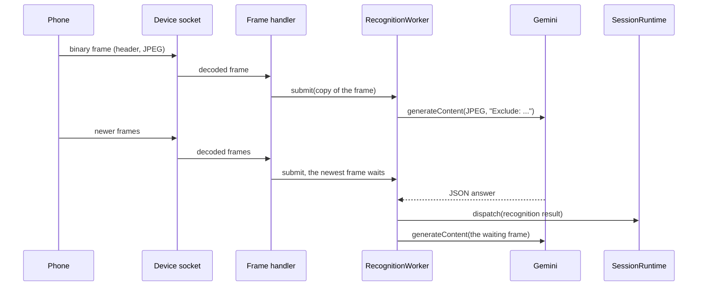
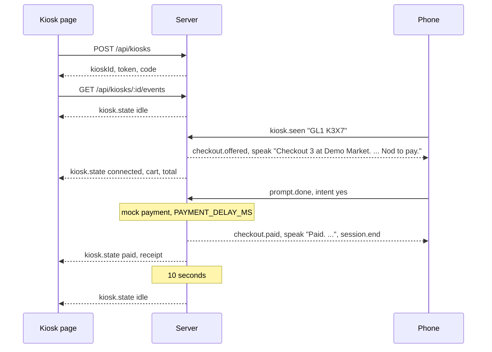
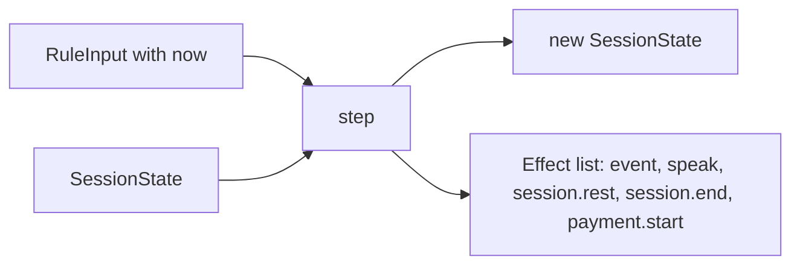
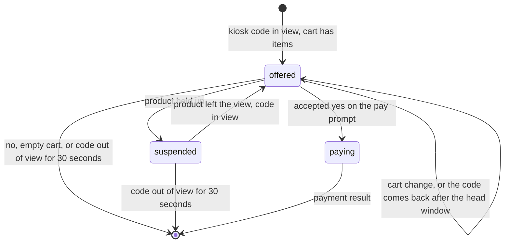
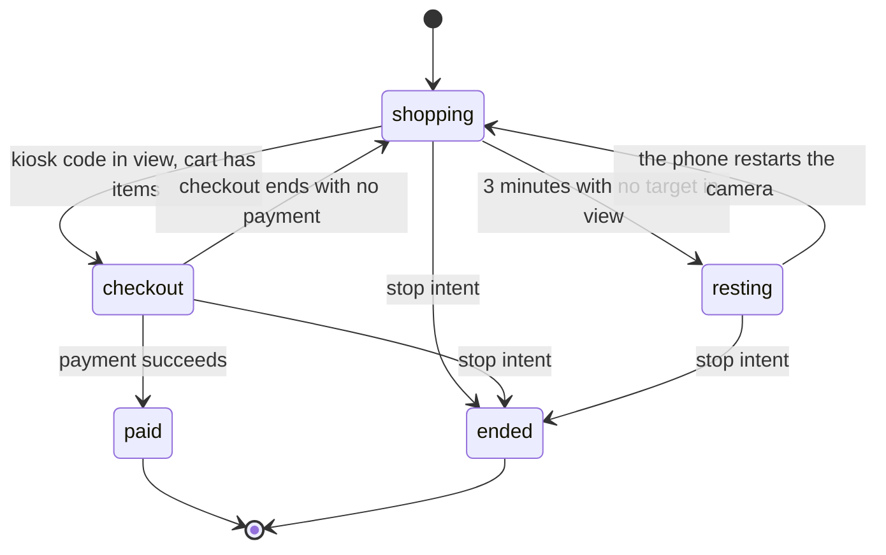
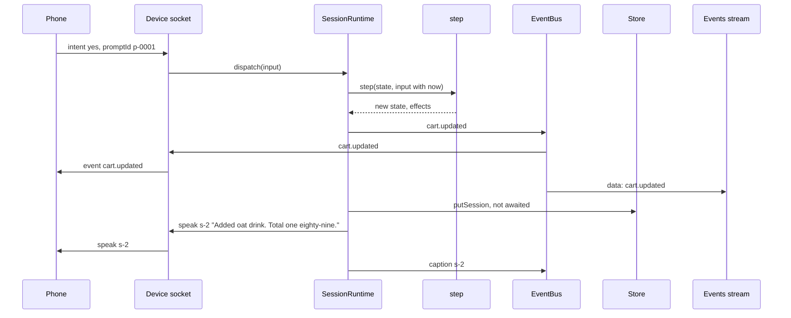

# @glance/server

The server of Meta Glance. One Node process runs TypeScript sources with `tsx`. The message types come from `@glance/shared`.

This file describes only the parts that exist. The plan is `docs/superpowers/plans/2026-11-14-glance-1-server.md`.

## What exists

| Path | Content |
|---|---|
| `src/config.ts` | `loadConfig` reads the settings from the environment and the command line. |
| `src/app.ts` | `buildApp` makes the Fastify app: the CORS headers, the JSON error bodies, `GET /healthz`, the paths, and the device socket. |
| `src/bus.ts` | `EventBus` delivers messages inside the process, by topic. |
| `src/clock.ts` | The time source of the runtime. |
| `src/main.ts` | Opens the store, starts the server, and closes it on `SIGTERM` and `SIGINT`. |
| `src/catalog/catalog.ts` | `readCatalogFile` reads a catalog file, and `indexCatalog` finds a product by its ID. |
| `catalog/catalog.dev.json` | The dev catalog with four products. The tests use its IDs and prices. |
| `src/recognition/` | The recognition of a frame, and the script player that stands in for it. See "Recognition" and "Fake mode". |
| `agents/recognition.md` (repository root) | The instruction for the recognition model, with the placeholder `{{catalog}}`. |
| `fixtures/fake-script.json` | The default script of fake recognition. |
| `scripts/check-model.ts` | `npm run model:check`: a check of the model ID with the real service. |
| `src/sessions/` | The cart rules as the pure function `step`, the session runtime, and the registry. See "Rules" and "Session runtime". |
| `src/speech/` | The text of each spoken line, and the speech clips. See "Spoken text" and "Speech clips". |
| `src/kiosk/` | The kiosks and the mock payment. See "Kiosk and payment". |
| `src/db/` | The `Store` interface with a memory store and a MongoDB store. See "Storage". |
| `src/http/` | The session paths, the kiosk paths, the speech path, and the events streams. See "REST paths". |
| `src/ws/device.ts` | The socket of the phone. See "Device socket". |
| `src/testing.ts` | Test helpers: an app on a free port, a reader for an events stream, and a phone on the device socket. |

Parts that do not exist yet: the token check, the catalog seed, the `SAVE_FRAMES` switch, the spot check, and the fingerprint check. The lines for a paused stream, the battery, and slow recognition have a text, and no rule speaks them yet.

## Run it

Run `npm install` at the repository root first. Then run the commands in `apps/server`, or add `--workspace @glance/server` at the root.

```bash
npm run dev:fake    # port 8080, both fake switches on, needs no key and no database
npm run dev         # reads .env if the file exists, and restarts on a change
npm start           # runs with the environment of the shell
PORT=18473 npm run dev:fake   # another port, when 8080 is in use
```

Check it:

```bash
curl http://localhost:8080/healthz
# {"ok":true,"fakeRecognition":true,"fakeSpeech":true,"store":"memory"}
curl -X POST http://localhost:8080/api/sessions
# {"sessionId":"...","token":"...","wsUrl":"ws://localhost:8080/ws/device?session=...&token=..."}
```

At the start the server logs `store: memory` or `store: mongo`, the number of products, `recognition: fake` or the model, and `speech: fake` or the speech model.

With real recognition and real speech (`npm run dev` with both keys in `.env` and both fake switches empty), each frame is one paid Gemini call, and each new line is one paid ElevenLabs call. A phone sends 2 frames each second.

## Settings

`.env.example` lists each variable. Copy it to `.env`. Git ignores `.env`, and the pre-commit hook stops a commit that holds one.

| Variable | Default | Meaning |
|---|---|---|
| `PORT` | `8080` | The port. The server listens on each network interface. |
| `PUBLIC_BASE_URL` | `http://localhost:<PORT>` | The address that clients use. |
| `MONGODB_URI` | not set | With no address, the server keeps its data in memory. |
| `MONGODB_DB` | `glance` | The database name. |
| `CATALOG_PATH` | `catalog/catalog.dev.json` | The catalog file. |
| `GEMINI_API_KEY` | not set | Needed when `FAKE_RECOGNITION` is off. |
| `GEMINI_MODEL` | `gemini-3.5-flash-lite` | The recognition model. |
| `GEMINI_MEDIA_RESOLUTION` | `default` | `default` or `low`. |
| `RECOGNITION_MIN_CONFIDENCE` | `0.6` | A number from 0 to 1. An `identified` answer below it counts as `unsure`. |
| `REQUIRE_BLUR` | off | `1` means on. The server then drops each frame that the phone sent with `blurred: false`. |
| `FAKE_RECOGNITION` | off | `1` selects `fixtures/fake-script.json`. Each other value is the path of a script file. |
| `FAKE_SPEECH` | off | `1` means on. |
| `ELEVENLABS_API_KEY` | not set | Needed when `FAKE_SPEECH` is off. |
| `ELEVENLABS_VOICE_EN` | not set | Needed when `FAKE_SPEECH` is off. |
| `ELEVENLABS_VOICE_IT` | not set | The voice for Italian. |
| `SPEECH_CACHE_DIR` | `.cache/speech` | The folder for speech clips. |
| `SAVE_FRAMES` | not set | A directory for frames. The config reads it, and no code uses it yet: the server stores no frame. |
| `PAYMENT_DELAY_MS` | `1500` | The length of the mock payment. |

- An empty value counts as not set.
- The flag `--fake` turns both fake switches on. A variable that is set wins over the flag.
- Each path is relative to the working directory, which is `apps/server`. The server also reads `../../agents/recognition.md` from there when recognition is real.
- With a missing key the server prints `config: <message>` and exits with code 1. The message names the variable and the switch that removes the need.
- With `MONGODB_URI` the products come from the database, and `CATALOG_PATH` has no effect. If the database holds no product, the server prints `products is empty. Run npm run catalog:seed.` and exits with code 1. The seed command does not exist yet.

## Fake mode

Two switches let the other apps work with no key. `npm run dev:fake` turns both on.

`FAKE_RECOGNITION`:

- The server makes no Gemini call and does not read `GEMINI_API_KEY`.
- One script player runs for each session. It starts when the phone opens the device socket, or when the first client opens the events stream of the session, whichever comes first.
- Each 500 ms the player gives the rules the result that the script holds for the time since its start. Outside each step the result is `none`.
- A session that starts from the events stream, with no phone, first gets the state of glasses that stream. A browser client then gets the "Camera on" caption.
- In a `kiosk` step the session sees the kiosk one time each second. `"newest"` names the kiosk that registered last. Each other value is a kiosk code.
- The device socket still decodes each frame. It logs `frame seq=<n> w=<w> h=<h> blurred=<b> kind=<k> bytes=<n>` at `info` level and drops the frame.
- The server has one kiosk from the start: `Checkout 3` at `Demo Market` with the code `K3X7`. A printed `GL1 K3X7` code starts a checkout.

A script file, as `fixtures/fake-script.json`:

```json
{
  "loop": true,
  "lengthMs": 60000,
  "steps": [
    { "atMs": 3000, "forMs": 6000, "result": { "status": "identified", "productId": "oat-drink-1l" } },
    { "atMs": 24000, "forMs": 3000, "result": { "status": "unsure", "aimHint": "left" } },
    { "atMs": 40000, "forMs": 15000, "kiosk": "newest" }
  ]
}
```

- A step covers the times from `atMs` up to, and not including, `atMs + forMs`. With `loop`, the script starts again after `lengthMs`.
- A `result` holds some fields of a recognition result. The other fields come from the empty result, with the confidence 0.95.
- A file that is no script, an unknown key, and a product ID that the catalog does not have stop the server at its start. The message names the file and the step, counted from 1.

`FAKE_SPEECH`:

- The server makes no ElevenLabs call and reads no ElevenLabs variable.
- Each `speak` message and each `caption` event has `url: null`. The `text` is the real line. The phone reads it with its own voice.
- `GET /api/speech/<hash>.mp3` answers 404.

Try the fake server with no phone. The second call prints the events of the script:

```bash
curl -s -X POST http://localhost:8080/api/sessions -H "content-type: application/json" -d "{}"
curl -N "http://localhost:8080/api/sessions/<sessionId>/events?token=<token>"
# after 3 seconds: glance.pending for the oat drink. Answer it with its promptId:
curl -s -X POST "http://localhost:8080/api/sessions/<sessionId>/intents?token=<token>" -H "content-type: application/json" -d '{"kind":"yes","source":"phone","promptId":"<promptId>"}'
# at second 40: checkout.offered. The same call with its promptId gives checkout.paid.
```

## Recognition

With `FAKE_RECOGNITION` off, each frame of the phone goes to Gemini, and the answer goes to the rules.



| File in `src/recognition` | Content |
|---|---|
| `result.ts` | `RecognitionResult`, and `normalizeResult`, which checks an answer of the model |
| `prompt.ts` | The system instruction with the catalog, the JSON Schema of the answer, and the text of a request |
| `gemini.ts` | `createGeminiRecognizer`: one `generateContent` call of `@google/genai` for each frame |
| `worker.ts` | `RecognitionWorker`: the calls of one session |
| `intake.ts` | `createFrameHandler`: one worker for each session, between the device socket and the rules |
| `fake.ts` | The script file and `ScriptPlayer` of fake recognition |

The request:

- The system instruction is `agents/recognition.md` with one line for each product in place of `{{catalog}}`: ID, name, brand, pack size, look, and look-alikes. It holds no price.
- The answer is JSON with the six fields of spec section 11.1. Its schema lets `productId` and `candidates` take only catalog IDs.
- The text part is `Exclude: none.` or `Exclude: <id>, <id>.`, with the products that the shopper skipped in the last 10 seconds (R9).
- The call makes one attempt, with a time limit of 4 seconds. The SDK default is 5 attempts.
- `GEMINI_MEDIA_RESOLUTION=low` asks for the low resolution for a stream frame. A still keeps the default.

`normalizeResult` never turns another status into `identified`:

- An answer that fails the schema counts as no product.
- `identified` with an ID outside the catalog becomes `unknown`. With an excluded ID it becomes `none`. Below `RECOGNITION_MIN_CONFIDENCE` it becomes `unsure`.
- `ambiguous` keeps the candidates that are in the catalog and not excluded. With one candidate left it becomes `unsure` with the aim hint `turn`. With none it becomes `unknown`.

The worker:

- One call runs at a time for each session. While it runs, one frame waits, and a newer frame takes its place. A stream frame does not replace a waiting still.
- A call that takes 4 seconds is dropped: the worker aborts it and ignores a late answer.
- A call that fails gets one log line with the name of the error and at most 200 characters of its message.
- After 3 failed calls in a row the server logs `recognition is slow for the session <id>`. No spoken line follows yet.
- The worker holds a frame only for the time of its call. The server writes no frame to disk, to the store, or to a log.
- The worker stops when its session stops and when the app closes.
- Each result gets the log line `recognition session=<id> seq=<n> status=<status> ms=<n>`. It gives the server share of the time from glance to voice.

Frames with `blurred: false` did not go through face detection on the phone. Without `REQUIRE_BLUR` they still go to Gemini, and the server logs `frame not blurred: the phone did not run face detection` one time for each session. With `REQUIRE_BLUR=1` the server drops them and logs `frame dropped: not blurred` one time for each session.

## Speech clips

With `FAKE_SPEECH` off, each line gets an MP3 clip from ElevenLabs, and the `speak` message carries its address.

- The name of a clip is the SHA-256 hash of its text, language, voice ID, and model. One line in one voice is one file, `<SPEECH_CACHE_DIR>/<hash>.mp3`.
- A clip in the directory needs no call. So a line costs one call, the first time a session needs it.
- A miss calls `POST https://api.elevenlabs.io/v1/text-to-speech/<voiceId>/stream?output_format=mp3_44100_128` with the model `eleven_flash_v2_5` and a time limit of 3 seconds.
- Two requests for one clip at the same time share one call.
- If the call fails, the line goes out with `url: null`, and the server logs `speech: no clip. <cause>`. The prompt still takes a yes. The next line with that text tries again.
- The voice is `ELEVENLABS_VOICE_IT` for Italian text when it is set. In each other case it is `ELEVENLABS_VOICE_EN`.
- `GET /api/speech/<hash>.mp3` serves a clip with `content-type: audio/mpeg` and a cache time of one year. A name that is not 64 hex characters plus `.mp3` gets 404, and the server reads no file for it.
- The address of a clip starts with `PUBLIC_BASE_URL`. The phone must reach that address.

## Kiosk and payment

A kiosk is a checkout screen with a QR code. The kiosk page registers with `POST /api/kiosks`, shows `GL1 <code>`, and reads its events stream.



- A kiosk gets a random ID, a random token, and a code of 4 characters from `ABCDEFGHJKLMNPQRSTUVWXYZ23456789`. No two kiosks have one code.
- `kiosk.seen` of the phone carries the text of a QR code. A text that is no code of a kiosk has no effect (R14). Upper and lower case both count.
- One session holds a kiosk for the time of its checkout. A second shopper hears "This checkout is busy." The kiosk is free again when the checkout ends, and when a client deletes the session.
- The kiosk stream sends a `KioskEvent` each time its view changes: `idle`, `connected` with the cart and the total, then `paid` with the receipt or `failed`. A result stays for 10 seconds, or until the next checkout starts.
- The payment is a mock. No money moves. After `PAYMENT_DELAY_MS` the server writes an order (`ord-` plus 8 hex characters, `method: "demo"`) and gives the rules the result.
- A kiosk that registered with `failPayment: true` declines each payment and makes no order. The cart stays.
- A second yes while the payment runs has no effect, so one checkout makes one order.
- The store keeps each kiosk. After a restart of the server, no session holds a kiosk, and a shopper starts the checkout again at the code.
- If the server stops while a payment waits, that payment fails when the session loads again. No order exists for it.
- The `spotCheck` value of a kiosk is stored and has no effect yet.

## Catalog

A catalog file is a JSON array. Each entry is a `Product` of `@glance/shared`. Prices are integers in cents.

- `readCatalogFile` stops at the first entry that fails the schema. Its message names the file, the index of the entry, and the ID.
- `indexCatalog` rejects a catalog that holds one ID two times.
- In `allergens`, `null` means "no data", and an empty list means "no allergen". The potato crisps of the dev catalog have no data.

## Rules

`step(state, input, ctx)` in `src/sessions/step.ts` holds the interaction rules of spec section 6.2. It returns the new state and a list of effects. It reads no clock and does no I/O: each input carries its time as `now`. The session runtime calls it for each input.



| File in `src/sessions` | Content |
|---|---|
| `types.ts` | `SessionState`, `RuleInput`, `Effect`, and `Line`, a spoken line before it has a text |
| `step.ts` | `createSessionState`, `step`, and the rules that depend on time alone |
| `glance.ts` | Recognition results: the glance prompt, the unknown line, and the aim hint |
| `answers.ts` | The answers: yes, no, undo, the cart edit, and `accepts`, which tells if an answer counts |
| `checkout.ts` | The kiosk code, the pay prompt, and the result of the payment |
| `general.ts` | The device state, the profile patch, and the intents stop, repeat, total, cart, and help |
| `say.ts` | The priority, the sound, and the interrupt value of each line |
| `view.ts` | `inView`, `excludeList` for the recognition worker, and `toSnapshot` for a client that connects |
| `turn.ts` | The helpers that the handlers share |
| `harness.ts` | A test helper that plays inputs with a clock of its own |
| `runtime.ts` | `SessionRuntime`: one session in the process. It runs `step` and then the effects |
| `registry.ts` | `SessionRegistry`: creates, finds, and removes sessions, and sends the tick |
| `voice.ts` | `parseVoiceCommand`: the spoken command words |

The rules that exist:

- A recognized product gets a glance prompt with a new ID (R1). A new product replaces the pending product (R2).
- Results inside the view time belong to one appearance. A product that comes back after it left the view gets a new prompt.
- A product prompt ends when its product left the view for 15 seconds (R5).
- A product in the cart gets the prompt for "add another" (R11).
- An unknown product gets one line for each appearance (R13). An aim hint plays at most one time each 5 seconds.
- A yes or a no counts only with the ID of the current prompt (R3). From the head it also needs a finished prompt, the product in view, and the head window (R4). From voice, touchpad, key, or camera it needs a finished prompt (R5). From the phone or the HUD it needs the ID alone (R6).
- An accepted yes adds one unit (R7). An accepted no skips the product, and recognition excludes it for 10 seconds (R8, R9).
- After an add, a no removes that unit for 8 seconds, and a second yes gets one hint (R10). On the prompt for "add another", a no removes one unit (R11).
- An undo removes the last added unit that the cart still holds (R12). A cart edit sets the quantity of a cart line from 0 to 99.
- A yes or a no with no valid target gets one hint, if a prompt finished in the last 15 seconds (R20). Silence adds nothing (R21).
- A kiosk code starts a checkout when the cart has items and no product prompt is current (R15). A busy kiosk and an empty cart get one line for each appearance of the code.
- A yes pays only as an answer to the pay prompt (R16). The effect `payment.start` asks the runtime for the payment, and the input `payment.result` brings its result.
- A product held up during a checkout suspends it. The pay prompt returns with the new total when the product has left the view and the code is in view (R17).
- A no on the pay prompt cancels the checkout, and the kiosk is muted until its code has left the view (R18).
- A checkout ends when its code was out of view for 30 seconds (R19). The cart stays.
- A cart change during a pay prompt gives a new pay prompt with the new total. The old prompt cannot pay.
- While the payment runs, no answer, no undo, and no cart edit has an effect.

The steps of a checkout:



A paid checkout sets the phase `paid`, empties the cart, and ends the session. A failed payment keeps the cart, and the shopper looks at the code again.

The session rules:

- The camera counts as on when the phone reports the stream state `streaming`. The voice then says the start line.
- When the phone reports `stopped`, an open checkout ends and the cart stays (R24). The line is "Camera off. Please use a regular checkout." when the battery is at 5 percent or less, or the thermal level is 6 or more. `DeviceState` has no stream error, so `general.ts` holds these two limits. In each other case the line is "Camera off."
- After 3 minutes with no product and no kiosk in view, the camera rests and the cart stays (R22). The effect `session.rest` tells the phone.
- The intent `stop` ends the session. The intent `repeat` speaks the last line again.
- The intents `total` and `cart` speak the cart. The cart by voice has at most five lines (R23).
- In the phase `paid` or `ended`, the session takes only the device state and a profile patch.

The phases of a session:



Only the server computes a total, and each price comes from the catalog. Each timing number comes from `TIMING` of `@glance/shared`.

## Session runtime

`SessionRuntime` holds one session. `dispatch(input)` adds the clock time, runs `step`, and runs the effects in their order.

- An event goes to the bus at once, on the topic of the session. The events stream and the device socket listen there.
- A line gets its text at once. Then it waits in the outbox of the session for its clip. The outbox sends one message at a time, so the phone gets the lines in the order of the rules, also when an early clip is slow.
- Each line goes to the phone as `speak` and to the bus as a `caption` event with the same ID (`s-1`, `s-2`). If the clip fails, the line goes out with `url: null`.
- The effect `payment.start` starts the mock payment. After each step, the kiosk service reads the checkout of the session and updates the kiosk.
- The runtime keeps the last 20 captions for the snapshot.
- With no phone attached, the runtime drops the device messages. Events and captions still go to the bus.
- After a step with an event, and after a profile patch, the runtime writes the session to the store. `dispatch` does not wait for the write. A sighting alone writes nothing.
- After `session.end` the runtime stops: its stop listeners run one time. A stopped session still answers a snapshot, for the receipt.



`SessionRegistry` keeps the runtimes of the process.

- `create` makes the session ID with `randomUUID()` and the token from 24 random bytes, and writes the first record.
- `get` looks in the memory first and then in the store. So a phone that connects again after a restart of the server finds its session and its cart.
- A stored session with a payment that the restart cut off gets a failed payment. The cart stays.
- One timer sends a `tick` each second to each session in the phase `shopping` or `checkout`. The rules that depend on time alone need it.
- The speak counter starts again at `s-1` after a restart, and the captions of the old process are gone.

## Spoken text

The rules select a line by its key, and `renderLine(line, profile)` in `src/speech/render.ts` writes its text. `lines.en.ts` holds one template for each key, with the text of the table "Spoken lines" of the plan.

- `spokenPrice` in `numbers.ts` writes a price as words. The short form is "one eighty-nine". The full form is "one euro eighty-nine". The pay prompt and the paid line use the full form.
- `yesPhrases` in `phrases.ts` names the input of the shopper: "Nod to add.", "Double tap to add.", "Say add.", "Press Add on your phone.", or "Press volume up to add.". A shopper with `headGestures: false` gets the phone phrases.
- The detail level `brief` shortens the glance line, the added line, and the removed line. The level `detailed` adds the brand, the long pack text, and "Contains gluten." for a product that lists allergens.
- No level shortens the pay prompt.
- The voice says nothing about allergens for a product with no allergen data. It never says that a product is safe.
- The profile language `it` gives the English text. The Italian lines do not exist yet.

## Storage

`Store` in `src/db/store.ts` is the interface for the data of spec section 8.6: products, sessions, kiosks, orders, and speech clips.

- `MemoryStore` keeps the data in the process. A restart loses it. The server uses it when `MONGODB_URI` is not set.
- `MongoStore` keeps the data in MongoDB, in the collections `products`, `sessions`, `kiosks`, `orders`, and `speech_clips`. It creates a unique index on `kiosks.code` and an index on `orders.sessionId`. `connect` rejects after 5 seconds if no server answers.
- Each record that a store gives or takes is a copy.
- `deleteSession` also deletes the orders of the session.
- `src/db/contract.ts` holds the tests that each store must pass. No test has run them against a MongoDB server yet.

## REST paths

The paths are those of spec section 8.1. Each body and each answer is a type of `@glance/shared`.

| Call | Body | Answer |
|---|---|---|
| `POST /api/sessions` | `CreateSessionRequest`, or no body | 201, `CreateSessionResponse` |
| `GET /api/sessions/:id` | | 200, `SessionSnapshot` |
| `PATCH /api/sessions/:id/profile` | `ProfilePatch` | 200, the new `Profile` |
| `POST /api/sessions/:id/intents` | `WebIntentRequest` | 204 |
| `POST /api/sessions/:id/cart` | `CartEditRequest` | 204 |
| `GET /api/sessions/:id/events` | | a stream of `ServerEvent` |
| `DELETE /api/sessions/:id` | | 204 |
| `POST /api/kiosks` | `CreateKioskRequest` | 201, `CreateKioskResponse` |
| `GET /api/kiosks/:id/events` | | a stream of `KioskEvent`. The first message is the current view. |
| `GET /api/speech/<hash>.mp3` | | 200, the MP3 of a clip |
| `GET /healthz` | | 200, the state of the switches |

- `wsUrl` of a new session is `PUBLIC_BASE_URL` with `ws` in place of `http`, plus `/ws/device?session=<id>&token=<token>`.
- A body that fails its schema gets 400 with `{ "error": "bad_request" }`. An unknown session gets 404 with `{ "error": "not_found" }`. An unknown key in a profile patch is dropped.
- A 204 says only that the server took the input. The outcome arrives as events.
- No path checks the token yet. A client still sends `?token=` with each call.
- The events stream sends `data: <json>` for each event, and the comment `: ping` at the start and then each 15 seconds. A web client opens the stream first and then gets the snapshot, so it loses no event.
- `DELETE` sends `session.end` to the phone, closes its socket, ends each events stream of the session, frees its kiosk, and deletes the session with its orders.
- An unknown kiosk gets 404.
- The stream of a session that is paid or ended stays open and sends only pings.
- A call with the JSON content type and an empty body counts as a call with no body.

## Device socket

The phone opens `/ws/device?session=<id>&token=<token>`, as in spec section 8.2. The messages are `DeviceToServer` and `ServerToDevice` of `@glance/shared`.

- An upgrade for another path or for an unknown session gets `404 Not Found`.
- On open, the server sends a `snapshot`. Then it sends each event of the session as `event`, and each line as `speak`.
- One phone holds a session. A second socket for the same session takes over, and the server closes the older one. No message goes to both.
- `intent`, `prompt.done`, `device.state`, `cart.edit`, and `profile.set` go to the rules. After `profile.set` the phone gets a new `snapshot`.
- `speech.final` with a confidence of 0.5 or more goes through the command table below. A command becomes an intent with the source `voice` and the ID of the last prompt that finished.
- A binary message is a frame. A frame that decodes goes to the recognition worker of the session, or to the log line of fake recognition. The server logs a frame that does not decode and drops it.
- The server logs and drops a text message that is no `DeviceToServer`. The socket stays open.
- `kiosk.seen` goes to the kiosk service. `biometric.result` has no effect yet.
- A message can have at most 2 MB. A larger one closes the socket.
- The server sends a ping each 20 seconds, and ends a socket that sent no pong since the last ping.
- When the phone leaves, the session stays.

Voice commands. Only a full match counts, with no regard to case and punctuation.

| Words | Intent | Answers |
|---|---|---|
| add, add it | `yes` | a product prompt, or no prompt |
| yes | `yes` | each prompt |
| pay | `yes` | the pay prompt |
| no | `no` | each prompt |
| skip, skip it, remove, remove it | `no` | a product prompt, or no prompt |
| cancel | `no` | the pay prompt |
| undo, repeat, total, cart, help, stop | the same word | |

So the word "add" never pays, and the word "pay" never adds a product.

## Checks

```bash
npm test --workspace @glance/server                  # all tests
npm test --workspace @glance/server -- config        # the test files with "config" in the path
npm run typecheck --workspace @glance/server
npm run lint                                         # at the repository root, for each workspace
```

No test calls a vendor, and no test needs a key. The tests of the Gemini call and of the ElevenLabs call give the code a fetch function of their own.

Each test that needs a server starts one with `testApp` of `src/testing.ts`, on a free port of `127.0.0.1`, and closes it.

The store tests of `src/db/mongo.test.ts` need a MongoDB server. Without `MONGODB_URI_TEST` they are skipped. With it, each test makes a database with a random name and drops it:

```bash
MONGODB_URI_TEST=<connection string> npm test --workspace @glance/server -- mongo
```

Two checks call a vendor, cost money, and are not part of the tests. Run each one by hand, one time:

```bash
# The model ID, with no cost. With a JPEG path it also makes one recognition call.
npm run model:check --workspace @glance/server -- <frame.jpg>
# Expected: "model: <name>", then a result with "status", and "ms:" under 4000.
```

`model:check` reads `apps/server/.env`. To read another file, run `npx tsx --env-file=<file> scripts/check-model.ts <frame.jpg>` in `apps/server`. The fake switches have no effect on this command.

Each rule R1 to R24 has a test with its number in the name, in `src/sessions/*.test.ts`. `replays.test.ts` replays result sequences with gaps and changes, because live results flicker.
