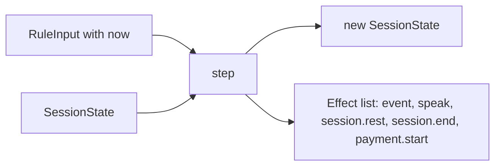
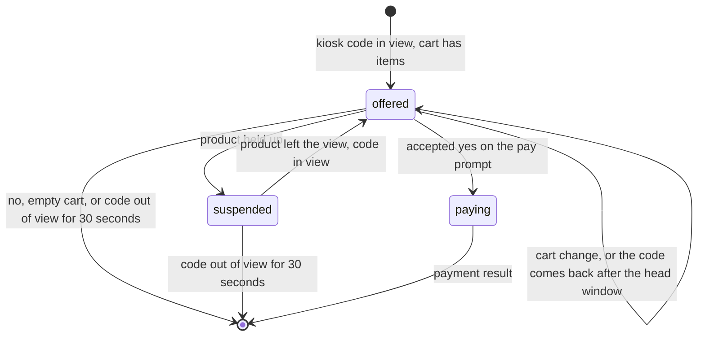
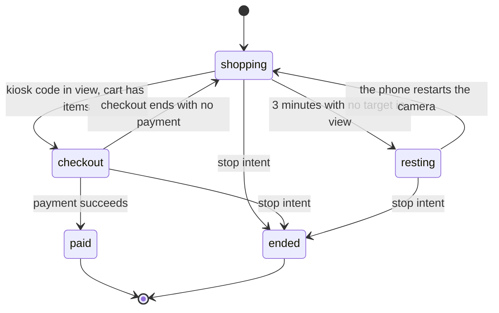
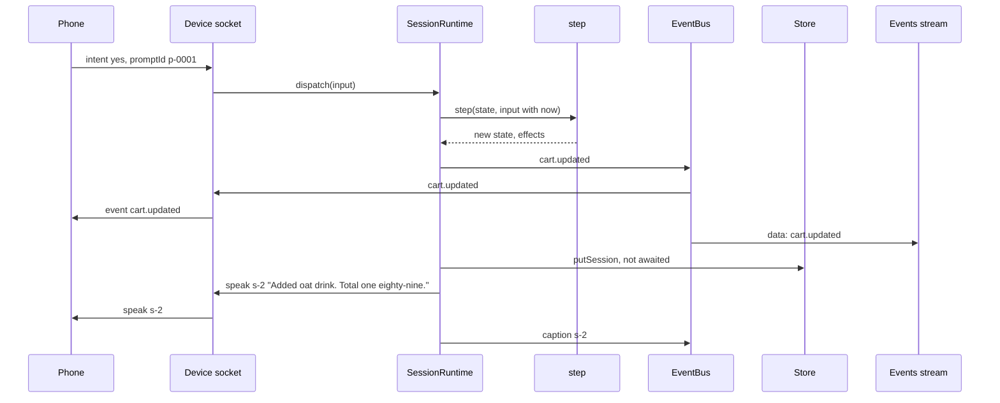

# @glance/server

The server of Meta Glance. One Node process runs TypeScript sources with `tsx`. The message types come from `@glance/shared`.

This file describes only the parts that exist. The plan is `docs/superpowers/plans/2026-11-14-glance-1-server.md`.

## What exists

| Path | Content |
|---|---|
| `src/config.ts` | `loadConfig` reads the settings from the environment and the command line. |
| `src/app.ts` | `buildApp` makes the Fastify app: the CORS headers, the JSON error bodies, `GET /healthz`, the session paths, and the device socket. |
| `src/bus.ts` | `EventBus` delivers messages inside the process, by topic. |
| `src/clock.ts` | The time source of the runtime. |
| `src/main.ts` | Opens the store, starts the server, and closes it on `SIGTERM` and `SIGINT`. |
| `src/catalog/catalog.ts` | `readCatalogFile` reads a catalog file, and `indexCatalog` finds a product by its ID. |
| `catalog/catalog.dev.json` | The dev catalog with four products. The tests use its IDs and prices. |
| `src/recognition/result.ts` | `RecognitionResult`: what one frame shows. |
| `src/sessions/` | The cart rules as the pure function `step`, the session runtime, and the registry. See "Rules" and "Session runtime". |
| `src/speech/` | The text of each spoken line. See "Spoken text". |
| `src/db/` | The `Store` interface with a memory store and a MongoDB store. See "Storage". |
| `src/http/` | The session paths and the events stream. See "REST paths". |
| `src/ws/device.ts` | The socket of the phone. See "Device socket". |
| `src/testing.ts` | Test helpers: an app on a free port, a reader for an events stream, and a phone on the device socket. |

Parts that do not exist yet: recognition of a frame, speech clips, the kiosk, the payment, and the token check. The server takes each frame and drops it. Each line goes out as text with no clip. A kiosk code from the phone has no effect.

## Run it

Run `npm install` at the repository root first. Then run the commands in `apps/server`, or add `--workspace @glance/server` at the root.

```bash
npm run dev:fake    # port 8080, both fake switches on, needs no key and no database
npm run dev         # reads .env if the file exists, and restarts on a change
npm start           # runs with the environment of the shell
```

Check it:

```bash
curl http://localhost:8080/healthz
# {"ok":true,"fakeRecognition":true,"fakeSpeech":true,"store":"memory"}
curl -X POST http://localhost:8080/api/sessions
# {"sessionId":"...","token":"...","wsUrl":"ws://localhost:8080/ws/device?session=...&token=..."}
```

At the start the server logs `store: memory` or `store: mongo`, and the number of products.

## Settings

`.env.example` lists each variable. Copy it to `.env`. Git ignores `.env`, and the pre-commit hook stops a commit that holds one.

| Variable | Default | Meaning |
|---|---|---|
| `PORT` | `8080` | The port. The server listens on each network interface. |
| `PUBLIC_BASE_URL` | `http://localhost:<PORT>` | The address that clients use. |
| `MONGODB_URI` | not set | With no address, the server keeps its data in memory. |
| `MONGODB_DB` | `glance` | The database name. |
| `CATALOG_PATH` | `catalog/catalog.dev.json` | The catalog file. |
| `GEMINI_API_KEY` | not set | Needed when `FAKE_RECOGNITION` is off. |
| `GEMINI_MODEL` | `gemini-3.5-flash-lite` | The recognition model. |
| `GEMINI_MEDIA_RESOLUTION` | `default` | `default` or `low`. |
| `RECOGNITION_MIN_CONFIDENCE` | `0.6` | A number from 0 to 1. |
| `FAKE_RECOGNITION` | off | `1` selects `fixtures/fake-script.json`. Each other value is the path of a script file. |
| `FAKE_SPEECH` | off | `1` means on. |
| `ELEVENLABS_API_KEY` | not set | Needed when `FAKE_SPEECH` is off. |
| `ELEVENLABS_VOICE_EN` | not set | Needed when `FAKE_SPEECH` is off. |
| `ELEVENLABS_VOICE_IT` | not set | The voice for Italian. |
| `SPEECH_CACHE_DIR` | `.cache/speech` | The folder for speech clips. |
| `SAVE_FRAMES` | not set | A directory for frames. Without it the server stores no frame. |
| `PAYMENT_DELAY_MS` | `1500` | The length of the mock payment. |

- An empty value counts as not set.
- The flag `--fake` turns both fake switches on. A variable that is set wins over the flag.
- Each path is relative to the working directory, which is `apps/server`.
- With a missing key the server prints `config: <message>` and exits with code 1. The message names the variable and the switch that removes the need.
- With `MONGODB_URI` the products come from the database, and `CATALOG_PATH` has no effect. If the database holds no product, the server prints `products is empty. Run npm run catalog:seed.` and exits with code 1. The seed command does not exist yet.

## Catalog

A catalog file is a JSON array. Each entry is a `Product` of `@glance/shared`. Prices are integers in cents.

- `readCatalogFile` stops at the first entry that fails the schema. Its message names the file, the index of the entry, and the ID.
- `indexCatalog` rejects a catalog that holds one ID two times.
- In `allergens`, `null` means "no data", and an empty list means "no allergen". The potato crisps of the dev catalog have no data.

## Rules

`step(state, input, ctx)` in `src/sessions/step.ts` holds the interaction rules of spec section 6.2. It returns the new state and a list of effects. It reads no clock and does no I/O: each input carries its time as `now`. The session runtime calls it for each input.



| File in `src/sessions` | Content |
|---|---|
| `types.ts` | `SessionState`, `RuleInput`, `Effect`, and `Line`, a spoken line before it has a text |
| `step.ts` | `createSessionState`, `step`, and the rules that depend on time alone |
| `glance.ts` | Recognition results: the glance prompt, the unknown line, and the aim hint |
| `answers.ts` | The answers: yes, no, undo, the cart edit, and `accepts`, which tells if an answer counts |
| `checkout.ts` | The kiosk code, the pay prompt, and the result of the payment |
| `general.ts` | The device state, the profile patch, and the intents stop, repeat, total, cart, and help |
| `say.ts` | The priority, the sound, and the interrupt value of each line |
| `view.ts` | `inView`, `excludeList` for the recognition worker, and `toSnapshot` for a client that connects |
| `turn.ts` | The helpers that the handlers share |
| `harness.ts` | A test helper that plays inputs with a clock of its own |
| `runtime.ts` | `SessionRuntime`: one session in the process. It runs `step` and then the effects |
| `registry.ts` | `SessionRegistry`: creates, finds, and removes sessions, and sends the tick |
| `voice.ts` | `parseVoiceCommand`: the spoken command words |

The rules that exist:

- A recognized product gets a glance prompt with a new ID (R1). A new product replaces the pending product (R2).
- Results inside the view time belong to one appearance. A product that comes back after it left the view gets a new prompt.
- A product prompt ends when its product left the view for 15 seconds (R5).
- A product in the cart gets the prompt for "add another" (R11).
- An unknown product gets one line for each appearance (R13). An aim hint plays at most one time each 5 seconds.
- A yes or a no counts only with the ID of the current prompt (R3). From the head it also needs a finished prompt, the product in view, and the head window (R4). From voice, touchpad, key, or camera it needs a finished prompt (R5). From the phone or the HUD it needs the ID alone (R6).
- An accepted yes adds one unit (R7). An accepted no skips the product, and recognition excludes it for 10 seconds (R8, R9).
- After an add, a no removes that unit for 8 seconds, and a second yes gets one hint (R10). On the prompt for "add another", a no removes one unit (R11).
- An undo removes the last added unit that the cart still holds (R12). A cart edit sets the quantity of a cart line from 0 to 99.
- A yes or a no with no valid target gets one hint, if a prompt finished in the last 15 seconds (R20). Silence adds nothing (R21).
- A kiosk code starts a checkout when the cart has items and no product prompt is current (R15). A busy kiosk and an empty cart get one line for each appearance of the code.
- A yes pays only as an answer to the pay prompt (R16). The effect `payment.start` asks the runtime for the payment, and the input `payment.result` brings its result.
- A product held up during a checkout suspends it. The pay prompt returns with the new total when the product has left the view and the code is in view (R17).
- A no on the pay prompt cancels the checkout, and the kiosk is muted until its code has left the view (R18).
- A checkout ends when its code was out of view for 30 seconds (R19). The cart stays.
- A cart change during a pay prompt gives a new pay prompt with the new total. The old prompt cannot pay.
- While the payment runs, no answer, no undo, and no cart edit has an effect.

The steps of a checkout:



A paid checkout sets the phase `paid`, empties the cart, and ends the session. A failed payment keeps the cart, and the shopper looks at the code again.

The session rules:

- The camera counts as on when the phone reports the stream state `streaming`. The voice then says the start line.
- When the phone reports `stopped`, an open checkout ends and the cart stays (R24). The line is "Camera off. Please use a regular checkout." when the battery is at 5 percent or less, or the thermal level is 6 or more. `DeviceState` has no stream error, so `general.ts` holds these two limits. In each other case the line is "Camera off."
- After 3 minutes with no product and no kiosk in view, the camera rests and the cart stays (R22). The effect `session.rest` tells the phone.
- The intent `stop` ends the session. The intent `repeat` speaks the last line again.
- The intents `total` and `cart` speak the cart. The cart by voice has at most five lines (R23).
- In the phase `paid` or `ended`, the session takes only the device state and a profile patch.

The phases of a session:



Only the server computes a total, and each price comes from the catalog. Each timing number comes from `TIMING` of `@glance/shared`.

## Session runtime

`SessionRuntime` holds one session. `dispatch(input)` adds the clock time, runs `step`, and runs the effects in their order.

- An event goes to the bus at once, on the topic of the session. The events stream and the device socket listen there.
- A line gets its text at once. Then it waits in the outbox of the session for its clip. The outbox sends one message at a time, so the phone gets the lines in the order of the rules, also when an early clip is slow.
- Each line goes to the phone as `speak` and to the bus as a `caption` event with the same ID (`s-1`, `s-2`). If the clip fails, the line goes out with `url: null`.
- The runtime keeps the last 20 captions for the snapshot.
- With no phone attached, the runtime drops the device messages. Events and captions still go to the bus.
- After a step with an event, and after a profile patch, the runtime writes the session to the store. `dispatch` does not wait for the write. A sighting alone writes nothing.
- After `session.end` the runtime stops: its stop listeners run one time. A stopped session still answers a snapshot, for the receipt.



`SessionRegistry` keeps the runtimes of the process.

- `create` makes the session ID with `randomUUID()` and the token from 24 random bytes, and writes the first record.
- `get` looks in the memory first and then in the store. So a phone that connects again after a restart of the server finds its session and its cart.
- A stored session with a payment that the restart cut off gets a failed payment. The cart stays.
- One timer sends a `tick` each second to each session in the phase `shopping` or `checkout`. The rules that depend on time alone need it.
- The speak counter starts again at `s-1` after a restart, and the captions of the old process are gone.

## Spoken text

The rules select a line by its key, and `renderLine(line, profile)` in `src/speech/render.ts` writes its text. `lines.en.ts` holds one template for each key, with the text of the table "Spoken lines" of the plan.

- `spokenPrice` in `numbers.ts` writes a price as words. The short form is "one eighty-nine". The full form is "one euro eighty-nine". The pay prompt and the paid line use the full form.
- `yesPhrases` in `phrases.ts` names the input of the shopper: "Nod to add.", "Double tap to add.", "Say add.", "Press Add on your phone.", or "Press volume up to add.". A shopper with `headGestures: false` gets the phone phrases.
- The detail level `brief` shortens the glance line, the added line, and the removed line. The level `detailed` adds the brand, the long pack text, and "Contains gluten." for a product that lists allergens.
- No level shortens the pay prompt.
- The voice says nothing about allergens for a product with no allergen data. It never says that a product is safe.
- The profile language `it` gives the English text. The Italian lines do not exist yet.

## Storage

`Store` in `src/db/store.ts` is the interface for the data of spec section 8.6: products, sessions, kiosks, orders, and speech clips.

- `MemoryStore` keeps the data in the process. A restart loses it. The server uses it when `MONGODB_URI` is not set.
- `MongoStore` keeps the data in MongoDB, in the collections `products`, `sessions`, `kiosks`, `orders`, and `speech_clips`. It creates a unique index on `kiosks.code` and an index on `orders.sessionId`. `connect` rejects after 5 seconds if no server answers.
- Each record that a store gives or takes is a copy.
- `deleteSession` also deletes the orders of the session.
- `src/db/contract.ts` holds the tests that each store must pass. No test has run them against a MongoDB server yet.

## REST paths

The paths are those of spec section 8.1. Each body and each answer is a type of `@glance/shared`.

| Call | Body | Answer |
|---|---|---|
| `POST /api/sessions` | `CreateSessionRequest`, or no body | 201, `CreateSessionResponse` |
| `GET /api/sessions/:id` | | 200, `SessionSnapshot` |
| `PATCH /api/sessions/:id/profile` | `ProfilePatch` | 200, the new `Profile` |
| `POST /api/sessions/:id/intents` | `WebIntentRequest` | 204 |
| `POST /api/sessions/:id/cart` | `CartEditRequest` | 204 |
| `GET /api/sessions/:id/events` | | a stream of `ServerEvent` |
| `DELETE /api/sessions/:id` | | 204 |
| `GET /healthz` | | 200, the state of the switches |

- `wsUrl` of a new session is `PUBLIC_BASE_URL` with `ws` in place of `http`, plus `/ws/device?session=<id>&token=<token>`.
- A body that fails its schema gets 400 with `{ "error": "bad_request" }`. An unknown session gets 404 with `{ "error": "not_found" }`. An unknown key in a profile patch is dropped.
- A 204 says only that the server took the input. The outcome arrives as events.
- No path checks the token yet. A client still sends `?token=` with each call.
- The events stream sends `data: <json>` for each event, and the comment `: ping` at the start and then each 15 seconds. A web client opens the stream first and then gets the snapshot, so it loses no event.
- `DELETE` sends `session.end` to the phone, closes its socket, ends each events stream of the session, and deletes the session with its orders.
- The stream of a session that is paid or ended stays open and sends only pings.
- A call with the JSON content type and an empty body counts as a call with no body.

## Device socket

The phone opens `/ws/device?session=<id>&token=<token>`, as in spec section 8.2. The messages are `DeviceToServer` and `ServerToDevice` of `@glance/shared`.

- An upgrade for another path or for an unknown session gets `404 Not Found`.
- On open, the server sends a `snapshot`. Then it sends each event of the session as `event`, and each line as `speak`.
- One phone holds a session. A second socket for the same session takes over, and the server closes the older one. No message goes to both.
- `intent`, `prompt.done`, `device.state`, `cart.edit`, and `profile.set` go to the rules. After `profile.set` the phone gets a new `snapshot`.
- `speech.final` with a confidence of 0.5 or more goes through the command table below. A command becomes an intent with the source `voice` and the ID of the last prompt that finished.
- A binary message is a frame. A frame that decodes goes to the frame handler of the app, which drops it for now. The server logs a frame that does not decode and drops it.
- The server logs and drops a text message that is no `DeviceToServer`. The socket stays open.
- `kiosk.seen` and `biometric.result` have no effect yet.
- A message can have at most 2 MB. A larger one closes the socket.
- The server sends a ping each 20 seconds, and ends a socket that sent no pong since the last ping.
- When the phone leaves, the session stays.

Voice commands. Only a full match counts, with no regard to case and punctuation.

| Words | Intent | Answers |
|---|---|---|
| add, add it | `yes` | a product prompt, or no prompt |
| yes | `yes` | each prompt |
| pay | `yes` | the pay prompt |
| no | `no` | each prompt |
| skip, skip it, remove, remove it | `no` | a product prompt, or no prompt |
| cancel | `no` | the pay prompt |
| undo, repeat, total, cart, help, stop | the same word | |

So the word "add" never pays, and the word "pay" never adds a product.

## Checks

```bash
npm test --workspace @glance/server                  # all tests
npm test --workspace @glance/server -- config        # the test files with "config" in the path
npm run typecheck --workspace @glance/server
npm run lint                                         # at the repository root, for each workspace
```

No test calls a vendor, and no test needs a key.

Each test that needs a server starts one with `testApp` of `src/testing.ts`, on a free port of `127.0.0.1`, and closes it.

The store tests of `src/db/mongo.test.ts` need a MongoDB server. Without `MONGODB_URI_TEST` they are skipped. With it, each test makes a database with a random name and drops it:

```bash
MONGODB_URI_TEST=<connection string> npm test --workspace @glance/server -- mongo
```

Each rule R1 to R24 has a test with its number in the name, in `src/sessions/*.test.ts`. `replays.test.ts` replays result sequences with gaps and changes, because live results flicker.
