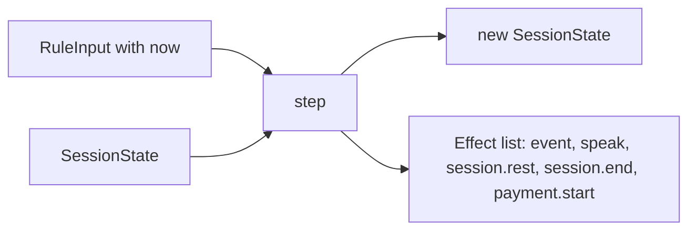

# @glance/server

The server of Meta Glance. One Node process runs TypeScript sources with `tsx`. The message types come from `@glance/shared`.

This file describes only the parts that exist. The plan is `docs/superpowers/plans/2026-11-14-glance-1-server.md`.

## What exists

| Path | Content |
|---|---|
| `src/config.ts` | `loadConfig` reads the settings from the environment and the command line. |
| `src/app.ts` | `buildApp` makes the Fastify app: the CORS headers, the JSON error bodies, and `GET /healthz`. |
| `src/bus.ts` | `EventBus` delivers messages inside the process, by topic. |
| `src/clock.ts` | The time source of the runtime. |
| `src/main.ts` | Starts the server and closes it on `SIGTERM` and `SIGINT`. |
| `src/catalog/catalog.ts` | `readCatalogFile` reads a catalog file, and `indexCatalog` finds a product by its ID. |
| `catalog/catalog.dev.json` | The dev catalog with four products. The tests use its IDs and prices. |
| `src/recognition/result.ts` | `RecognitionResult`: what one frame shows. |
| `src/sessions/` | The cart rules as the pure function `step`. See "Rules". |

The server has no session path and no device socket yet.

## Run it

Run `npm install` at the repository root first. Then run the commands in `apps/server`, or add `--workspace @glance/server` at the root.

```bash
npm run dev:fake    # port 8080, both fake switches on, needs no key and no database
npm run dev         # reads .env if the file exists, and restarts on a change
npm start           # runs with the environment of the shell
```

Check it:

```bash
curl http://localhost:8080/healthz
# {"ok":true,"fakeRecognition":true,"fakeSpeech":true,"store":"memory"}
```

## Settings

`.env.example` lists each variable. Copy it to `.env`. Git ignores `.env`, and the pre-commit hook stops a commit that holds one.

| Variable | Default | Meaning |
|---|---|---|
| `PORT` | `8080` | The port. The server listens on each network interface. |
| `PUBLIC_BASE_URL` | `http://localhost:<PORT>` | The address that clients use. |
| `MONGODB_URI` | not set | With no address, the server keeps its data in memory. |
| `MONGODB_DB` | `glance` | The database name. |
| `CATALOG_PATH` | `catalog/catalog.dev.json` | The catalog file. |
| `GEMINI_API_KEY` | not set | Needed when `FAKE_RECOGNITION` is off. |
| `GEMINI_MODEL` | `gemini-3.5-flash-lite` | The recognition model. |
| `GEMINI_MEDIA_RESOLUTION` | `default` | `default` or `low`. |
| `RECOGNITION_MIN_CONFIDENCE` | `0.6` | A number from 0 to 1. |
| `FAKE_RECOGNITION` | off | `1` selects `fixtures/fake-script.json`. Each other value is the path of a script file. |
| `FAKE_SPEECH` | off | `1` means on. |
| `ELEVENLABS_API_KEY` | not set | Needed when `FAKE_SPEECH` is off. |
| `ELEVENLABS_VOICE_EN` | not set | Needed when `FAKE_SPEECH` is off. |
| `ELEVENLABS_VOICE_IT` | not set | The voice for Italian. |
| `SPEECH_CACHE_DIR` | `.cache/speech` | The folder for speech clips. |
| `SAVE_FRAMES` | not set | A directory for frames. Without it the server stores no frame. |
| `PAYMENT_DELAY_MS` | `1500` | The length of the mock payment. |

- An empty value counts as not set.
- The flag `--fake` turns both fake switches on. A variable that is set wins over the flag.
- Each path is relative to the working directory, which is `apps/server`.
- With a missing key the server prints `config: <message>` and exits with code 1. The message names the variable and the switch that removes the need.

## Catalog

A catalog file is a JSON array. Each entry is a `Product` of `@glance/shared`. Prices are integers in cents.

- `readCatalogFile` stops at the first entry that fails the schema. Its message names the file, the index of the entry, and the ID.
- `indexCatalog` rejects a catalog that holds one ID two times.
- In `allergens`, `null` means "no data", and an empty list means "no allergen". The potato crisps of the dev catalog have no data.

## Rules

`step(state, input, ctx)` in `src/sessions/step.ts` holds the interaction rules of spec section 6.2. It returns the new state and a list of effects. It reads no clock and does no I/O: each input carries its time as `now`. No runtime calls it yet.



| File in `src/sessions` | Content |
|---|---|
| `types.ts` | `SessionState`, `RuleInput`, `Effect`, and `Line`, a spoken line before it has a text |
| `step.ts` | `createSessionState`, `step`, and the rules that depend on time alone |
| `glance.ts` | Recognition results: the glance prompt, the unknown line, and the aim hint |
| `answers.ts` | The answers: yes, no, undo, the cart edit, and `accepts`, which tells if an answer counts |
| `say.ts` | The priority, the sound, and the interrupt value of each line |
| `view.ts` | `inView`, and `excludeList` for the recognition worker |
| `turn.ts` | The helpers that the handlers share |
| `harness.ts` | A test helper that plays inputs with a clock of its own |

The rules that exist:

- A recognized product gets a glance prompt with a new ID (R1). A new product replaces the pending product (R2).
- Results inside the view time belong to one appearance. A product that comes back after it left the view gets a new prompt.
- A product prompt ends when its product left the view for 15 seconds (R5).
- A product in the cart gets the prompt for "add another" (R11).
- An unknown product gets one line for each appearance (R13). An aim hint plays at most one time each 5 seconds.

- A yes or a no counts only with the ID of the current prompt (R3). From the head it also needs a finished prompt, the product in view, and the head window (R4). From voice, touchpad, key, or camera it needs a finished prompt (R5). From the phone or the HUD it needs the ID alone (R6).
- An accepted yes adds one unit (R7). An accepted no skips the product, and recognition excludes it for 10 seconds (R8, R9).
- After an add, a no removes that unit for 8 seconds, and a second yes gets one hint (R10). On the prompt for "add another", a no removes one unit (R11).
- An undo removes the last added unit that the cart still holds (R12). A cart edit sets the quantity of a cart line from 0 to 99.
- A yes or a no with no valid target gets one hint, if a prompt finished in the last 15 seconds (R20). Silence adds nothing (R21).

Only the server computes a total, and each price comes from the catalog. Each timing number comes from `TIMING` of `@glance/shared`.

## Checks

```bash
npm test --workspace @glance/server                  # all tests
npm test --workspace @glance/server -- config        # the test files with "config" in the path
npm run typecheck --workspace @glance/server
npm run lint                                         # at the repository root, for each workspace
```

No test calls a vendor, and no test needs a key.
