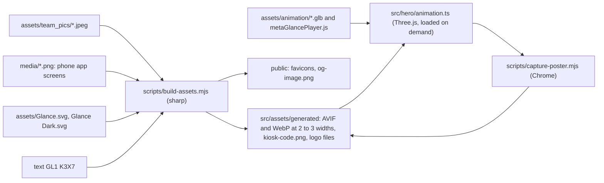

# Product site

`@glance/site` is the one-page website that presents Meta Glance. It is a static site: React, TypeScript, and Vite, with the Astryx Neutral theme of the phone app, the Optimistic font, and Motion for the animations. The build is a folder that any static host serves.

`docs/design.md` holds the design: the references, the reference lock, the decision ledger, the tokens, and the standards with their measurements.

## Requirements

- Node 22 or later, with npm.
- Chrome, for two optional scripts only: the poster of the animation and the page check.

The package has its own `package.json` and lockfile, because the `main` branch has no npm workspace yet. Its name and its scripts (`test`, `typecheck`) also fit the workspace of the app branch, which takes each folder of `apps/*`.

## Run, build, and check

Run each command in `apps/site`.

```bash
npm install
npm run dev          # dev server on http://localhost:18420
npm run build        # type check, client build, server build, prerender: writes dist/
npm run preview      # serves dist/ on http://localhost:18421
npm test             # Vitest: sections, links, team, footer notices, motion, axe in jsdom
npm run typecheck
```

`npm run build` writes the HTML of the page into `dist/index.html` (`scripts/prerender.mjs`), so the text shows before the script loads. React then hydrates it.

The check of the built page runs in headless Chrome against `npm run preview`:

```bash
node scripts/check-page.mjs                 # default URL http://localhost:18421/
```

It runs axe (WCAG 2.2 A and AA, and best practice) at 360, 768, 1440, and 1920 px in light and dark mode, checks target sizes and sideways scroll, prints the heading outline and the landmarks, walks the keyboard focus, and measures the load: bytes, requests, LCP, and CLS. It exits with 1 on a problem. `CHROME_PATH` names Chrome when it is not in `C:/Program Files/Google/Chrome/Application/chrome.exe`.

## Deploy

Copy `dist/` to any static host: GitHub Pages, Netlify, Vercel, an S3 bucket, or nginx. No server code and no redirect rule is needed: the page is one `index.html`.

- The asset paths are relative (`./assets/...`), so the folder works at any path, also at `https://host/some/folder/`.
- A host that needs an absolute base gets it from `SITE_BASE`: `SITE_BASE=/glance/ npm run build`.
- A social preview needs the absolute address of the image. Set `SITE_URL` to the address of the site, with a trailing slash: `SITE_URL=https://example.org/glance/ npm run build`. Without it, `og:image` is the relative path `./og-image.png`, which some services do not read.
- Serve `.glb` as `model/gltf-binary` and `.avif` as `image/avif`. Most hosts do it by default.
- Let the host cache `assets/` for a long time: each file name holds a hash of its content.

## Where to edit

| What | File |
|---|---|
| All text of the page, section by section | `src/content/site.ts` |
| Names and titles of the team | `src/content/team.ts` (one line for each person, in the order of the page; an empty title shows nothing) |
| Text and layout of the diagram of the parts | `DIAGRAM` in `src/content/site.ts`, and `src/sections/PartsDiagram.tsx` for the coordinates |
| The display mock | `DISPLAY` in `src/content/site.ts`, `src/sections/Display.tsx`, and `hud/` with its README for the build in `public/hud` |
| Order of the sections and the links of the sticky bar | `SECTIONS` in `src/content/site.ts`, and `src/App.tsx` |
| Colors, type sizes, spacing | `src/styles/site.css` (Astryx tokens only) |
| The animation of the hero | `src/hero/` (field of view, framing, lights, and speed at the top of `animation.ts`) |
| Motion of the page | `src/motion/Reveal.tsx` (the reveal on scroll) |

Meta Glance is a protocol: a place shows a Glance code, the glasses read it, and a nod confirms. The copy presents it so: the loop, the use cases, the store demo, how to build on it. Each mechanic in the copy comes from `docs/architecture.md` and `apps/website/README.md` of the app branch. Use cases other than the checkout are what the protocol enables. The page states no test log, no availability, no price, no partner, and no certification.

## Asset pipeline



- `npm run assets` runs `scripts/build-assets.mjs`. It writes each team photo as a 4:5 portrait at 320, 480, and 640 px, each screen capture at two widths, the pixelated photo of the privacy chapter, the QR card of the hero, the logo files, the favicons, and the social preview image. The output is committed, so a build needs neither sharp nor Chrome.
- The logo comes from `assets/Glance.svg` (dark word mark, for the light scheme) and `assets/Glance Dark.svg` (white word mark, for the dark scheme). Each source file holds a 3157 x 2105 PNG as the fill of the symbol and weighs 357 KB. The script keeps each path and color, stores that fill as an 800 px WebP, and crops the view box to the drawing: 24 KB for each file. The favicon is the symbol of the same file. `public/og-image.png` is the light logo on the canvas color, 1200 x 630.
- `media/` holds the source captures of the phone app. They come from the build of the app branch in replay mode (`apps/mobile/ui` with `?replay=1&ready=1` at 390 x 844, light and dark), at a device pixel ratio of 2. Take new ones after a change of the app UI, with the same names.
- The kiosk in the feature chapters is not a picture: `src/components/KioskScreen.tsx` draws the "waiting for your nod" state of the kiosk page of the demo run with the tokens of the page, so it follows the color scheme. Its QR code stays black on a white card with a quiet zone of four modules, also in the dark scheme.
- The hero imports `assets/animation/metaGlancePlayer.js` and `meta-glances-placeholder.glb` from the repository root, unchanged. `vite.config.ts` allows that folder and dedupes `three`, so the player and the site share one copy of Three.js.
- `scripts/capture-poster.mjs` needs `npm run dev` and Chrome. It opens `/?poster`, where the hero shows the last frame of the clip on a clear background, and writes `media/hero-poster.png` and the poster images. Run it after a change of the GLB, of the QR text, or of the camera distance in `src/hero/animation.ts`.
- The font is Optimistic VF, in `public/fonts/OptimisticVF.woff2`, unchanged. The owner supplied the file, and its licence must be confirmed before the site is published: Optimistic is a typeface of Meta, and its name table forbids changes to the file. `src/styles/fonts.css` declares it (weights 300 to 800, `font-display: swap`) with a fallback of Arial with metric overrides, so the swap moves no line. `index.html` preloads it. On dark grounds the page sets the `DRKM` axis of the font to 1. The page makes no request to another host.
- The hero renders the mark with no tone mapping and no environment map, so its blue is the blue of the vertex colors of the GLB (#3BA8F0 to #4BBDFD). The camera has a field of view of 18 degrees, so the two loops stay even.
- `public/hud` is the build of the Display HUD of the app, with its own toolkit. `hud/README.md` says where each file comes from and how to build it again. `scripts/capture-hud-still.mjs` writes its still, with the dev server running.
- The QR code of the hero and of the kiosk holds `GL1 K3X7`, the code of the demo kiosk `Checkout 3`. Both the PNG and the rendered last frame of the animation decode to that text.

## Size of the build

Measured on 2026-11-14 at 1440 x 900 on a local server, with a cold cache:

| Part | Size |
|---|---|
| Until the load event: HTML, CSS, JS, font, poster | 5 to 6 requests, 303 to 482 KB transferred (the font arrives before or after the load event) |
| Main script, with React, Astryx, and Motion | 667 KB, 210 KB transferred |
| Motion (`domAnimation` through `LazyMotion`, `m`, the hooks) | about 33 KB of the transferred main script |
| Font, preloaded | 179 KB (`OptimisticVF.woff2`, the file as supplied) |
| Stylesheet | 334 KB, 53 KB transferred (the full Astryx stylesheet) |
| Animation chunk (Three.js), after the load event | 638 KB, 156 KB transferred |
| GLB of the hero, after the load event | 2.7 MB |
| Largest image | 45 KB (`team-fb-640.webp`) |
| `dist/` on disk | 14 MB, of which 11 MB are the four GLB files |

LCP was 448 to 508 ms over two runs (the poster of the hero) and CLS was 0. These are local numbers with no network throttling.

The display mock adds no byte to the first load. When its section nears the view, the page loads `public/hud`: 606 KB of script (196 KB compressed), 98 KB of CSS (18 KB compressed), and three Noto Sans files of 13 KB. Its still is 18 to 40 KB.

## Gotchas

- `dist/` holds all four GLB files, but the page fetches one. `metaGlancePlayer.js` names each variant with `new URL(..., import.meta.url)`, so Vite copies each of them.
- The animation, the logo files, and the font are Meta assets or hold the mark of Meta: the clip starts from the Meta logo, `assets/Glance.svg` holds the same symbol, and Optimistic is a typeface of Meta. The owner asked for all three. Ask the Meta mentors before the page goes public, as `apps/website/README.md` on the app branch also says.
- The hero fills the first viewport with the header. Its height is `100dvh` (with `100vh` before it) less `--site-header-measured`, which `SiteHeader` measures, and less its top margin, between 34 rem and 68 rem. The CSS default of that variable is the header height at the default font size, so the first paint does not move.
- The clip plays once at 1.25 times its speed, 4.8 seconds, and rests on its last frame, so it needs no pause control (WCAG 2.2.2). With reduced motion it does not play. The canvas draws no frame while the hero is out of view.
- Nothing that a person clicks moves: buttons, links, and cards keep their place on hover and on press.
- Each reveal starts from the server HTML, so the text is visible before the script runs. An element below the viewport hides after hydration and appears when it scrolls in. The reader never sees it hide.
- The diagram of the parts has two drawings: a wide one for a figure of 70 rem or more, and a tall one below. The text of each is 18.5 units, and each drawing shows only where that is 14 px or more.
- Headless Chrome needs `--enable-unsafe-swiftshader --use-angle=swiftshader` for WebGL. Those flags slow the first paint by seconds, so `scripts/check-page.mjs` measures the load in a Chrome with its default flags.
- SwiftShader caps a texture at 8192 px. A full-page screenshot of a taller page repeats its top, so capture the page one viewport at a time.
- The hero and the captions windows nest a `Theme` of Astryx with `mode="dark"`. In the dark scheme, where the canvas is dark as well, `site.css` paints them with `--color-background-surface`.
- `src/content/site.ts` is the only place for text. The tests in `src/App.test.tsx` check the order of the section headings, so a new heading needs a change there too.
- With `prefers-reduced-motion: reduce` or Save-Data, the hero loads no Three.js and shows the poster. The play button still loads it on request.
