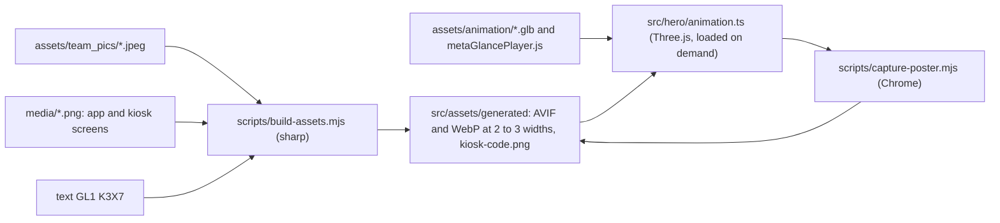

# Product site

`@glance/site` is the one-page website that presents Meta Glance. It is a static site: React, TypeScript, and Vite, with the Astryx Neutral theme of the phone app. The build is a folder that any static host serves.

`docs/design.md` holds the design: the references, the reference lock, the decision ledger, the tokens, and the standards with their measurements.

## Requirements

- Node 22 or later, with npm.
- Chrome, for two optional scripts only: the poster of the animation and the page check.

The package has its own `package.json` and lockfile, because the `main` branch has no npm workspace yet. Its name and its scripts (`test`, `typecheck`) also fit the workspace of the app branch, which takes each folder of `apps/*`.

## Run, build, and check

Run each command in `apps/site`.

```bash
npm install
npm run dev          # dev server on http://localhost:18420
npm run build        # type check, client build, server build, prerender: writes dist/
npm run preview      # serves dist/ on http://localhost:18421
npm test             # Vitest: sections, links, team, footer notices, motion, axe in jsdom
npm run typecheck
```

`npm run build` writes the HTML of the page into `dist/index.html` (`scripts/prerender.mjs`), so the text shows before the script loads. React then hydrates it.

The check of the built page runs in headless Chrome against `npm run preview`:

```bash
node scripts/check-page.mjs                 # default URL http://localhost:18421/
```

It runs axe (WCAG 2.2 A and AA, and best practice) at 360, 768, 1440, and 1920 px in light and dark mode, checks target sizes and sideways scroll, prints the heading outline and the landmarks, walks the keyboard focus, and measures the load: bytes, requests, LCP, and CLS. It exits with 1 on a problem. `CHROME_PATH` names Chrome when it is not in `C:/Program Files/Google/Chrome/Application/chrome.exe`.

## Deploy

Copy `dist/` to any static host: GitHub Pages, Netlify, Vercel, an S3 bucket, or nginx. No server code and no redirect rule is needed: the page is one `index.html`.

- The asset paths are relative (`./assets/...`), so the folder works at any path, also at `https://host/some/folder/`.
- A host that needs an absolute base gets it from `SITE_BASE`: `SITE_BASE=/glance/ npm run build`.
- Serve `.glb` as `model/gltf-binary` and `.avif` as `image/avif`. Most hosts do it by default.
- Let the host cache `assets/` for a long time: each file name holds a hash of its content.

## Where to edit

| What | File |
|---|---|
| All text of the page, section by section | `src/content/site.ts` |
| Names and roles of the team | `src/content/team.ts` (one line for each person; an empty role shows nothing) |
| Order of the sections and the links of the sticky bar | `SECTIONS` in `src/content/site.ts`, and `src/App.tsx` |
| Colors, type sizes, spacing | `src/styles/site.css` (Astryx tokens only) |
| The animation of the hero | `src/hero/` |

Each claim of the copy comes from `README.md`, `docs/architecture.md`, and the design spec of the repository. Keep it true to the build. The section "A prototype, said plainly" lists what is a demo, and it must change when the build changes.

## Asset pipeline



- `npm run assets` runs `scripts/build-assets.mjs`. It writes each team photo as a 4:5 portrait at 320, 480, and 640 px, each screen capture at two widths, the pixelated photo of the privacy chapter, and the QR card of the hero. The output is committed, so a build needs neither sharp nor Chrome.
- `media/` holds the source captures of the phone app and the kiosk page. They come from the builds of the app branch in replay mode (`apps/mobile/ui` with `?replay=1&ready=1` at 390 x 844, light and dark; `apps/website` at `/kiosk?replay=1` at 1280 x 800), at a device pixel ratio of 2. Take new ones after a change of the app UI, with the same names.
- The hero imports `assets/animation/metaGlancePlayer.js` and `meta-glances-placeholder.glb` from the repository root, unchanged. `vite.config.ts` allows that folder and dedupes `three`, so the player and the site share one copy of Three.js.
- `scripts/capture-poster.mjs` needs `npm run dev` and Chrome. It opens `/?poster`, where the hero shows the last frame of the clip on a clear background, and writes `media/hero-poster.png` and the poster images. Run it after a change of the GLB, of the QR text, or of the camera distance in `src/hero/animation.ts`.
- Figtree comes from `@fontsource-variable/figtree` (SIL Open Font License 1.1) through `src/styles/fonts.css`, as in the phone app. The page makes no request to another host.

## Size of the build

Measured on 2026-11-14 at 1440 x 900 on a local server, with a cold cache:

| Part | Size |
|---|---|
| Until the load event: HTML, CSS, JS, font, poster | 4 requests, 253 KB transferred |
| Main script | 578 KB, 178 KB transferred |
| Stylesheet | 332 KB, 53 KB transferred (the full Astryx stylesheet) |
| Animation chunk (Three.js), after the load event | 633 KB, 154 KB transferred |
| GLB of the hero, after the load event | 2.7 MB |
| Largest image | 45 KB (`team-fb-640.webp`) |
| `dist/` on disk | 14 MB, of which 11 MB are the four GLB files |

LCP was 432 ms (the poster of the hero) and CLS was 0.0002. These are local numbers with no network throttling.

## Gotchas

- `dist/` holds all four GLB files, but the page fetches one. `metaGlancePlayer.js` names each variant with `new URL(..., import.meta.url)`, so Vite copies each of them.
- The animation and `assets/Glance.svg` hold the mark of Meta: the clip starts from the Meta logo. The page chrome uses the glasses glyph of the app as its mark instead. Ask the Meta mentors before the page goes public, as `apps/website/README.md` on the app branch also says.
- Headless Chrome needs `--enable-unsafe-swiftshader --use-angle=swiftshader` for WebGL. Those flags slow the first paint by seconds, so `scripts/check-page.mjs` measures the load in a Chrome with its default flags.
- SwiftShader caps a texture at 8192 px. A full-page screenshot of a taller page repeats its top, so capture the page one viewport at a time.
- The hero and the status band nest a `Theme` of Astryx with `mode="dark"`. In the dark scheme, where the canvas is dark as well, `site.css` paints them with `--color-background-surface`.
- `src/content/site.ts` is the only place for text. The tests in `src/App.test.tsx` check the order of the section headings, so a new heading needs a change there too.
- With `prefers-reduced-motion: reduce` or Save-Data, the hero loads no Three.js and shows the poster. The play button still loads it on request.
