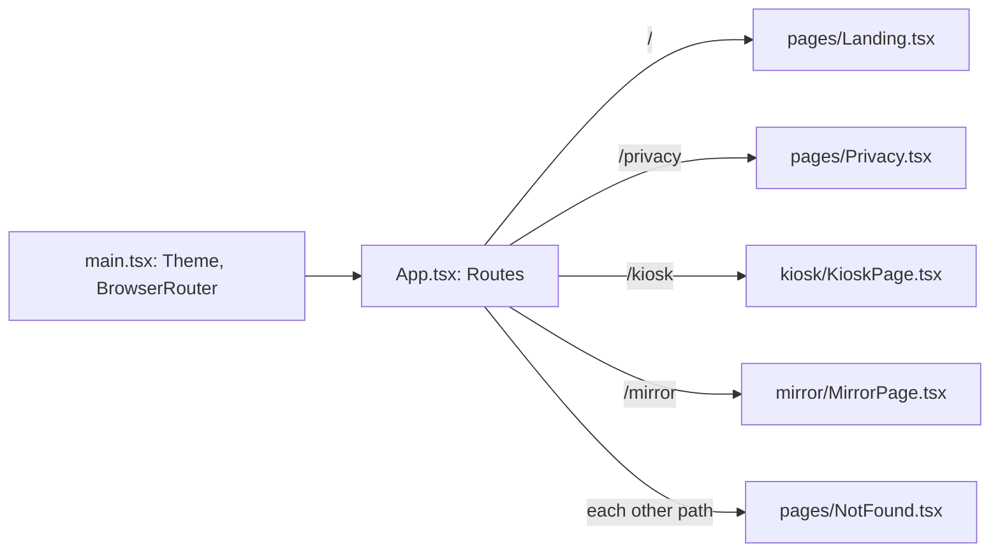
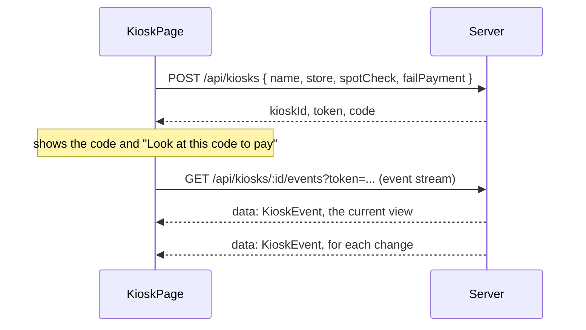
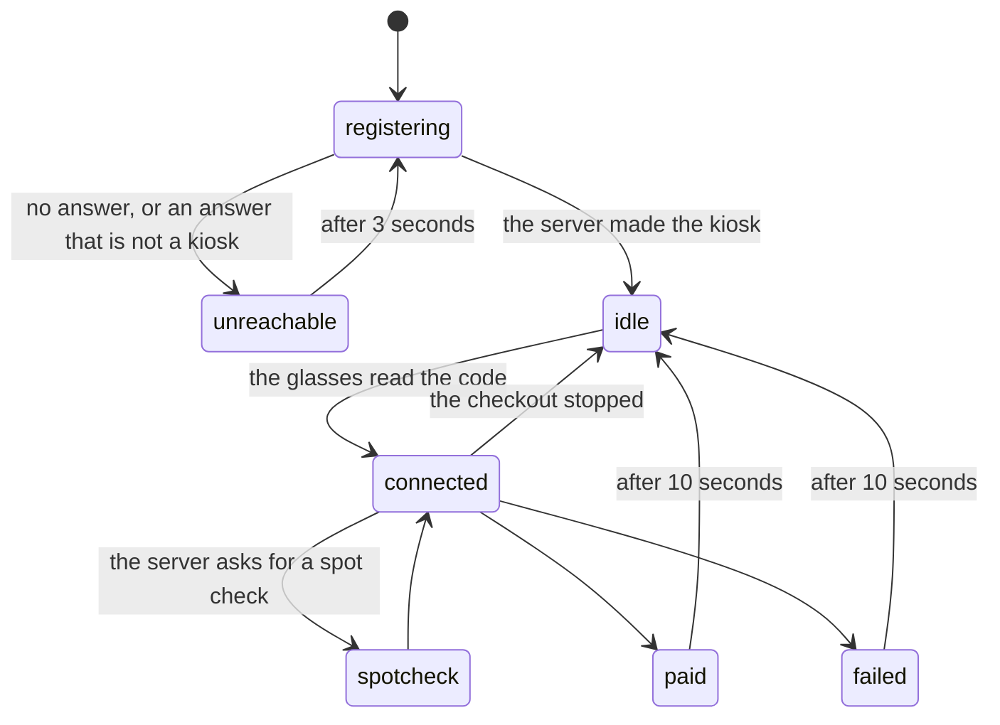
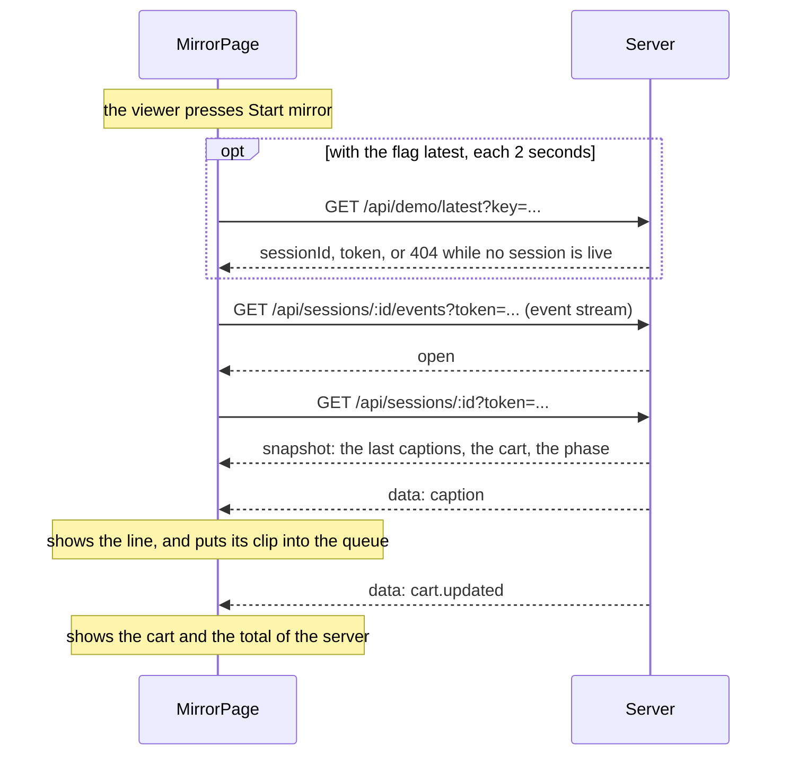

# @glance/website

The website of Meta Glance: a Vite app with React 19, Astryx, and `react-router`. It holds the landing page, the privacy page, the kiosk page, and the mirror page.

The kiosk page and the mirror page work. The landing page and the privacy page are placeholders with one heading. Plan 4 fills them.

## Routes



Each page renders one `main` element with exactly one `h1`. `src/App.test.tsx` checks this for each route.

## Run it

Run each command at the repository root, after `npm install`.

```bash
npm run dev --workspace @glance/website      # dev server on http://localhost:5174
npm run build --workspace @glance/website    # writes apps/website/dist
```

The host of the build must answer an unknown path with `index.html`, because the router reads the address in the browser.

## Settings

| Setting | Default | Effect |
|---|---|---|
| `GLANCE_SERVER_ORIGIN` (environment) | `http://localhost:8080` | The dev server sends each `/api` request to this origin. |

The dev server uses port 5174 only. If the port is in use, the dev server stops with an error.

## Kiosk page

`/kiosk` is the screen at the checkout. It shows a QR code with the text `GL1 <code>`, and the glasses of the shopper read that code. Open the page in full screen on a screen with a height of 1080 px or more.

Query flags of `/kiosk`:

| Flag | Default | Effect |
|---|---|---|
| `name` | `Checkout 3` | The name of the kiosk, cut at 40 characters. |
| `store` | `Demo Market` | The name of the store, cut at 40 characters. |
| `spot` | off | The server asks for a spot check at this kiosk. `spot=0` and `spot=false` mean off. |
| `fail` | off | Each payment at this kiosk fails. `fail=0` and `fail=false` mean off. |
| `replay=1` | off | The page plays `KIOSK_RUN` of `src/kiosk/kioskRun.ts` in a loop of 24 seconds. It makes no network call. |

The page registers a kiosk, and then it follows the event stream of that kiosk:



Each event holds the whole view, and its `state` selects the text:



The server selects each state after `idle`. The page only shows it.

- The code keeps its place and its size in each state. It is black on white in each color mode, and the page uses the light mode.
- The page shows the total of the event. It never adds prices. It shows 7 cart lines, and then the line `and <n> more items`.
- The page drops a message that is not JSON and a message that `KioskEventSchema` of `@glance/shared` rejects.
- When the stream drops, the browser opens it again. The page keeps the code and the cart, and it shows "Connection lost. Reconnecting." The first message of the new stream is the current view.
- When the server refuses the stream, the browser does not open it again. This occurs after a restart of the server, which keeps its kiosks in memory. The page then registers a new kiosk each 3 seconds until one call succeeds. The new kiosk has a new code.
- Each load of the page makes a new kiosk. The server has no call that removes one.

`src/kiosk/kiosk.css` holds the sizes. On a screen of 1920 x 1080 px the total has a font of 160 px, a row has a font of 48 px, and the code is 960 px wide. The code is never smaller than 15 cm, with its quiet zone. To measure, open `/kiosk?replay=1` at 100 percent zoom, wait for the cart, and run this in the console. It must print `[true, true, true]`.

```js
const box = (selector) => document.querySelector(selector).getBoundingClientRect();
[parseFloat(getComputedStyle(document.querySelector('.kiosk-total')).fontSize) >= 160, box('.kiosk-row').height >= 48, box('.kiosk-code').width >= 567]
```

## Mirror page

`/mirror` shows what the glasses say, for the people next to the demo: each spoken line as large text, the speech clip of each new line, and the cart of one session. It is a demo tool. Open it on a second screen.

Query flags of `/mirror`:

| Flag | Effect |
|---|---|
| `s=<sessionId>&t=<token>` | The page shows this session. The debug panel of the phone UI prints the two flags as `Session query`. |
| `latest=<DEMO_KEY>` | The page follows the newest live session of the server. `s` with `t` wins over `latest`. |
| `replay=1` | The page plays `MIRROR_RUN` of `src/mirror/mirrorRun.ts`: one shop of 13 seconds with no clip. It makes no network call. |

With no flag, the page shows "Add ?latest=, or ?s= and ?t=, to the address." and no button.

The page starts on the button "Start mirror", because a browser blocks sound before a tap. It makes no network call before that tap.



- `mirrorReduce` in `src/mirror/mirrorModel.ts` keeps the last 5 captions, the cart, and the phase. It ignores each other event. The page shows the newest line first and largest, so that it stays on the screen.
- The page drops a message that is not JSON and a message that `parseServerEvent` of `@glance/shared` rejects.
- A caption of the snapshot plays no clip. A new caption with a `url` plays its clip one time. A path such as `/api/speech/abc.mp3` resolves against the origin of the page.
- `ClipQueue` in `src/mirror/clipQueue.ts` plays one clip at a time, in arrival order. A clip that fails does not stop the queue. With more than 2 clips waiting, it drops the oldest waiting clip, so that the mirror stays near the voice.
- Mute stops the current clip, drops the waiting clips, and ignores new ones. Unmute plays the clip of the next new caption.
- When the stream drops, the browser opens it again. The page keeps the captions and the cart, shows "Connection lost. Reconnecting.", and loads the snapshot again at the next `open`.
- When the server refuses the stream, the browser does not open it again. With `s` and `t` the page then opens a new stream each 3 seconds. With `latest` the next answer of the demo path opens one.
- A snapshot call that fails with no answer or with a status of 500 or more runs again after 3 seconds. The `/api` proxy of the dev server answers 502 for some calls. A status of 4xx stops the calls for that stream.
- With `latest`, the page shows "Waiting for a session on the phone." while the server names no session. When the answer names another session, the page closes the stream, clears the captions and the cart, and opens the new session. A session that is on the screen stays there while the server names none.
- The server answers `GET /api/demo/latest` only with `DEMO_KEY` set (Plan 1 Task 17). A server with no such path answers 404, and the page then waits.
- The website has no 48 px rule for controls. The Mute button is 36 px high, because the mirror runs on a laptop with a pointer.

Code for the pages that read a stream:

- `src/lib/api.ts`: `createKiosk`, `kioskEventsUrl`, `getSession`, `sessionEventsUrl`, and `getLatestSession`. Each call throws `ApiError` for a status of 400 or more, and for an answer with the wrong shape. `getLatestSession` returns `null` for the status 404. No error message holds a token.
- `src/lib/events.ts`: `subscribeSse` follows a stream and reports `open`, `lost`, or `closed`. `replay` plays a recorded list of events.
- `src/test/fakes.ts`: `fakeFetch` and `fakeSources` (a fake `EventSource`) for the tests. `src/test/events.ts` has three event fixtures and the snapshot fixture of `@glance/shared` as typed values.

## Checks

```bash
npm test --workspace @glance/website         # Vitest with jsdom
npm run typecheck --workspace @glance/website
npx eslint apps/website
```

`build` runs no typecheck. A type error in a test file does not stop a deployment, so run `typecheck` before each commit.

## Astryx

- The theme is the stock Neutral theme. `npx @astryxdesign/cli theme add neutral` wrote `src/astryx-themes.ts`. Do not edit that file.
- The app uses the prebuilt CSS of Astryx (`src/styles/globals.css`). It has no StyleX compiler, so `xstyle` does not work here.
- Before the first use of a component, run `npx @astryxdesign/cli component <Name>` in this folder.
- `AGENTS.md` holds the Astryx rules for agents, and the Glance rules that win over them.
- `src/test/render.tsx` exports `renderWithTheme`. Use it in each test that renders an Astryx component.
- The font of the theme loads from Google Fonts. With no internet, the system font shows.
- `main.tsx` uses no `StrictMode`. The kiosk page registers in an effect, and `StrictMode` would register two kiosks in development.
- The Astryx `Text` and `Heading` components take `className`. The kiosk sizes and the mirror sizes are plain CSS classes on them, because app CSS outside a cascade layer wins over the Astryx layers.
- The Astryx `Text` component has no `lang` prop. A mirror caption is a `span` with `lang` inside a `Text`, and the size class sits on that `span`.
