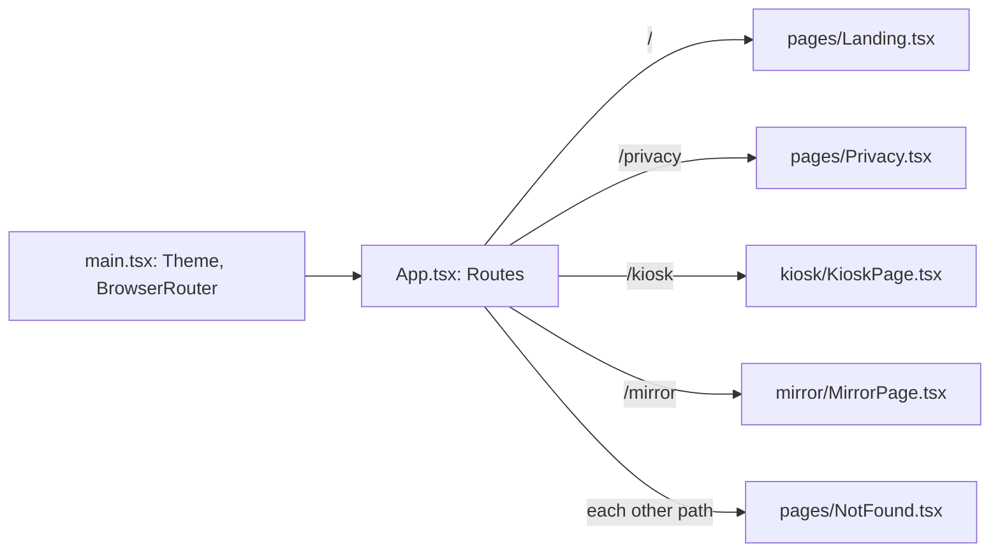

# @glance/website

The website of Meta Glance: a Vite app with React 19, Astryx, and `react-router`. It holds the landing page, the privacy page, the kiosk page, and the mirror page.

Each page is a placeholder with one heading. Plan 3 fills the kiosk page and the mirror page. Plan 4 fills the landing page and the privacy page.

## Routes



Each page renders one `main` element with exactly one `h1`. `src/App.test.tsx` checks this for each route.

## Run it

Run each command at the repository root, after `npm install`.

```bash
npm run dev --workspace @glance/website      # dev server on http://localhost:5174
npm run build --workspace @glance/website    # writes apps/website/dist
```

The host of the build must answer an unknown path with `index.html`, because the router reads the address in the browser.

## Settings

| Setting | Default | Effect |
|---|---|---|
| `GLANCE_SERVER_ORIGIN` (environment) | `http://localhost:8080` | The dev server sends each `/api` request to this origin. |

The dev server uses port 5174 only. If the port is in use, the dev server stops with an error.

## Checks

```bash
npm test --workspace @glance/website         # Vitest with jsdom
npm run typecheck --workspace @glance/website
npx eslint apps/website
```

`build` runs no typecheck. A type error in a test file does not stop a deployment, so run `typecheck` before each commit.

## Astryx

- The theme is the stock Neutral theme. `npx @astryxdesign/cli theme add neutral` wrote `src/astryx-themes.ts`. Do not edit that file.
- The app uses the prebuilt CSS of Astryx (`src/styles/globals.css`). It has no StyleX compiler, so `xstyle` does not work here.
- Before the first use of a component, run `npx @astryxdesign/cli component <Name>` in this folder.
- `AGENTS.md` holds the Astryx rules for agents, and the Glance rules that win over them.
- `src/test/render.tsx` exports `renderWithTheme`. Use it in each test that renders an Astryx component.
- The font of the theme loads from Google Fonts. With no internet, the system font shows.
- `main.tsx` uses no `StrictMode`. The kiosk page will register in an effect, and `StrictMode` would register two kiosks in development.
