# Architecture

This file describes the parts of Meta Glance that exist and work on the branch `feat/barcode-lookup`, which starts from `feat/overnight-build`. The design, with the parts that do not exist yet, is in `docs/superpowers/specs/2026-11-13-meta-glance-design.md`. The design of the barcode scan is `docs/superpowers/specs/2026-11-14-barcode-lookup-design.md`.

Each name in this file is a name in the code. Each message type is a schema in `packages/shared/src`.

## Parts

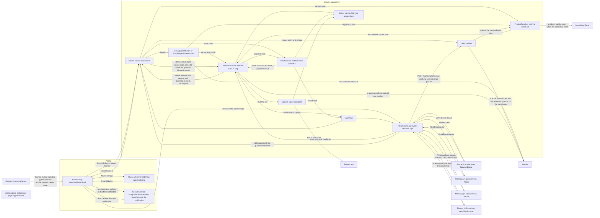

| Part | Folder | Task |
|---|---|---|
| Contract | `packages/shared` | Each message type as a zod schema, one JSON fixture for each message variant, `TIMING`, the frame codec, the kiosk code helpers, and the GTIN helpers. |
| Android app | `apps/mobile/android` | Connects to the glasses through the DAT SDK, sends frames and answers to the server, reads the barcode of a product, plays the lines, selects the vibrations, and hosts the phone UI. Its foreground service keeps a session alive with the screen off. |
| Phone UI | `apps/mobile/ui` | The setup screen links the glasses and asks for the camera and for notifications. The session screen shows the current prompt, the last lines as text, the cart, the pay prompt, the receipt, and the settings. It has no network code: each message goes through a `GlanceBridge`. |
| Server | `apps/server` | Recognizes the product in a frame, finds the product of a barcode, runs the cart rules, writes the spoken lines, answers a question about a product, and runs the checkout with a mock payment. |
| Website | `apps/website` | The kiosk page shows the code that starts a checkout, and then the cart and the result. The mirror page shows the spoken lines and the cart of one session, and plays the speech clips. The landing page and the privacy page show fixed text and make no call to the server. |
| Display HUD | `apps/display-pow` | A mockup of the screen for glasses with a display. It shows the pending product, the total, and the last line of one session, and it sends a yes or a no. Without a session it plays a recording. |

Facts that the diagram does not show:

- The server is the only part that changes a cart or computes a total. Each price comes from the catalog or from the store list of the server.
- The Android app has its own Kotlin classes for the messages, in `apps/mobile/android/core/src/main/kotlin/com/metaglance/core/contract`. A Kotlin test decodes each fixture of `packages/shared/fixtures`.
- The phone UI uses `AndroidBridge` in the WebView and `BrowserBridge` in each other browser. With the query flag `api`, `BrowserBridge` talks to the server with REST calls and the event stream. A session then needs no phone.
- With `FAKE_RECOGNITION`, the server makes no Gemini call. A `ScriptPlayer` gives the rules the results, the kiosk sightings, and the barcodes of a script file.
- With `FAKE_PRODUCT_INFO`, the server makes no call to Open Food Facts. The details of a scanned product come from fixture files. The flag `--fake` turns the three fake switches on.
- With `FAKE_SPEECH`, the server makes no ElevenLabs call. Each line has `url: null`, and the phone reads the text with its own voice.
- Mock glasses are MockDeviceKit of the DAT SDK. The app uses them through `MockGlassesController`.
- A session needs the page only for the taps of the shopper. The frames, the answers of the head, the lines, the sounds, and the vibrations do not go through the page, so they continue while the screen is off. See "A session with the screen off".
- The `EventBus` has one topic for each session and one topic for each kiosk. It delivers inside the server process only.
- The server checks a token on the device socket and on each path with a session ID. The events stream of a kiosk needs the token of the kiosk. A missing or wrong token gets 401.
- The server sends two `error` events: `kiosk.busy` for a kiosk that another session holds, and `recognition.slow` after 3 failed recognition calls in a row, which never comes in fake mode. Each other `error` event comes from the Android app, with a code that starts with `native.`.

### Messages

| From | To | Channel | Type |
|---|---|---|---|
| Page | Android app | `window.GlanceNative.postMessage(json)` | `PageToNative` |
| Android app | Page | `window.__glanceReceive(json)` | `NativeToPage` |
| Android app | Server | Text message on the device socket | `DeviceToServer` |
| Android app | Server | Binary message on the device socket | A frame: 4 bytes with the header length, a `FrameHeader` as JSON, and a JPEG. The kind of the header is `frame`, `still`, or `label`. The header of a phone with the held crop also has `view` (`crop` or `full`), `crop` (the place of a crop in the source image), `source` (the size of that image), and `contextBytes`: the byte count of a second JPEG at the end of the message, the whole frame in a small size |
| Server | Android app | Text message on the device socket | `ServerToDevice` |
| Android app, browser | Server | `POST /api/sessions` | `CreateSessionRequest`, answer `CreateSessionResponse` |
| Android app, browser, mirror page, Display HUD | Server | `GET /api/sessions/:id` | Answer `SessionSnapshot` |
| Browser, Display HUD | Server | `POST /api/sessions/:id/intents` | `WebIntentRequest` |
| Browser | Server | `POST /api/sessions/:id/cart` | `CartEditRequest` |
| Browser | Server | `PATCH /api/sessions/:id/profile` | `ProfilePatch`, answer `Profile` |
| Android app, browser | Server | `DELETE /api/sessions/:id` | No body |
| Server | Browser, mirror page, Display HUD | `GET /api/sessions/:id/events` | A stream of `ServerEvent` |
| Mirror page | Server | `GET /api/demo/latest` | Answer `LatestSessionResponse`: the ID and the token of the newest live session |
| `npm run reference` | Server | `POST`, `GET`, `DELETE /api/demo/reference` | The reference pictures of the store items: take one through the glasses, list them, remove them |
| Kiosk page | Server | `POST /api/kiosks` | `CreateKioskRequest`, answer `CreateKioskResponse` |
| Server | Kiosk page | `GET /api/kiosks/:id/events` | A stream of `KioskEvent` |
| Android app, mirror page | Server | `GET /api/speech/<hash>.mp3` | Answer: the MP3 of a line |

The device socket carries each `ServerEvent` of its session inside the `ServerToDevice` message `event`. The Android app passes it to the page inside the `NativeToPage` message `event`.

## One glance, from the frame to the cart

The diagram shows a server with real recognition and real speech. The shopper looks at a product that is not in the cart, and answers the prompt with a nod.

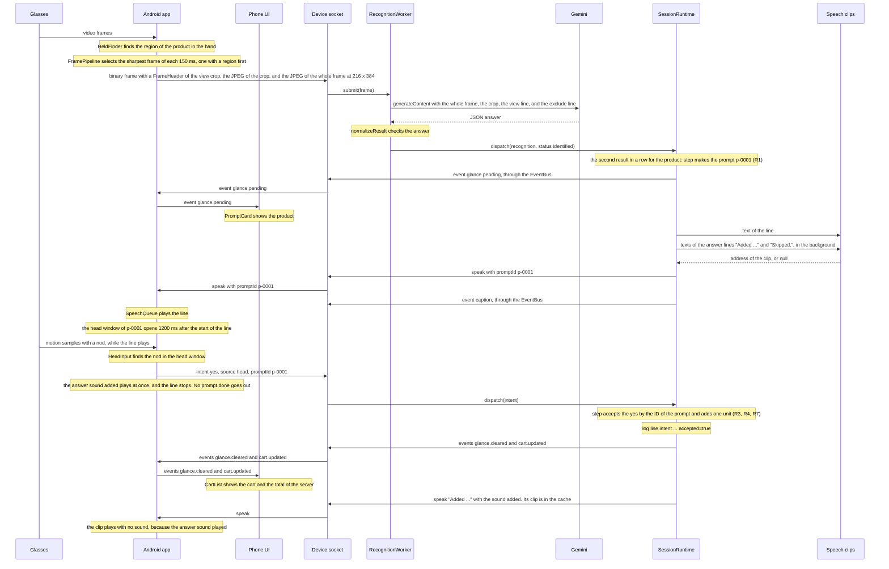

A shopper who waits for the end of the line gets the old order: the app sends `prompt.done`, and the nod follows in the head window.

Rules of this path:

- The phone uploads one frame each 150 ms at most, and it pixelates each face in an upload first. With the setting `Held crop` of the app on, which is the default, an object detector on the phone looks for a product in a hand in each frame.
- A frame with a region goes out as a crop: the region with 30 percent more on each side, cut from the stream frame with no scale, as a JPEG of quality 92. The same message holds the context image, the whole frame at 216 x 384 pixels. The frame call gets both images, and the instruction says: decide `held` in the whole frame, and read the product in the crop.
- A frame with no region goes out as the full frame, with a long side of 768 pixels at most and the quality 80, one time each second. With the setting off, the full frame of each window goes out, with no `view` in its header.
- Measured on 2026-11-14 on the saved uploads of that day: the detector finds a region in about half of the frames with a can in a hand, and in 26 percent of the frames that the server answered with `none`. The phone rule gives 45 percent of the model calls of before. A crop of a 720 x 1280 stream has 2.8 times the pixels on the can, and a crop of a 504 x 896 stream 1.4 times. See "The crop of the held product" in `apps/mobile/android/README.md` and "A crop of the phone" in `apps/server/README.md`.
- The upload stops while the socket is down, while an earlier frame is not sent yet, and while the glasses are off the face.
- The recognition worker runs up to 8 calls at the same time for each session (`RECOGNITION_CONCURRENCY`). Each call starts with the reference pictures of the store items, up to 3 for each item (`RECOGNITION_REFERENCES`). With no free call, the newest frame waits. A call that takes 4 seconds is dropped. The rules get the results in the order of the frames: the worker drops the result of an older frame that arrives after the result of a newer frame.
- `RECOGNITION_PIPELINE=observe` selects a second pipeline behind the same worker: a frame call holds no store data, a search of the store list follows, and a verify call names the product. The default is `frame`. See "The observe pipeline" in `apps/server/README.md`.
- Results for one product inside 3 seconds belong to one appearance, and one appearance gets one prompt.
- `glance.pending` and the glance line carry the allergen and diet warnings of the product for the profile of the session. A line with a warning has the sound `warning`. No message says that a product is safe.
- The head window is on the phone. For a product prompt it opens 1200 ms after the line starts to play, and for a pay prompt when the line ended. It ends `headWindowMs` of the profile after the end of the line: 8 seconds by default. `HeadInput` keeps it in the time of the motion samples: a sample counts when the glasses took it inside the window, also when it arrives up to 6 seconds late. The time of the window does not run in a stall of the samples or during a still, for 15 seconds more at most.
- A head answer while the line of a product prompt plays stops that line at once. The app sends no `prompt.done` for it.
- The server has no head window of its own. A yes or a no from the head for a product prompt counts with the ID of the current prompt alone: the product can be out of view, and `prompt.done` can be missing. It must arrive less than the head window plus 21 seconds after `prompt.done`, or after the start of the prompt when no `prompt.done` came, on the clock of the server. The 21 seconds are the 15 seconds and the 6 seconds of the phone, so the phone is the judge of the time. A prompt that ended, or that another prompt replaced, takes no answer.
- A head answer for the pay prompt needs more: `prompt.done`, and a report of the kiosk code in the last 3 seconds.
- A yes or a no with no prompt to answer says nothing. The server logs each intent with `accepted` and the reason.
- When a product prompt opens, the runtime asks for the clips of the lines that a yes and a no will speak. So the line after the answer waits for no synthesis. The answer line interrupts the line that plays.
- The glance line is short: at the standard level a name of more than 3 words gets no pack size, and only the first 2 prompts of a session name the yes input.
- The app plays the answer sound at the moment it sends a head answer: `added` for a yes, `removed` for a no. The next line of the server then plays its clip with no sound, when it has the same sound. This holds for 3 seconds.
- A yes from the page carries the ID of the prompt on its card and needs no `prompt.done`. In the WebView the app sends it as an intent with the source `phone`. In a browser it is a `POST /api/sessions/:id/intents` call.
- The server writes each line in the language of the profile, English or Italian. `speak` and `caption` carry that language as `lang`. A profile patch with a new language gives `cart.updated` with each cart name in that language.
- The runtime sends the lines in the order of the rules. A line waits for its clip, and a clip that fails gives `url: null`.
- After each step with an event, the runtime writes the session to the store.
- In fake mode no frame goes to a worker. The server decodes each frame, logs it, and drops it. The `ScriptPlayer` dispatches the recognition results. A frame with the kind `label` goes to a fake label reader.

### A nod during a stall of the link

The link from the glasses to the phone stalls for seconds: 3 to 12 seconds in the log of 2026-11-14. The frames and the motion samples stop together, and the samples of the stall arrive together after it. The diagram shows a nod in a stall of 10 seconds.

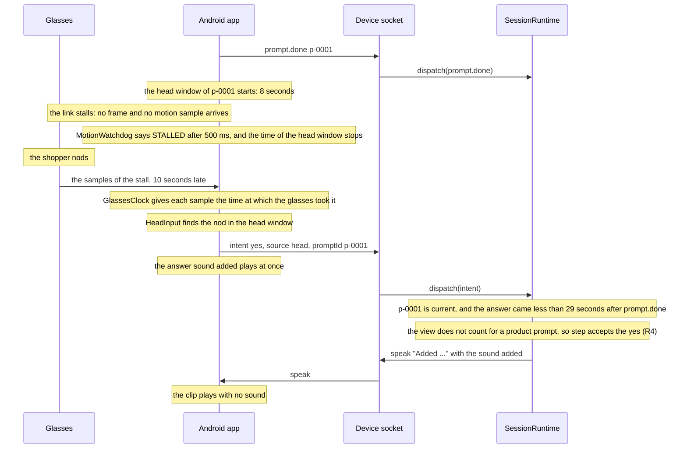

- The phone sends the answer 6 seconds after the end of its head window at the latest. A stall adds 15 seconds to a window at most. A nod in a longer stall is lost.
- The product prompt ends on the server 18 seconds after the last result with its product. A stall does not stop that time, so a nod after it adds nothing.
- Each number of this path comes from tests with synthetic samples and from one log. See "Parts that do not exist yet".

A result with the status `ambiguous` gives no prompt. The server sends the event `glance.ambiguous` with the candidates. With the second such result in a row for the same candidates, it speaks "I cannot tell which oat drink this is. Turn the front to me." If the pending product is one of the candidates, the result has no effect: the prompt stays for the nod, and no event and no line follow.

A product that comes back after 3 seconds with no result keeps its prompt while the head window of that prompt can be open: `headWindowMs` of the profile after `prompt.done`, or after the start of the prompt. In the session of 2026-11-14 a still stopped the frames for 4.7 seconds. The next result opened a second prompt for the held product, and the nod for the first one was lost.

With its setting `Second look still` on, the Android app takes a still photo after each `glance.ambiguous`. The setting is off by default, because each still stalls the motion samples for seconds and the server waits for this still only with `SECOND_LOOK_WAIT_MS`. The message `still.request` of the contract asks only for the still of a barcode, so for look-alike products the event is the signal for the phone. With `SECOND_LOOK_WAIT_MS` above 0 on the server, the look-alike line waits for the result of that still. The default is 0: the line plays at once, and the result of a still counts as the result of a stream frame. The diagram shows a server with a wait.

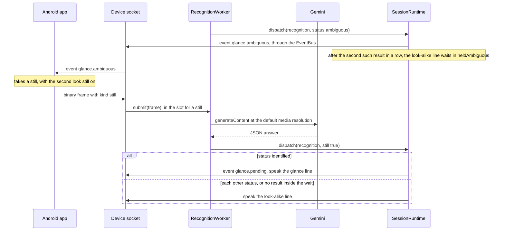

The other answers use the same messages. A no on a new product skips it, and recognition excludes it for 10 seconds. A no in the 8 seconds after an add removes that unit. When an add takes the total over the budget of the profile, the event `budget.exceeded` follows `cart.updated`, and the added line has the sound `warning`. The server README lists each rule from R1 to R24.

## A barcode scan and a label frame

The shopper can show the barcode of a product in place of its front. Three readers can find the code: the barcode scanner of the phone, the text reader of the phone, and the model on the server.

The first diagram shows the readers of the phone. `FramePipeline` of the Android app runs them on each frame of the stream.

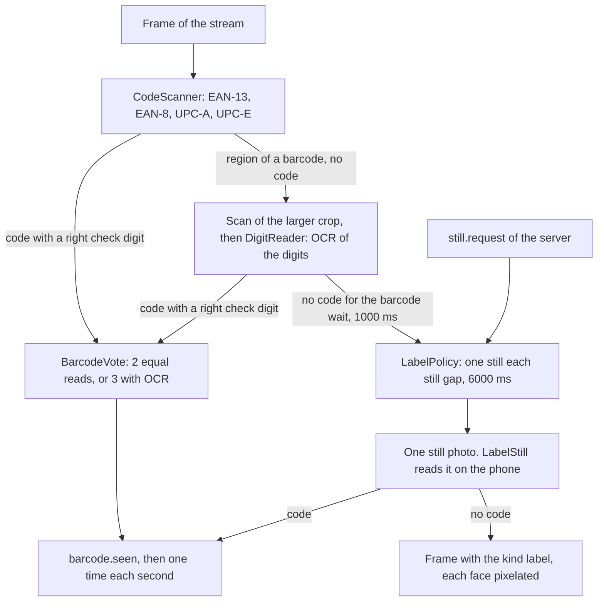

The barcode wait and the still gap are settings of the Android app. A person changes them in the group `Barcode` of the screen "Glance Mock", with no new build. `apps/mobile/android/README.md` has the limits and the rules of each reader.

The second diagram shows a code that the phone read.

```mermaid
sequenceDiagram
  participant App as Android app
  participant Socket as Device socket
  participant Resolver as ProductResolver
  participant List as StoreList
  participant Off as Open Food Facts
  participant Runtime as SessionRuntime

  App->>Socket: barcode.seen with code and source, one time each second while the code is in view
  Note over Socket: normalizeGtin: 13 digits and a right check digit
  Socket->>Resolver: resolve(gtin)
  alt a catalog product has the code
    Resolver-->>Socket: the catalog product
  else
    Resolver->>List: byGtin(gtin)
    List-->>Resolver: the item with its price, or nothing
    Resolver->>Off: GET /api/v2/product/<code>, unless the cache has the answer
    Off-->>Resolver: brand, pack size, allergens, diets
    Note over Resolver: the lookup has 2500 ms. Late or failed details give a product with no allergen data
    Resolver-->>Socket: the product gtin-<13 digits>, or null
  end
  alt a product
    Socket->>Runtime: dispatch(barcode, outcome product)
    Note over Runtime: the path of an identified product: one prompt for each appearance (R1)
    Runtime->>Socket: event glance.pending, speak the glance line with the price of the store
  else the store does not sell the code
    Socket->>Runtime: dispatch(barcode, outcome notInStore)
    Runtime->>Socket: speak "This product is not in this store.", one time for each appearance
  else a wrong check digit
    Socket->>Runtime: dispatch(barcode, outcome invalid), which has no effect
  end
```

The third diagram shows a code that only the model sees. The recognition call of each stream frame also answers `code`, with `visible` and `digits`.

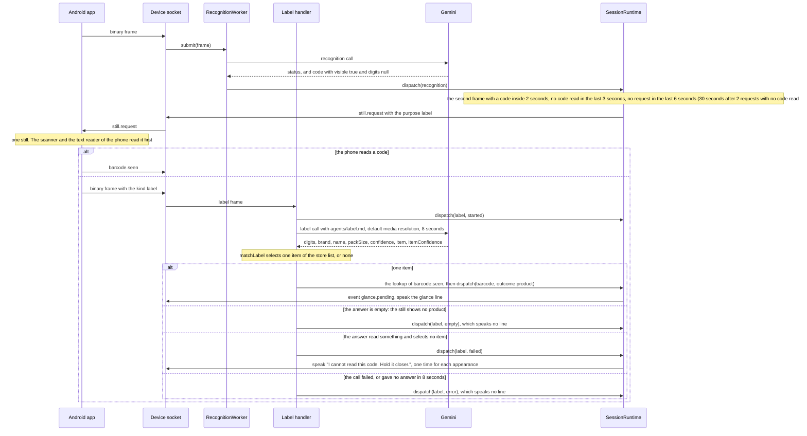

The label call gets the store list in its instruction. It answers with `item`, the code of the one store item that the package is, and the server takes it with an `itemConfidence` of `LABEL_MIN_CONFIDENCE` or more. So a package with Finnish text selects an item with an English name.

The fourth diagram shows a product that recognition by sight cannot name. The same still and the same label call read its package, with no barcode in view.

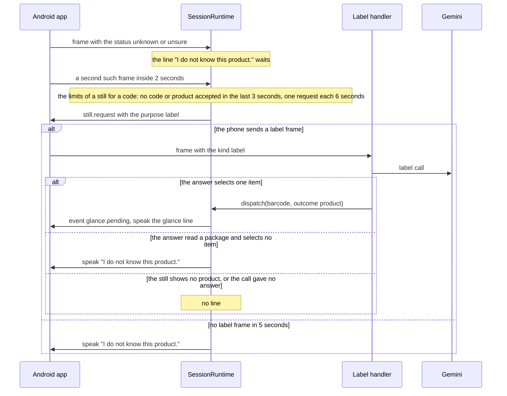

Recognition by sight also knows the store list. Its instruction lists each store item that the catalog does not hold, with the ID `gtin-<13 digits>`, and the answer schema takes these IDs. A clear frame of a store item then gives `identified`, and the product goes through `ProductResolver` to the normal prompt. The server reads the store list one time at its start, with the details that the product cache holds, and makes no call to Open Food Facts then.

Rules of this path:

- The store list decides what the store sells and at which price. It is the file of `STORE_LIST_PATH`, behind the interface `StoreList`, so an ERP client can take its place.
- A catalog product with the `gtin` of the code wins over the store list. It keeps the price and the spoken texts of the catalog.
- Each other product is built from the store item and the details of Open Food Facts. The store list gives the name and the price. Open Food Facts gives the allergens and the diets, and the brand and the pack size when the store list has none. The server does not read the name of Open Food Facts, which is often in another language or only a part of the name. The ID of the product is `gtin-<13 digits>`, and `ScannedProducts` keeps it for the process. The rules find it by that ID as they find a catalog product: the cart, the warnings, the snapshot, a question, and the spot check need no change. No client sees a new type.
- At its start, a server with real product details reads the details of each store item that the cache does not hold, in the background, one read each 5 seconds. So the first prompt of an item does not wait for Open Food Facts.
- Open Food Facts answers are kept for 30 days, and "not found" for 1 day, in memory and in files. After a failed read the next request for that code waits 30 seconds, and after the status 429 each code waits 60 seconds. The server never asks for a code that starts with `2`, `02`, or `04`: only one store knows such a code.
- An empty allergen list of Open Food Facts counts as no data. The shopper then hears "Allergen data is missing for this product." when the profile lists an allergen or a diet.
- Digits that the model read count only with a right check digit and a product of the catalog or the store list. Then one frame is enough. The model never causes the line "This product is not in this store."
- A label gives a product only when its answer selects exactly one item of the store list: by digits with a right check digit, else by the item that the model chose from the list, else by each word of the brand and each word and number of the name. Digits of one item and a chosen item that is another one give no product. Free text of the model never becomes a product.
- A still that shows no product gets no line. A label call that failed, or that gave no answer in 8 seconds, gets none too. The line "I cannot read this code." is for an answer that read something and selected no item.
- A label frame for a product that already has its name goes to no label call: a product prompt is open, a yes or a no answered one in the last 8 seconds, or a product got its name in the last 3 seconds. The phone can send the still of an old request after the answer.
- Each line of the rules goes through one guard, `src/sessions/guard.ts`. A line that answers an action of the shopper always plays, and so do a product prompt, a checkout line, and a state line. Each other line is dropped when a line of the last 20 seconds had its text, or when it comes less than 3 seconds after another unsolicited line. A line about a failed read plays one time for each appearance of a product or a code. The server logs each spoken line and each dropped line. `apps/server/README.md` has the definition and the audit of each line, in "A guard for the voice".
- One voice: while barcode reports or label frames arrive, or the model sees a code, and for 3 seconds after, recognition by sight speaks no unknown line and no aim hint. The same holds while the server waits for a still that it asked for, and for its label call. The recognition instruction also gives the status `none` to a package shown with its barcode side.
- A still is the exception, because it stops the head-motion stream of the glasses for seconds (measured: 5.9 seconds, and 10 seconds for a failed capture). The server asks for none while a product prompt is open, none while sight named a product in the last 3 seconds, and none in the 8 seconds after a yes or a no.
- The phone starts no still while a prompt waits for a head answer: from the start of the line of the prompt to its answer, to its end, or to the end of its head window. That time uses no still gap of `LabelPolicy`. A `still.request` that meets the prompt gives no still: the phone drops it when the prompt gets its answer or ends, and 3 seconds after it arrived. A barcode region that asked behind the prompt starts its barcode wait again. The sharp second look waits 5 seconds at most, and then the phone drops it. The still of a reference picture waits 30 seconds at most. `HeadInput.holdsStills` is the gate.
- 2 frames with a product that sight cannot name ask for a still, with the limits of a still for a code. The unknown line waits for the still and its label call, and plays only when they gave no product.
- The phone takes a label still by itself when a barcode region was in view for the barcode wait with no accepted code, and after each `still.request`. It takes at most one each still gap.
- The label call also gets the reference pictures of the store items: photos that a person took through the glasses before the demo, in the folder of `REFERENCE_DIR`. Each picture is one image part at the low media resolution, after a text part with the code and the name of its item. A call gets the newest 3 pictures of an item, and 24 pictures and 9 MB at most. The server sends each picture to the Files API of Gemini one time, and the label calls and the frame calls of recognition by sight hold the address of the file. `apps/server/README.md` has the capture and the limits, in "Reference pictures".
- A label call is one more Gemini call. The server asks for a still at most one time each 6 seconds for a session, and each 30 seconds after 2 requests with no code read. It starts at most one label call each 5 seconds for a session, and none for a session that does not shop.
- A lookup result that arrives after the result of a later report of another code is dropped.
- In fake mode a script step `barcode` reports a code as the phone does, a `result` step can set `code`, and the field `label` of the script is the answer of the label reader. With `FAKE_PRODUCT_INFO` the details come from fixture files, and no call goes to Open Food Facts.

## A question about a product

The intent `ask` opens a question window of 10 seconds, and the voice says "Listening." The microphone button of the page sends that intent. A yes from the touchpad with no current prompt opens the window too.

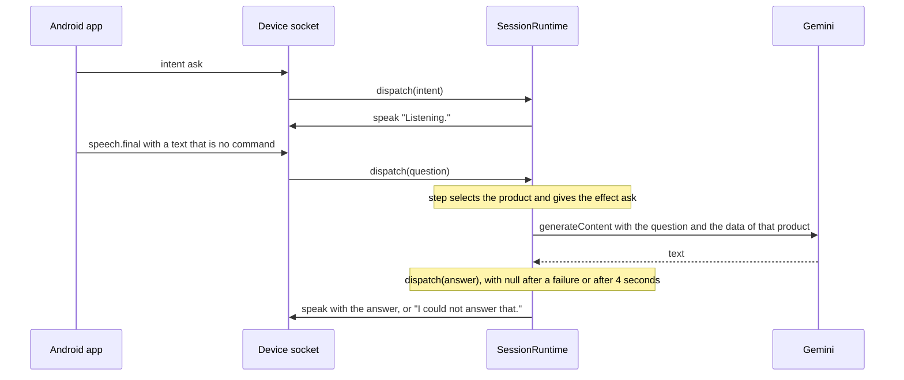

- The question is about the product of the current prompt, else the product in view, else the product of the last add. With no such product the voice says "Hold a product up, then ask."
- The model gets the name, the brand, the pack size, the price, the allergens, and the diet fields of that one product. It gets no frame. Its instruction is `agents/answers.md`.
- A `speech.final` outside the window that is no command has no effect.
- In fake mode no call goes to Gemini, and each question gets the answer "I do not have that information."

## Answers from the other inputs

The head is one of four inputs of the Android app. Each other input sends its answer on the same socket.

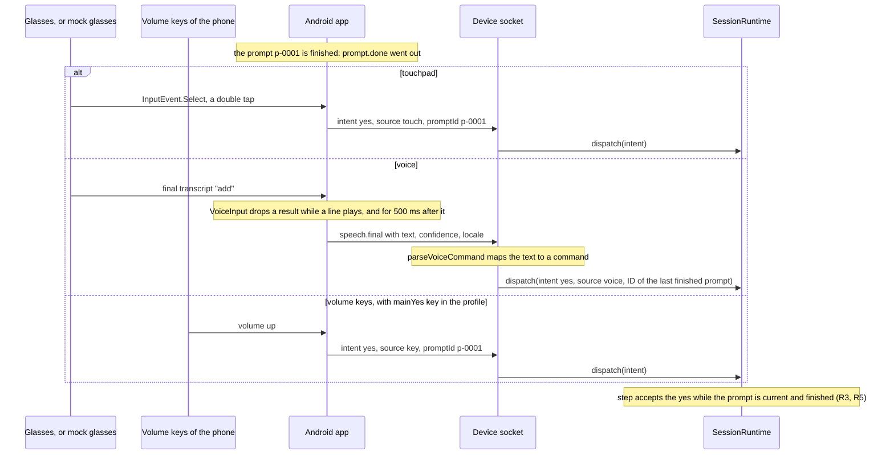

- A double tap carries the ID of the last finished prompt, also after that prompt ended, and the server decides if it counts. A swipe sends `intent repeat` with the source `touch`, and the server sends its last line again.
- The app sends each final speech result as `speech.final` and maps no word to an intent. The server drops a result with a confidence below 0.5 and a text that is no command.
- Volume up is a yes and volume down is a no, only when `mainYes` of the profile is `key` and a prompt is current. In each other case the key changes the volume of the phone. The keys reach the app only while its screen shows, so they are no input with the screen off.
- Speech needs the microphone permission of the glasses. The app asks for it when the page sets `mainYes` to `voice`, and when the page sends the intent `ask`.

## A session with the screen off

A shop continues when the shopper presses the power button and puts the locked phone in a pocket. The app does not keep the screen on, and it has no pocket mode. `SessionService` of the Android app is a foreground service with the types `connectedDevice` and `mediaPlayback`. It holds a partial wake lock and the notification while `SessionController.sessionActive` is true.

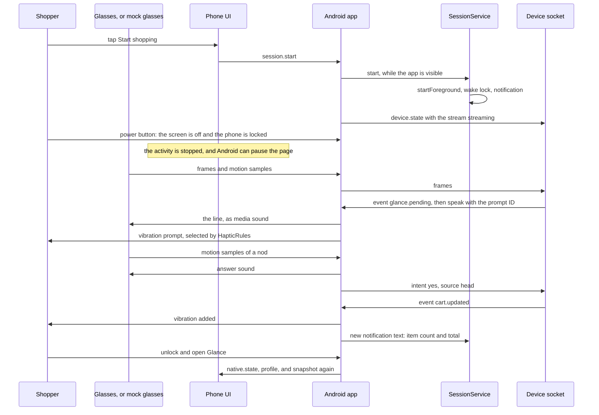

- The service owns no part of the session. It stops itself when `sessionActive` is false: after `session.end`, after `session.rest`, after End on the page, after "Stop camera" in the notification, and after a start that failed.
- Android lets an app start a foreground service only while the app is visible. So the start is the tap on Start shopping, and a session that ended with the screen off does not start again by itself.
- After a lost link or a closed hinge, the service stays while the app waits for the glasses, for 5 minutes at most. A new DAT session then starts with the screen off.
- The notification shows the state as its title and the item count and the total as its text. Android 13 or later needs a permission for it, and the setup of the page asks for that permission. A denied permission does not stop a shop.
- The app selects each vibration from the events of the server and the state of the camera stream (`HapticRules`). The page has no message for a vibration.
- Android can end the renderer of the page while the screen is off. The app then loads the page again, and the page gets its state from `native.state`, `profile`, and the snapshot.
- The volume keys are no input with the screen off. The head, the touchpad of the glasses, and the voice are.
- As of 2026-11-14 nobody measured a session of the real glasses with the screen off. `apps/mobile/android/README.md` lists the open points and the checks, in "The session service" and "Checks with the glasses or with sound".

## The fingerprint and the still photo in the Android app

Two extras have their Android side: the fingerprint before a payment, and the sharp second look. Each one starts with a message of the server. The second look also needs the setting `Second look still` of the app, which is off by default. The server sends `biometric.request` only with its setting `BIOMETRIC_ABOVE_CENTS`. With no such setting, which is the default, a yes pays each total. The still of a barcode is in "A barcode scan and a label frame". No still starts while a prompt waits for a head answer, because a still stalls the motion samples for seconds.

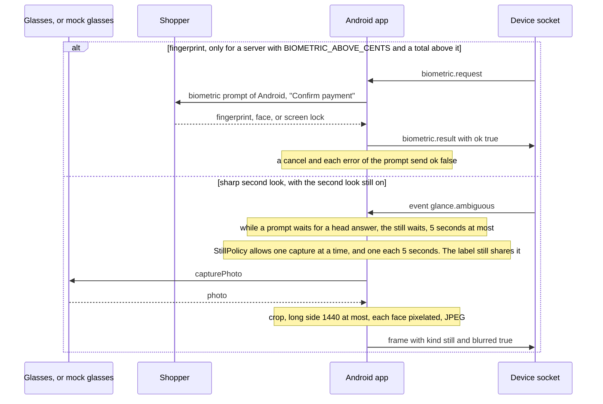

- A phone with no screen lock and no biometric shows no prompt. The app sends `ok: false`, and the page gets the `error` event `native.biometric_unavailable`.
- The app closes an open prompt when the checkout ends: at `checkout.cancelled` and at `session.end`.
- The prompt needs a screen that the shopper sees. With the screen off or the phone locked, the app sends `ok: false` at once.
- If face detection fails on the phone, the still does not leave the phone.
- A second look that waited 5 seconds for a prompt is dropped: the shopper holds something else then. The still of a reference picture waits 30 seconds at most. A label still that waited behind a prompt is not taken after the answer. `apps/mobile/android/README.md` has the rules, in "No still while a prompt waits".

## Phases of a session

`PhaseSchema` in `packages/shared/src/events.ts` names the phases. The server holds the phase in `SessionState.phase` and sends each change as the event `session.state`, with the value `cameraOn`.

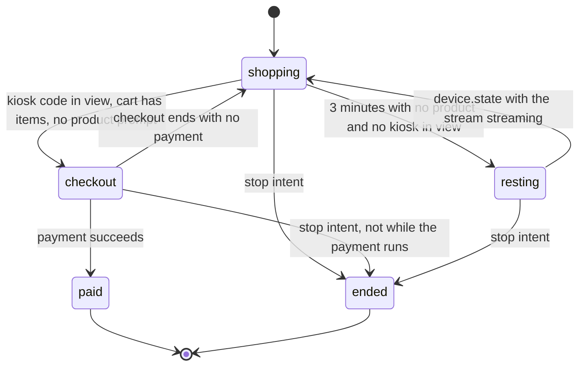

- A new session starts in `shopping` with `cameraOn: false`. The first `device.state` with the stream `streaming` sets `cameraOn`, and the voice says the start line.
- `resting`: the server sends `session.rest`, and the Android app stops its DAT session. The cart stays. The next `session.start` of the page starts a new DAT session for the same server session.
- `paid` and `ended`: the server sends `session.end`, and the session runtime stops. The session then takes only `device.state` and `profile.set`. It still answers a snapshot, for the receipt.
- A `device.state` with the stream `stopped` sets `cameraOn` to false and ends an open checkout, but not in the steps `biometric` and `paying`. The phase does not become `resting` or `ended`.
- The rules that depend on time alone run before each input. A timer of the `SessionRegistry` sends a `tick` input each second to each session in `shopping` or `checkout`.

The Android app has two sessions. The server session holds the cart and has the phases above. The DAT session holds the camera stream, and a stopped DAT session is final. So one server session can use many DAT sessions: after a rest, a closed hinge, or a lost link.

## Steps of a checkout

A checkout exists while `SessionState.checkout` is not null. Its `step` is `spotcheck`, `offered`, `suspended`, `biometric`, or `paying`. The phase of the session is `checkout` for that time.

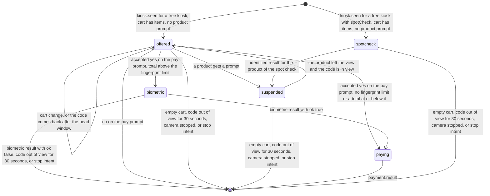

| Step | Event to the session clients | View of the kiosk page |
|---|---|---|
| A checkout starts | `session.state` with the phase `checkout`, then `checkout.offered` with a new prompt ID | `connected`, with the cart and the total |
| A checkout starts at a kiosk with `spotCheck` | `session.state` with the phase `checkout`, then `checkout.spotcheck` with the product to show. The line is "Quick check. Show me the rye bread." | `spotcheck`, with the cart and the total |
| The shopper shows that product | none. The line is "Thank you." The next `kiosk.seen` gives `checkout.offered` | `connected` |
| `offered` again | `checkout.offered` with a new prompt ID and the new total | `connected` |
| `suspended` | `checkout.suspended`, then `glance.pending` for the product | `connected` |
| `biometric` | none. The phone gets the line "Confirm with your fingerprint on the phone." and then the message `biometric.request` | `connected` |
| `paying` | none | `connected` |
| The payment succeeds | `checkout.paid` with the receipt, `cart.updated` with an empty cart, `session.state` with the phase `paid` | `paid` with the receipt for 10 seconds, then `idle` |
| The payment fails | `checkout.failed`, `session.state` with the phase `shopping` | `failed` for 10 seconds, then `idle` |
| The checkout ends with no payment | `checkout.cancelled`, `session.state` with the phase `shopping` | `idle` |

- The phone reports a kiosk code with `kiosk.seen` after 1500 ms in view, and then one time each second. The text is `GL1`, one space, and the code of the kiosk.
- `KioskService` finds the kiosk of the code. A text that is no code of a kiosk has no effect. A kiosk that another session holds gives the line "This checkout is busy."
- One session holds a kiosk from the start of its checkout to its end.
- Each pay prompt has a new ID. An answer with the ID of an older pay prompt cannot pay.
- The yes on the pay prompt gives the effect `payment.start`. The mock payment waits `PAYMENT_DELAY_MS`, writes an order to the store, and dispatches `payment.result`. No money moves.
- The fingerprint limit is the server setting `BIOMETRIC_ABOVE_CENTS`. It is not set by default, and then no payment needs a fingerprint: `needsBiometric` is false for each total, the step `biometric` never starts, and a yes pays each total.
- With the setting, `checkout.offered` has `needsBiometric: true` for a total above the limit. The yes on that pay prompt starts no payment: the server sends `biometric.request`, and the phone answers with `biometric.result`. A result with `ok: false` ends the checkout as a no does. A result with no request has no effect.
- While the step is `biometric`, no answer, no undo, no cart edit, and no recognition result has an effect. The checkout still ends when the code was out of view for 30 seconds, so a browser client, which has no fingerprint check, loses its checkout above the limit after that time.
- While the step is `paying`, no answer, no undo, no cart edit, and no stop intent has an effect.
- After a no on the pay prompt, and after a failed payment, the kiosk is muted until its code has left the view. So the shopper looks away and back to start again.
- A failed payment keeps the cart. A kiosk that registered with `failPayment: true` declines each payment.
- A kiosk that registered with `spotCheck: true` starts its checkout in the step `spotcheck`. The product to show is the cart line with the highest unit price. Until 2 `identified` results in a row name that product, no pay prompt exists. Another product in view gets its usual prompt, and the step stays. If the product leaves the cart, the server asks for another one with a new `checkout.spotcheck`.

## Parts that do not exist yet

Missing parts:

- `ProbeDecisions.SPEECH` of the Android app is false until the probe run on the glasses. So a session with the real glasses attaches no Speech and sends no `speech.final`. The voice commands and the spoken question work with mock glasses only.
- `SECOND_LOOK_WAIT_MS` has the default 0, so the server does not wait for a still. The Android app sends the still in both cases.
- A browser client has no fingerprint check and no microphone. On a server with `BIOMETRIC_ABOVE_CENTS`, its checkout above the limit ends after 30 seconds with no payment. Its question window closes with no question.
- A phone with the screen off cannot show the fingerprint prompt. On a server with `BIOMETRIC_ABOVE_CENTS`, a payment above the limit fails with the phone in a pocket: the app answers `ok: false`.
- A session with the screen off is not measured on the real glasses. The frame rate, the rate of the motion samples, and the battery use with a locked phone are open.
- The Display HUD shows the product prompt, the total, and the last line. It has no view for the pay prompt, the receipt, the look-alike candidates, or the spot check.
- A snapshot has no field for the spot check, and a `KioskEvent` does not name the product of the spot check.
- The prices of `apps/server/catalog/store-list.dev.json` are invented for the demo. A real shop needs the list of the store, or an ERP client behind `StoreList`.
- The server does not count its calls to Open Food Facts, which allows 15 product reads each minute for one address. The guards are the cache, the wait after a failed read, and the pause after the status 429.
- A UPC-E code needs the phone: `barcode.seen` has no format field, and the server reads 8 digits as EAN-8.
- `apps/server/catalog/catalog.json` holds 12 product slots with `FILL_` texts and the price 0. A person must fill them. The default catalog is `catalog.dev.json` with four products.
- The products of both catalog files have no Italian texts, except the oat drink of `catalog.dev.json`. A product with no Italian text keeps its English text.
- In the Italian phone UI, the words of Astryx itself and the debug panel stay English. The voice commands stay English in each language.

Checks that nobody did:

- The tests of the head, the touchpad, the voice, the volume keys, and the still photo use mock glasses or synthetic samples. One session with the real glasses ran, on 2026-11-14: see below.
- Nobody has put a finger on the payment prompt. The tests close the prompt of Android with no finger, or replace it.
- No native speaker has read the Italian lines of the server or the Italian table of the phone UI.
- Nobody has checked the Display HUD in the Display simulator or on glasses with a display. The checks ran in a browser.
- No replay of a frame set has run with the real recognition service, and no test has run the store tests against a MongoDB server.
- One test with Ray-Ban Meta glasses ran on 2026-11-14. The stream fell to 504 x 896, and the scanner of the phone read no code at the length of an arm. A label still took 2.3 to 2.9 seconds and its label call 1.5 to 2.3 seconds. The distance at which the phone reads a code is still not known.
- The changes after that test have not run with the real glasses or the real model: the item that the label call chooses, the store items in the recognition instruction, the still for an unknown product, the size limit of a barcode region, and the barcode wait of 1000 ms.
- The held crop has not run on a phone. Its detector and its rule were measured on the build computer, with the saved uploads of 2026-11-14. In that measurement the frame call named fewer cans from a crop than from the full frame, with crops that have fewer pixels than a crop of the phone. Nobody measured a crop of the stream. See "The crop of the held product" in `apps/mobile/android/README.md`.
- The changes after the session of 2026-11-14 at 22:34 have not run with the real glasses or the real model: the prompt that stays when its product comes back, the label call with no line after a failure, the label frame that the server drops for a named product, the reference pictures of a label call as files, the second look still as a setting, and the label still that the phone drops behind a prompt. Tests of the rules replay the times of that session.
- The head gestures after their rework have only synthetic tests. This holds for the rules of the detector for a nod and a shake, and for the head window in the time of the samples. It also holds for the watchdog of the motion samples with its restart of Motion, and for the gate that holds a still while a prompt waits. One session of 2026-11-14 gave log lines of real nods, and the rule for the other axis of a gesture comes from them. A later session of that day gave four motion recordings with nods of two persons, and the axis map of the glasses comes from them: `MotionReplayTest` replays them. No recording of a shake or of a walk exists.
- These changes after that session have tests of their rules only, and no session with the glasses ran with them: the head window that opens while the line of a product prompt plays, the stop of that line at a head answer, the head answer that counts by the ID of its prompt (R4), the clips of the answer lines that the server makes in advance, and the one answer sound.
- The instrumented tests of the Android app did not run after the group `Barcode` came to "Glance Mock". They also did not run after the rework of the head gestures. They need the test phone.
- The label call and the `code` field of the recognition call have not run with the real model. The server code has made no call to Open Food Facts: the tests use a fetch function of their own and fixture files.
