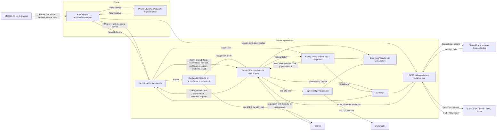
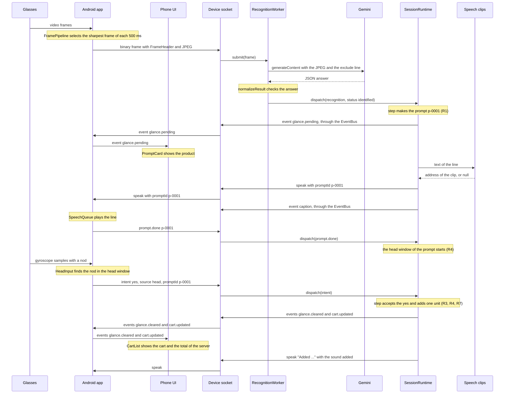
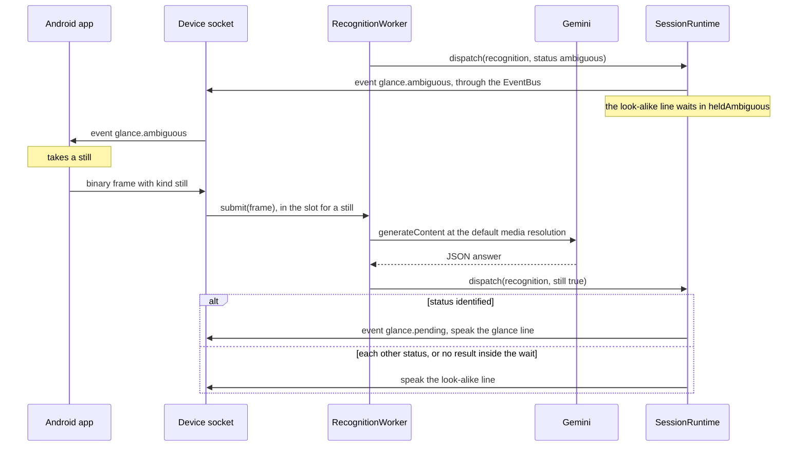
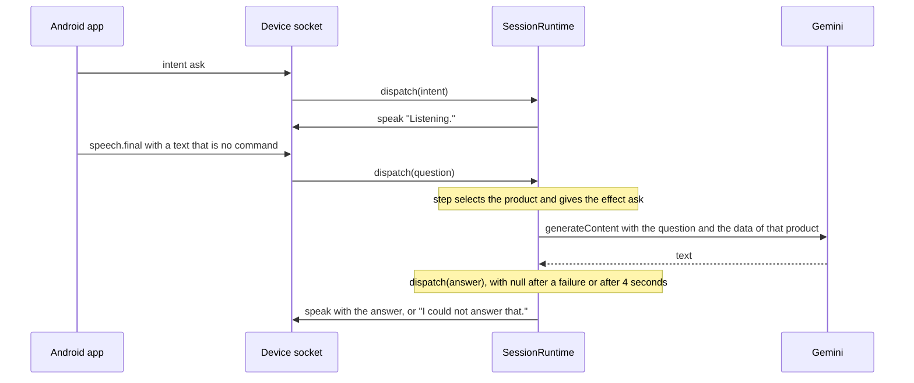
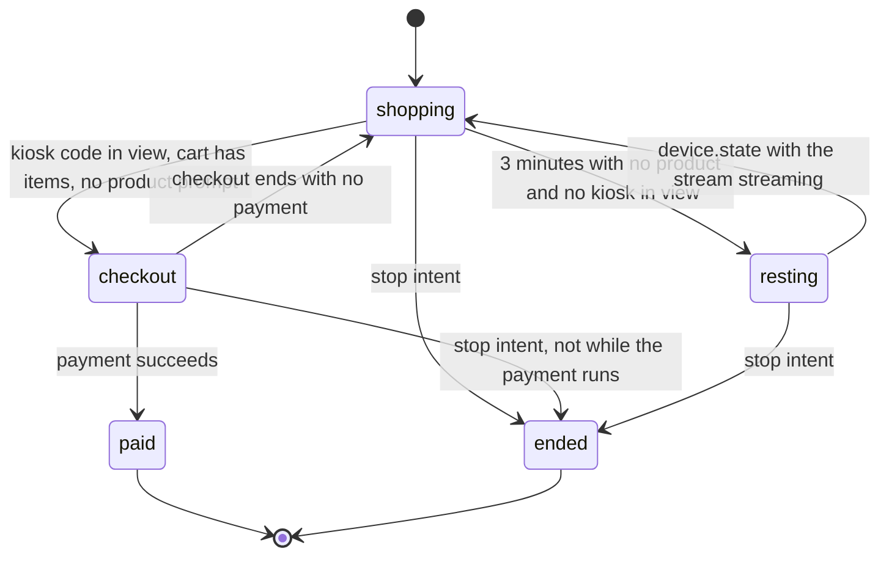
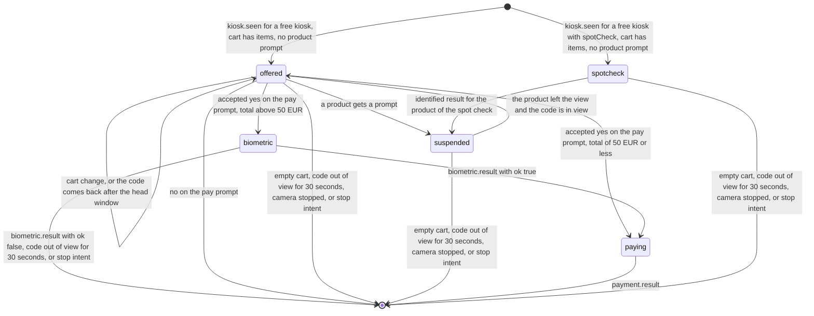

# Architecture

This file describes the parts of Meta Glance that exist and work on the branch `feat/overnight-build`. The design, with the parts that do not exist yet, is in `docs/superpowers/specs/2026-11-13-meta-glance-design.md`.

Each name in this file is a name in the code. Each message type is a schema in `packages/shared/src`.

## Parts

| Part | Folder | Task |
|---|---|---|
| Contract | `packages/shared` | Each message type as a zod schema, one JSON fixture for each message variant, `TIMING`, the frame codec, and the kiosk code helpers. |
| Android app | `apps/mobile/android` | Connects to the glasses through the DAT SDK, sends frames and answers to the server, plays the lines, and hosts the phone UI. |
| Phone UI | `apps/mobile/ui` | Shows the current prompt, the last lines as text, and the cart. It has no network code: each message goes through a `GlanceBridge`. |
| Server | `apps/server` | Recognizes the product in a frame, runs the cart rules, writes the spoken lines, and runs the checkout with a mock payment. |
| Website | `apps/website` | The kiosk page shows the code that starts a checkout, and then the cart and the result. |

Facts that the diagram does not show:

- The server is the only part that changes a cart or computes a total. Each price comes from the catalog of the server.
- The Android app has its own Kotlin classes for the messages, in `apps/mobile/android/core/src/main/kotlin/com/metaglance/core/contract`. A Kotlin test decodes each fixture of `packages/shared/fixtures`.
- The phone UI uses `AndroidBridge` in the WebView and `BrowserBridge` in each other browser. With the query flag `api`, `BrowserBridge` talks to the server with REST calls and the event stream. A session then needs no phone.
- With `FAKE_RECOGNITION`, the server makes no Gemini call. A `ScriptPlayer` gives the rules the results and the kiosk sightings of a script file.
- With `FAKE_SPEECH`, the server makes no ElevenLabs call. Each line has `url: null`, and the phone reads the text with its own voice.
- Mock glasses are MockDeviceKit of the DAT SDK. The app uses them through `MockGlassesController`.
- The `EventBus` has one topic for each session and one topic for each kiosk. It delivers inside the server process only.

### Messages

| From | To | Channel | Type |
|---|---|---|---|
| Page | Android app | `window.GlanceNative.postMessage(json)` | `PageToNative` |
| Android app | Page | `window.__glanceReceive(json)` | `NativeToPage` |
| Android app | Server | Text message on the device socket | `DeviceToServer` |
| Android app | Server | Binary message on the device socket | A frame: 4 bytes with the header length, a `FrameHeader` as JSON, and a JPEG |
| Server | Android app | Text message on the device socket | `ServerToDevice` |
| Android app, browser | Server | `POST /api/sessions` | `CreateSessionRequest`, answer `CreateSessionResponse` |
| Android app, browser | Server | `GET /api/sessions/:id` | Answer `SessionSnapshot` |
| Browser | Server | `POST /api/sessions/:id/intents` | `WebIntentRequest` |
| Browser | Server | `POST /api/sessions/:id/cart` | `CartEditRequest` |
| Browser | Server | `PATCH /api/sessions/:id/profile` | `ProfilePatch`, answer `Profile` |
| Android app, browser | Server | `DELETE /api/sessions/:id` | No body |
| Server | Browser | `GET /api/sessions/:id/events` | A stream of `ServerEvent` |
| Kiosk page | Server | `POST /api/kiosks` | `CreateKioskRequest`, answer `CreateKioskResponse` |
| Server | Kiosk page | `GET /api/kiosks/:id/events` | A stream of `KioskEvent` |
| Android app | Server | `GET /api/speech/<hash>.mp3` | Answer: the MP3 of a line |

The device socket carries each `ServerEvent` of its session inside the `ServerToDevice` message `event`. The Android app passes it to the page inside the `NativeToPage` message `event`.

## One glance, from the frame to the cart

The diagram shows a server with real recognition and real speech. The shopper looks at a product that is not in the cart, and answers the prompt with a nod.

Rules of this path:

- The phone uploads one frame each 500 ms at most. The JPEG has the quality 80 and a long side of 768 pixels at most. It is the center of the camera frame (80 percent of the width, 70 percent of the height), and the phone pixelates each face in it before the upload.
- The upload stops while the socket is down, while an earlier frame is not sent yet, and while the glasses are off the face.
- The recognition worker runs one call at a time for each session. While a call runs, the newest frame waits, and a call that takes 4 seconds is dropped.
- Results for one product inside 3 seconds belong to one appearance, and one appearance gets one prompt.
- `glance.pending` and the glance line carry the allergen and diet warnings of the product for the profile of the session. A line with a warning has the sound `warning`. No message says that a product is safe.
- A yes from the head counts only with the ID of the current prompt, after `prompt.done`, with the product in view, and inside the head window of the profile. The default is 8 seconds.
- A yes from the page carries the ID of the prompt on its card and needs no `prompt.done`. In the WebView the app sends it as an intent with the source `phone`. In a browser it is a `POST /api/sessions/:id/intents` call.
- The server writes each line in the language of the profile, English or Italian. `speak` and `caption` carry that language as `lang`. A profile patch with a new language gives `cart.updated` with each cart name in that language.
- The runtime sends the lines in the order of the rules. A line waits for its clip, and a clip that fails gives `url: null`.
- After each step with an event, the runtime writes the session to the store.
- In fake mode no frame goes to a worker. The server decodes each frame, logs it, and drops it. The `ScriptPlayer` dispatches the recognition results.

A result with the status `ambiguous` gives no prompt. The server sends the event `glance.ambiguous` with the candidates and speaks "I cannot tell which oat drink this is. Turn the front to me." If the pending product is one of the candidates, `glance.cleared` comes first, so a yes cannot add it.

With `SECOND_LOOK_WAIT_MS` set on the server, the look-alike line waits for a still. The contract has no message that asks for a still, so the event is the signal for the phone.

The other answers use the same messages. A no on a new product skips it, and recognition excludes it for 10 seconds. A no in the 8 seconds after an add removes that unit. When an add takes the total over the budget of the profile, the event `budget.exceeded` follows `cart.updated`, and the added line has the sound `warning`. The server README lists each rule from R1 to R24.

## A question about a product

The intent `ask` opens a question window of 10 seconds, and the voice says "Listening." The microphone button of the page sends that intent. A yes from the touchpad with no current prompt opens the window too.

- The question is about the product of the current prompt, else the product in view, else the product of the last add. With no such product the voice says "Hold a product up, then ask."
- The model gets the name, the brand, the pack size, the price, the allergens, and the diet fields of that one product. It gets no frame. Its instruction is `agents/answers.md`.
- A `speech.final` outside the window that is no command has no effect.
- In fake mode no call goes to Gemini, and each question gets the answer "I do not have that information."

## Phases of a session

`PhaseSchema` in `packages/shared/src/events.ts` names the phases. The server holds the phase in `SessionState.phase` and sends each change as the event `session.state`, with the value `cameraOn`.

- A new session starts in `shopping` with `cameraOn: false`. The first `device.state` with the stream `streaming` sets `cameraOn`, and the voice says the start line.
- `resting`: the server sends `session.rest`, and the Android app stops its DAT session. The cart stays. The next `session.start` of the page starts a new DAT session for the same server session.
- `paid` and `ended`: the server sends `session.end`, and the session runtime stops. The session then takes only `device.state` and `profile.set`. It still answers a snapshot, for the receipt.
- A `device.state` with the stream `stopped` sets `cameraOn` to false and ends an open checkout. The phase does not become `resting` or `ended`.
- The rules that depend on time alone run before each input. A timer of the `SessionRegistry` sends a `tick` input each second to each session in `shopping` or `checkout`.

The Android app has two sessions. The server session holds the cart and has the phases above. The DAT session holds the camera stream, and a stopped DAT session is final. So one server session can use many DAT sessions: after a rest, a closed hinge, or a lost link.

## Steps of a checkout

A checkout exists while `SessionState.checkout` is not null. Its `step` is `spotcheck`, `offered`, `suspended`, `biometric`, or `paying`. The phase of the session is `checkout` for that time.

| Step | Event to the session clients | View of the kiosk page |
|---|---|---|
| A checkout starts | `session.state` with the phase `checkout`, then `checkout.offered` with a new prompt ID | `connected`, with the cart and the total |
| A checkout starts at a kiosk with `spotCheck` | `session.state` with the phase `checkout`, then `checkout.spotcheck` with the product to show. The line is "Quick check. Show me the rye bread." | `spotcheck`, with the cart and the total |
| The shopper shows that product | none. The line is "Thank you." The next `kiosk.seen` gives `checkout.offered` | `connected` |
| `offered` again | `checkout.offered` with a new prompt ID and the new total | `connected` |
| `suspended` | `checkout.suspended`, then `glance.pending` for the product | `connected` |
| `biometric` | none. The phone gets the line "Over fifty euros. Confirm with your fingerprint on the phone." and then the message `biometric.request` | `connected` |
| `paying` | none | `connected` |
| The payment succeeds | `checkout.paid` with the receipt, `cart.updated` with an empty cart, `session.state` with the phase `paid` | `paid` with the receipt for 10 seconds, then `idle` |
| The payment fails | `checkout.failed`, `session.state` with the phase `shopping` | `failed` for 10 seconds, then `idle` |
| The checkout ends with no payment | `checkout.cancelled`, `session.state` with the phase `shopping` | `idle` |

- The phone reports a kiosk code with `kiosk.seen` after 1500 ms in view, and then one time each second. The text is `GL1`, one space, and the code of the kiosk.
- `KioskService` finds the kiosk of the code. A text that is no code of a kiosk has no effect. A kiosk that another session holds gives the line "This checkout is busy."
- One session holds a kiosk from the start of its checkout to its end.
- Each pay prompt has a new ID. An answer with the ID of an older pay prompt cannot pay.
- The yes on the pay prompt gives the effect `payment.start`. The mock payment waits `PAYMENT_DELAY_MS`, writes an order to the store, and dispatches `payment.result`. No money moves.
- `checkout.offered` has `needsBiometric: true` for a total above 50 EUR. The yes on that pay prompt starts no payment: the server sends `biometric.request`, and the phone answers with `biometric.result`. A result with `ok: false` ends the checkout as a no does. A result with no request has no effect.
- While the step is `biometric`, no answer, no undo, no cart edit, and no recognition result has an effect. The checkout still ends when the code was out of view for 30 seconds, so a browser client, which has no fingerprint check, loses its checkout above 50 EUR after that time.
- While the step is `paying`, no answer, no undo, no cart edit, and no stop intent has an effect.
- After a no on the pay prompt, and after a failed payment, the kiosk is muted until its code has left the view. So the shopper looks away and back to start again.
- A failed payment keeps the cart. A kiosk that registered with `failPayment: true` declines each payment.
- A kiosk that registered with `spotCheck: true` starts its checkout in the step `spotcheck`. The product to show is the cart line with the highest unit price. Until an `identified` result names that product, no pay prompt exists. Another product in view gets its usual prompt, and the step stays. If the product leaves the cart, the server asks for another one with a new `checkout.spotcheck`.

## Parts that do not exist yet

- The Android app sends a yes or a no only from the head and from the page. The touchpad, the voice of the glasses, and the volume keys are no input yet, so the app sends no `speech.final`.
- The Android app has no handler for `biometric.request` and sends no `biometric.result`. So a checkout above 50 EUR ends after 30 seconds with no payment.
- The Android app takes no still for the event `glance.ambiguous`. So `SECOND_LOOK_WAIT_MS` stays at 0 on the server, and the look-alike line plays at once.
- No native speaker has read the Italian lines of the server. The products of `apps/server/catalog/catalog.dev.json` have no Italian texts, except the oat drink.
- The phone UI has an Italian table, and no native speaker has read it. In Italian the page text is Italian. The words of Astryx itself and the debug panel stay English.
