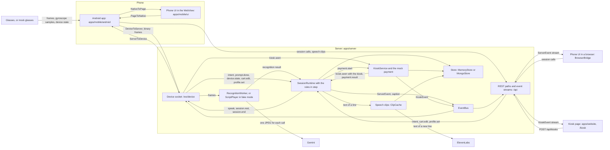
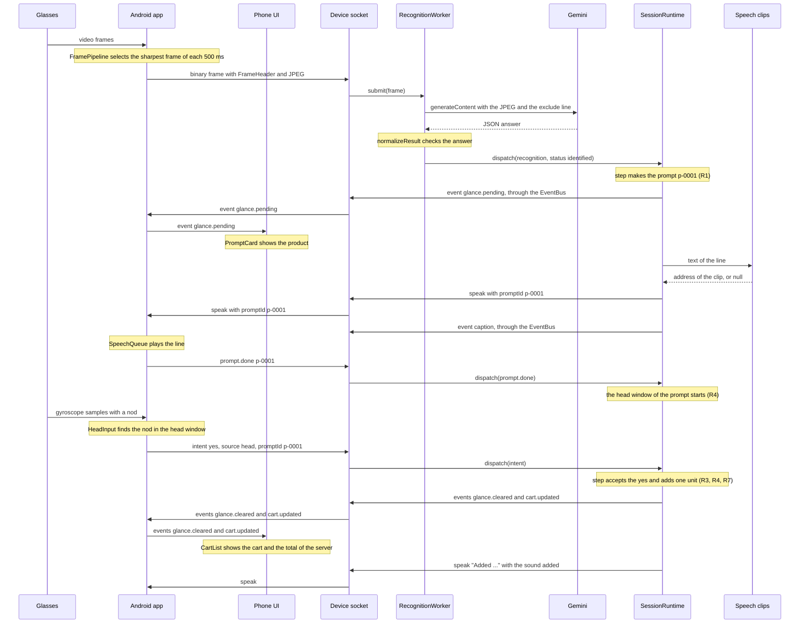
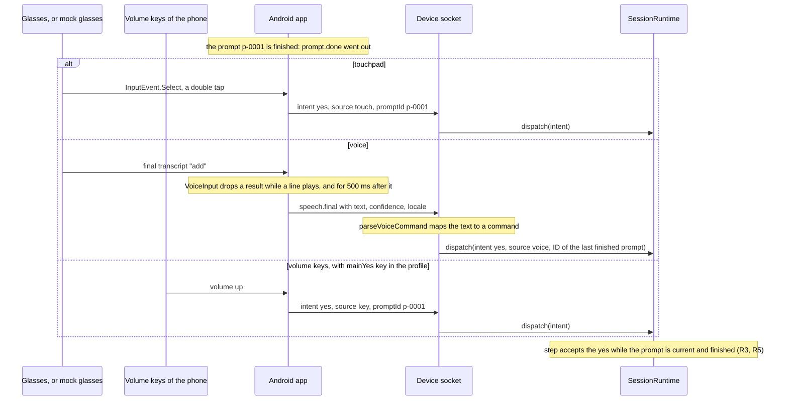
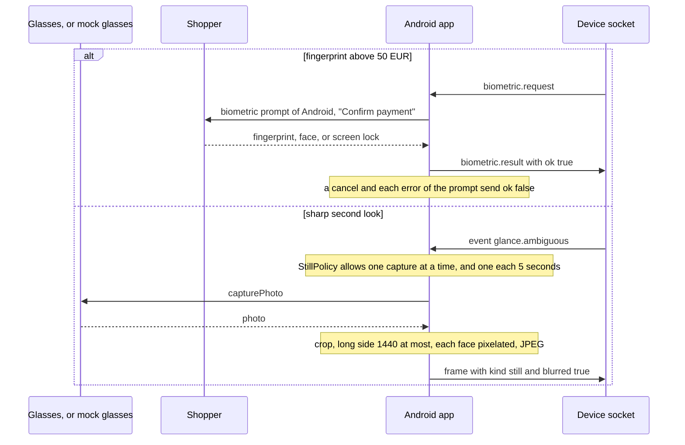
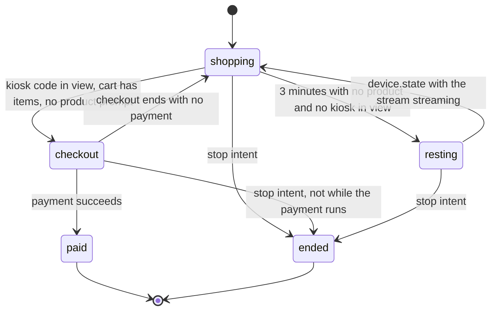
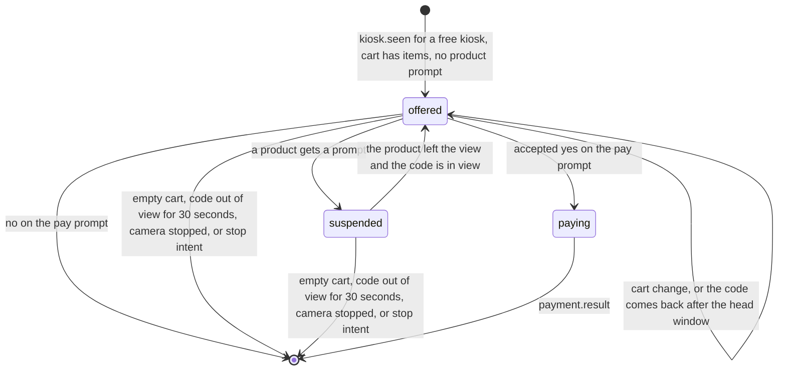

# Architecture

This file describes the parts of Meta Glance that exist and work on the branch `feat/overnight-build`. The design, with the parts that do not exist yet, is in `docs/superpowers/specs/2026-11-13-meta-glance-design.md`.

Each name in this file is a name in the code. Each message type is a schema in `packages/shared/src`.

## Parts

| Part | Folder | Task |
|---|---|---|
| Contract | `packages/shared` | Each message type as a zod schema, one JSON fixture for each message variant, `TIMING`, the frame codec, and the kiosk code helpers. |
| Android app | `apps/mobile/android` | Connects to the glasses through the DAT SDK, sends frames and answers to the server, plays the lines, and hosts the phone UI. |
| Phone UI | `apps/mobile/ui` | Shows the current prompt, the last lines as text, and the cart. It has no network code: each message goes through a `GlanceBridge`. |
| Server | `apps/server` | Recognizes the product in a frame, runs the cart rules, writes the spoken lines, and runs the checkout with a mock payment. |
| Website | `apps/website` | The kiosk page shows the code that starts a checkout, and then the cart and the result. |

Facts that the diagram does not show:

- The server is the only part that changes a cart or computes a total. Each price comes from the catalog of the server.
- The Android app has its own Kotlin classes for the messages, in `apps/mobile/android/core/src/main/kotlin/com/metaglance/core/contract`. A Kotlin test decodes each fixture of `packages/shared/fixtures`.
- The phone UI uses `AndroidBridge` in the WebView and `BrowserBridge` in each other browser. With the query flag `api`, `BrowserBridge` talks to the server with REST calls and the event stream. A session then needs no phone.
- With `FAKE_RECOGNITION`, the server makes no Gemini call. A `ScriptPlayer` gives the rules the results and the kiosk sightings of a script file.
- With `FAKE_SPEECH`, the server makes no ElevenLabs call. Each line has `url: null`, and the phone reads the text with its own voice.
- Mock glasses are MockDeviceKit of the DAT SDK. The app uses them through `MockGlassesController`.
- The `EventBus` has one topic for each session and one topic for each kiosk. It delivers inside the server process only.

### Messages

| From | To | Channel | Type |
|---|---|---|---|
| Page | Android app | `window.GlanceNative.postMessage(json)` | `PageToNative` |
| Android app | Page | `window.__glanceReceive(json)` | `NativeToPage` |
| Android app | Server | Text message on the device socket | `DeviceToServer` |
| Android app | Server | Binary message on the device socket | A frame: 4 bytes with the header length, a `FrameHeader` as JSON, and a JPEG |
| Server | Android app | Text message on the device socket | `ServerToDevice` |
| Android app, browser | Server | `POST /api/sessions` | `CreateSessionRequest`, answer `CreateSessionResponse` |
| Android app, browser | Server | `GET /api/sessions/:id` | Answer `SessionSnapshot` |
| Browser | Server | `POST /api/sessions/:id/intents` | `WebIntentRequest` |
| Browser | Server | `POST /api/sessions/:id/cart` | `CartEditRequest` |
| Browser | Server | `PATCH /api/sessions/:id/profile` | `ProfilePatch`, answer `Profile` |
| Android app, browser | Server | `DELETE /api/sessions/:id` | No body |
| Server | Browser | `GET /api/sessions/:id/events` | A stream of `ServerEvent` |
| Kiosk page | Server | `POST /api/kiosks` | `CreateKioskRequest`, answer `CreateKioskResponse` |
| Server | Kiosk page | `GET /api/kiosks/:id/events` | A stream of `KioskEvent` |
| Android app | Server | `GET /api/speech/<hash>.mp3` | Answer: the MP3 of a line |

The device socket carries each `ServerEvent` of its session inside the `ServerToDevice` message `event`. The Android app passes it to the page inside the `NativeToPage` message `event`.

## One glance, from the frame to the cart

The diagram shows a server with real recognition and real speech. The shopper looks at a product that is not in the cart, and answers the prompt with a nod.

Rules of this path:

- The phone uploads one frame each 500 ms at most. The JPEG has the quality 80 and a long side of 768 pixels at most. It is the center of the camera frame (80 percent of the width, 70 percent of the height), and the phone pixelates each face in it before the upload.
- The upload stops while the socket is down, while an earlier frame is not sent yet, and while the glasses are off the face.
- The recognition worker runs one call at a time for each session. While a call runs, the newest frame waits, and a call that takes 4 seconds is dropped.
- Results for one product inside 3 seconds belong to one appearance, and one appearance gets one prompt.
- A yes from the head counts only with the ID of the current prompt, after `prompt.done`, with the product in view, and inside the head window of the profile. The default is 8 seconds.
- A yes from the page carries the ID of the prompt on its card and needs no `prompt.done`. In the WebView the app sends it as an intent with the source `phone`. In a browser it is a `POST /api/sessions/:id/intents` call.
- The runtime sends the lines in the order of the rules. A line waits for its clip, and a clip that fails gives `url: null`.
- After each step with an event, the runtime writes the session to the store.
- In fake mode no frame goes to a worker. The server decodes each frame, logs it, and drops it. The `ScriptPlayer` dispatches the recognition results.

### Answers from the other inputs

The head is one of four inputs of the Android app. Each other input sends its answer on the same socket.

- A double tap carries the ID of the last finished prompt, also after that prompt ended, and the server decides if it counts. A swipe sends `intent repeat` with the source `touch`, and the server sends its last line again.
- The app sends each final speech result as `speech.final` and maps no word to an intent. The server drops a result with a confidence below 0.5 and a text that is no command.
- Volume up is a yes and volume down is a no, only when `mainYes` of the profile is `key` and a prompt is current. In each other case the key changes the volume of the phone.
- Speech needs the microphone permission of the glasses. The app asks for it when the page sets `mainYes` to `voice`, and when the page sends the intent `ask`.

### The fingerprint and the still photo in the Android app

Two extras have their Android side: the fingerprint above 50 EUR, and the sharp second look. Each one starts with a message of the server.

- A phone with no screen lock and no biometric shows no prompt. The app sends `ok: false`, and the page gets the `error` event `native.biometric_unavailable`.
- The app closes an open prompt when the checkout ends: at `checkout.cancelled` and at `session.end`.
- The contract has no request for a still, so the event `glance.ambiguous` is the signal. If face detection fails on the phone, the still does not leave the phone.

The other answers use the same messages. A no on a new product skips it, and recognition excludes it for 10 seconds. A no in the 8 seconds after an add removes that unit. The server README lists each rule from R1 to R24.

## Phases of a session

`PhaseSchema` in `packages/shared/src/events.ts` names the phases. The server holds the phase in `SessionState.phase` and sends each change as the event `session.state`, with the value `cameraOn`.

- A new session starts in `shopping` with `cameraOn: false`. The first `device.state` with the stream `streaming` sets `cameraOn`, and the voice says the start line.
- `resting`: the server sends `session.rest`, and the Android app stops its DAT session. The cart stays. The next `session.start` of the page starts a new DAT session for the same server session.
- `paid` and `ended`: the server sends `session.end`, and the session runtime stops. The session then takes only `device.state` and `profile.set`. It still answers a snapshot, for the receipt.
- A `device.state` with the stream `stopped` sets `cameraOn` to false and ends an open checkout. The phase does not become `resting` or `ended`.
- The rules that depend on time alone run before each input. A timer of the `SessionRegistry` sends a `tick` input each second to each session in `shopping` or `checkout`.

The Android app has two sessions. The server session holds the cart and has the phases above. The DAT session holds the camera stream, and a stopped DAT session is final. So one server session can use many DAT sessions: after a rest, a closed hinge, or a lost link.

## Steps of a checkout

A checkout exists while `SessionState.checkout` is not null. Its `step` is `offered`, `suspended`, or `paying`. The phase of the session is `checkout` for that time.

| Step | Event to the session clients | View of the kiosk page |
|---|---|---|
| A checkout starts | `session.state` with the phase `checkout`, then `checkout.offered` with a new prompt ID | `connected`, with the cart and the total |
| `offered` again | `checkout.offered` with a new prompt ID and the new total | `connected` |
| `suspended` | `checkout.suspended`, then `glance.pending` for the product | `connected` |
| `paying` | none | `connected` |
| The payment succeeds | `checkout.paid` with the receipt, `cart.updated` with an empty cart, `session.state` with the phase `paid` | `paid` with the receipt for 10 seconds, then `idle` |
| The payment fails | `checkout.failed`, `session.state` with the phase `shopping` | `failed` for 10 seconds, then `idle` |
| The checkout ends with no payment | `checkout.cancelled`, `session.state` with the phase `shopping` | `idle` |

- The phone reports a kiosk code with `kiosk.seen` after 1500 ms in view, and then one time each second. The text is `GL1`, one space, and the code of the kiosk.
- `KioskService` finds the kiosk of the code. A text that is no code of a kiosk has no effect. A kiosk that another session holds gives the line "This checkout is busy."
- One session holds a kiosk from the start of its checkout to its end.
- Each pay prompt has a new ID. An answer with the ID of an older pay prompt cannot pay.
- The yes on the pay prompt gives the effect `payment.start`. The mock payment waits `PAYMENT_DELAY_MS`, writes an order to the store, and dispatches `payment.result`. No money moves.
- While the step is `paying`, no answer, no undo, no cart edit, and no stop intent has an effect.
- After a no on the pay prompt, and after a failed payment, the kiosk is muted until its code has left the view. So the shopper looks away and back to start again.
- A failed payment keeps the cart. A kiosk that registered with `failPayment: true` declines each payment.

## Parts that do not exist yet

- No path of the server checks the token of a session or of a kiosk.
- The server never sends the events `glance.ambiguous`, `budget.exceeded`, `checkout.spotcheck`, and `error`. An `error` event comes only from the Android app, with a code that starts with `native.`.
- Nobody has run the touchpad, the voice, and the volume keys with the real glasses. The app has each path, and the tests use mock glasses. With the real glasses a session attaches Speech only after the probe sets `ProbeDecisions.SPEECH` to true.
- The intent `ask` has no effect on the server.
- The server never sends `biometric.request`, and it drops `biometric.result`. The Android app has its side of both messages, and its tests use the fake server of the app.
- The server does not wait for a frame with `kind: still`. The Android app sends a still after each `glance.ambiguous`, and its tests use the fake server of the app.
- Nobody has put a finger on the payment prompt, and nobody has taken a still with the real glasses.
- The mirror page, the landing page, and the privacy page of the website are placeholders. `apps/display-pow` is empty.
- The phone UI has the session screen only. No screen shows the pay prompt or the receipt.
- The server has English lines only.
