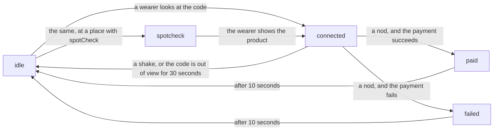
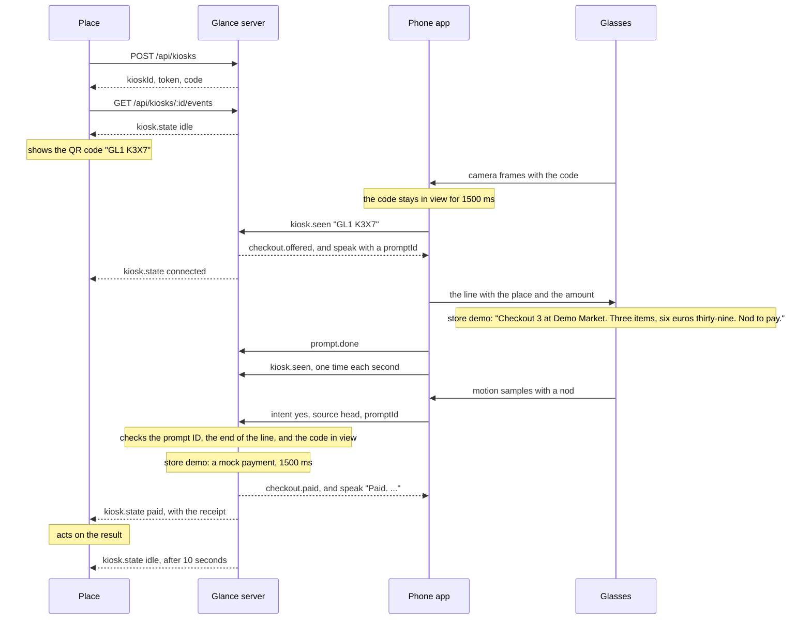

# The Glance protocol

Meta Glance is a protocol for AI glasses. A person looks at a Glance code, hears what it is and what it costs, and nods to confirm.

This document is for an engineer who wants to build the loop into the glasses, or to connect a place to it. It describes the code on the branch `feat/barcode-lookup`. Each path, event, field, and number comes from a file in "Sources". One working demo exists: a store checkout with a mock payment. The part "Built today, and enabled by the protocol" separates that demo from the uses that nobody built.

## What it is

The protocol is one loop with four steps.

1. Look. The person looks at a Glance code that a place shows.
2. Hear. A voice in the glasses says what the place is and what a nod will cost.
3. Nod. A nod confirms. A shake says no. A look alone changes nothing.
4. Done. The place gets the result and acts on it.

Two rules hold for each step. The voice says what a nod will do before a nod can count. A nod counts only while the person looks at the code.

## The parts

| Part | Role |
|---|---|
| Glasses | Ray-Ban Meta glasses. The camera sees the code, the speakers play the voice, and the motion sensor feels the nod. |
| Phone app | An Android app. It gets the camera stream and the motion samples, reads the code, reads the nod, and plays each line. |
| Glance server | It links the session of a wearer to a place, writes each spoken line, and decides if an answer counts. |
| Place | Anything that shows a Glance code and acts on the result. In the demo it is a checkout screen. |

The code uses other names for two of these things. A place is a `kiosk` in each path, event, and field. A Glance code is a kiosk code. A wearer is a shopper in the store demo.

## The Glance code

### Text

The text of a Glance code is the prefix `GL1`, one space, and the code of the place. An example is `GL1 K3X7`.

- The code of a place has 4 to 8 characters from `A-Z` and `0-9` (`KioskCodeSchema`).
- The server makes each code: 4 random characters from `ABCDEFGHJKLMNPQRSTUVWXYZ23456789`. The letters I and O and the digits 0 and 1 are left out, because a person can confuse them. No two places have one code.
- A reader removes spaces at both ends and makes the text upper case before it compares. A text with another prefix, or with more than two words, is no Glance code (`parseKioskCode`).
- `GL1` is the one version of the format.

### QR code

A place shows the text as a plain QR code. The kiosk page makes it with the error correction level `M` and a quiet zone of 4 modules on each side. The code is black on white. On a screen of 1920 x 1080 px it is 960 px wide, and it is never smaller than 15 cm with its quiet zone.

### Time in view

The phone scans each frame of the camera stream for a QR code. `KioskDwell` decides when the phone reports one.

- The phone reports a code after 1500 ms in view (`TIMING.kioskDwellMs`). Then it reports the code one time each second while the code stays in view.
- The dwell continues over a gap of 600 ms, because the scanner can miss a frame. At 2 frames each second the gap is 1250 ms.
- With two codes in a frame, the phone follows the larger one. Another code takes over only when its area is more than 1.2 times the area of the first one.

### Report

The phone reports the code on its socket to the server, as the full text:

```json
{ "t": "kiosk.seen", "text": "GL1 K3X7" }
```

A text that is no code of a registered place has no effect. For the server, a code is in view when its last report is less than 3000 ms old (`TIMING.viewMs`).

## The session

### The session of a wearer

The phone app makes a session and opens a socket.

| Call | Answer |
|---|---|
| `POST /api/sessions` | 201 with `sessionId`, `token`, and `wsUrl` |
| `/ws/device?session=<id>&token=<token>` | The socket of the phone. The messages are `DeviceToServer` and `ServerToDevice`. |
| `GET /api/sessions/:id/events?token=<token>` | A stream of `ServerEvent`, for a client that follows the session. |
| `POST /api/sessions/:id/intents?token=<token>` | An answer from a phone or HUD client (`WebIntentRequest`). 204. |
| `DELETE /api/sessions/:id?token=<token>` | Deletes the session and its orders. 204. |

### Registration of a place

A place registers one time and gets its code.

```
POST /api/kiosks
{ "name": "Checkout 3", "store": "Demo Market" }

201
{ "kioskId": "<uuid>", "token": "<token>", "code": "K3X7" }
```

- `name` and `store` are the two names that the voice says. Both are required (`CreateKioskRequestSchema`).
- `spotCheck` and `failPayment` are optional switches of the store demo. `spotCheck: true` makes the server ask for one product of the cart before the payment. `failPayment: true` makes each payment fail.
- The server has no call that removes a place.

### The event stream of a place

The place then follows its event stream:

```
GET /api/kiosks/:id/events?token=<token>
```

The stream sends `data: <json>` for each event, and the comment `: ping` at the start and then each 15 seconds. Each event is a `KioskEvent`, and each event holds the whole view of the place. The first message is the current view.

```json
{
  "type": "kiosk.state",
  "state": "idle",
  "kiosk": { "id": "<uuid>", "name": "Checkout 3", "store": "Demo Market" },
  "code": "K3X7",
  "cart": null,
  "totalCents": null,
  "receipt": null
}
```

| `state` | Meaning | Fields |
|---|---|---|
| `idle` | No session holds the place. | `cart`, `totalCents`, and `receipt` are null |
| `connected` | A wearer looked at the code, and a confirmation is open. | `cart` and `totalCents` |
| `spotcheck` | The server asks the wearer for one product first. The store demo alone uses it. | `cart` and `totalCents` |
| `paid` | The wearer confirmed, and the payment succeeded. | `totalCents` and `receipt` |
| `failed` | The wearer confirmed, and the payment failed. | all three are null |

The server shows `paid` or `failed` for 10 seconds (`KIOSK_RESULT_MS`), or until the next confirmation starts. Then the place is `idle` again. A `receipt` has `orderId`, `totalCents`, `paidAt`, `items`, and `kiosk`.



### The link between a session and a place

`kiosk.seen` links the two. The server parses the text, finds the place with that code, and starts a confirmation for the session that sent it.

- A confirmation starts only when the session has something to confirm. In the store demo that is a cart with items. With an empty cart the voice says "Your cart is empty."
- One session holds a place from the start of its confirmation to its end. A second wearer hears "This checkout is busy.", and that session gets the event `error` with the code `kiosk.busy`.
- The place is free again when the confirmation ends, and when a client deletes the session.

### Tokens

- A session has a token, and a place has a token. Each token is 24 random bytes in base64url.
- Each path with a session ID needs the token of that session in the query string. The event stream of a place needs the token of that place.
- `POST /api/sessions` and `POST /api/kiosks` need no token.
- A missing or wrong token gets 401 with `{ "error": "unauthorized" }`. An unknown ID gets 404 with `{ "error": "not_found" }`.

## The confirmation



### The spoken line

The server writes the line and sends it to the phone as `speak` with a `promptId`. The session also gets the event `checkout.offered` with `promptId`, `kiosk`, `totalCents`, `itemCount`, and `needsBiometric`.

The line names the place, the amount, and the input that confirms. The line of the store demo is "Checkout 3 at Demo Market. Three items, six euros thirty-nine. Nod to pay." The server computes the amount. The lines exist in English and Italian.

When the line ended, the phone sends `prompt.done` with the `promptId`.

### The head window

The phone reads a nod and a shake from the motion samples of the glasses. A head gesture counts only in the head window of the prompt.

- The head window of this prompt opens when its line ended. A movement during the line never confirms.
- The head window lasts 8 seconds by default. The profile of the wearer can set 15 seconds, or no limit (`headWindowMs`).
- The phone is the judge of the head window, in the time of the motion samples. After a stall of the link, its answer can arrive late.
- So the server keeps one last time: the head window plus 21 seconds after `prompt.done` (`HEAD_MAX_EXTRA_MS` plus `HEAD_LATE_MS`).

### A nod and a shake

The phone sends the answer as an intent with the ID of the prompt:

```json
{ "t": "intent", "kind": "yes", "source": "head", "promptId": "<promptId>" }
```

A head answer to this prompt counts only when each of these conditions holds:

- The `promptId` is the ID of the current prompt. Each new prompt has a new ID, so an answer to an older prompt cannot confirm.
- The line of the prompt ended (`prompt.done`).
- The phone reported the code of the place in the last 3 seconds. An answer with the code out of view has no effect.
- The answer arrived before the last time.

A nod confirms. In the store demo the mock payment then starts, and a second nod while it runs has no effect. A shake cancels: the voice says "Checkout cancelled. Your cart is safe." After a shake, and after a failed payment, the place stays quiet for this wearer until its code has left the view.

A nod is the yes by default. The profile can swap the nod and the shake, or turn the head gestures off. Each answer also has a button in the phone app, and a button answer needs the prompt ID alone.

### Time limits

| Limit | Value | Name in the code |
|---|---|---|
| Time in view before the first report | 1500 ms | `TIMING.kioskDwellMs` |
| Time between two reports | 1000 ms | `repeatMs` of `KioskDwell` |
| A code counts as in view after a report | 3000 ms | `TIMING.viewMs` |
| Head window | 8000 ms, 15000 ms, or no limit | `headWindowMs` of the profile |
| Last time for a late head answer | head window plus 21 seconds | `HEAD_MAX_EXTRA_MS`, `HEAD_LATE_MS` |
| A confirmation ends with its code out of view | 30000 ms | `TIMING.kioskIdleMs` |
| One hint after an answer with the code out of view | in the 15000 ms after the line ended | `TIMING.hintAfterPromptMs` |
| The place shows the result | 10000 ms | `KIOSK_RESULT_MS` |
| Mock payment | 1500 ms by default | `PAYMENT_DELAY_MS` |

The hint is the line "Look at the checkout code, then nod." It plays one time.

### The result for the wearer

| Result | Event of the session | Line |
|---|---|---|
| Confirmed and paid | `checkout.paid` with the receipt | "Paid. Six euros thirty-nine. Your receipt is on your phone. Camera off." |
| Confirmed, and the payment failed | `checkout.failed` with the reason `declined` | "Payment failed. Nothing was charged. Look at the code to try again." |
| Cancelled, or the code left the view for 30 seconds | `checkout.cancelled` | "Checkout cancelled. Your cart is safe." |

In the store demo a paid confirmation also ends the session: the phone gets `session.end` and stops the camera.

## What a place must implement

1. Register with `POST /api/kiosks`, and keep `kioskId`, `token`, and `code`.
2. Show the text `GL1 <code>` as a QR code, large enough for a camera at the distance of the wearer.
3. Open `GET /api/kiosks/:id/events?token=<token>`, and read each `KioskEvent`.
4. Act on the `state`: show the amount at `connected`, do the work of the place at `paid`, and show the failure at `failed`.
5. When the stream drops, open it again. The first message is the current view.

The kiosk page of the website is the one place that exists. It is a web page with no code of its own on the server side: each state comes from the server.

## What the glasses side needs from the platform

The phone app reaches the glasses through the Meta Wearables Device Access Toolkit. With real glasses, a session uses three capabilities:

| Capability | Use |
|---|---|
| Camera stream | The frames in which the phone finds the Glance code. |
| Motion | The motion samples, at 30 Hz, from which the phone reads a nod and a shake. |
| Inputs | The touchpad: a double tap is a yes for a wearer who does not use the head. |

- The voice does not use the toolkit. The phone plays each line as media sound, and the glasses are the audio output of the phone.
- The app can also attach Speech for voice commands. `ProbeDecisions.SPEECH` is false, so a session with real glasses does not use it.
- The loop itself needs the camera, the speakers, and the motion sensor. A version inside the glasses needs the same three and no phone app. Nobody built that version.

## Security and privacy as built

- Each token travels in the query string. The request log holds the path with no query string.
- The server compares a token in constant time (`tokenMatches`).
- Registration of a place needs no token. Any client that reaches the server can register a place.
- A nod is consent, not authentication. The server setting `BIOMETRIC_ABOVE_CENTS` adds a fingerprint check on the phone for an amount above its value. It is not set by default.
- The phone pixelates each face in a frame before the frame leaves the phone. If face detection fails, the phone drops the frame. A face that the detector does not find is not pixelated.
- The phone reads the Glance code itself. The server gets the text of the code, and the protocol needs no picture of the place.
- The server keeps a frame in memory for one recognition call. It writes no frame to a disk, a database, or a log. The setting `SAVE_FRAMES`, for a test set, changes that, and it is off by default.
- The server stores sessions, places, orders, and speech clips. A session holds the cart and the profile of the wearer. The server has no accounts: a session is an ID and a token.
- `DELETE /api/sessions/:id` deletes a session and its orders.

## Built today, and enabled by the protocol

Built and tested:

| Thing | State |
|---|---|
| Store checkout | The demo. The wearer fills a cart by sight or by barcode, looks at the code of the checkout, and nods. The payment is a mock: the server writes an order, and no money moves. |
| Kiosk page | The page `/kiosk` of the website. It registers as a place, shows the code, the cart, the total, and the result. |
| Mirror page | The page `/mirror` of the website. It shows the spoken lines and the cart of one session, for the people next to a demo. |

Enabled by the protocol, and not built. No place of this kind exists, and no partner agreed to one. For each one, the server also needs a way for the place to state its offer: see "Limits of the prototype".

| Use | What the place would implement |
|---|---|
| Bus ticket | A code by the door. The bus states the line and the fare, and makes a valid ticket when the result arrives. |
| Gate | A code on a ticket gate or a door. The gate states what it opens, and opens when the result arrives. |
| Vending machine | A code on the machine. The machine states the item and the price, and releases the item when the result arrives. |
| Parking meter | A code on the meter. The meter states the time and the price, and starts the parking time when the result arrives. |
| Table order | A code on the table. The restaurant states the dish and the price, and sends the order to the kitchen when the result arrives. |
| Exhibit | A code next to an exhibit. The museum gives a text, and the voice reads it. This use needs no nod and no result. |

## Limits of the prototype

- The payment is a mock. No payment service is connected, and no money moves.
- One type of place exists: the store checkout. A place cannot state an offer of its own. The amount is the total of the cart that the wearer filled in the store, and the line is the checkout line.
- The code format has one version, `GL1`. The code of a place does not change after a use, and a place registers with no token.

## Sources

| Fact | File |
|---|---|
| The text of a Glance code | `packages/shared/src/kioskCode.ts`, `apps/mobile/android/core/src/main/kotlin/com/metaglance/core/kiosk/KioskCode.kt` |
| The QR code | `apps/website/src/kiosk/qr.ts`, `apps/website/README.md` ("Kiosk page") |
| The time in view and the reports | `apps/mobile/android/core/src/main/kotlin/com/metaglance/core/kiosk/KioskDwell.kt`, `apps/mobile/android/app/src/main/kotlin/com/metaglance/android/pipeline/FramePipeline.kt` |
| The timing numbers | `packages/shared/src/timing.ts` |
| The REST bodies and `KioskEvent` | `packages/shared/src/rest.ts` |
| The session events and the receipt | `packages/shared/src/events.ts` |
| The socket messages | `packages/shared/src/device.ts` |
| The paths of a place, and the tokens | `apps/server/src/http/kiosks.ts`, `apps/server/src/http/auth.ts`, `apps/server/src/http/sse.ts`, `apps/server/src/sessions/registry.ts`, `apps/server/README.md` ("REST paths") |
| The code alphabet, the states of a place, and the 10 seconds | `apps/server/src/kiosk/kiosks.ts` |
| The mock payment | `apps/server/src/kiosk/payment.ts`, `apps/server/src/config.ts` |
| The rules of the confirmation | `apps/server/src/sessions/checkout.ts`, `apps/server/src/sessions/answers.ts`, `apps/server/src/sessions/view.ts` |
| The spoken lines | `apps/server/src/speech/lines.en.ts`, `apps/server/src/speech/phrases.ts`, `apps/server/src/speech/render.test.ts` |
| The head window on the phone | `apps/mobile/android/README.md` ("The head window"), `packages/shared/src/profile.ts` |
| The capabilities of the toolkit | `apps/mobile/android/app/src/main/kotlin/com/metaglance/android/dat/ProbeDecisions.kt`, `apps/mobile/android/README.md` ("Parts") |
| Frames, faces, and storage | `apps/mobile/android/README.md`, `apps/server/README.md` ("Stored frames", "Storage") |
