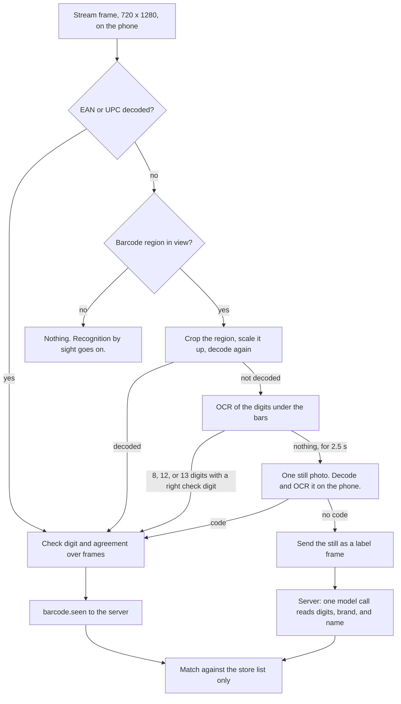
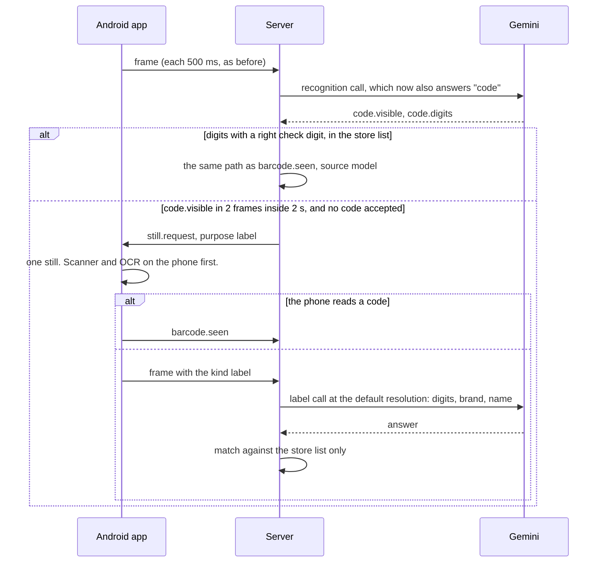

# Barcode scan with a store list and Open Food Facts

Date: 2026-11-14. Branch: `feat/barcode-lookup`, from `feat/overnight-build`.

## Goal

The shopper looks at the barcode of a product. The phone reads the code, the server finds the product, and the voice says it with its price. The shopper answers as for each other product.

This reverses one non-goal of the design of 2026-11-13 ("Barcode decode of products"). The catalog recognition by sight stays as it is.

## Decisions of the user

1. Detection runs on the phone.
2. The store list decides what can be sold. For the demo it is a file with the GTIN and the price of each item. It stands in for an API of the ERP of the supermarket, so the server reads it through an interface.
3. Open Food Facts gives the details (name, brand, quantity, allergens, diet). The server caches each answer.
4. A code that is not in the store list is not added. The voice says that the product is not in this store.

## The three ways to read a product, in order

1. **Barcode**: ML Kit barcode scanning (already in the APK) with EAN-13, EAN-8, UPC-A, UPC-E beside QR, and `enableAllPotentialBarcodes()` for the region of a code that it cannot decode.
2. **OCR**: ML Kit text recognition v2 (bundled Latin model) on the barcode region, extended downward for the digits. It runs only when a region is in view and the decode failed.
3. **Brand and name, last resort**: one still, sent with the new frame kind `label`. The server asks the model for the printed digits, the brand, and the product name. The server accepts the answer only when it selects exactly one item of the store list.

## The model also reads the code

Decision of the user, 2026-11-14: the model must be able to find the code when the scanner of the phone finds nothing, not even a region. So the server has two paths of its own.

- The recognition call of each frame gets one more answer field: `code: { visible: boolean, digits: string | null }`. `visible` means that a barcode, or the side of a package with its barcode, is in the frame. `digits` are the digits under the bars when the model can read each one. The instruction says: never guess a digit.
- A model reads the printed digits. It does not decode the bars. It can also write digits that are not there. So digits of the model count only with a right check digit and when the store list holds the code. With both, one read is enough.
- The uploaded frame is small (494 x 768), so the digits are often not readable in it. Then `visible` alone asks the phone for a still: the server sends `still.request` at most one time each 6 seconds, and only while no code was accepted in the last 3 seconds. The phone answers through its `StillPolicy`, so the two triggers of a still (the region rule of the phone and the request of the server) share one limit.
- The label call reads the still at the default media resolution. It is the same call as the last resort: digits first, then brand and name.
- Cost: the recognition call already runs for each frame, so the new field costs no call. Each label call is one more model call, at most one each 6 seconds.

## Stability rules

These rules are the reason for the design. Each one is pure logic in `:core` (phone) or in a pure function (server), with unit tests.

- **Check digit**: each candidate must be a GTIN of 8, 12, or 13 digits with a right GS1 check digit. UPC-E expands to UPC-A. The phone sends the code as it read it; the server normalises it to 13 digits.
- **Agreement** (`BarcodeVote`): a code from the decoder counts after 2 equal reads inside 1500 ms. A code from OCR counts after 3 equal reads inside 2500 ms, because OCR has no checksum of its own. A different valid code in between resets the count.
- **One report for each appearance**: after a report the phone repeats the same code once each second while it stays in view (as `kiosk.seen` does), and the server opens one prompt for each appearance (rule R1).
- **Back-pressure**: the pipeline keeps its one worker. The barcode scan runs on each frame. OCR runs at most 3 times each second. One NV21 buffer is shared by the scans of one frame.
- **Still**: at most one still each 6 seconds, through the existing `StillPolicy`, and only after a barcode region was in view for 2.5 seconds with no accepted code. A still can stop Motion for a moment, so it is the third step and not the first.
- **Privacy**: a label frame goes through face detection and pixelation as each other upload, with no centre crop. If face detection fails, the phone drops it.
- **In-store codes**: a GTIN-13 that starts with 2, or with 04, is a code of one store. The server never asks Open Food Facts for it; only the store list can know it.
- **Late answers**: the lookup has 2500 ms. The store list answers first; if Open Food Facts is late or down, the server uses the name of the store list and marks the allergen data as missing. A result that arrives after the session stopped is dropped.
- **No wrong product**: free text of the model never becomes a product. Digits from the model must pass the check digit and be in the store list. A brand and name must match exactly one store item (each word of the brand and at least half of the words of the name, compared without case and accents); two matches or none give no product.
- **One voice**: while barcode reports or label frames arrive, and for 3 seconds after, the server speaks no "Turn the front to me" and no "I do not know this product" from recognition by sight. The recognition instruction also says that a package shown with its barcode side gives `none`.

## Range, measured before trust

The research of 2026-11-13 and of today says that the stream gives 2 pixels for each narrow bar only at about 7 to 11 cm. Nobody measured it on these glasses. So:

- The probe screen gets the button `Barcode log`: it logs each decoded code with its format, its width in pixels, and the frame size; each undecoded region; and each OCR digit run. With it a person finds the real distance.
- The still photo is the path with more pixels (1440 x 1080 in one iOS test, not measured on Android). The phone logs its size and time.
- The README states the measured values when a person has them. Until then it says that the distance is not measured.

## Contract (packages/shared, and the Kotlin classes)

- New device message: `{ "t": "barcode.seen", "code": "<digits>", "source": "barcode" | "ocr" }`.
- New frame kind: `label`, beside `frame` and `still`.
- New message of the server to the device: `{ "t": "still.request", "purpose": "label" }`.
- `ProductRef`, `CartItem`, and each server event keep their shape. A product from a scan is a full `Product` on the server, so no client changes its types.
- New line keys on the server: `barcode.notInStore`, `barcode.unreadable` (said one time when a label frame gave no product: "I cannot read this code. Hold it closer.").

## Server

- `StoreList` (interface): `byGtin(gtin13)`, `all()`. `FileStoreList` reads `STORE_LIST_PATH` (default `catalog/store-list.dev.json`): entries with `gtin`, `priceCents`, `name`, and optional `brand`, `packSize`. An HTTP implementation for an ERP can follow; the README says how.
- `ProductInfo` (interface): `byGtin(gtin13)` gives name, brand, quantity, allergens, vegan, vegetarian, or null. `OpenFoodFactsInfo` calls `GET {OFF_BASE_URL}/api/v2/product/{gtin}?fields=...` with the header `User-Agent` from `PRODUCT_INFO_USER_AGENT`, a timeout of 2000 ms, status 404 as "not found", and a lenient parser. It caches hits for 30 days and misses for 1 day, in memory and in files under `PRODUCT_CACHE_DIR` (default `.cache/products`). Concurrent calls for one code share one request. `FAKE_PRODUCT_INFO=1` (and `--fake`) reads fixtures and makes no network call; each test uses it.
- `ProductResolver.resolve(gtin)`: a catalog product with this `gtin` wins (it has the spoken texts). Else the store item plus the Open Food Facts details become a `Product` with the ID `gtin-<13 digits>`, and the registry of scanned products holds it, so the cart, the warnings, the questions, and the snapshot find it by ID as each catalog product.
- Allergens: Open Food Facts `allergens_tags` and `traces_tags` map to the 14 EU allergens of `packages/shared`. An empty list from Open Food Facts counts as "no data" (null), never as "no allergen". Vegan and vegetarian come from `ingredients_analysis_tags`; each unknown value is null.
- The device socket resolves a `barcode.seen` before the rules see it (as `kiosk.seen`), then dispatches the input `barcode` with the outcome `product`, `notInStore`, or `invalid`. `product` uses the path of an identified product.
- A frame with the kind `label` goes to `LabelReader` (one model call, own instruction `agents/label.md`, own response schema, 4 s). Fake mode has a scripted reader.
- The fake script gets the step `{ "atMs", "forMs", "barcode": "<digits>" }`.
- `GET /healthz` reports `fakeProductInfo`. The start log names the store list and its item count.
- The phone UI shows "Product data: Open Food Facts (ODbL)" in the settings sheet, and the README has the attribution.

## Android

- `core`: `Gtin` (check digit, UPC-E expansion, digit runs of an OCR text, also when the text splits the groups), `BarcodeVote`, `LabelPolicy` (when to take the still). Each with JVM tests.
- `app`: `QrScanner` becomes `CodeScanner` with the retail formats and the potential-barcode regions; `DigitReader` wraps ML Kit text recognition; `FramePipeline` runs the steps of the flow chart; `SessionController` sends `barcode.seen` and the label frame.
- `tools/fake-server` logs `barcode.seen` and the kind of each frame. The instrumented tests feed a clip with an EAN-13 and a clip with digits only (made by `make-clips.mjs`).
- `run-spine.mjs` reads the serial from `ANDROID_SERIAL`, and uses the one attached phone when it is not set.

## Not in this change

- Prices from Open Prices. The store list is the only price.
- A search in Open Food Facts by brand and name. The last resort matches the store list only.
- GS1 DataBar codes. ML Kit does not read them.
- A real ERP client. The interface is ready for it.
