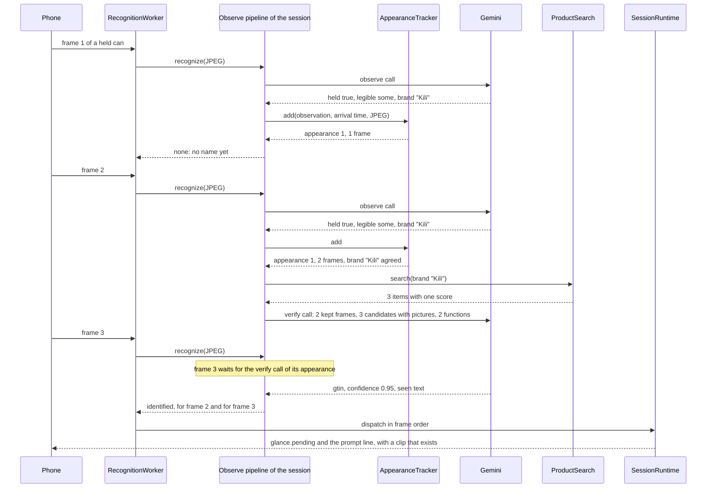
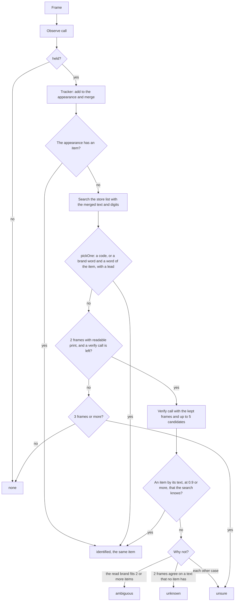

# Recognition of a held product: observe, look up, verify

Date: 2026-11-14. Branch: `recog/observe`, from `feat/barcode-lookup`.

## Goal

The shopper holds a product in front of the glasses, and the voice names it with its price. The shopper does not look for the barcode.

The request of the owner: "it would be nice if Gemini detected when i'm just holding something and try to understand what it is directly so that I don't have to go around looking for the barcode. We could give it an MCP or something to look up the article data?"

A second requirement came during the work: "Holding an object in front of you for 2 seconds is way too long. It should feel almost seamless." The target is a voice that starts about 700 ms after the product is shown clearly, and never a wrong name to get there.

This document says what was built, what was measured, and what the numbers do not support. The measured tables are in `apps/server/README.md`, sections "Measured: the observe pipeline" and "A search by picture, measured and not built".

## The problems of the frame pipeline

The frame pipeline sends each frame to one Gemini call. Its request holds the whole store list and 3 reference pictures of each item. The logs of 2026-11-14 show these problems:

1. It does not scale. 4 items with 12 pictures are 6551 prompt tokens in each frame call. A store has thousands of items, and a call takes at most 12 pictures.
2. It names no can of three cans of one design from a stream frame. It answers `ambiguous`, and the phone takes a still.
3. The package text is Finnish or Swedish, and the store names are English.
4. A single blurred frame gets a wrong name at a high confidence: 3 of 317 calls in this measurement.
5. The model copies an ID of the request as "digits that it read".

## What was built

Five parts, each behind an interface, beside the frame pipeline. `RECOGNITION_PIPELINE=observe` selects them. The default stays `frame`.

| Part | File | Model call |
|---|---|---|
| Observe: what one frame shows of the product in the hand | `src/observe/gemini.ts`, `agents/observe.md` | one for each frame, with no store data |
| Tracker: the frames of one held product, merged | `src/observe/tracker.ts` | none |
| Look-up: the store items that fit the read text | `src/search/productSearch.ts` | none |
| Verify: which candidate is the held product | `src/observe/verify.ts`, `agents/verify.md` | 0 to 2 for an appearance, each with up to 2 function rounds |
| Result: a `RecognitionResult` for the rules | `src/observe/pipeline.ts` | none |

Two more parts serve both pipelines: the texts of Open Food Facts for the search (`src/products/`), and the clips of the product prompts at the start (`src/speech/prewarm.ts`).

The details of each part, the log lines, and the settings are in `apps/server/README.md`, section "The observe pipeline".

## Where the measurements changed the design

The first design came from the main session. These points differ from it, each for a measured reason.

1. A verify call needs 2 frames in which the observe call read print. Of 48 verify calls, an answer by text from 2 such frames was right in 8 of 8. Each other answer with an item was wrong in 7 of 18.
2. The server takes only an answer with `seen: text`. The answers by the look of the package were wrong in 5 of 14 calls, at a confidence of up to 0.95. The first design took one strong candidate from "clear evidence" of each kind.
3. An appearance gets up to 2 verify calls, not 1. The first one runs with the first 2 readable frames, which often show the product while it comes into view. In the replay, the second call named a can that the first one missed.
4. A held product with no name yet is `none` for the rules, and not `unsure`. Two `unsure` results ask the phone for a still, which stops the motion stream for 2 to 3 seconds. The frames report `unsure` after 3 frames with fewer than 2 readable ones.
5. Each frame of an appearance waits for the verify call of that appearance. The recognition worker drops the result of a frame when a newer frame has its result. Without the wait, the frame that started the verify call would lose its name.
6. The pipeline adds no agreement of 2 frames of its own. After a decision each frame repeats it, so the rule of the session that wants 2 equal results in a row gets them one frame apart. The two rules do not stack.
7. The observe answer has a `box`. The tracker keeps the frames with the largest product, and the measurement of the picture search used the boxes as crops.
8. With no read word, a store list of at most 5 items gives each item as a candidate. A larger store gives none, and the model must search with its functions. The first design gave the look-up result only.
9. `unknown` needs 2 frames that agree on a brand or a name that no item has, and a verify call that found no item. A blurred can of the store must not get "I do not know this product."
10. The label call for stills did not change. A still with the kind `still` goes through the observe call and one verify call.
11. No fast path and no search by picture were built. See "The fast path" below.
12. One internal interface changed: `createFrameHandler` takes `recognizerFor(session)` in place of `recognizer`. No file under `src/sessions` changed.

## Function calling, and MCP

The owner asked for "an MCP or something to look up the article data". Inside one server, the function calling of Gemini is the mechanism: the model asks for a function, and the server runs it in its own process.

- The verify call declares `search_products(query, brand, limit)` and `get_product(gtin)`. Both run on `ProductSearch`.
- One request holds the functions and the JSON Schema of the answer. The documentation says that Gemini 3 and Gemini 4 models take both, as a preview feature (https://aistudio.google.com/docs/function-calling and https://aistudio.google.com/docs/structured-output, read on 2026-11-14). It does not name `gemini-3.5-flash-lite` for this.
- A run on 2026-11-14 checked it: with a sharp still and no candidate, `gemini-3.5-flash-lite` called `search_products`, then `get_product`, and then wrote the JSON answer. Each function call came with a thought signature and an ID.
- A Gemini 3 model needs each thought signature back, and answers 400 without it (https://aistudio.google.com/docs/thought-signatures, read on 2026-11-14). The verify call puts the content of the model into the history as it came.
- In 67 verify calls with candidates, the model never called a function. It called one only with no candidate.
- The model searched with the words "estrella galicia cascara avellaneda" for a can that says "Kili Cascara Vadelma". The search found the can by the word "cascara". So a search of the model can turn a guess into a candidate. The guards stay: `seen: text`, the confidence, and 2 readable frames.

An MCP server is the form for other clients. It would register the same two tools with the same JSON Schemas (`VERIFY_FUNCTIONS`) and call `runVerifyFunction` for each tool call. A chat agent of the store could then search the same store list. This part is not built.

## Results

All numbers are of 2026-11-14, with `gemini-3.5-flash-lite`, 4 store items, 146 labeled frames, and 18 labeled appearances. The room had purple light, and the stream was 288 x 448 to 720 x 1280 pixels.

| Question | Frame pipeline | Observe pipeline |
|---|---|---|
| Prompt tokens of a frame call | 6551 | 1798 |
| Median of a frame call, 3 at a time | 1228 ms | 1136 ms |
| Wrong names | 3 in 317 calls | 0 in 644 calls |
| Appearances with a store item that got a right name, of 14 | 5 with one result, 3 with 2 results in a row | 2 |
| Time to the first right name | 1071 to 4081 ms | 2599 and 3923 ms |
| Frames with no product in a hand, of 29 | 28 `none`, 1 wrong name | 28 `held` false |
| The paper cups, which the store does not sell | `unknown` in 1 of 15 frames, else `none` | `none` |

The observe call read the brand in 1 of 111 frames with a store item, and the flavor in none. The frames of this day carry no readable text. So the text search had nothing to search with, and the verify call decided the 2 names of the observe pipeline.

Where the observe pipeline wins:

- The request does not grow with the store. The frame pipeline cannot hold 1000 items.
- It gave no wrong name. Its observe call cannot copy an ID or a name, and the server takes a verify answer only by text.
- A frame call has 27 percent of the prompt tokens, and it is about 8 percent faster.
- The search is exact code with tests. A Finnish package finds an English store name through the names of Open Food Facts.

Where it does not win:

- It named fewer appearances in the frames of this day, and it was slower to the first name. It needs an observe call and a verify call in a row.
- For the three cans of one design it names nothing in the small frames, as the frame pipeline. The still stays the path for them.
- It costs up to 2 verify calls for an appearance on top of the frame calls.

## The latency budget

The target is 700 ms from "the product is shown clearly" to "the voice starts".

| Hop | Time | Source |
|---|---|---|
| Glasses to phone, the Bluetooth stream | unknown | Not measured. No log has it |
| The frame picker of the phone | 0 to 150 ms | `TIMING.uploadEveryMs`. The three newest saved sessions have a frame each 196 to 450 ms, so the picker is not the limit there |
| Face detection, pixelation, and JPEG on the phone | about 95 ms | `logs/phone.log` of 2026-11-14, lines "frame path": faces 59 to 83 ms, pixelate 11 to 18 ms, jpeg 9 to 11 ms, each a mean of 10 seconds |
| Upload of a frame of 20 to 60 kB | unknown | Not measured |
| Recognition, frame pipeline | 1228 ms median, 1401 ms at the 90th percentile | This measurement, 3 calls at a time |
| Recognition with its wait, in the sessions of the day | 1767 ms median, 2559 ms at the 90th percentile | `glance timing` lines of the server logs, 32 prompts |
| The rule that wants 2 equal results in a row | one frame more: 196 to 450 ms | The arrival times of the saved frames |
| The read of the product | 0 ms with the details in the cache | `resolveMs` of the `glance timing` lines |
| The speech clip | 0 to 1 ms with a clip, 241 to 2542 ms without | `clipMs` of the `glance timing` lines: 28 of 39 prompts had a clip |
| Audio start on the phone | unknown | Not measured |

- The known hops of today add up to about 1.6 seconds in the best case: 95 ms, a call of 1.2 seconds, one frame more, and a clip that exists. The appearances of the replay took 1.1 to 4.1 seconds to a first name.
- A Gemini call cannot meet the target. A call with one word of text and one word of answer took 617 ms from the test computer. A frame with the answer `{held}` took 748 ms.
- The clips of the start take the 241 to 2542 ms of a missing clip away. This part is built.
- So the 700 ms need a recognition step of about 250 ms or less. That is a model on the server or on the phone, and no call to a language model.

## The fast path: measured, and not built

The plan was a local embedding model on the server as the first path: embed the held product, compare it with the reference pictures in memory, and name the item when the best score is high and clear in 2 frames. Gemini would be the slow path beside it.

The measurement does not support it. No model told the 4 cans apart in these frames.

| Model | One image on the CPU | Right item in 83 crops of the box, with the 13 reference pictures | With crops of the other appearances as the gallery |
|---|---|---|---|
| CLIP ViT-B/32, 352 MB | 38 ms | 28 percent | 35 percent |
| DINOv2 small, 88 MB | 50 to 74 ms | 35 percent | 36 percent |
| SigLIP base, 8 bit, 99 MB | 192 ms | 31 percent | 48 percent |
| `gemini-embedding-2`, through the API | 494 ms | 66 percent | 61 percent |

- 4 items give 25 percent by chance. The crops are the boxes of the observe call, which a person checked: 23 of 23 hold the product.
- The whole frame, and a fixed crop where the hand is in these frames, gave 14 to 32 percent.
- The Open Food Facts front image of each item as the gallery gave 22 to 24 percent with each model.
- With thresholds that give no wrong name on the set, the best rule took 15 of 83 frames (`gemini-embedding-2`), and the local models took 0 to 10. Thresholds fitted to 83 frames are no safe rule.
- A linear classifier on the embeddings, trained on the other appearances, gave 12 to 33 percent. So more pictures of the same kind do not fix it with these models.
- The confusion of the best local model (SigLIP, crops of other appearances): Yuzu went to Mango in 12 of 21 frames, the white and red can went to Vadelma and Mango in 11 of 18, and Vadelma went to the white and red can in 5 of 18.
- Why: the can is about 90 pixels wide, the stream is blurred, and the purple light moves each color. The three cans of one design differ in one word and in their colors. The embeddings follow the pose, the hand, and the background.

What can make a fast path work. None of it is measured:

1. A crop of the held product at the size of the stream, made on the phone. See "The next step on the phone".
2. Reference pictures through the glasses, under the light of the store. `npm run reference` takes them. The measured gallery of glasses crops was better for SigLIP (48 against 31 percent), and still too weak.
3. A model that was trained on packages, with metric learning on in-store pictures. See "How product search systems do this".
4. The barcode. The scanner of the phone already runs on the phone in milliseconds, and a code is exact. A can shown with its barcode side needs no model on the server.

So the server has no local model. `@huggingface/transformers` 4.3.2, `onnxruntime-node` 1.30.0, and `sharp` were installed in a scratch folder on Windows for the measurement, with no build step. The image of `infra/Dockerfile` starts from `node:22-slim`, which has glibc, so it needs no change for `onnxruntime-node`. An Alpine image has no prebuilt binary (https://github.com/microsoft/onnxruntime/issues/2909). The download of a model of 88 to 352 MB took 3 to 10 minutes on the line of the test computer.

## Why this shape

Four ways to name a held product, with the numbers of this day.

| | 1. The catalog in the prompt (today) | 2. Describe, look up by text, verify (built) | 3. Search by picture and by text, then verify (not built) | 4. A Gemini Live session (measured before, not built) |
|---|---|---|---|---|
| Items in the store | Tens. 4 items are 6551 tokens, and a call takes 12 pictures | No limit in the request. The search index holds the names | No limit in the request. 3 pictures of 512 values for each item are 6 kB, so 1000 items are 6 MB | Tens: the instruction holds the list |
| Model calls for a shopper in a minute | 130 to 300: one for each frame at 2.2 to 5.1 frames a second | The same number of smaller calls, plus up to 2 verify calls for an appearance | 0 for the search, plus the verify calls | 1 session, with about 80 reports |
| Time to the first right name | 1.1 to 4.1 s | 2.6 and 3.9 s | Not known. The search itself would take 38 to 192 ms for an image | 0.7 to 2.6 s |
| Wrong names | 3 in 317 calls | 0 in 644 calls | Not known. The measured search was wrong in 34 to 72 percent of the frames | Named a product with no product in view, in 2 of 3 runs of the newer model |
| What the store gives | Names, and 3 pictures of each item for a look-alike | Names. Barcodes for Open Food Facts. Pictures for the verify call | Pictures of each item through a camera like the glasses, and names | Names |
| Share of right names in these frames | 5 of 14 appearances | 2 of 14 | Not known | Not measured on this set |

- The Live numbers are those of "Measured: a Gemini Live session" in `apps/server/README.md`: one can, 101 frames.
- Shape 3 is how product search systems work. It needs pictures and a model that separate the items, and this measurement had neither.

The recommendation, stated plainly. The two answers differ.

- For the demo of 4 items this week: shape 1, the frame pipeline, with `RECOGNITION_PIPELINE` not set. It names more appearances and is faster. Add the rule of the session that wants 2 equal results in a row, the clips of the start, and the still for the cans of one design.
- For a real store: shape 2 first, with `ProductSearch` on the ERP and the gate and the crop on the phone. Shape 3 comes when a picture model is shown to separate items in frames of the glasses. Shape 1 cannot hold the list of a store, and shape 4 named products that were not there.
- For the 700 ms target, no shape is enough today. It needs the crop from the phone and a measured local model, or the barcode.

## How product search systems do this

- A survey of retail product recognition names the problem: many items, few pictures of each, pictures "acquired in ideal conditions" against queries from real conditions, and new items with no training. It lists the package text as a cue for items that look alike (Wei et al. 2020, https://pmc.ncbi.nlm.nih.gov/articles/PMC7676964/).
- Tonioni and Di Stefano embed a query and search the nearest of "one reference image per product". They name the gap between studio pictures and cheap in-store cameras (https://arxiv.org/abs/1902.00760). Pictures through the same camera take that gap away at its source. That last step is our reading, not a claim of the paper.
- PRISM (2025) has the shape of row 3: SigLIP gives the top 35 of a gallery, a detector removes the background, and a local matcher decides. It says that global CLIP and SigLIP embeddings miss small differences between brands (https://arxiv.org/abs/2509.14985). This measurement saw the same.
- Cat2Real (2026) treats the task as a search from "noisy in-store queries" to "pristine studio packshots", and trains for it (https://arxiv.org/abs/2607.09888).
- RP2K has more than 500,000 shelf pictures of 2,000 products, taken in stores (https://arxiv.org/abs/2006.12634).

How a hybrid `ProductSearch` would look, as a plan and not as code:

- The gallery: one embedding for each picture of each item, computed at the start and when the pictures change, in memory. 3 pictures of 1000 items are 3000 vectors. A full compare of 3000 vectors of 512 values is some milliseconds in one process.
- Behind an interface, so a vector index of a database can take its place. MongoDB Atlas Vector Search has the index type `vectorSearch` with up to 8192 dimensions and cosine similarity (https://www.mongodb.com/docs/vector-search/indexes/vector-search-type.md).
- The fusion: digits with a right check digit win. Else the text channel and the picture channel each give ranked candidates. One item at the top of both goes to `pickOne`. Each other case sends the union of the top candidates to the verify call.
- Where a store gets pictures: the ERP, Open Food Facts, and a capture pass with the glasses (`npm run reference`).
- Open Food Facts has a front image for each of the 4 demo items (read on 2026-11-14, as `image_front_url` of the product answer). The images have the licence CC BY-SA 3.0, and the data has the ODbL (https://world.openfoodfacts.org/terms-of-use). As a gallery they gave 22 to 24 percent here.
- The API of Gemini has an embedding model that takes an image: `gemini-embedding-2`, with 128 to 3072 values and 6 images in a request (https://aistudio.google.com/docs/embeddings, read on 2026-11-14). The key of the project lists it. One image took 494 ms, so it is no fast path.

## The next step on the phone

This part was not built when this document was written. The server measurement gives its reasons.

Update of 2026-11-14, later that day: the gate and the crop are built, as the setting `Held crop` of the Android app. The numbers below were estimates, and the measurement of the build gave others:

- The detector is the object detector of MediaPipe Tasks with EfficientDet-Lite0. The hand landmarks found a hand in 11 of 117 frames with a product in a hand. ML Kit object detection was not measured.
- The gate gives 45 percent of the frame calls of before, and not 16 percent: the detector also finds the cans on the tables, and one full frame goes out each second.
- A crop has 2.8 times the pixels on the can for a stream of 720 x 1280 and 1.4 times for a stream of 504 x 896, against the upload of 432 x 768. The "3 to 6 times" below compare with an upload of 288 pixels.
- The header has `view`, `crop`, `source`, and `contextBytes`. A crop carries the whole frame in a small size, because the frame call lost `held` with a crop alone.
- No crop of the stream was measured. With crops of the saved uploads, the frame call named fewer cans than with the full frame.

See "The crop of the held product" in `apps/mobile/android/README.md` and "A crop of the phone" in `apps/server/README.md`.

The cost of a frame call for each frame:

- In the 5 sessions of 2026-11-14 with real recognition, 2564 of 3052 results were `none`: 84 percent, and 72 to 93 percent for a session.
- A gate on the phone that sends only frames with a held object would save up to that share of the frame calls. A shopper then costs about 10 to 80 calls a minute in place of 130 to 300.
- The gate also gives the crop. The box of a held can has 26 percent of the frame width at the median. In an upload of 288 pixels the can is about 75 pixels wide. At the stream size of 504 pixels it is about 130 pixels, and at 720 pixels about 190. The crop at that size has 3 to 6 times the pixels of the can of today.
- The one appearance that both pipelines named by its text had frames of 720 x 1280.

Candidate APIs for Android. Each one is unverified: no page was read and no code was run for them in this work.

- ML Kit object detection and tracking, in its mode for one prominent object. Unverified: if it finds a can in a hand in a dark room, and its time for a frame.
- MediaPipe hand landmarks, with a crop around the hand. Unverified: its time on the phone beside face detection, and the crop for a hand that is partly out of view.
- The barcode scanner that the app has. It already tells when a code is in view.

The server needs one change for it: a frame header that says "crop of a held object", so the server can tell such a frame from a whole frame. The observe call and the verify call take a crop as they take a frame.

## Limits, and what was not measured

- One room, one light, 4 items, and one person who labeled the frames by eye. The labels of 87 frames inside the appearances come from the labeled frames around them.
- 8 verify answers passed the rule of the server. That is too few to call the rule safe in another room.
- The replay ran outside a session: no rules, no phone, no still.
- The `unknown` answer for a readable product that the store does not sell was not seen. The frames with the paper cups were not readable.
- A store with more than 4 items was not measured. The search has unit tests for 7 items.
- The pipeline does not name a catalog product with no barcode.
- A verify call with 2 function rounds took 2828 ms. The limit is 2800 ms, so such a call can end as `unsure`.

## Vendor calls of this work

| Service | Calls |
|---|---|
| Gemini `generateContent` | 1383: 317 frame pipeline, 317 observe, 48 latency floor, 57 verify probes, 644 in two replays |
| Gemini `embedContent` with `gemini-embedding-2` | 106 |
| Gemini Files API uploads of reference pictures | 12 |
| Open Food Facts product reads | 4, and 4 front images |
| ElevenLabs | 0 |
