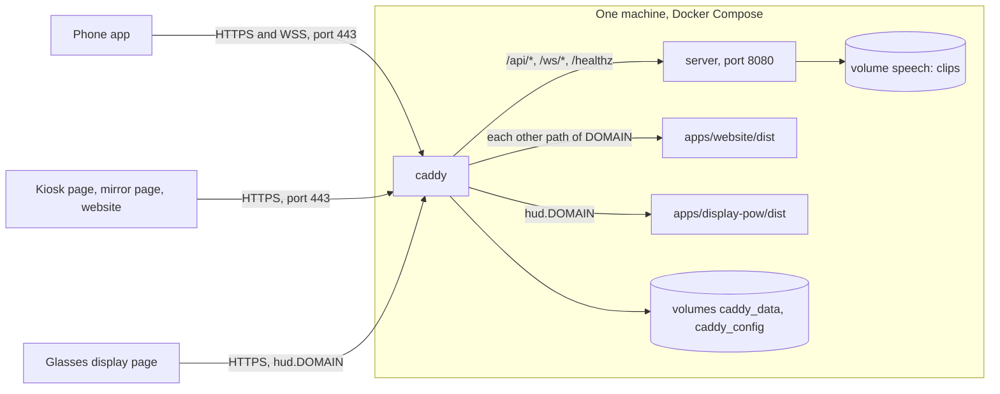

# infra

The files that run Meta Glance on one machine with HTTPS: the server in a Docker image, and Caddy as the proxy in front of it. The plan is Task 22 of `docs/superpowers/plans/2026-11-14-glance-1-server.md`.

No instance exists yet. The image and the proxy were checked on a laptop only (see "Check on a laptop").

| File | Content |
|---|---|
| `Dockerfile` | The image of the server: Node 22, the production dependencies of `@glance/server`, and the sources. `tsx` runs the TypeScript files. |
| `Dockerfile.dockerignore` | The files that stay out of the image: `.git`, `node_modules`, each `.env` file, the docs, the skills, and the Android project. |
| `compose.yaml` | Two services, `server` and `caddy`, and three volumes. |
| `Caddyfile` | The routes of the proxy for `<DOMAIN>` and `hud.<DOMAIN>`. |
| `.env.example` | The settings. Copy it to `infra/.env`. Git ignores `infra/.env`. |



- Only Caddy has ports on the machine: 80, 443, and 443 over UDP. The server has no port outside the Compose network.
- Caddy gets the certificates from Let's Encrypt by itself. For that, both names need a DNS A record to the machine, and ports 80 and 443 must be open.
- Caddy passes the socket upgrade of `/ws/device` and flushes the events streams with no extra setting.
- A path that is no file of a static folder gets `index.html`, so the routes of the pages work after a reload.
- If `apps/website/dist` or `apps/display-pow/dist` does not exist, Docker creates it empty, and the pages answer 404. The API still works.

## Settings

`infra/.env` serves two readers. Compose reads `DOMAIN` from it for the proxy, and the server gets each variable of the file. `apps/server/README.md` describes the variables of the server.

| Variable | Value |
|---|---|
| `DOMAIN` | The host name with no scheme, for example `glance.example.com`. |
| `PUBLIC_BASE_URL` | `https://` plus `DOMAIN`. The server builds the socket address and the clip addresses from it. |
| `FAKE_RECOGNITION`, `FAKE_SPEECH` | `1` for a server that needs no key. Clear both for the real services, and set the two keys and `ELEVENLABS_VOICE_EN`. |
| `DEMO_KEY` | A random word of 12 characters or more. Without it the mirror page cannot find the session of the phone. |
| `REQUIRE_BLUR` | `1` when the phone runs face detection. |
| `SECOND_LOOK_WAIT_MS` | `2500` when the phone sends a still for look-alike products. Empty means off. |

The image sets `PORT=8080`, `NODE_ENV=production`, and `SPEECH_CACHE_DIR=/data/speech`. Do not set them in `infra/.env`.

## Deploy

On a new machine with Docker, as in Task 22 Step 2 of the plan:

```bash
git clone https://github.com/mrBymax/glance.git /opt/glance
cd /opt/glance && git switch <branch>
mkdir -p apps/website/dist apps/display-pow/dist
cp infra/.env.example infra/.env
nano infra/.env
docker compose -f infra/compose.yaml up -d --build
curl -sS https://<domain>/healthz
```

A machine with 1 GB of memory needs swap for the build. The plan has the commands.

After a change:

```bash
cd /opt/glance && git pull && docker compose -f infra/compose.yaml up -d --build
```

Build the static pages on the machine:

```bash
docker run --rm -v /opt/glance:/app -w /app node:22-slim sh -c "npm ci && npm run build --workspace apps/website --workspace apps/display-pow"
```

Seed the database and the speech clips with the image. Without `--no-clips`, each clip that the volume does not hold is one paid ElevenLabs call:

```bash
docker compose -f infra/compose.yaml build
docker compose -f infra/compose.yaml run --rm server npm run catalog:seed -- catalog/catalog.json
docker compose -f infra/compose.yaml up -d
```

Logs: `docker compose -f infra/compose.yaml logs -f server`.

## Check the deployed server

On a laptop, in the repository:

```bash
npm run smoke --workspace @glance/server -- https://<domain>
# ok health
# ok session
# ok socket
# ok events
# ok line
# ok caption
# ok delete
# smoke: OK
```

The command plays a phone and a web client: it makes a session, opens the device socket and the events stream through the proxy, waits for the "Camera on" line and its caption, and deletes the session. With real speech, that line is one ElevenLabs call if its clip does not exist yet.

Before the demo, `/healthz` must show `"fakeRecognition":false`, `"fakeSpeech":false`, and `"saveFrames":false`.

## Check on a laptop

The image alone, with no key and no proxy:

```bash
docker build -f infra/Dockerfile -t glance-server .
docker run --rm -p 127.0.0.1:18522:8080 -e FAKE_RECOGNITION=1 -e FAKE_SPEECH=1 -e PUBLIC_BASE_URL=http://127.0.0.1:18522 glance-server
npm run smoke --workspace @glance/server -- http://127.0.0.1:18522
```

`PUBLIC_BASE_URL` must be the address that the smoke command uses, because the server builds the socket address from it.

The proxy too, with `DOMAIN=localhost`: Caddy then signs its own certificate, so the client must skip the certificate check. Put the ports in an override file, so that the check needs no port 80 and 443 of the laptop:

```yaml
# override.yaml
services:
  caddy:
    ports: !override
      - "127.0.0.1:18543:443"
```

```bash
# infra/.env: DOMAIN=localhost, PUBLIC_BASE_URL=https://localhost:18543, FAKE_RECOGNITION=1, FAKE_SPEECH=1
docker compose -p glance-check -f infra/compose.yaml -f override.yaml up -d --build
NODE_TLS_REJECT_UNAUTHORIZED=0 npm run smoke --workspace @glance/server -- https://localhost:18543
docker compose -p glance-check -f infra/compose.yaml down -v --rmi local
```

Both checks passed on 2026-11-14 with Docker 29.9.2: the image built, the seven steps of the smoke command passed directly and through Caddy, and the two static folders answered on `localhost` and `hud.localhost`.
