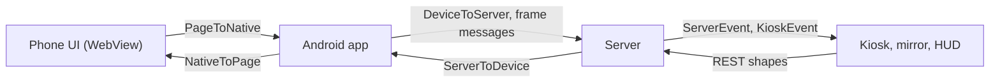

# @glance/shared

The message contract of Meta Glance. The package holds each message type as a zod schema with its TypeScript type, and one JSON fixture for each message variant. It also holds the money helpers, the kiosk code helpers, the GTIN helpers, the frame codec, and the timing defaults.

The package exports its TypeScript source. It has no build step.

## Messages



| File in `src` | Content |
|---|---|
| `languages.ts` | `LANGS`, `Localized`, `localize` |
| `money.ts` | `formatEur`, `cartTotalCents`. Money is an integer number of cents in EUR. |
| `timing.ts` | `TIMING`, the only place for a timing number |
| `kioskCode.ts` | `formatKioskCode`, `parseKioskCode`. The QR text is `GL1`, one space, and the code. |
| `allergens.ts`, `profile.ts`, `catalog.ts`, `cart.ts` | `Profile`, `ProfilePatch`, `Product`, `ProductRef`, `Cart` |
| `events.ts`, `snapshot.ts` | `ServerEvent`, `SessionSnapshot` |
| `device.ts` | `DeviceToServer`, `ServerToDevice` |
| `frame.ts` | `encodeFrame`, `decodeFrame` for the binary frame message. The header has the kind `frame`, `still`, or `label`. |
| `gtin.ts` | `hasGs1CheckDigit`, `expandUpcE`, `normalizeGtin`, `isStoreInternalGtin`. The rules for the digits of a product barcode. |
| `bridge.ts` | `PageToNative`, `NativeToPage`, `NativeState`, `GlanceBridge` |
| `rest.ts` | The bodies and the answers of the REST calls, and `KioskEvent` |

Each type `X` has a schema `XSchema`. Each parse helper (`parseServerEvent`, `parseDeviceToServer`, `parseServerToDevice`, `parsePageToNative`, `parseNativeToPage`) returns `null` for a message that it does not know. It does not throw. `decodeFrame` throws `FrameFormatError`.

## Use it in a TypeScript app

Add the package to the `dependencies` of the app, then run `npm install` at the repository root:

```json
{ "dependencies": { "@glance/shared": "*" } }
```

```ts
import { parseServerEvent, formatEur, type ServerEvent } from '@glance/shared';
import oatDrink from '@glance/shared/fixtures/catalog/oat-drink-1l.json';
```

The app compiles the source of this package. Its bundler or its runner must read TypeScript, and its `tsconfig.json` must extend `tsconfig.base.json` of the repository root.

## Kotlin uses the same names

The Android app has its own classes for these messages. Each class uses the field names and the wire values of this package, for example `promptId`, `t`, and `glance.pending`. Plan 2 adds Kotlin tests that decode each file in `fixtures/`, so that a name that differs fails a test.

## Each new message variant gets a fixture

When you add a variant to a union, add one valid example to the folder of that union. The file name is the `type` or `t` value, for example `fixtures/events/glance.pending.json`. A file in `fixtures/rest/` has the name of its type, for example `CreateSessionResponse.json`.

| Folder in `fixtures` | Schema | Files |
|---|---|---|
| `catalog` | `ProductSchema` | 1 |
| `events` | `ServerEventSchema` | 16 |
| `device-to-server` | `DeviceToServerSchema` | 9 |
| `server-to-device` | `ServerToDeviceSchema` | 7 |
| `bridge-page-to-native` | `PageToNativeSchema` | 12 |
| `bridge-native-to-page` | `NativeToPageSchema` | 4 |
| `rest` | the schema with the name of the file | 8 |

`src/fixtures.test.ts` validates each file. The tests of this package count the files, and the Kotlin tests of Plan 2 will count them too. Update each count when you add a file.

## Checks

Run these at the repository root:

```bash
npm test --workspace @glance/shared
npm run typecheck --workspace @glance/shared
npm run lint
```

## Gotchas

- `barcode.seen` has no field for the barcode format, and `normalizeGtin` reads 8 digits as EAN-8. A phone that reads a UPC-E code sends the 12 digits of `expandUpcE`.
- A schema drops each key that it does not know. A parsed message can have fewer keys than its input.
- `ProfileSchema` fills each default. `ProfilePatchSchema` fills none, so a patch holds only the keys that the sender set.
- `EMPTY_CART` and `DEFAULT_PROFILE` are frozen, because each app shares the one object. A write to one of them throws `TypeError`. Make a new object: `{ ...cart, items: [...cart.items, item] }`.
- TypeScript 6 loads no `@types` package by default. `tsconfig.json` names `node` in `types`, because the tests read the fixture folders.
