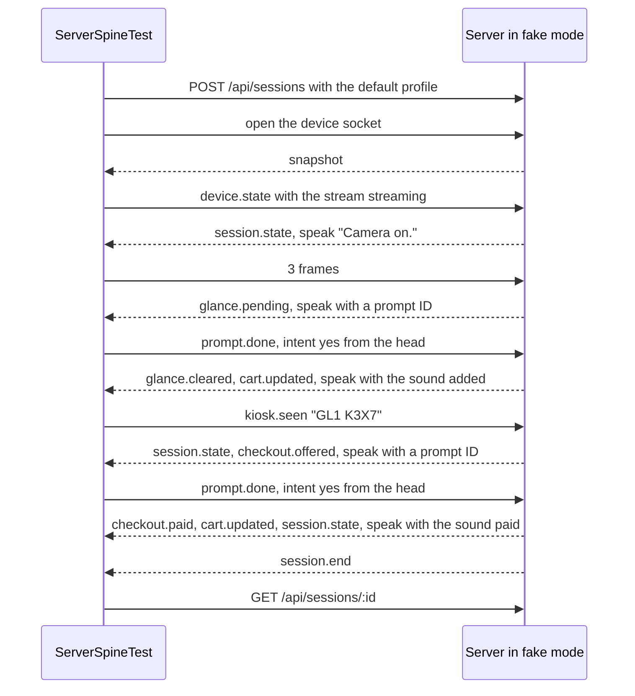
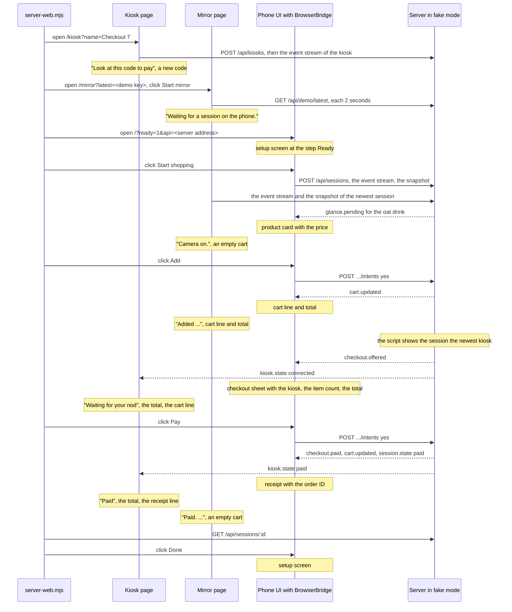

# Integration tests

Each script here starts the Glance server of `apps/server` in fake mode on `127.0.0.1` and a free port, runs one test against it, and stops it. No test calls Gemini or ElevenLabs.

`package.json` of this folder holds the tools of these scripts, so that no app gets a new dependency. The folder is not a workspace of the repository, so it needs its own install:

```bash
npm install                               # at the repository root
npm install --prefix scripts/integration  # puppeteer-core, for the test of the web pages
```

| Command, at the repository root | Test |
|---|---|
| `node scripts/integration/server-kotlin.mjs` | The server and the Kotlin client of the Android app |
| `node scripts/integration/server-web.mjs` | The server, the phone UI with `BrowserBridge`, the kiosk page, and the mirror page |

The exit code of each script is 0 for a pass and 1 for a fail, and the last line is `result: pass` or `result: fail`.

## The server and the Kotlin client

`server-kotlin.mjs` needs `JAVA_HOME` with a JDK from 17 to 24. It runs the Gradle task `:core:integrationTest` of `apps/mobile/android` with the server address as `-Pglance.serverUrl`.

The test is `ServerSpineTest` in `apps/mobile/android/core/src/integrationTest`. It uses the real `GlanceApi`, `DeviceSocket`, `Codec`, and `FrameCodec`, and it plays one shop:



- The server plays `server-kotlin.fake-script.json`: the product `oat-drink-1l` is in view from 1.5 seconds after the socket opens.
- The test fails when the Kotlin codec cannot decode an event of the server, when the socket drops a message, and when the socket goes down.
- In fake mode the server logs the header of each frame that decodes. The script reads the log and fails when one of the 3 frames is missing.
- The mock payment takes 300 ms (`PAYMENT_DELAY_MS`).

## The server and the web pages

`server-web.mjs` needs Google Chrome on the machine. `puppeteer-core` starts the installed Chrome with no window and downloads no browser. To use another browser of the Chromium family, set `CHROME_PATH` to its program file.

The script starts three servers on free ports of `127.0.0.1`: the Glance server in fake mode, the Vite dev server of `apps/mobile/ui`, and the Vite dev server of `apps/website` with its `/api` proxy to the Glance server. Each dev server uses the `vite.config.ts` of its app. Then it plays one shop in three pages:



- The server plays `server-web.fake-script.json`: the oat drink is in view from 1.5 to 5.5 seconds after the event stream of the session opens, and the newest kiosk is in view from second 12. The kiosk page registers the newest kiosk.
- The test reads the text that each page shows. For the events it reads the messages that `BrowserBridge` delivers to the page, through `window.glanceBridge`, which only the dev build has.
- Each answer of the shopper is a click on a button of the phone UI: Start shopping, Add, Pay, and Done.
- The mirror page follows the phone with the flag `latest`. The script gives the server a new `DEMO_KEY` for each run. In fake mode a caption has no clip, so the mirror plays no sound.
- The last server check reads the snapshot: the phase `paid`, an empty cart, the receipt with the order ID of the page, and the caption "Paid. ...".
- An error that a page throws fails the run.
- Each wait checks its page each 100 ms. The default wait of Puppeteer checks at each animation frame, and Chrome gives no animation frame to a page that is not the front page. The kiosk page and the mirror page are not the front page while the phone UI is open.
- The mock payment takes 300 ms (`PAYMENT_DELAY_MS`). One run takes about 25 seconds.
- Each page loads two times. With an empty Vite cache, Vite can load a page again after the first load, and the second load keeps the page stable. So the kiosk page registers two kiosks, and the test uses the second one.
- The script gives the `/api` proxy of each dev server an agent of `node:http`. With no agent, the proxy of Vite 8.3.8 on Node 26.12.1 and Windows lost about one call in four with `ECONNRESET`, also with a plain Node server as its target. With an agent, 80 calls of 80 arrived.

Known defect, which the test reports and which does not fail the run:

- The phone UI with `?api=` does not show the caption "Paid. ...". The server sends it after `session.state` with the phase `paid`, and `BrowserBridge` closes the event stream at that event.
- The run prints one line that starts with `known defect:`. With `node scripts/integration/server-web.mjs --strict`, a known defect fails the run. When the page shows the caption, the line goes away.

## Shared code

`lib/server.mjs` exports `startFakeServer`. It removes each server variable of the shell from the environment of the server, sets `FAKE_RECOGNITION` and `FAKE_SPEECH`, and waits for `GET /healthz`. It throws when the answer does not show both fake switches. A script can give it the path of a `FAKE_RECOGNITION` script file and a `DEMO_KEY`.

`lib/pages.mjs` exports `startDevServer`, `startBrowser`, `openPage`, and `waitForText` for a test with web pages.
