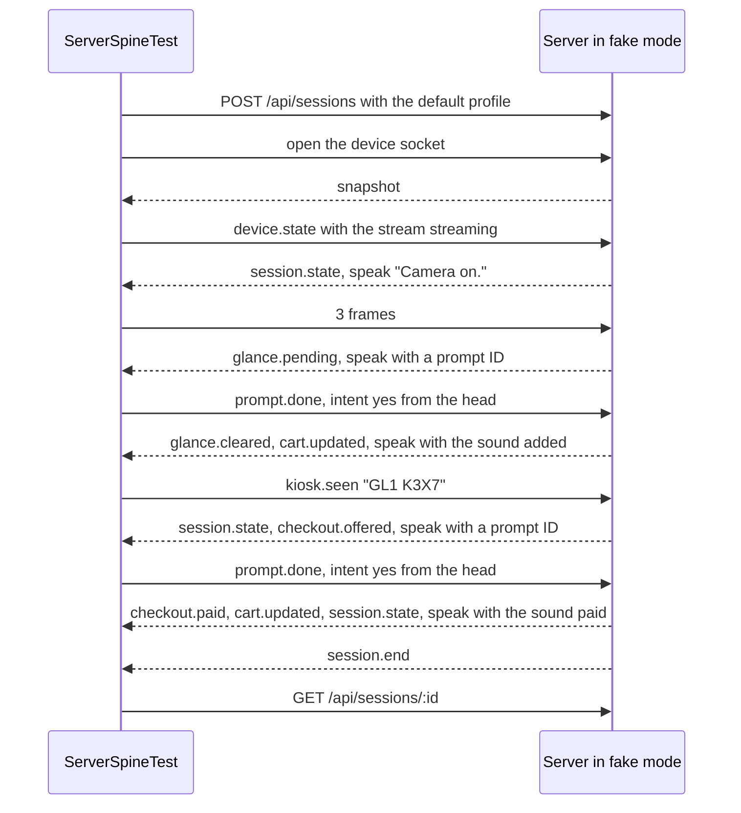

# Integration tests

Each script here starts the Glance server of `apps/server` in fake mode on `127.0.0.1` and a free port, runs one test against it, and stops it. No test calls Gemini or ElevenLabs.

Run `npm install` at the repository root first. `package.json` of this folder holds the tools of these scripts, so that no app gets a new dependency. It has no dependency yet.

| Command, at the repository root | Test |
|---|---|
| `node scripts/integration/server-kotlin.mjs` | The server and the Kotlin client of the Android app |

## The server and the Kotlin client

`server-kotlin.mjs` needs `JAVA_HOME` with a JDK from 17 to 24. It runs the Gradle task `:core:integrationTest` of `apps/mobile/android` with the server address as `-Pglance.serverUrl`. The exit code is 0 for a pass.

The test is `ServerSpineTest` in `apps/mobile/android/core/src/integrationTest`. It uses the real `GlanceApi`, `DeviceSocket`, `Codec`, and `FrameCodec`, and it plays one shop:

- The server plays `server-kotlin.fake-script.json`: the product `oat-drink-1l` is in view from 1.5 seconds after the socket opens.
- The test fails when the Kotlin codec cannot decode an event of the server, when the socket drops a message, and when the socket goes down.
- In fake mode the server logs the header of each frame that decodes. The script reads the log and fails when one of the 3 frames is missing.
- The mock payment takes 300 ms (`PAYMENT_DELAY_MS`).

## Shared code

`lib/server.mjs` exports `startFakeServer`. It removes each server variable of the shell from the environment of the server, sets `FAKE_RECOGNITION` and `FAKE_SPEECH`, and waits for `GET /healthz`. It throws when the answer does not show both fake switches. A script can give it the path of a `FAKE_RECOGNITION` script file.
